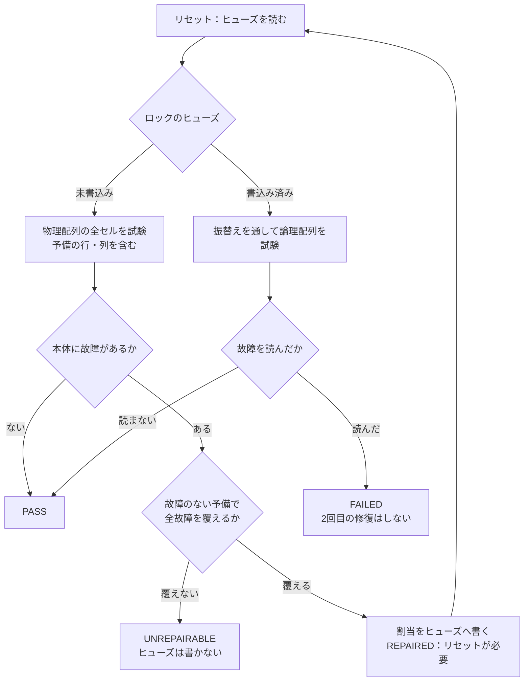

# メモリの修復：予備の行・列の割当、ヒューズ、修復後の再試験

[MBISTの例](../local-mbist/README.md)は、マーチ試験でメモリの故障を見つけるところまでを扱います。この教材はその続きです。見つけた故障を予備の行と列で置き換えられるかを判定し、割当をヒューズへ書き、再起動の後にヒューズを読んで番地を振り替え、もう一度試験して合格することまでを確かめます。

割当の期待値は、RTLの手順を写しません。Pythonが行と列の選び方をすべて試して「修復できるか」だけを判定し、RTLが出した割当は、ヒューズの内容が全故障を覆っているかで判定します。割当そのものの一致は求めません。

分野全体の観点は[メモリの検証手順](../../docs/method/memory-verification.md)、故障モデルと検出率の分け方は[DFTの検証手順](../../docs/method/dft-verification.md)にあります。

## 試験から再試験までの流れ



| 見るところ | 期待する動作 | 主な照合対象 |
| --- | --- | --- |
| 判定 | 修復できる故障は修復し、できない故障は修復不能と報告する | `status`と、全探索による判定 |
| 割当 | ヒューズの示す行と列が本体の全故障を覆い、故障のある予備を使わない | ヒューズの内容と、テストベンチが持つ故障の位置 |
| ヒューズ | 1回だけ書く。書いたビットは消えない。修復しないときは書かない | `fuse_prog`の回数、`fuse_q`の変化 |
| 再起動 | リセットの後にヒューズを読み、振替えを有効にする | `repair_active`、再試験中にアクセスした物理セル |
| 再試験 | 修復後は合格する。後から増えた故障では不合格になり、書き直さない | `status`、`fuse_prog`の回数 |

## 対象回路の仕様

### メモリと予備

メモリは1ビットのセルを行と列に並べた配列で、番地は行と列の組です。本体は`ROWS`×`COLS`、その外側に予備の行`SR`本と予備の列`SC`本があります。物理配列は(`ROWS`+`SR`)×(`COLS`+`SC`)です。

| 構成 | 本体 | 予備の行・列 | 物理配列 |
| --- | --- | --- | --- |
| `s1x1` | 4×4 | 1・1 | 5×5 |
| `s2x2` | 8×8 | 2・2 | 10×10 |

物理配列と故障は[テストベンチ](tb/repair_tb.sv)が持ちます。[`mem_repair.sv`](rtl/mem_repair.sv)は、物理の行と列を指定して1セルずつ読み書きします（`req_valid`・`req_ready`・`req_write`・`req_row`・`req_col`・`req_data`・`read_data`）。`req_ready`が0の間、要求は変わりません。

### 試験

試験はMarch C−です。全セルへ0を書き、「0を読んで1を書く」「1を読んで0を書く」を番地の昇順で1回ずつ、降順で1回ずつ行い、最後に全セルの0を読みます。操作の数はセル数の10倍です。

- ヒューズが未書込みのときは、**予備を含む物理配列の全セル**を試験します（`s1x1`で250操作、`s2x2`で1,000操作）。故障を読んだ物理セルを、故障ビットマップに記録します。
- ヒューズが書込み済みのときは、**論理配列**（本体と同じ大きさ）を、振替えを通して試験します（160操作、640操作）。

### 修復の判定と割当

故障ビットマップから、次の順で判定します。

1. **使える予備**：予備の行は、その物理の行のどこかに故障があれば使いません。予備の列も同じです。予備の行と予備の列が交わるセルの故障は、その行と列の両方を使えなくします。
2. **本体に故障がない**：`PASS`です。予備だけに故障があっても、修復は要りません。
3. **must-repair**：本体の1行の故障数が、使える予備の列の本数より多ければ、その行は予備の行でしか直せません。そういう行が、使える予備の行より多ければ、`UNREPAIRABLE`です。
4. **割当の探索**：予備の行で置き換える行の組を、行のビットマスクを0から順に数え上げて試します。must-repairの行をすべて含み、行の数が使える予備の行以下で、残りの故障がある列の数が使える予備の列以下なら、その組を採用します。どのマスクも当てはまらなければ`UNREPAIRABLE`です。

行の組を決めると、必要な列は一意に決まります。行の組をすべて試すので、この割当は**完全**です。全探索で修復できる故障は、必ず修復できます。試すマスクは2の`ROWS`乗個（`s2x2`で256個）なので、行数が大きい配列には向きません。この教材は、割当の速さや回路の大きさではなく、判定の正しさを題材にしています。

### ヒューズ

[`fuse_bank.sv`](rtl/fuse_bank.sv)は、1回だけ書ける記憶の動作モデルです。`prog`が1のサイクルに、`d`の1のビットを書きます。書いたビットは0に戻りません。機能のリセットはなく、`blank`は「未書込みの素子」を表すためにテストベンチだけが使います。

| ビット | 内容 |
| --- | --- |
| 0 | ロック。修復を書いたことを示す |
| 予備の行ごとに`$clog2(ROWS)`+1ビット | 下位1ビットが有効、残りが置き換える本体の行 |
| 予備の列ごとに`$clog2(COLS)`+1ビット | 下位1ビットが有効、残りが置き換える本体の列 |

`s1x1`は7ビット、`s2x2`は17ビットです。ヒューズへの書込みは、修復できると判定したときの1回だけです。`PASS`と`UNREPAIRABLE`では書きません。

### 再起動と振替え

回路は、リセットの直後の1サイクルでヒューズを読み、`ready`を1にします。**ヒューズを読むのはこのときだけ**です。ヒューズを書いた後は、リセットされるまで`start`を受け付けません。書いた割当を、読み込まないまま使うことはありません。

ロックのビットが1なら`repair_active`が1になり、アクセスを振り替えます。論理の行が有効な行のエントリーと一致すれば、物理の行は対応する予備の行です。列も同じです。行と列の両方が一致するセルは、予備の行と予備の列が交わるセルになります。

### 結果

| `status` | 名前 | 意味 |
| --- | --- | --- |
| 0 | `PASS` | 故障を読まなかった（未書込みのときは、本体に故障がない） |
| 1 | `REPAIRED` | 割当をヒューズへ書いた。リセットが必要 |
| 2 | `UNREPAIRABLE` | 使える予備では全故障を覆えない |
| 3 | `FAILED` | 修復後の試験で故障を読んだ。2回目の修復はしない |

## 機能検証と、製造故障の検査を分ける

この教材が確かめるのは、**修復の論理の機能**です。割当の判定、ヒューズの書込みと読込み、番地の振替えが仕様どおりかを見ます。

**マーチ試験が製造故障をどれだけ検出できるか**は、別の問いです。この教材で注入する故障は、値が0または1に固定されたセル（縮退故障）だけで、March C−はこれを必ず検出します。遷移故障、結合故障、番地の取り違えの検出は、[MBISTの例](../local-mbist/README.md)が扱います。この教材の合格を、故障モデルに対する検出率として読み替えません。

## 期待値と判定

[`model.py`](model.py)は、使える予備の本数以内で、本体の行の組と列の組をすべて試します。全故障がどれかの行か列に入る組が1つでもあれば「修復できる」です。RTLのmust-repairの規則や、マスクの数え上げは使いません。セルフテストでは、もう1つの求め方（行を選び、残りの列を数える）とも、800個のランダムな故障パターンで一致することを確かめています。

テストベンチは、RTLの割当を次のように判定します。

| 検査ラベル | 内容 |
| --- | --- |
| `REPAIR_VERDICT` | 修復できる故障を`REPAIRED`にしない。故障のない本体を`PASS`にしない |
| `REPAIR_UNREPAIRABLE` | 修復できない故障を`UNREPAIRABLE`にしない |
| `REPAIR_FUSE` | 書込みの回数が違う、ロックがない、同じ行を2つの予備に割り当てた、書いたビットが消えた、修復しないのに書いた |
| `REPAIR_SPARE` | 故障のある予備を使った |
| `REPAIR_COVER` | ヒューズの示す行にも列にも入らない本体の故障がある |
| `REPAIR_REBOOT` | ヒューズを書いた後、リセットなしで`start`を受け付けた |
| `REPAIR_LOAD` | リセット後の`repair_active`が、ヒューズと合わない |
| `REPAIR_REMAP` | 再試験が、修復した本体の行または列のセルへアクセスした |
| `REPAIR_RETEST` | 再試験の結果が違う |
| `REPAIR_COUNT` | 操作の数がセル数の10倍でない |
| `REPAIR_X` | 出力にXがある。Xのセルを読んだ |
| `REPAIR_RANGE`・`REPAIR_START`・`REPAIR_READY`・`REPAIR_DONE`・`REPAIR_RESET`・`REPAIR_TIMEOUT` | 範囲外の番地、開始・準備・完了・リセットの状態、時間切れ |

メモリのセルは、試験のたびにXへ戻します。マーチ試験は最初に全セルへ書くので、正しい回路はXを読みません。振替えが書込みと読出しで食い違うと、書いていない予備のセルを読むことになり、Xとして見つかります。

再試験の合格は、MBISTの結果だけでなく、アクセスした物理セルでも確かめます。修復した行や列へのアクセスが1回でもあれば、結果が合格でも`REPAIR_REMAP`です。

「後から増えた故障」は、テストベンチが置きます。ヒューズを読み、修復していない行と列の最初のセルを1に固定します。RTLの割当に合わせて場所を選ぶので、期待値は割当に依存しません。

## 固定パターンと目標

固定シナリオは13個のパターンです。`SR`と`SC`から作るので、2つの構成で同じ意味になります。

| 名前 | 故障 | 期待 |
| --- | --- | --- |
| `clean` | なし | `PASS` |
| `single` | (1, 2)の1個 | 修復（行と列を取り違えると覆えない位置） |
| `must-row` | 1行に`SC`+1個。待ちあり | 修復（予備の行が必要） |
| `shared-columns` | `SR`+1行が同じ`SC`列で故障 | 修復（列で直す。行では足りない） |
| `row-and-column` | 1行に`SC`+1個と、別の1列に`SR`個 | 修復（行と列の両方） |
| `diagonal` | 対角に`SR`+`SC`+1個 | 修復不能 |
| `must-overflow` | `SR`+1行にそれぞれ`SC`+1個 | 修復不能（must-repairの行が多すぎる） |
| `bad-spare-row` | 予備の行に故障。`SR`行にそれぞれ`SC`+1個 | 修復不能（予備の行が1本足りない） |
| `bad-spare-row-column` | 予備の行に故障。本体に1個 | 修復 |
| `bad-spare-column` | 予備の列に故障。本体に1個 | 修復 |
| `spares-only` | 予備の行と列だけに故障 | `PASS` |
| 後からの故障 | 1個を修復した後に、もう1個 | 修復の後、再試験は`FAILED` |
| 途中のリセット | 3操作の後にリセットし、やり直す。待ちあり | 修復 |

ランダム刺激は、故障の数（0個から、予備の本数＋3個まで）、位置（1行に集める、1列に集める、ばらまく、予備を含める）、固定値、待ち、途中のリセット、後からの故障を変えます。

[要求カタログ](requirements.json)は6要求・19目標です。どちらの構成も、固定シナリオだけで19目標に達します。目標は合格した通常ケースだけから数えます。

セルフテストでは、`s1x1`の本体に故障が3個以下のパターン697個をすべて実行します。601個が`PASS`か修復、96個（3個の故障がどの2個も同じ行・列にない）が修復不能で、RTLの判定は全探索と一致します。

## 検出する誤実装

| 番号 | 誤り | 検査ラベル | 見つかるパターン |
| --- | --- | --- | --- |
| 1 | must-repairの条件を「以上」にした（予備の列でちょうど足りる行まで、予備の行を要求する） | `REPAIR_VERDICT` | `shared-columns` |
| 2 | 修復不能を報告せず、何も書かずに`REPAIRED`を返す | `REPAIR_UNREPAIRABLE` | `diagonal` |
| 3 | 列の振替えを読出しにだけ適用し、書込みに適用しない | `REPAIR_REMAP` | `single`の再試験 |
| 4 | ヒューズへ書くとき、行と列を取り違える | `REPAIR_COVER` | `single` |
| 5 | リセットの後にヒューズを読まない | `REPAIR_LOAD` | `single`の再起動 |
| 6 | 予備の故障を見ない | `REPAIR_UNREPAIRABLE` | `bad-spare-row` |

変異1は、構成`s1x1`の`single`では正しい回路と違う割当（列ではなく行）を出しますが、全故障を覆うので合格します。割当の一致ではなく有効性で判定していることが、ここで分かります。変異1が不合格になるのは、修復できる故障を修復不能と報告したときです。

`REPAIR_SPARE`・`REPAIR_FUSE`・`REPAIR_REBOOT`・`REPAIR_COUNT`・`REPAIR_RETEST`は、上の6種類では働きません。セルフテストが、RTLやベクトルを書き換えて、それぞれが働くことを確かめています。

## 実行

Icarus Verilogだけで動きます。リポジトリのルートから実行します。

```sh
python3 examples/local-memory-repair/run.py --out artifacts/memory-repair
python3 examples/local-memory-repair/run.py --profile nightly --out artifacts/memory-repair-nightly
python3 -m unittest discover -s examples/local-memory-repair/tests -v
```

[共通手順](../local-common/README.md)を使います。構成は`s1x1`と`s2x2`、smokeは16パターン×1 seed、nightlyは80パターン×3 seedに固定の13パターンを加えます。`--demo-bug 1..6`は、通常の検証へ変異を入れます。JUnitはsmoke 18件／nightly 22件、セルフテストは12件です。

## 証跡

出力先には、共通手順と同じものが残ります。

- `manifest.json`：全ケースのベクトル、構成、seed、RTL・テストベンチ・`model.py`・要求カタログのSHA-256。
- ケースごとの`vectors.txt`、`simulation.log`、`wave.vcd`、`result.json`。ベクトルの1行は、故障のマスク、固定値、後からの故障、待ち、途中のリセット、期待する判定、再試験の期待、must-repairの種別です。
- `coverage.json`：構成ごとの19目標と、達成したケース。
- `summary.json`と`junit.xml`：予定と完了の件数、通常の合格、変異の検出、構成ごとの判定。

完了の件数は6種類（`steps`・`clean`・`repaired`・`unrepairable`・`retests`・`late_faults`）で、テストベンチが`status`から数えた値を、Pythonの予定と照合します。

## 適用範囲と対象外

2026-11-20に、macOS arm64のPython 3.14、Icarus Verilog 14.0開発版で、2構成のsmoke／nightly、19目標、6種類の変異の検出、セルフテスト12件が成功しました。RTLの2ファイルは、Verilator 5.052の`--lint-only -Wall`で警告0件（3つのパラメーター構成）、YoWASP版Yosys 0.70の`synth`でラッチなしで読めます。Linuxとkirimasimでは実行していません。

この教材で確かめていないことは次のとおりです。

- **実際のメモリ**：SRAMのマクロ、ワード単位の構成、列の多重化、予備の物理的な配置は扱いません。セルは1ビットで、行と列をそのまま番地にしています。
- **実際のヒューズ**：eFuseやアンチヒューズの電気的な書込み、書込みの検証と再試行、読出しのセンス回路、書込み中の電源断は扱いません。ヒューズは「ビットが増えるだけ」の動作モデルで、全ビットを同時に読み書きします。
- **修復の運用**：電源投入のたびに試験して揮発性のレジスタへ割り当てる方式（ソフトリペア）、複数回に分けた修復、出荷後の追加の修復は扱いません。修復は1回で、修復後の故障は不合格にするだけです。
- **割当の一般解**：行の組をすべて試す方法は、この大きさだから使えます。大きな配列で使われる、分枝限定法や貪欲法などの割当と、その取りこぼしの評価は扱いません。予備の使用本数を最小にすることも保証しません。
- **故障モデルと検出率**：注入するのは縮退故障だけです。マーチ試験の検出力、実速度の試験、温度や電圧の条件は扱いません。
- **ECCとの併用、歩留まりの解析、試験時間、試験装置との接続**は扱いません。
- **配列の大きさ**：テストベンチのベクトルは、物理配列が128セル以下であることを前提にしています。数え上げは2の`ROWS`乗サイクルかかります。

## 参考にした一次資料

- [Microchip AN1229](https://ww1.microchip.com/downloads/en/AppNotes/01229B.pdf)：マーチ試験（March C−）の記法と手順。[MBISTの例](../local-mbist/README.md)と同じ出典です。
- S.-Y. Kuo and W. K. Fuchs, "Efficient Spare Allocation for Reconfigurable Arrays," IEEE Design & Test of Computers, vol. 4, no. 1, 1987：予備の行と列の割当の問題の定式化と、must-repairの考え方。論文の本文や図は引用していません。この教材の割当は、その手法の実装ではなく、小さな配列で行の組をすべて試す独自のものです。
- A. J. van de Goor, *Testing Semiconductor Memories: Theory and Practice*：メモリの故障モデルの体系。書籍のため、内容は引用していません。
