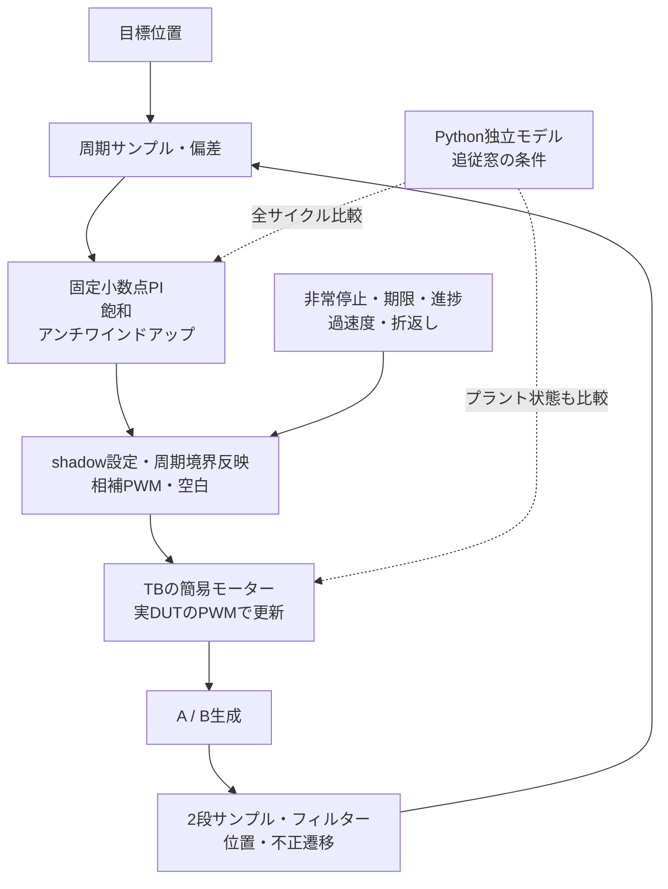
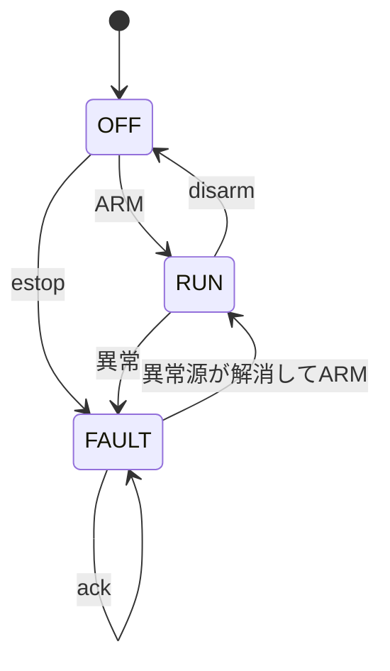

# 1軸の閉ループ制御：固定小数点PI・PWM・エンコーダ

目標位置からPI制御で駆動指令を求め、相補PWMで簡易モーターモデルを動かし、直交エンコーダで位置を戻す教材です。実際のDUTのPWM出力をTB内のプラントへ接続し、演算だけでなく、追従・時間関係・停止・再開を確認します。

[分野別ガイド](../../docs/method/robotics-verification.md)と[単体のPWM／エンコーダ](../local-motion-io/README.md)から、制御周期と複数の回路を結合した検証へ進めます。

## 接続と時間関係



| 構成 | PWM周期・空白 | フィルター | 制御周期 | PI演算レイテンシ | 速度差分の上限 |
| --- | --- | --- | --- | --- | --- |
| p16-sample64 | 16・2クロック | 2サンプル | 64クロック | 3クロック | 6カウント/制御周期 |
| p24-sample96 | 24・3クロック | 3サンプル | 96クロック | 5クロック | 8カウント/制御周期 |

全体は単一クロック・同期active-low resetです。ARMのエッジからSAMPLEクロック後に最初のサンプルを取ります。偏差は、そのエッジの更新前のエンコーダ位置から求めます。演算結果はdoneとして出た次のエッジにPWMのshadowへ渡し、activeへの反映はキャリア周期境界です。サンプル、演算完了、設定更新、端子出力を別々の時点として検査します。

## PIの数値仕様

目標・位置はsigned 16ビット、偏差はsigned 17ビット、積分状態と中間計算はsigned 32ビットです。ゲインはQ4で`Kp=8/16`、`Ki=1/16`に固定します。Kiは1制御更新当たりの係数で、秒単位のゲインではありません。出力上限UはPERIOD/2です。

1. 積分候補を`I候補 = clamp(I + e, −16U, +16U)`とする。
2. 候補出力`(8e + I候補)/16`が上限を超え、偏差が同じ側へ押す場合は積分更新を取り消す。
3. 採用する積分値で出力を再計算し、最も近い整数へ丸める。ちょうど半分は0から離れる方向へ丸める。
4. 出力を`−U〜+U`へ飽和し、PWM設定を`PERIOD/2 + 出力`とする。

例えばPERIOD 16、偏差12、積分0なら、積分候補12、出力108/16=6.75を7へ丸め、duty設定15になります。大きな偏差で飽和している間に積分を蓄積し続けないことと、飽和から戻る応答を別々に確認します。

`compute_hold`は演算資源が進めない状態を模す入力です。hold中は残り時間を保持します。次の制御周期にまだbusyなら期限超過とし、そのエッジで完了できる状態でも取消します。前のエッジまでにdoneが出ていれば、次周期と同じエッジで旧結果の更新と新サンプルの受理ができます。

## 停止と再開



| causeビット | 条件 |
| --- | --- |
| bit 0 | estop。ARMやackとの競合でも停止・IRQセットを優先 |
| bit 1 | 運転中の不正なエンコーダ遷移 |
| bit 2 | 次の制御サンプルでPIがまだbusy |
| bit 3 | 出力指令の絶対値3以上で、3×SAMPLEクロックにわたり位置stepが観測されない |
| bit 4 | 制御周期間の位置差分がSPEED_LIMITを超える |
| bit 5 | 運転中のsigned位置カウンター折返し |

同時原因をORして保持し、IRQを通知します。異常時はPWMを抑止し、演算中または未更新の結果をcancelledで取消します。`ack`は通知を解除するだけで再開しません。`disarm`は通常停止で、未処理の制御ジョブは同様に取り消します。

ARMは停止中かつestop・不正遷移・wrap通知がない場合だけ受理し、原因・IRQを解除して再開します。PIの積分と前回指令を破棄し、新しい結果が出るまでは中立のdutyへ戻します。原点設定は停止中だけ有効で、ARMと同時なら新しい原点を速度差分の基準にも使います。運転中の原点書込みは無視します。

OFF／FAULT中もエンコーダ計数は続きます。再開時に現在位置を速度差分の基準に取り直します。原因の判定は回路のサンプリング時点と通知のレイテンシに従い、実機の停止時間を示す数値ではありません。

## 簡易プラントと結合検証

モデルの位置と速度は、エンコーダ単位を4096倍した正規化された整数です。物理単位のモーター定数ではありません。

```text
v[n+1] = trunc_zero((15*v[n] + 256*(hi[n]-lo[n]) - load[n]) / 16)
x[n+1] = x[n] + v[n+1]
```

TBは**実際のDUTのhi／lo**を使い、更新前の位置を4096で切り下げたカウントからA／BのGray状態を生成します。期待値のPWMをTBのモーターへ与える構成ではありません。機械拘束では位置を保持し速度を0へ、センサー停止ではプラントを動かしたまま観測A／Bを保持するため、2つを区別できます。

Python参照では有理数でPIの値と丸めを計算し、PWMは時刻、エンコーダはGray環で表します。プラントは仕様の離散式から更新します。DUT内部状態だけでなく、実PWMで変化したTBのプラント位置・速度・A／Bも全サイクル照合します。

追従ケースの末尾4制御周期では、モデル一致に加えて、異常なし・運転継続、位置偏差±2カウント以内、プラント偏差±3カウント以内を自動判定します。この観測窓の実測を、任意の実モーターや全入力に対する安定性証明とは扱いません。

## シナリオと検出力

| シナリオ | 主な確認内容 |
| --- | --- |
| tracking／reversal／load-step | 位置追従、正逆転、負荷変動後の追従窓 |
| saturation | 飽和中の積分更新取消と、目標を戻した後の回復 |
| estop-rearm | estopとARM／ackの競合、ack後の停止保持、明示再開と中立指令 |
| encoder-invalid／encoder-stuck／mechanical-stall | 不正遷移、センサー停止、機械拘束。後2者は進捗なしとして検出し、原因を断定しない |
| deadline／deadline-boundary | 演算停止での取消、期限に間に合った結果の更新 |
| overspeed／position-wrap | 外力による速度超過、原点近くからの折返し検出 |
| reset-pending／origin-arm | 演算中resetの取消、原点とARMの同時更新、運転中の原点書込み抑止 |
| random | 再現可能な目標値・負荷の列と、各区間の追従窓 |

[要求カタログ](requirements.json)は5要求・22観測目標です。全制御ジョブの**サンプル数＝更新数＋取消数＋reset取消数**と、終了時に演算やPWM出力が残らないことも照合します。4変異は、アンチワインドアップ省略を`AXIS_PI`、PWM同時出力を`AXIS_PWM`、期限超過無視とestopよりARMを優先する誤りを`AXIS_STATE`で検出します。

```sh
python3 examples/local-motion-control/run.py --profile smoke --out artifacts/motion-axis-smoke
python3 examples/local-motion-control/run.py --profile nightly --out artifacts/motion-axis-nightly
```

Python 3・Icarus Verilog・vvpを使います。2構成でJUnitはsmoke 42件／nightly 46件です。nightlyはランダムseedを1→3、各seedの目標・負荷区間を2→6へ増やします。入力と期待値は幅を検査し、符号付き値を32ビットへ符号拡張して比較します。

ソース・構成・seed、`vectors.txt`、全状態の`expected.hex`、VCD、ログ、比較行数・更新・取消・reset件数、構成別の観測目標を保存します。[全体実行](../../tools/REGRESSION.md)と[追加記録](../../PROVENANCE.md#robotics-20261101)から計画と証跡を確認できます。

## 適用範囲

対象はRTLと正規化した簡易プラントの学習用結合です。PWMの出力抑止と機械の静止は別で、外力や慣性による移動もモデルへ残ります。実モーター・電源・ゲートドライバー・ブレーキ、センサーの電気特性、CDCの物理評価、安全規格への適合は確認していません。機能カバレッジは観測ログ方式で、ネイティブcovergroup DB・コードカバレッジ・新回路のフォーマル証明とも区別します。
