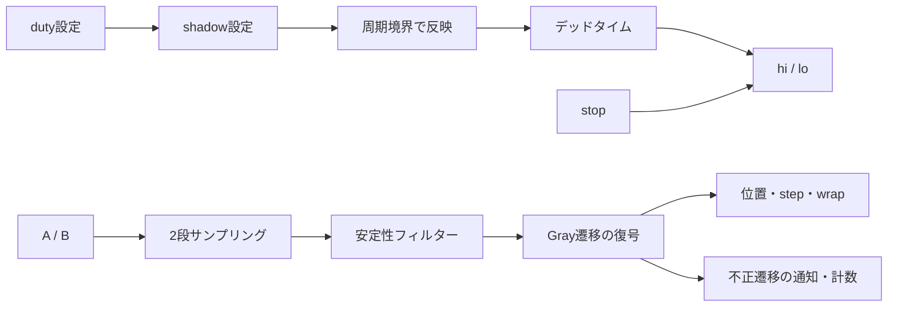

# モーション制御I/O：相補PWMと直交エンコーダ

相補PWMの周期境界・デッドタイムと、フィルター付き直交エンコーダの計数を検証する単体例です。[ロボティクス・モーション制御の手順](../../docs/method/robotics-verification.md)から、[固定小数点PIの閉ループ例](../local-motion-control/README.md)へ進めます。

## 構成と確認する境界



| 構成 | PWM周期 | デッドタイム | フィルターの連続サンプル数 |
| --- | --- | --- | --- |
| p16-dead2-filter2 | 16クロック | 2クロック | 2 |
| p24-dead3-filter3 | 24クロック | 3クロック | 3 |

本例はバイポーラPWMとして解釈し、50%を中立指令、双方0を無効出力とします。2つのRTLは独立した部品として同じTBで検証します。モーターへ結合するのは[閉ループ例](../local-motion-control/README.md)です。全レジスタは同期active-low resetで初期化します。

## PWMの仕様

| 項目 | 契約 |
| --- | --- |
| 32ビットduty入力 | 0〜PERIODが有効。0はlo側、PERIODはhi側、PERIOD/2は正負同時間の指令 |
| shadow更新 | `load`で受け付ける。範囲外は`config_error`を通知し、元の値を維持 |
| active更新 | 開始時と周期境界だけ。境界と同時の有効loadは新しい値をその境界へ反映 |
| 相補出力 | hi／loを同時に1にしない。ここでは正駆動／逆駆動の抽象的なブリッジ制御状態を表す |
| デッドタイム | 開始時と極性切替えでDEADクロック以上、双方0を挟む |
| 短いパルス | 予定された極性が空白中に変われば、空白を取り直す。狭いパルスが消える場合がある |
| stop／disable | 双方0。stop解除後の再開も空白を置く。物理的な制動・停止を保証する信号ではない |

`stop`とresetは出力の論理ゲートにも接続しているため、クロックエッジを待たずに端子の論理値を抑止します。内部状態はエッジで初期化・停止します。RTLの論理確認から、実回路の伝搬時間、ゲートドライバーやMOSFETの同時導通まで検証したとは扱いません。

デッドタイムは出力パルスの長さと平均駆動に影響します。公称dutyと実際のhi／loの有効時間を分けて考えます。

## エンコーダの仕様

正方向を`00 → 01 → 11 → 10 → 00`、逆方向をその逆と定め、各有効遷移で1カウントします。方向の定義は配線・極性とともに対象仕様へ固定します。

| 項目 | 契約 |
| --- | --- |
| 入力 | `{a,b}`を2段でサンプリングし、同じ値がFILTER回続いた後に採用 |
| 短い変化 | 採用条件を満たさない変化は位置へ反映しない |
| 正常遷移 | 1ビットだけが変わる隣接状態。signed 16ビットの位置を±1し、stepを通知 |
| 不正遷移 | 2ビット同時変化。位置は変えず、invalidと累積件数を通知。観測した状態を新しい基準にする |
| 折返し | +32767の次は−32768、−32768の前は+32767。wrappedを通知 |
| 原点設定 | origin_enで位置をoriginへ設定し、そのエッジの計数より優先。更新後のフィルター状態を基準にする |
| reset | パイプライン・位置・通知・件数を0にする |

2段のサンプリングと安定性フィルターはデジタル動作のモデルです。メタスタビリティやCDCの物理評価を代用しません。入力が速過ぎる場合は遷移を取り逃すため、対応する入力間隔とクロックの要求を別に定めます。

## 検証と実行

PythonのPWMモデルは切替えを許可する時刻、エンコーダモデルはGray状態の環上の距離で期待値を作ります。RTLの空白カウンターやcase表をそのまま複写しません。全サイクルで出力・設定値・内部状態・計数・通知を比較し、端子の相互排他と極性切替え間の空白も別の自動チェッカーで確認します。

[要求カタログ](requirements.json)は4要求・16観測目標です。0／100%／中間duty、設定の遅延反映・境界同時反映、不正設定、stop、正逆転、短いノイズ、不正遷移、原点、採用エッジと重なる原点設定、両方向の折返し、resetを固定ケースで確保し、ランダム列を加えます。

5変異は、同時出力を`IO_OVERLAP`、方向・不正遷移通知の誤りを`IO_ENCODER`、周期途中の設定反映・空白省略を`IO_PWM`で検出します。変異ケースの観測で通常ケースの未達を埋めません。

```sh
python3 examples/local-motion-io/run.py --profile smoke --out artifacts/motion-io-smoke
python3 examples/local-motion-io/run.py --profile nightly --out artifacts/motion-io-nightly
```

Python 3・Icarus Verilog・vvpを使います。2構成でJUnitはsmoke 28件／nightly 32件です。nightlyはランダムseedを1→3、各seedの追加区間を32→96へ増やします。

生成入力と期待値のハッシュ、`vectors.txt`、`expected.hex`、VCD、ログ、行数・遷移・不正遷移・wrap・設定拒否・reset件数を保存します。符号付き値は32ビットへ符号拡張して比較し、期待値の切捨てによる見かけ一致を防ぎます。観測ログによる機能カバレッジで、ネイティブcovergroup DB・コードカバレッジ・フォーマル証明とは区別します。[追加記録](../../PROVENANCE.md#robotics-20261101)も参照してください。
