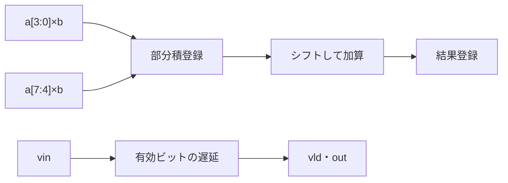

# パイプライン乗算器を独立の積とk帰納法で検証する

8ビット×8ビットの符号なし乗算器を2段または3段のパイプラインで実装し、Pythonの積キューとフォーマル証明の両方で照合する教材です。変異体・反例・証明の3つの手段で、パイプライン特有の「結果が正しい段数で出てくる」ことを要求します。

## 回路の契約



| 条件 | 要求する動作 |
| --- | --- |
| 入力 | `vin=1`のサイクルの`a`・`b`を受け付ける。毎サイクル受け入れ可能 |
| 遅延 | 結果は入力からちょうどSTAGESサイクル後に`vld=1`とともに出る |
| 連続入力 | 途中で空けても連続でも、各積は正しい順序で出る |
| 無効サイクル | 演算は進むが`vld`が立たない。次結果で上書きされる |
| リセット | 全段と`vld`を0へ。復帰後の最初の積はリセット後入力から |

## 独立した期待値

Pythonは`(a*b) mod 2^16`の履歴を保持し、各サイクルの期待`vld`・期待`out`を入力からSTAGESサイクル前の値とします。回路が内部で部分積をどう分割しても、この期待値は回路構造に依存しません。固定シナリオは最大値・ゼロ・1・同一オペランド・上位レーンの境界（16×1）・下位のみ（15×255）・連続入力・隙間・リセット復帰を含みます。

| 構成 | 段数と遅延 |
| --- | --- |
| `s2` | 2段（部分積加算と結果登録） |
| `s3` | 3段（部分積登録・加算・結果登録） |

[要求カタログ](requirements.json)は3要求・10目標です。`vld`が立っていない間の`out`も毎回比較するため、段の取り違えは最初の有効結果を待ちません。

## 意図的な誤実装

| 番号 | 誤実装 | 期待する検出ラベル |
| --- | --- | --- |
| 1 | 上位部分積を4ビットシフトしない | MUL_DATA |
| 2 | `vld`だけ1段短くする | MUL_TIME |
| 3 | 上位部分積に下位4ビットを使う | MUL_DATA |
| 4 | 結果の下位8ビットだけを出す | MUL_DATA |

判定は`vld`→`out`の順です。判定順を固定するので変異2は`MUL_TIME`、それ以外は`MUL_DATA`で決定的に検出されます。

## フォーマル証明

[formal/mul_pipe_formal.sv](formal/mul_pipe_formal.sv)は、設計のポートだけで入力履歴を再生する参照チェーン（`p1`→`p2`→`p3`）を作り、「`out`は常に3サイクル前の積である」をk帰納法で証明します。参照が内部段を読まないため、段の対応を仮定せずに済み、深さ10で閉じます。リセットは初回のみ仮定して解放後は保つ制約にしました。稼働中のリセットを含むリセット挙動はシミュレーション側で検査します。coverは255×255と1×1が出力まで届くことを見ます。セルフテストは3件で、証明成功（生存Assertionが1個＝空洞でないことも確認）・cover到達・変異体（上位部分積のシフト漏れ）の証明失敗を確認します。

## 実行

```sh
python3 examples/local-mul-pipe/run.py --out artifacts/mul-pipe
python3 examples/local-mul-pipe/run.py --profile nightly --out artifacts/mul-pipe-nightly
python3 -m unittest discover -s examples/local-mul-pipe/tests -v
```

smokeは200サイクル×1 seed、nightlyは1000サイクル×3 seedを固定シナリオへ加えます。各構成6／8件、全体12／16件の回帰に構成別の目標ゲート2件を足したJUnitです。フォーマル3件は`yowasp-sby`がある環境でのみ実行されます。

## 確認範囲

両構成で各10個のカバレッジ目標に到達し、各4種類の変異を検出しました。単体テストはフォーマル3件を含む10件です。

この教材は符号なしのみ、演算は1サイクルに1積です。乗除算器的な待機、符号拡張、飽和丸め、実機クロックでのタイミング、消費電力は対象外です。フォーマル証明は3段構成のデータ整合だけを見ます。`vld`の位置、2段構成、稼働中のリセットを含むリセット挙動はシミュレーション側で検査します。
