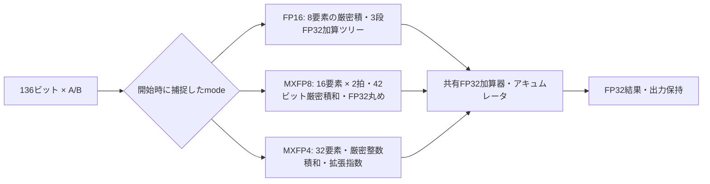

# FP16／MXFP8／MXFP4のGEMMと量子化

[付録B](upstream/docs/appendixB/mxfp4_appendixB_multiprecision.md)の案Aを基に、3モードのブロック内積、GEMM、FP32からの変換を実装しました。MXFP8はE4M3です。E5M2、BF16、乗算器のビット分割による共有は今後の拡張対象です。元のMXFP4回路とUVM環境は[upstream/](upstream/)に保持し、拡張RTLは[rtl/](rtl/)へ分けています。

## 回路とデータ配置



1オペランドの1拍は136ビットで、`[127:0]`に要素、`[135:128]`にヘッダを置きます。要素0を最下位ビット側へ配置します。

| mode | 形式 | 1拍の要素数 | 32要素の拍数 | ヘッダ | BDPの段数 |
| --- | --- | --- | --- | --- | --- |
| `00` | FP16（IEEE binary16） | 8 | 4 | `0x00` | 8 |
| `01` | MXFP8（E4M3） | 16 | 2 | 両拍に同じE8M0スケール | 8 |
| `10` | MXFP4（E2M1） | 32 | 1 | E8M0スケール | 6 |
| `11` | 予約 | — | — | — | 入力拒否・エラー通知 |

`mp_pkg.sv`が形式変換と丸め、`mp_add.sv`が既存のFP32加算器を使う共通演算、`mp_bdp.sv`が3モードの内積、`mp_encoder.sv`が32個のFP32入力の変換、`mp_gemm.sv`が行列バッファとPE配列を担当します。

1拍を受理するたびに処理するMAC数はFP16：MXFP8：MXFP4＝1：2：4です。GEMM全体にはLOADとDRAINの時間も必要です。周波数・面積・消費電力を測定した性能比ではなく、合成やSTAによる評価も今回の確認に含みません。

## 数値規約と丸め位置

すべて最近接偶数丸め（RNE）を使います。FP32加算の入力はDAZ、結果はFTZ、オーバーフローは符号付きInf、NaNは`0x7fc00000`です。FP16とE4M3の入力要素の非正規化数は厳密に展開します。

- **MXFP4**：32項を整数で厳密に積和し、仮数24ビット・拡張指数の項に変換します。その項とFP32アキュムレータを加算してから丸めと範囲判定を行います。既存回路のビット列と6段のレイテンシを維持します。
- **MXFP8**：要素を`M × 2^(E−3)`に展開し、`M_a × M_b << (E_a+E_b+12)`を符号付き42ビットで32項積和します。LSBの重みは`2^-18`、スケール合成は`sa+sb−272`です。**ブロック末のFP32化で一度丸めて範囲判定し、その値とアキュムレータの加算でもう一度丸めます**。厳密な全項和を最後に一度だけ丸める計算とは異なります。
- **FP16**：有限値の積は、最小非正規化数同士の積を含めてFP32で厳密に表現できます。8個の積を隣接レーンの組から`8→4→2→1`の平衡加算ツリーで縮約し、各段でFP32に丸めます。その結果を拍ごとにアキュムレータへ加算し、再び丸めます。レーン0からの逐次加算とは結果が異なる場合があります。

E4M3の要素NaN、またはE8M0スケール`0xff`がある場合、内積結果はNaNです。FP16ではNaNと`Inf×0`をNaNにし、Infの符号と加算時の相殺を扱います。厳密な相殺は`+0`、`-0`同士の加算は`-0`です。

FP32からの変換は次の規約です。

| 出力 | スケールと変換 |
| --- | --- |
| MXFP4 | 既存のAlgorithm 1と同じスケール・RNE。NaN／Infを含むブロックはscale=`0xff`・要素全0 |
| MXFP8 | `max(amax_exp−8, 0)`をスケールにし、E4M3へRNE。最大有限値448へ飽和。NaN／Infを含むブロックはscale=`0xff`・要素全0 |
| FP16 | 各要素をRNEで変換。非正規化数を生成し、オーバーフローはInf、NaNは`0x7e00`。ヘッダは全拍0 |

`amax_exp`は最大絶対値のFP32バイアス付き指数です。MX形式のFP32入力はDAZです。E4M3の非正規化領域では一定の`2^-9`刻みで丸めます。相対値がちょうど`2^-10`なら0、これを超えれば最小非正規化数へ丸めます。「相対指数が−10ならすべて0」という草案の記述を修正しました。最大指数の仮数がNaNコードへ丸まる場合も448へ制限します。

## 入出力と制御

`mp_bdp`は`in_valid && in_ready`で入力を受理します。計算列の先頭を`first`、末尾を`last`で示してください。先頭でmodeを捕捉し、途中の入力休止を許容します。MXFP8は32要素を必ず2拍で送り、`last`は後半の拍に付けます。

1本の計算列を処理し、その結果を消費してから次の列を受理します。列内の入力は連続投入できます。最終入力の受理後は`in_ready=0`となり、出力は`out_valid && out_ready`まで保持します。出力を停止させるとパイプラインも停止します。入力休止・出力停止のない場合、最終入力を受理する立上りを第1段として、MXFP4は第6段、FP16／MXFP8は第8段の立上り直後に`out_valid`が立ちます。

MXFP8のスケールは、**受理した前半の拍**から保持します。途中に休止があっても保持値と後半の拍を比較し、不一致なら`err_scale_mismatch`を立て、演算には前半の値を使います。単に直前サイクルを参照する`$past`では、この契約を検査できません。スケールの不一致だけを理由にNaNへ変更しません。

途中のmode変更とFP16の非ゼロヘッダは`err_protocol`で通知します。演算には捕捉したmodeを使い、FP16のヘッダは無視します。診断はその列が終わっても保持し、次の有効な列の開始またはリセットで初期化します。予約modeは受理しません。不正な`first/last`の並びは契約違反であり、結果の生成や回復は保証せず、リセットで復帰させます。SVAは出力保持、捕捉modeの保持、各違反に対する診断を検査します。

`mp_encoder`は32個のFP32を1回で受理し、捕捉したmodeに応じて1／2／4拍を出力します。最初の拍は受理した立上り直後に有効となり、`out_mode`と`out_last`もデータとともに保持します。出力中は次の入力を受理しません。既存の`quant_encoder`とは変換結果を比較しており、旧5段エンコーダのレイテンシを引き継ぐインターフェースではありません。

## GEMM

`mp_gemm`の既定値は`ROWS=4, COLS=4, KBLK=4`で、内積長は`32×KBLK`です。`ROWS, COLS, KBLK`はいずれも1以上とし、単一ブロックにも対応します。各PEはAの行とBの列を受け取ります。

A/Bの書込みはIDLE中に行います。`wr_sel=0`がA、`1`がBで、アドレスは`行または列の番号×BEATS+拍番号`です。1計算の`BEATS`はFP16が`4×KBLK`、MXFP8が`2×KBLK`、MXFP4が`KBLK`となります。バッファ自体は最大の`4×KBLK`拍分を確保し、実行modeに必要な全アドレスを書いてから`start`を与えます。範囲外とbusy中の書込み、busy中の再起動要求は無視します。

`start`でmodeを捕捉します。起動を受理した立上りを第1サイクルと数えて`1+BEATS+LAT`サイクル目で`done`が立ちます。`LAT`はMXFP4が6、他が8です。結果`c_o`はdoneサイクル末にラッチされるため、**次のサイクル以降に読みます**。それまでは前回の結果を保持します。予約modeでの起動は演算せず、`done`と`error`を返します。PEの診断も計算完了時の`error`へ集約します。

リセットは演算を取り消し、出力と制御状態を初期化します。A/Bの内容は保持するため、処理中リセットの後に同じ入力で再起動できます。バッファが未初期化のアドレスを使うことはできません。

## 検証の範囲と実行

独立した[有理数モデル](reference_mp.py)で期待値を生成し、[SVテストベンチ](tb/)でビット列・受理数・出力数・出力時点を照合します。FP16は平衡加算ツリーと拍ごとの累積、MXFP8は2箇所の丸めをモデル化します。FP4モードでは既存BDP／GEMMの結果とサイクル、既存エンコーダの変換結果も直接比較します。

| 付録Bの要求 | 主な照合 |
| --- | --- |
| X0・P1 | FP4の直接比較、3モードの要素配置、エンコーダの全出力拍 |
| M1 | 途中mode変更、休止を挟むscale不一致、FP16ヘッダ、出力停止、リセット |
| Q1・Q2 | 全256 E4M3コード、42ビット積和の直接比較、nightlyで256×256の全要素ペア |
| Q3〜Q5 | GRSとタイ、極端なスケール、2段階丸め、NaN／非正規化数、乱数 |
| H1〜H4 | FP16の厳密積、平衡ツリーと逐次和の差、特殊値、境界、乱数 |
| エンコーダ | E4M3の全隣接有限値の中点と前後・正負、FP16の丸め境界、nightlyで全65,536 FP16コードのFP32経由の変換と隣接有限値31,743組の中点・前後・正負 |
| GEMM | 4×4・KBLK=4、4×4・KBLK=1、2×3・KBLK=3、全出力・完了サイクル・再起動・範囲外書込み・起動拒否後の出力保持 |

FP16の中点検査の期待値は、隣接コードと保持する仮数の偶奇から決め、変換モデルを流用しません。smokeは各指数の桁上がりと非正規化数／正規数の境界、nightlyは全31,743組を対象とし、オーバーフロー境界も別に確認します。GEMMのランナーは結果数だけでなく、完了前の保持・最終値・起動拒否・リセット取消しを含む予定比較件数の一致を要求します。内積とエンコーダのランナーも、出力停止中に保持を確認したサイクル数を予定値と照合し、出力停止が実際に起きたことを合格条件に含めます。

全FP16コードの変換では、NaNは規定の正規化NaNへ変換します。これは全FP32入力の網羅でも、全FP16要素ペアの網羅でもありません。要求の対応は[requirements.json](requirements.json)へ記録し、ネイティブcovergroupやRTLコードカバレッジの達成率とは区別します。元のUVM環境への3モード追加は行っていません。

```sh
# 既存MXFP4と拡張を一括実行：26件の合否判定
python3 examples/local-mxfp4/run.py
python3 examples/local-mxfp4/run.py --profile nightly

# 拡張だけ：8件、既存部分だけ：19件
python3 examples/local-mxfp4/run.py --stage multiprecision
python3 examples/local-mxfp4/run.py --stage core

# 有理数モデル・判定処理：19件
python3 -m unittest discover -s examples/local-mxfp4/tests -v
```

必要なツールと証跡ファイルは[README](README.md)を参照してください。誤った期待値を与える対照実行も行い、通常の照合箇所で異常終了することを要求します。ビルド失敗とタイムアウトは検出成功に数えません。
