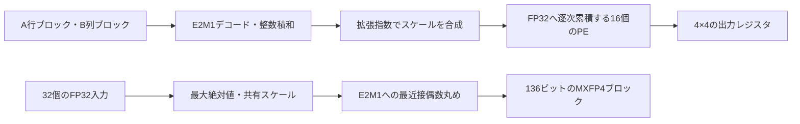

# FP16／MXFP8／MXFP4のブロック内積・GEMM・量子化を検証する

Qiitaの[設計仕様の記事](https://qiita.com/sukimaengineer/items/ead428dd5487ae3cd7da)と、著者の[mxfp4リポジトリ](https://github.com/kurochan001/mxfp4)を基にした実行例です。取り込み元は`347edbb8e45454e84945a13c1815e08937feff3f`に固定しました。仕様・図・RTL・プレーンSVとUVMの検証環境を[upstream/](upstream/)へ取り込み、出典と元ファイルのSHA-256を[upstream.json](upstream.json)へ保存しています。

付録Bを基にしたFP16／MXFP8（E4M3）拡張も実装しました。[実装仕様・使い方・検証範囲](MULTIPRECISION.md)を参照してください。既存MXFP4回路との比較を含め、下記ランナーで一括実行できます。

## 対象と構成

[仕様書Rev.1.3](upstream/docs/mxfp4_spec_rev1.3.md)に従い、32要素のE2M1とE8M0スケールからなる136ビットのブロックを扱います。E2M1を値の2倍の整数へ変換し、32項の積和を厳密に計算します。ブロック間ではFP32に丸めて昇順に累積します。4×4のGEMMは行・列バスから各PEへブロードキャストする出力固定型で、PE間でデータを受け渡す構成ではありません。



| 対象 | 実行する検査 |
| --- | --- |
| デコード・整数積和・累積 | 全256通りの要素積、符号、相殺、NaN、範囲外、連続投入、ブロック順序 |
| エンコーダ | 全7中点と前後・正負、全ゼロ、DAZ、NaN・Inf、入力位置、ランダムブロック |
| GEMM | 4×4のKBLK=4と1、2×3のKBLK=3、行列全要素のビット一致、done前の出力保持、処理中リセットと再起動、doneのサイクル数 |
| 発展機能 | FIFOとバックプレッシャ、near/far加算器、gradual underflow、3/4スケーリング |
| FP16／MXFP8拡張 | 厳密なFP16積と平衡FP32加算ツリー、E4M3の42ビット積和、3モードのGEMM・変換・診断・出力停止 |

付録AのUVM環境も保存していますが、下記ランナーはプレーンSV版と有理数照合を実行します。UVM・sukimasim・商用シミュレータによる結果を今回の成功に含めません。[付録BのFP16/MXFP8仕様](upstream/docs/appendixB/mxfp4_appendixB_multiprecision.md)は取り込み元では草案でした。本リポジトリで[拡張RTL](rtl/)と独立モデル、3モードの検証を追加し、草案の丸め境界・参照モデル・制御の記述を修正しています。

## MXFP4の数値規約の注意点

整数積和を変換する先は、仮数24ビット・符号付き拡張指数の内部形式です。極端なスケールではFP32の格納範囲を外れるため、先にFP32へ変換してFTZやInf化するのではなく、アキュムレータとの加算後に丸めと範囲判定を行います。既定は入力DAZ・結果FTZ、丸めはRNE、NaNは`0x7fc00000`です。gradual underflowは別の切替で検証します。

厳密モデルも**各累積ステップで丸める**必要があります。例えば`2^24, 1, -2^24`の順に足す結果は`+0`で、すべてを厳密に合計して最後だけ丸めると`1`になります。[reference.py](reference.py)はPythonの有理数で各ステップを計算し、上流のSV参照モデルと異なる方法で期待ビット列を作ります。

エンコーダは、NaNまたはInfを1要素でも含む入力をscale=`0xff`・要素全0へ変換します。全要素がDAZ後に0になる場合も、符号によらず全0ブロックです。3/4スケーリングは通常のAlgorithm 1とは別に照合し、RNEで不偏になるとは主張しません。OCPの形式定義と、この教材固有の数値規約・配置・制御は区別します。

GEMMの`done`は`1 + KBLK + LAT`のタイミングで立ちますが、`c_o`はそのサイクル末にラッチされます。読み出しは**次のサイクル以降**です。A/Bバッファはリセットしないため、全アドレスへの書込みを終えてから起動し、busy中には書き換えない契約です。

## 準備と実行

POSIX環境、Python 3.10以上、Verilator、C++コンパイラ、makeを使います。制約付きランダム化にはPATH上のZ3も必要です。本リポジトリでの確認版はVerilator 5.052です。Pythonの追加パッケージは不要です。拡張は同じツールで実行します。

```sh
python3 examples/local-mxfp4/run.py
python3 examples/local-mxfp4/run.py --profile nightly
python3 examples/local-mxfp4/run.py --stage multiprecision
python3 -m unittest discover -s examples/local-mxfp4/tests -v
```

smokeは上流の試行数を短縮し、独立した有理数照合には64本のランダム列を加えます。nightlyは上流READMEの大規模実行条件を使い、有理数照合のランダム列は1,024本です。各有理数構成で固定の全数・境界ケースも必ず実行します。拡張のnightlyでは全65,536通りのE4M3要素ペアと、FP16の全65,536コードのFP32経由の変換も照合します。FP16はさらに、隣接する非負の有限値31,743組すべての中点とその前後を、正負両方で確認します。

既定の`--stage all`は、既存の12回のSV実行・4構成の有理数照合と、拡張の内積・エンコーダ・3構成のGEMMを実行します。lint・誤った期待値の検出・要求対応の確認を合わせて26件のJUnitを出力します。`--stage core`は従来部分の19件、`--stage multiprecision`は拡張の8件です。共通の要求対応確認は各実行に1件だけ含めます。セルフテスト19件はこれらとは別です。

`--seed`は既定17、`--iterations`は有理数照合のランダム列数、`--jobs`はC++ビルドの並列数（既定4）です。`--timeout`は各実行の秒数（既定120）、`--build-timeout`は各ビルドの秒数（既定300）です。ツールは`--verilator`、新規の出力先は`--out`で指定できます。既存の出力先を上書きしません。Icarus用の共通ランナーとは別の実行例です。

## 合格条件と証跡

上流テストは終了コード0だけでは合格にしません。唯一の正のチェック件数、エラー0、唯一のPASS表示、FAIL・ERROR・TIMEOUT表示の不在が必要です。有理数照合は予定された全結果の値・valid時点・完了件数を確認し、誤った期待ビットを与えた対照実行では、既存部分は`BDP_DATA`、拡張は`MP_RESULT`による異常終了を要求します。ビルド失敗やタイムアウトは検出成功に数えません。

[requirements.json](requirements.json)の15要求群は、成功した通常テスト群との対応を記録します。部分実行では選択した範囲に含まれる要求群だけを判定し、対象外の要求群も明示します。これはソースコードカバレッジやネイティブcovergroupの達成率ではありません。出力にはソースハッシュ・実行計画の`manifest.json`、版情報、ビルド／実行ログ、有理数ベクトルとVCD、`coverage.json`、`summary.json`、`junit.xml`を保存します。`artifacts/`はGit管理外です。

## 取り込み時の修正

- 参照モデルの引数`x/y`とローカル変数`X/Y`の紛らわしい名前を変更し、現行VerilatorのSIMILARNAME警告を解消しました。
- クラスの32要素の乱数配列を同じ要素配置のpacked配列へ変更し、Verilator 5.052の生成一時配列に対するUNDRIVEN警告を回避しました。制約付きランダム化自体は維持し、Makefileの不要になったUNDRIVEN警告の抑制も撤去しました。
- 不一致とシミュレーション時間切れを`$fatal`で非ゼロ終了にしました。Makefileのビルド先の絶対パス指定にも対応しました。
- GEMMのテストを構成変更可能にし、KBLK=1・非2冪の3・長方形構成を追加しました。NaNを入れる位置とアドレス幅も構成に合わせます。出力がdoneの次サイクルまで更新されないことと、処理中リセットによる取消し・入力バッファを保持した再起動も確認します。
- 長方形GEMMのA/Bバッファで、共通の書込みアドレス幅をそのまま狭い側の配列へ渡していた箇所を修正しました。全幅で範囲を検査してから、各配列の添字幅へ変換します。
- 仕様の参照モデルの説明、量子化バイアスの向き、UVMの実装状況、過去の実行記録と今回の確認範囲を整理しました。

取り込み元のファイル対応と元のSHA-256は`upstream.json`に記録し、ローカル差分を特定できるようにしています。元リポジトリにはLICENSEファイルがなく、取り込み元のファイルへ新たなライセンス表記は追加していません。

## 参考

- [OCP MX仕様v1.0](https://www.opencompute.org/documents/ocp-microscaling-formats-mx-v1-0-spec-final-pdf)：E2M1、E8M0、内積の内部精度・順序と量子化の規定。
- [上流の元コミット](https://github.com/kurochan001/mxfp4/tree/347edbb8e45454e84945a13c1815e08937feff3f)：設計仕様・回路・検証環境の出典。
