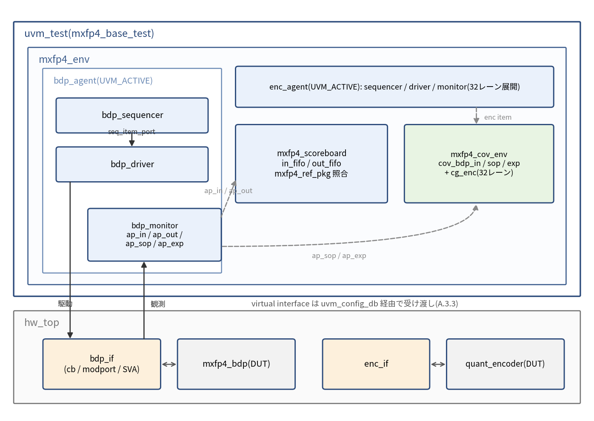
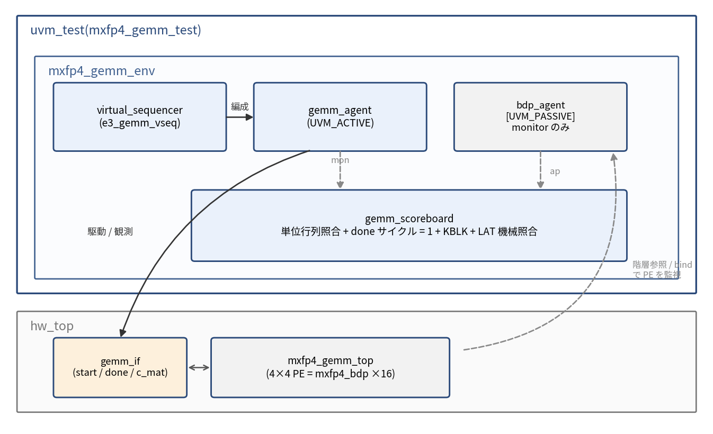
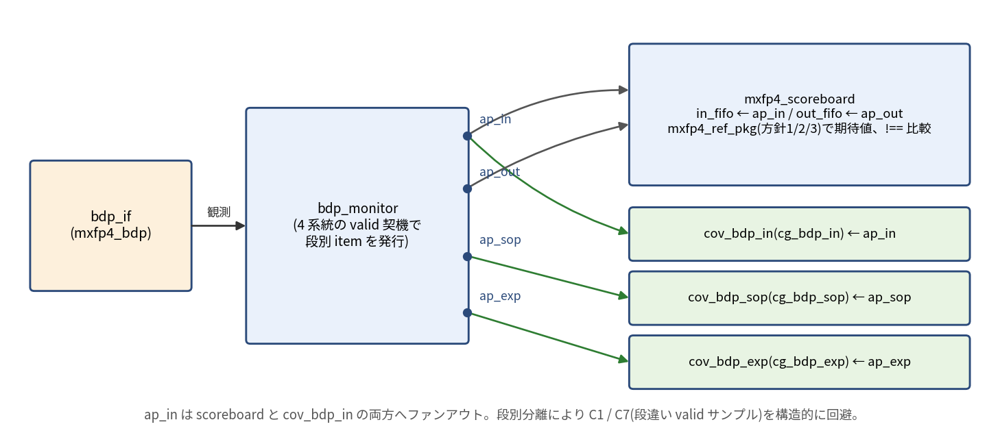
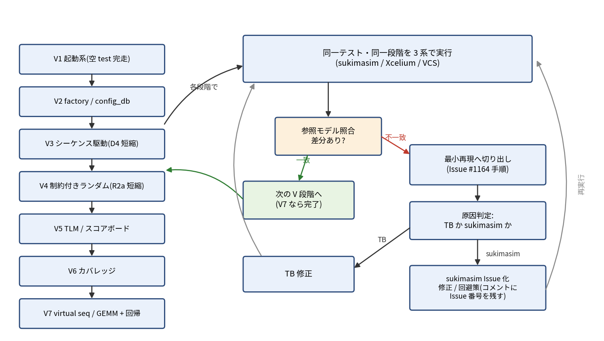

# 付録A UVM ベース検証仕様(オプション)

本付録はオプションであり、既定の検証仕様は 9 章のプレーン SystemVerilog 環境である。本付録は 9 章を置換するものではなく、プレーン SV 環境を既定として残したうえで、UVM(Universal Verification Methodology)を用いた並行実装の指針を追補する。信号名・シナリオ ID・数値規約・モジュール名はすべて本文(Rev.1.3)と完全整合させる。図(図11〜図14)は本ファイルと同じフォルダの PNG を相対パスで参照する(本文の図1〜図10 と連番)。

## A.1 位置づけと適用場面

### A.1.1 オプションであることの明記

9 章のプレーン SystemVerilog 検証環境が本設計の既定(デフォルト)検証仕様である。sukimasim は UVM ライブラリのコンパイル・実行に対応済みだが、UVM 対応部はまだ十分にテストされていない。そこで切り分けの基準となる既定環境はプレーン SV に置き、UVM ベース環境は「代替」ではなく「追加のオプション」と位置づける。UVM 版を sukimasim で走らせること自体が sukimasim の UVM 対応のデバッグを兼ねる(A.12)。プレーン SV 版 TB と UVM 版 TB は、リファレンスモデル関数群(A.6)を共有することで二重メンテナンスコストを抑える。

### A.1.2 三つの適用場面

- 適用場面 1(商用シミュレータでの運用): 業務で使用する Cadence Xcelium / Verisium および Synopsys VCS は UVM を完全サポートする。これらの環境では、UVM 版が制約付きランダム・カバレッジ駆動・レグレッション自動化の点でプレーン SV より効率的である。
- 適用場面 2(業務スキルの再利用・学習): 業務(SystemVerilog / UVM / EDA ツールチェーン)で培った UVM 資産・記法を本学習プロジェクトへ再利用し、本プロジェクトで得た知見を業務へ還流する。
- 適用場面 3(sukimasim の UVM 対応デバッグ): sukimasim は UVM 対応済みだが未検証領域が残る。本付録の env を実地のテストベクタとして段階的に流し、商用シミュレータ(Xcelium / VCS)との差分比較で sukimasim 側の不具合を洗い出す。DUT とリファレンスは 9 章環境で検証済みのため、UVM 版で生じる差分の原因は TB コードかシミュレータの UVM 対応のどちらかに絞られるという切り分け上の利点がある。デバッグ計画は A.12.3 に示す。

### A.1.3 UVM バージョン方針

標準規格は IEEE 1800.2 の最新版である IEEE 1800.2-2020(2017 年版のリビジョン)に準拠する。これより新しい正式リビジョン(1800.2-2023 等)は現時点で発行されていない。IEEE 1800.2-2020 は IEEE Get Program 経由で無償入手できる。リファレンス実装は Accellera の UVM-2020 参照実装(GitHub accellera-official/uvm-core、最新タグ 1800.2-2020.3.1)であり、IEEE 1800.2-2020 に整合する。商用シミュレータには通常 UVM ライブラリが同梱されるため、まず同梱版を使用し、必要に応じて外部ライブラリを指定する。本付録のコードは IEEE 1800-2023(SystemVerilog)および IEEE 1800.2-2020(UVM)に準拠し、`uvm_component_utils / `uvm_object_utils / `uvm_info 等のマクロを通常どおり使用する。

## A.2 環境アーキテクチャ

### A.2.1 階層(BDP / エンコーダ単体レベル)



図11: BDP / エンコーダ単体レベルの UVM 環境階層。bdp_monitor は段別の analysis port(ap_in / ap_out / ap_sop / ap_exp)を持ち、scoreboard と cov_env へ配信する。virtual interface は uvm_config_db 経由で受け渡す(A.3.3)。

### A.2.2 階層(GEMM レベル、A.9 で詳述)



図12: GEMM レベルの UVM 環境階層。bdp_agent は UVM_PASSIVE で PE 内の BDP を監視のみ行い(階層参照 / bind)、駆動は gemm_agent と virtual sequence が担う。gemm_scoreboard は done サイクル = 1 + KBLK + LAT を機械照合する。

### A.2.3 config 切替方針

env_config クラス(uvm_object 派生)に is_active(UVM_ACTIVE / UVM_PASSIVE)、has_scoreboard、has_coverage、num_blocks 等を保持し、uvm_config_db 経由で env・agent へ配布する。GEMM レベルでは bdp_agent の is_active を UVM_PASSIVE に設定し、駆動は gemm_agent / virtual sequence が担い、bdp_agent は監視のみを行う。

| フィールド | 型 | 役割 |
|---|---|---|
| is_active | uvm_active_passive_enum | agent の駆動系(driver / sequencer)生成の有無。GEMM レベルの bdp_agent では UVM_PASSIVE |
| has_scoreboard | bit | scoreboard 生成の有無 |
| has_coverage | bit | 段別 subscriber(mxfp4_cov_env)生成の有無 |
| num_blocks | int unsigned | ランダム系シーケンスの投入数の既定値 |

## A.3 インターフェースと BFM

### A.3.1 bdp_if

mxfp4_bdp 用インターフェース bdp_if は次を収容する。

| 区分 | 信号 |
|---|---|
| 機能信号 | clk, rst_n, in_valid, in_ready, a_block[135:0], b_block[135:0], first, last, out_valid, result[31:0] |
| 観測(dbg) | sop4_dbg(signed 14), sop_valid_dbg, exp_internal_dbg(signed 11), exp_valid_dbg |
| clocking block | cb: driver 駆動用。入力を @(posedge clk) で駆動、in_ready / out_valid をサンプル |
| modport | mp_drv(driver 用、cb 経由)、mp_mon(monitor 用、観測専用) |

mxfp4_block_t = {scale[7:0], elems[127:0]} の型定義は共通 package(mxfp4_pkg)に置き、scale = [135:128]、要素 i は elems[4*i +: 4] という 2.3 節の規約を踏襲する。

### A.3.2 enc_if / addcore_if

enc_if は quant_encoder 用: in_valid、v_i(32bit × 32 要素)、blk_o[135:0]、out_valid、観測ポート e_rel_dbg(signed 10 × 32)、mag3_dbg(3 × 32)、tie_hit_dbg(1 × 32)、quant_valid_dbg。addcore_if は mxfp4_fp32_add_core 用(R2f): a_sign / b_sign、a_exp / b_exp(signed 11)、a_sig / b_sig(24bit)、r_sign、r_exp(signed 11)、r_sig(24bit)、r_carry_ovf、r_zero。加算器は組合せ回路のため、TB 側のサンプルクロックに同期させる。

### A.3.3 virtual interface 受け渡し

最上位モジュール(hw_top)でインターフェースを実体化し、uvm_config_db#(virtual bdp_if)::set(null, "*", "bdp_vif", bdp_i) 等でセットする。driver / monitor は build_phase で自身の config オブジェクト経由、または uvm_config_db::get() で取得する。vif は各コンポーネントの config オブジェクトに格納して渡す方式を推奨する。

### A.3.4 SVA の共用

9.5 節の SVA 群(p_latency、p_nan、p_hold、p_no_denorm、p_ovalid_cause)は、インターフェース内に記述するか bind で DUT に接続する形でプレーン SV 版・UVM 版の双方から共用する。UVM 環境固有のアサーションは設けない。p_ovalid_cause の $past 第 1 引数は式でなく中間信号(accept_last)にする既存規約をインターフェース内でも維持する。

## A.4 トランザクションとシーケンス

### A.4.1 blk_pair_item(BDP 用トランザクション)

```systemverilog
class blk_pair_item extends uvm_sequence_item;
  rand bit [135:0] a_block;
  rand bit [135:0] b_block;
  rand bit first;
  rand bit last;
  // スケール / 要素の分解ビュー(制約記述用)
  rand bit [7:0] a_scale, b_scale;
  rand bit [3:0] a_elem[32], b_elem[32];

  `uvm_object_utils_begin(blk_pair_item)
    `uvm_field_int(a_block, UVM_ALL_ON)
    `uvm_field_int(b_block, UVM_ALL_ON)
    `uvm_field_int(first,   UVM_ALL_ON)
    `uvm_field_int(last,    UVM_ALL_ON)
  `uvm_object_utils_end

  // 分解ビューを block へ結合(2.3 節: scale = [135:128]、要素 i = [4*i +: 4])
  constraint c_pack {
    a_block[135:128] == a_scale;
    b_block[135:128] == b_scale;
    foreach (a_elem[i]) a_block[4*i +: 4] == a_elem[i];
    foreach (b_elem[i]) b_block[4*i +: 4] == b_elem[i];
  }

  function new(string name = "blk_pair_item"); super.new(name); endfunction

  function string convert2string();
    return $sformatf("a=%034h b=%034h first=%0b last=%0b",
                     a_block, b_block, first, last);
  endfunction
endclass
```

補足: NaN 狙いには a_scale / b_scale == 8'hFF を dist で重み付けし、全ゼロブロックには elem 配列 == 0 を dist 指定する。

### A.4.2 enc_item / addcore_item

enc_item は rand logic [31:0] `v[32]`(FP32 × 32 要素)。R3 往復・タイ点狙いに dist 制約を付す。addcore_item(R2f 用)は rand bit a_sign, b_sign、rand bit signed [10:0] a_exp, b_exp、rand bit [23:0] a_sig, b_sig を持ち、同符号かつ指数差 1..30 を狙う制約と、完全相殺(a_sign != b_sign、a_exp == b_exp、a_sig == b_sig)を直接生成する制約を切替可能にする。

### A.4.3 シーケンス階層

base_seq(共通ユーティリティ)を頂点に、directed 系(D1〜D5、E1〜E3 対応)と constrained random 系(R1、R2a〜R2f、R3 対応)へ分岐する。各シーケンスは 9.3 節のシナリオ ID と 1 対 1 で対応する(A.8 対応表)。

### A.4.4 D4 相当の directed シーケンス(KBLK 累積)

```systemverilog
class d4_acc_seq extends uvm_sequence #(blk_pair_item);
  `uvm_object_utils(d4_acc_seq)
  int unsigned kblk = 3;            // KBLK = 1 / 2 / 3 を掃引
  function new(string name = "d4_acc_seq"); super.new(name); endfunction
  task body();
    blk_pair_item tr;
    for (int k = 0; k < kblk; k++) begin
      tr = blk_pair_item::type_id::create("tr");
      start_item(tr);
      if (!tr.randomize() with {
        first == (k == 0);          // 先頭で acc 初期化
        last  == (k == kblk - 1);   // 末尾で結果確定
      }) `uvm_error("D4", "randomize failed")
      finish_item(tr);
    end
  endtask
endclass
```

### A.4.5 R2a 相当の constrained random シーケンス(scaled_exp 制約)

```systemverilog
class r2a_scaled_exp_seq extends uvm_sequence #(blk_pair_item);
  `uvm_object_utils(r2a_scaled_exp_seq)
  int unsigned n = 100000;
  function new(string name = "r2a_scaled_exp_seq"); super.new(name); endfunction
  task body();
    blk_pair_item tr;
    repeat (n) begin
      tr = blk_pair_item::type_id::create("tr");
      start_item(tr);
      // scaled_exp = sa + sb - 256(4.5 節)を -120..+110 に制約
      if (!tr.randomize() with {
        a_scale inside {[8'd7 : 8'd247]};
        b_scale inside {[8'd7 : 8'd247]};
        (int'(a_scale) + int'(b_scale) - 256) inside {[-120 : 110]};
        a_scale != 8'hFF; b_scale != 8'hFF;   // NaN は本テストで除外
        first == 1'b1; last == 1'b1;          // 単一ブロック = 1 結果
      }) `uvm_error("R2A", "randomize failed")
      finish_item(tr);
    end
  endtask
endclass
```

## A.5 エージェント

### A.5.1 driver(bdp_driver)

run_phase で seq_item_port.get_next_item() → vif 駆動 → item_done() の UVM 標準ループを回す。要点は内積列を隙間なく連続投入できることで、これは B2 の RAW ハザード検出に必須である。in_ready = 0 のサイクルではストールし、1 に戻ったら投入するハンドシェイクを実装する。

```systemverilog
task bdp_driver::run_phase(uvm_phase phase);
  blk_pair_item tr;
  @(posedge vif.clk); wait (vif.rst_n);
  forever begin
    seq_item_port.get_next_item(tr);
    do @(vif.cb); while (vif.cb.in_ready !== 1'b1);
    vif.cb.in_valid <= 1'b1;
    vif.cb.a_block  <= tr.a_block;
    vif.cb.b_block  <= tr.b_block;
    vif.cb.first    <= tr.first;
    vif.cb.last     <= tr.last;
    @(vif.cb);
    vif.cb.in_valid <= 1'b0;   // 連続投入時は drop せず次 item へ直結する変種を使用
    seq_item_port.item_done();
  end
endtask
```

### A.5.2 monitor(bdp_monitor)

入力側・出力側・段別 dbg の 3 系統 analysis port を持ち、それぞれ別トランザクションを発行する。単一 covergroup を段違いの valid でサンプルすると別ブロックの値を拾う(C1 / C7 の教訓)問題を、モニタ側の段分離で構造的に回避する。

```systemverilog
class bdp_monitor extends uvm_monitor;
  virtual bdp_if vif;
  uvm_analysis_port #(blk_pair_item)   ap_in;   // 入力側(in_valid 契機)
  uvm_analysis_port #(bdp_result_item) ap_out;  // 出力側(out_valid 契機)
  uvm_analysis_port #(bdp_dbg_item)    ap_sop;  // sop_valid_dbg 契機
  uvm_analysis_port #(bdp_dbg_item)    ap_exp;  // exp_valid_dbg 契機
  `uvm_component_utils(bdp_monitor)
  function new(string n, uvm_component p); super.new(n, p);
    ap_in  = new("ap_in",  this); ap_out = new("ap_out", this);
    ap_sop = new("ap_sop", this); ap_exp = new("ap_exp", this);
  endfunction
  task run_phase(uvm_phase phase);
    fork mon_in(); mon_out(); mon_sop(); mon_exp(); join
  endtask
  // 各 mon_* はそれぞれの valid エッジで item を生成し write() する(骨格省略)
endclass
```



図13: bdp_monitor の analysis port 配線。ap_in は scoreboard(in_fifo)と cov_bdp_in の両方へファンアウトし、ap_sop / ap_exp は対応する段の subscriber のみに接続する。段別トランザクション分離により C1 / C7(段違い valid でのサンプル)問題を構造的に回避する。

### A.5.3 sequencer / agent

bdp_sequencer は uvm_sequencer#(blk_pair_item)。agent は is_active == UVM_ACTIVE のとき driver / sequencer を生成し、UVM_PASSIVE のとき monitor のみ生成する(GEMM レベルでの passive 再利用)。

## A.6 スコアボード

### A.6.1 リファレンス関数の共有

9.2 / 6.5 節のリファレンス関数群を SystemVerilog package(mxfp4_ref_pkg)として切り出し、プレーン SV 版 TB(9 章)と UVM 版スコアボードの双方から import する。方針 1(shortreal + $shortrealtobits + FTZ 補正)、方針 2(real_to_fp32_rne_ftz)、方針 3(共通指数の広幅整数で厳密加算し 1 回だけ RNE)を単一実装で共用し、境界系(R2b〜R2d、R2f 境界)は方針 3 を正とする。

### A.6.2 in-order 比較

uvm_tlm_analysis_fifo を用いた in-order 比較を採用する。BDP は投入順 = 出力順(LAT = 6、acc 累積はブロック昇順固定)であるため in-order 方式が適切で、加算順序固定の数値規約とも整合する。

```systemverilog
class mxfp4_scoreboard extends uvm_scoreboard;
  `uvm_component_utils(mxfp4_scoreboard)
  uvm_tlm_analysis_fifo #(blk_pair_item)   in_fifo;
  uvm_tlm_analysis_fifo #(bdp_result_item) out_fifo;
  function new(string n, uvm_component p); super.new(n, p);
    in_fifo = new("in_fifo", this); out_fifo = new("out_fifo", this);
  endfunction
  task run_phase(uvm_phase phase);
    bdp_result_item act;
    bit [31:0] exp;
    forever begin
      // first..last のブロック列を集約して 1 結果の期待値を計算(集約モデルは省略)
      out_fifo.get(act);
      exp = mxfp4_ref_pkg::bdp_reference(/* 集約した入力列 */);
      if (act.result !== exp) begin
        if (!(is_nan(exp) && is_nan(act.result)))
          `uvm_error("SB_MISMATCH",
            $sformatf("exp=%08h act=%08h (%s)", exp, act.result,
                      act.convert2string()))
      end else begin
        `uvm_info("SB_MATCH",
          $sformatf("exp=%08h act=%08h", exp, act.result), UVM_HIGH)
      end
    end
  endtask
endclass
```

### A.6.3 ビット厳密比較と NaN 扱い

比較は 32bit ビット厳密(!==)で行う。ただし NaN(0x7FC00000)は、期待・実測とも NaN なら一致とみなす(is_nan() 判定)。スケール 0xFF → NaN、±Inf 飽和、FTZ、DAZ は期待値側リファレンスで再現する。不一致時の uvm_error 書式は a / b / exp / act の 16 進で統一する。

## A.7 カバレッジ

### A.7.1 subscriber ベース構成

uvm_subscriber#(T) を継承した段別カバレッジコンポーネントを、モニタの各 analysis port に接続する。9.4 節の covergroup と bins・段タイミングを維持する。

| subscriber | 接続先 | covergroup |
|---|---|---|
| cov_bdp_in | ap_in(in_valid 契機) | cg_bdp_in: a_scale zero / mid / nan、first、last、cross |
| cov_bdp_sop | ap_sop(sop_valid_dbg 契機) | cg_bdp_sop: SoP4 符号・ゼロ |
| cov_bdp_exp | ap_exp(exp_valid_dbg 契機) | cg_bdp_exp: uf[-300:0] / norm[1:254] / ovf[255:400] |

### A.7.2 cg_enc(32 レーン)

cg_enc は clocking event を持たず 32 レーンを明示 sample() する既存規約を維持する。UVM 化では、enc_monitor が quant_valid_dbg のサイクルで 32 レーンを展開したトランザクション(レーンごとに e_rel / mag3 / tie_hit を格納)を発行し、subscriber 内の foreach ループでレーンごとに sample() する方式を推奨する。bins は 9.4 節と同一: cp_code 全 8 コード、cp_erel は `low[-300:-3]`(実値域 −252..2)と −2..2 個別、ignore_bins `hi[3:10]`(e_rel ≥ 3 は構造的に到達不能)、cp_tie。

### A.7.3 段分離の徹底

A.5.2 の段別トランザクション分離により、各 subscriber は自身が担当する段のトランザクションのみを受ける。

## A.8 テスト・シーケンス対応表

すべての uvm_test は +UVM_TESTNAME=<test> で起動する。シードは +ntb_random_seed(VCS)/ -svseed(Xcelium)で管理し、レグレッションでは複数シードを掃引する。

| uvm_test 名 | シーケンス | 9.3 の ID | 合否基準 |
|---|---|---|---|
| mxfp4_decode_test | d1_decode_seq | D1 | e2m1 全 16 コードのデコードが一致 |
| mxfp4_mul_test | d2_mul_seq | D2 | SoP4 = ±4608 境界が厳密一致 |
| mxfp4_scale_test | d3_scale_seq | D3 | scale_add / NaN、境界 0x00 / 0xFE 一致 |
| mxfp4_bdp_acc_test | d4_acc_seq | D4 | first / last、KBLK = 1 / 2 / 3 累積一致 |
| mxfp4_quant_test | d5_quant_seq | D5 | タイ 7 点 ±1ulp、クランプ、default 分岐検査 |
| mxfp4_rand_sop_test | r1_rand_seq | R1 | スケール固定 127、10 万ブロック以上 SoP4 照合 |
| mxfp4_r2a_test | r2a_scaled_exp_seq | R2a | scaled_exp −120..+110、ビット一致 100% |
| mxfp4_r2b_test | r2b_ovf_seq | R2b | scaled_exp ≥ +200、±Inf 飽和一致 |
| mxfp4_r2c_test | r2c_uf_seq | R2c | scaled_exp ≤ −200、FTZ 符号保持一致 |
| mxfp4_r2d_test | r2d_bound_seq | R2d | exp_internal = 0/1、254/255 近傍一致 |
| mxfp4_r2f_test | r2f_addcore_seq | R2f | 加算器単体、指数差 1..30 + 完全相殺 r_zero、100% 一致 |
| mxfp4_r3_test | r3_roundtrip_seq | R3 | 往復誤差範囲内、クランプ / フラッシュ率ログ |
| mxfp4_allzero_test | e1_allzero_seq | E1 | 全ゼロ入力で +0 |
| mxfp4_cancel_test | e2_cancel_seq | E2 | SoP4 = 0 の相殺一致 |
| mxfp4_gemm_test | e3_gemm_vseq | E3 | 単位行列、KBLK / LAT 掃引、done サイクル機械照合 |

段階 3 の完了基準は R2a かつ R2f(9.3 節と整合)。

### A.8.1 base_test 骨格

```systemverilog
class mxfp4_base_test extends uvm_test;
  `uvm_component_utils(mxfp4_base_test)
  mxfp4_env  env;
  env_config cfg;
  function new(string n, uvm_component p); super.new(n, p); endfunction
  function void build_phase(uvm_phase phase);
    super.build_phase(phase);
    cfg = env_config::type_id::create("cfg");
    cfg.is_active      = UVM_ACTIVE;
    cfg.has_scoreboard = 1;
    cfg.has_coverage   = 1;
    uvm_config_db#(env_config)::set(this, "env", "cfg", cfg);
    env = mxfp4_env::type_id::create("env", this);
  endfunction
  function void end_of_elaboration_phase(uvm_phase phase);
    // LAT = 6 の後追い結果取りこぼし防止のドレインタイム
    uvm_phase run_ph = uvm_run_phase::get();
    run_ph.phase_done.set_drain_time(this, 20);
  endfunction
endclass

class mxfp4_bdp_acc_test extends mxfp4_base_test;
  `uvm_component_utils(mxfp4_bdp_acc_test)
  function new(string n, uvm_component p); super.new(n, p); endfunction
  task run_phase(uvm_phase phase);
    d4_acc_seq seq = d4_acc_seq::type_id::create("seq");
    phase.raise_objection(this);
    seq.start(env.bdp_agt.bdp_sequencer);
    phase.drop_objection(this);
  endtask
endclass
```

### A.8.2 env 骨格

```systemverilog
class mxfp4_env extends uvm_env;
  `uvm_component_utils(mxfp4_env)
  env_config       cfg;
  bdp_agent        bdp_agt;
  mxfp4_scoreboard sb;
  function new(string n, uvm_component p); super.new(n, p); endfunction
  function void build_phase(uvm_phase phase);
    super.build_phase(phase);
    if (!uvm_config_db#(env_config)::get(this, "", "cfg", cfg))
      `uvm_fatal("ENV", "env_config not set")
    uvm_config_db#(env_config)::set(this, "bdp_agt", "cfg", cfg);
    bdp_agt = bdp_agent::type_id::create("bdp_agt", this);
    if (cfg.has_scoreboard)
      sb = mxfp4_scoreboard::type_id::create("sb", this);
  endfunction
  function void connect_phase(uvm_phase phase);
    if (cfg.has_scoreboard) begin
      bdp_agt.mon.ap_in.connect(sb.in_fifo.analysis_export);
      bdp_agt.mon.ap_out.connect(sb.out_fifo.analysis_export);
    end
  endfunction
endclass
```

## A.9 GEMM レベル検証

### A.9.1 方式比較

| 方式 | 概要 | 評価 |
|---|---|---|
| X: virtual sequencer / virtual sequence | gemm_agent の A / B ロードと start 制御を virtual sequence で編成、bdp_agent は passive 監視 | 拡張性・再利用性に優れる |
| Y: 専用 gemm driver | mxfp4_gemm_top 用の単純な driver で start / A / B ロードを直接駆動 | 実装が軽量で立ち上げが速い |

推奨: 初期は方式 Y で立ち上げ、複数エージェント協調が必要になった段階で方式 X へ移行する。将来拡張の痛点を減らすため、空の virtual_sequencer は最初から配置しておく(Cummings のガイドラインに従う慣行)。

### A.9.2 done サイクル機械照合

done サイクル = 1(LOAD)+ KBLK + LAT の規約をスコアボードで機械照合する。gemm_monitor が start から done までのサイクル数を計数し、gemm_scoreboard が期待値と比較する。c_mat は done の次サイクル以降に読み出し、次の start まで保持される規約(8.6 節)をモニタで確認する。単位行列(E3)入力時の c_mat[4][4] は mxfp4_ref_pkg と厳密一致を要求する。

## A.10 add_core 単体 env(R2f)

小規模 env(addcore_agent + addcore_scoreboard)を構成する。addcore_agent は任意 FP32 を直接駆動し、addcore_scoreboard は方針 3(広幅整数厳密加算 + 1 回 RNE)リファレンスと照合する。r2f_addcore_seq は同符号・指数差 1..30 の狙い撃ち(桁上げ + sticky 経路)と、完全相殺ダイレクト(a_sign != b_sign、a_exp == b_exp、a_sig == b_sig → r_zero = 1 かつ +0)を生成する。合否基準はビット一致 100%。両オペランドが binary32 範囲内の加算では方針 1 / 2 も厳密(中間精度 53bit ≥ 2p + 2 = 50bit)である点を利用し、方針 1 / 2 / 3 のクロスチェックも任意で行える。

## A.11 レグレッション運用

主要オプションの対応を先に整理する。

| 項目 | Xcelium(xrun) | VCS |
|---|---|---|
| UVM 有効化 | -uvm | -ntb_opts uvm(版指定は uvm-1.2 等) |
| 外部 UVM ライブラリ | -uvmhome <path> | UVM_HOME 環境変数 + -ntb_opts |
| テスト選択 | +UVM_TESTNAME=<test>(共通) | 同左 |
| verbosity | +UVM_VERBOSITY=<lvl>(共通) | 同左 |
| シード | -svseed <n または random> | +ntb_random_seed=<n>(実行時) |
| カバレッジ | -coverage all | -cm line+cond+tgl+fsm+branch+assert |

### A.11.1 Xcelium(xrun)起動

```text
xrun -uvm -sv -access +rwc \
  -f files.f +UVM_TESTNAME=mxfp4_bdp_acc_test \
  +UVM_VERBOSITY=UVM_MEDIUM -svseed random -coverage all
```

UVM 有効化は -uvm。外部の IEEE 1800.2-2020 ライブラリを使う場合は -uvmhome にパスを与える(同梱版は既定)。

### A.11.2 VCS 起動

```text
vcs -full64 -sverilog -ntb_opts uvm -timescale=1ns/1ps \
  -debug_access+all -cm line+cond+tgl+fsm+branch+assert -f files.f
./simv +UVM_TESTNAME=mxfp4_bdp_acc_test +UVM_VERBOSITY=UVM_MEDIUM \
  +ntb_random_seed=1 -cm line+cond+tgl+fsm+branch+assert
```

UVM 有効化は -ntb_opts uvm(版指定は -ntb_opts uvm-1.2 等)。外部ライブラリは UVM_HOME で指定する。

### A.11.3 objection / タイムアウト / シード

各テストの run_phase で raise_objection / drop_objection を対で使用する。LAT = 6 の後追い結果を取りこぼさないよう、drain time(例: LAT + 余裕)を設定する(A.8.1)。ハング防止にグローバルタイムアウト(+UVM_TIMEOUT)を設定する。シードは各ベンダのシードオプションで管理し、レグレッションでは複数シードを回す。

### A.11.4 カバレッジ収集とマージ

機能カバレッジ(covergroup)とコードカバレッジを収集し、テスト・シード横断でマージして閉包を追跡する。マージ手順・データベース形式はベンダ固有のため一般論に留める。

## A.12 sukimasim 観点

### A.12.1 UVM が要求する言語機能と本設計での踏み所

UVM ライブラリは IEEE 1800-2023 の広範なクラス機能を要求する。sukimasim はこれらに対応済みだが、下表の機能が本 env のどこで踏まれるかを整理しておくと、不一致発生時にどの言語機能起因かを一次切り分けしやすい(デバッグの観点表として使う)。

| 言語機能 | 本設計での踏み所 |
|---|---|
| パラメタライズドクラス + factory 型特殊化 | uvm_sequencer#(blk_pair_item)、uvm_analysis_port#(T)、type_id::create |
| テキストマクロ処理(`uvm_component_utils 等) | 全コンポーネント登録、`uvm_info / `uvm_error |
| typedef class 前方宣言 | driver ↔ sequencer 相互参照、scoreboard 参照 |
| virtual interface の config_db 格納 | A.3.3 の bdp_vif / enc_vif 受け渡し |
| randomize() with | R2a 等の制約付きランダム、blk_pair_item 生成 |
| キュー・連想配列 | スコアボード FIFO、集約 acc モデル、カバレッジ集計 |
| string 操作($sformatf 等) | convert2string、uvm_error メッセージ整形 |
| process 制御(fork / join、wait) | monitor の並行監視、driver ハンドシェイク |
| コールバック | objection の drain / phase_ready_to_end |
| パッケージと import | mxfp4_pkg、mxfp4_ref_pkg、uvm_pkg |
| $cast ダウンキャスト | factory 生成物の型変換、analysis write 内 |
| 静的初期化順序 | uvm_pkg の static 変数、factory 登録順 |

### A.12.2 オープンソース / フリー環境での UVM 実行の現状

Verilator は Antmicro / CHIPS Alliance の発表(2025 年 10 月)により、upstream の UVM 2017-1.0 をパッチなしでエラボレーションできる段階に到達した。単純〜中規模の UVM テストベンチは run_phase を実行して完走する一方、Verilator issue #1538 は「UVM is not yet supported」と明記し、$finish 後の実行継続や virtual interface + clocking のデータ伝搬など未解決サブ issue を挙げている。UVM 2020.3.1 は回帰スイートの大半(同 issue の集計で約 95%)が通る。+define+UVM_NO_DPI(regex は glob 照合へフォールバック)が必要。Icarus Verilog は標準 UVM をネイティブサポートせず、部分再実装(ivl_uvm)や Python 版(pyuvm / uvm-python)で代替する。AMD Vivado XSim は UVM 1.2 を同梱する(-L uvm)。

sukimasim は既に UVM 対応済みであるため、これら OSS の現状はデバッグ時の追加参照系(Verilator の UVM 2017-1.0 エラボ等)としての意味を持つ。ただし実行まで安定しているのは商用 2 種であり、差分デバッグの主参照は Xcelium / VCS とする。

| シミュレータ | UVM ネイティブ対応 | 対応バージョン | 備考 |
|---|---|---|---|
| Verilator | エラボレート可(実行は途上) | UVM 2017-1.0 中心、2020.3.1 も回帰対象(約 95% pass) | UVM_NO_DPI 必要 |
| Icarus Verilog | ネイティブ非対応 | 部分再実装のみ | ivl_uvm / pyuvm で代替 |
| Vivado XSim | 対応 | UVM 1.2(1.1 選択可) | -L uvm、IEEE 1800.2 世代より古い |
| sukimasim(自作) | 対応済み(テスト途上) | A.1.3 の UVM-2020 系を想定(実機で要確認) | 本付録 env をデバッグベクタに使用(A.12.3) |

Accellera UVM 実装リポジトリ: GitHub accellera-official/uvm-core(最新タグ 1800.2-2020.3.1)。Verilator 向けミラーとして verilator/uvm も存在する。UVM 2017-1.0 は Accellera 公式配布物から入手できる。

### A.12.3 sukimasim UVM 対応のデバッグ計画

sukimasim の UVM 対応は実装済みのため、目標は実装ではなく実証である。本付録の env を UVM サブシステム単位に切って段階的に流し、各段階で商用シミュレータ(Xcelium / VCS)と同一テストを実行して結果を突き合わせる。



図14: デバッグの進め方。V1〜V7 を順に、各段階で同一テストを 3 系(sukimasim / Xcelium / VCS)で実行し、不一致は最小再現へ切り出してから原因を判定する。

| 段階 | 対象サブシステム | テスト内容 | 一致確認項目 |
|---|---|---|---|
| V1 | 起動系 | uvm_pkg / uvm_macros.svh のコンパイル + `uvm_info のみの空 uvm_test を run_test() で完走 | UVM レポートサマリ(INFO / WARNING / ERROR 件数) |
| V2 | factory / config_db | mxfp4_base_test の build〜end_of_elaboration(run_phase 空) | uvm_root::print_topology() の階層出力 |
| V3 | シーケンス駆動系 | d4_acc_seq 短縮版で driver / sequencer / monitor 経路 | スコアボード一致 |
| V4 | 制約付きランダム | r2a_scaled_exp_seq 短縮版(n = 100 程度) | 参照モデル照合 + post_randomize() の制約充足セルフアサート |
| V5 | TLM / スコアボード | analysis port / uvm_tlm_analysis_fifo 経由の照合 | 全件一致 |
| V6 | カバレッジ | subscriber + covergroup | ignore_bins の扱いと get_coverage() 集計値 |
| V7 | virtual sequence / GEMM | E3 系 + フルレグレッション + シード掃引 | 三者(Xcelium / VCS / sukimasim)差分ゼロ |

補足事項:
- 乱数解はシミュレータ間で異なってよい(LRM 上ソルバは実装依存)。したがって商用との突き合わせはトランザクション同一性ではなく、参照モデル照合の合否とカバレッジ閉包で行う。sukimasim のソルバ不具合検出には、post_randomize() 内の assert で生成 item 自体の制約充足をセルフチェックするのが有効である。
- 不一致時の手順: 機能単体化・bind の有無・パラメータ / リテラル置換などで変数を潰しながら最小再現へ切り出し(10 章運用ノートの $past 事例、sukimasim Issue #1164 と同じ手順)、TB 起因か sukimasim 起因かを判定してから Issue 化する。回避策を TB へ一時適用する場合は Issue 番号をコメントで残す。
- DPI 起因の切り分けには +define+UVM_NO_DPI ビルド(regex は glob 照合へフォールバック)との比較が有効。
- DUT とリファレンスは 9 章環境で検証済みであるため、UVM 版で生じる差分の原因は TB コードかシミュレータの UVM 対応に絞られる。
- 既知の注意点は 10 章の運用ノート($past の式引数、駆動信号の宣言時初期値など)を参照。

## A.13 実装ロードマップとの接続

11 章の段階 1〜7 に対し、本付録の UVM 版は次のように並走させることを推奨する。

- 段階 1〜3(デコード・乗算・スケール加算・BDP 累積の基礎): プレーン SV(9 章)を主とし、UVM は着手しない。段階 3 完了基準 R2a / R2f はまずプレーン SV で満たす。
- 段階 4 以降(BDP 完成後): Xcelium / VCS で UVM 版を併走開始し、各テストが商用側で安定した時点から同一テストを sukimasim でも流して UVM 対応の差分デバッグ(A.12.3 の V 段階)を並行させる。R1 / R2a〜R2f / R3 の制約付きランダムとカバレッジ駆動を UVM で実施し、プレーン SV の結果ともクロスチェックする。
- 段階 5〜6(エンコーダ・GEMM): enc_agent、gemm_env(virtual sequencer)を追加。E3 の done サイクル機械照合をスコアボードで自動化する。sukimasim 側は V6〜V7 に相当する。
- 段階 7(仕上げ): レグレッション自動化(A.11)とカバレッジ閉包を UVM で駆動する。sukimasim を含む三者(Xcelium / VCS / sukimasim)でレグレッションを回し、差分ゼロを終了条件とする。

sukimasim の UVM 対応デバッグは独立の長期課題ではなく、上記のとおり UVM 版本線に組み込んで進める。

## A.14 付録参考文献

1. IEEE 1800.2-2020, IEEE Standard for Universal Verification Methodology Language Reference Manual(2017 年版のリビジョン。IEEE Get Program 経由で無償入手可。現時点の最新正式リビジョン)。
2. IEEE 1800-2023, IEEE Standard for SystemVerilog。
3. Accellera UVM リファレンス実装: UVM-2020 参照実装(IEEE 1800.2-2020 整合、Accellera プレスリリース 2020-12-16)。GitHub accellera-official/uvm-core(最新タグ 1800.2-2020.3.1)、Accellera 公式ダウンロードページ。
4. UVM Cookbook, Siemens Verification Academy(IEEE 1800.2 整合版)。
5. Verilator UVM 対応: Antmicro "Support for upstream UVM 2017 in Verilator"(2025-10-28)、CHIPS Alliance 同名記事、Verilator GitHub issue #1538、GitHub verilator/uvm。
6. Clifford E. Cummings, "Using UVM Virtual Sequencers & Virtual Sequences"(DVCon)。
