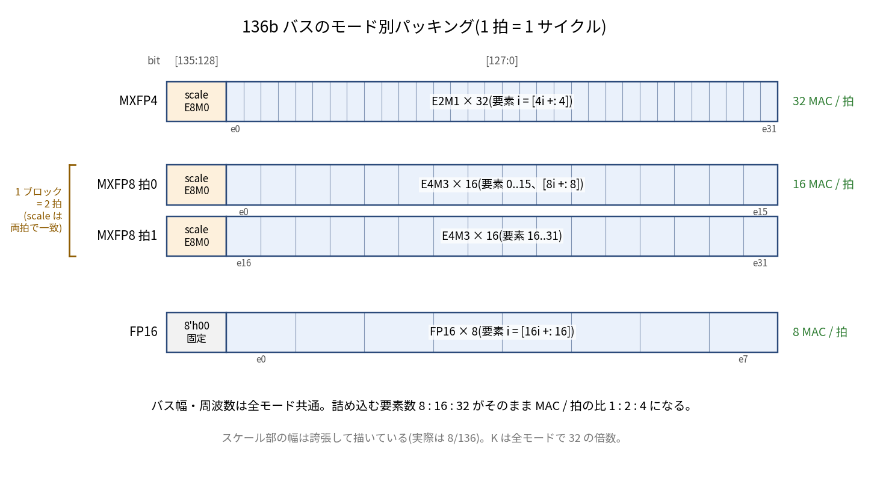
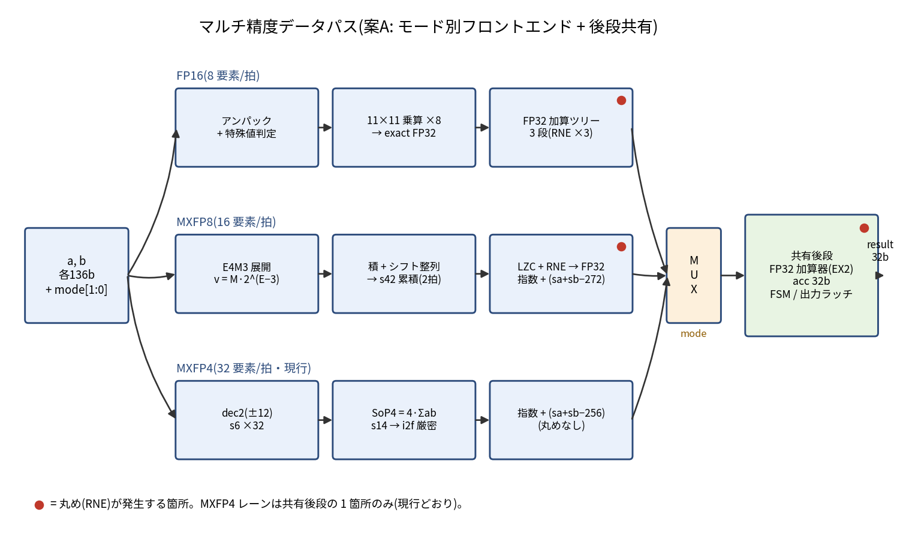
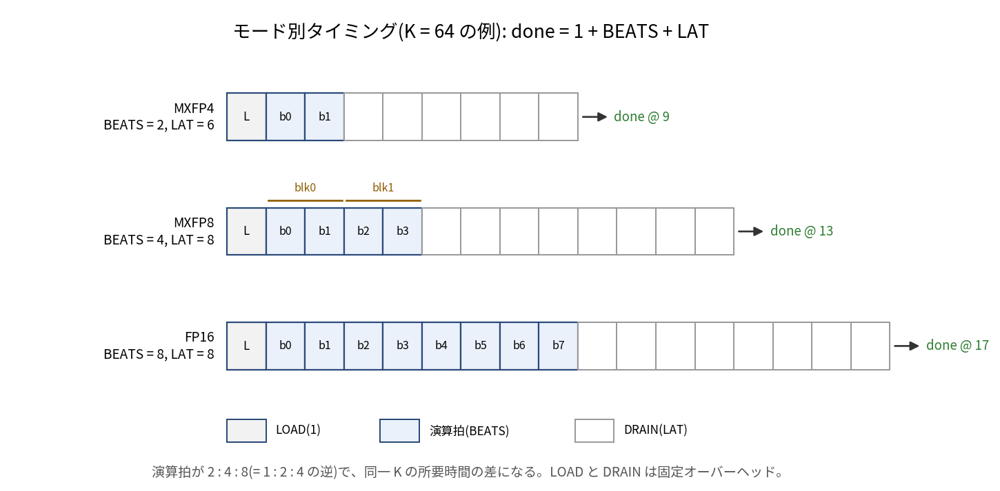

# Appendix B マルチ精度拡張仕様 — FP16 / MXFP8 / MXFP4（1拍のMAC数比 1：2：4）

> 取り込み元では拡張仕様の草案でした。本リポジトリでE4M3・FP16のRTLと検証を実装し、丸め境界・加算順序・スケール保持・最小構成の記述を修正しました。[実装仕様と検証範囲](../../../MULTIPRECISION.md)を参照してください。図は元の構想図です。

本 Appendix は「ブロックスケール MXFP4 演算器 設計仕様書 Rev.1.3」に対する拡張仕様である（取り込み元は草案）。現行の MXFP4 専用エンジンを、FP16(IEEE binary16)と MXFP8(OCP MX v1.0、要素 E4M3)でも演算できるように拡張し、演算スループットを FP16 = 1 倍、MXFP8 = 2 倍、MXFP4 = 4 倍とする。信号名・数値規約・文書規約は本文に従う。mode = MXFP4 のとき、既存 RTL とビット一致で動作すること(後方互換)を必須要求とする。

MXFP8(E4M3 / E5M2)と E8M0 の定義は OCP Microscaling Formats (MX) v1.0 および OCP 8-bit Floating Point Specification (OFP8) に基づく。本 Appendix の記載は既知の公開仕様に基づくが、Rev.2.0 として本文へ統合する際に原典の該当節と突き合わせることを推奨する。

図15(パッキング)、図16(マルチ精度データパス)、図17(モード別タイミング)は、本 Appendix と同じフォルダの PNG を相対パスで参照する(本文の図1〜図14 と連番)。

---

## B.1 目的と性能目標

性能比 1 : 2 : 4 は、入力バス幅を 136bit / サイクル / オペランドに固定し、そこへ詰め込む要素数で稼ぐ方式で実現する。目標とする動作周波数・バス幅・アレイ構成(4×4)は全モード共通であり、精度を半分にするたび 1 拍あたりの要素数が倍になる。

| mode | 要素 / 拍(1 PE) | 拍 / 32要素ブロック | MAC / cyc / PE | 4×4 アレイ合計 | 相対性能 |
|---|---|---|---|---|---|
| FP16 | 8 | 4(ブロックスケールなし) | 8 | 128 | 1 |
| MXFP8(E4M3) | 16 | 2 | 16 | 256 | 2 |
| MXFP4(E2M1) | 32 | 1 | 32 | 512 | 4 |

この「固定幅データパスへの詰め込み数でスループット差を出す」構造は、実機のテンソアコアが FP16 : FP8 : FP4 = 1 : 2 : 4 のピーク比を持つ仕組み(固定幅のオペランド格納・供給帯域に対し、低精度ほど多くの要素を載せられる)と同型である。乗算器のビット分割で稼ぐ方式(案B、B.4節)ではなく、まず供給側の詰め込みで比を作るのが本 Appendix の基本方針である。

## B.2 対応フォーマット定義

| 項目 | FP16 | MXFP8(E4M3) | MXFP8(E5M2、オプション) | MXFP4(E2M1、現行) |
|---|---|---|---|---|
| 要素ビット | 1+5+10 | 1+4+3 | 1+5+2 | 1+2+1 |
| 指数バイアス | 15 | 7 | 15 | 1 |
| 最大有限値 | 65504 | 448 | 57344 | 6 |
| subnormal | あり | あり | あり | あり(±0.5) |
| Inf | あり | なし | あり | なし |
| NaN | あり | S.1111.111 のみ | IEEE 的 | なし |
| ブロック長 | なし | 32 | 32 | 32 |
| 共有スケール | なし | E8M0(8bit) | E8M0(8bit) | E8M0(8bit) |

E4M3 は次の統一表現に展開できる(全 254 有限コードで一致することを数値検証済み)。

v = M × 2^(E − 3)、 正規数: E = e ∈ [−6, 8]、|M| ∈ [8, 15]、 subnormal: E = −6、|M| ∈ [0, 7]

この表現が B.6 の固定小数点設計の基礎になる。E5M2 は本 Appendix ではオプション扱いとし、対応する場合の差分(バイアス 15、Inf / NaN の IEEE 的扱い、emax = 15 に伴う B.10 のスケール式変更)のみ B.12 に記す。主対象は推論で標準的な E4M3 とする。

## B.3 データパッキング(136bit バス)

トップレベルのバス幅 136bit / 拍 / オペランドは変更しない。モード別のビット割当を次のとおり定める。

| mode | [135:128] | [127:0] | 要素の位置 |
|---|---|---|---|
| MXFP4 | scale(E8M0) | E2M1 × 32 | 要素 i = `[4*i +: 4]`(現行どおり) |
| MXFP8 | scale(E8M0) | E4M3 × 16(半ブロック) | 要素 i = [8*i +: 8] |
| FP16 | 8'h00 固定 | FP16 × 8 | 要素 i = [16*i +: 16] |



図15: 136b バスのモード別ビット割当。詰め込む要素数 8 : 16 : 32 が、そのまま MAC / 拍の比 1 : 2 : 4 になる。

MXFP8 の 1 ブロック(32 要素 + スケール)は 264bit なので、拍 0 に要素 0..15、拍 1 に要素 16..31 を載せる 2 拍構成とする。両拍の scale フィールドには同じ値を載せることを規約とし、SVA で一致を検証する(B.9)。FP16 はブロックスケールを持たないため、scale フィールドは 0 固定とする(非 0 は警告アサーション)。

K(内積長、要素数)は全モードで 32 の倍数に制約する(現行の KBLK 規約と整合)。モード別の拍数は次のとおり。

| mode | BEATS(拍数) | 32 要素あたり |
|---|---|---|
| FP16 | K / 8 | 4 拍 |
| MXFP8 | K / 16 | 2 拍 |
| MXFP4 | K / 32 | 1 拍 |

同一 K の入力拍数が 4 : 2 : 1 となり、B.1 の1拍のMAC数比 1 : 2 : 4 と整合する。LOAD / DRAIN を含む総サイクル数の比や、実装後の動作周波数を含む性能比を保証するものではない。パッキング展開の骨格を示す。

```systemverilog
// モード別アンパック(組合せ)。mode: 2'b00=FP16, 2'b01=MXFP8, 2'b10=MXFP4
typedef enum logic [1:0] {MODE_FP16=2'b00, MODE_FP8=2'b01, MODE_FP4=2'b10} mode_e;

function automatic logic [3:0]  get_e2m1 (input logic [135:0] blk, input int unsigned i);
  return blk[4*i +: 4];
endfunction
function automatic logic [7:0]  get_e4m3 (input logic [135:0] blk, input int unsigned i); // i=0..15
  return blk[8*i +: 8];
endfunction
function automatic logic [15:0] get_fp16 (input logic [135:0] blk, input int unsigned i); // i=0..7
  return blk[16*i +: 16];
endfunction
```

## B.4 データパス構成 — 案A / 案B

| 観点 | 案A: モード別フロントエンド + 後段共有 | 案B: 精度スケーラブル乗算器(subword 共有) |
|---|---|---|
| 乗算器 | FP4 整数パス(現行)、FP8 用、FP16 用を並置し mode で MUX | 小ビット乗算器スライスを分割合成(Bit Fusion / BitBlade 系) |
| 面積 | 増える(乗算器 3 系統) | 効率的 |
| 検証 | 各パス独立に検証可能。後方互換が自明 | 分割境界のガードビット等、検証が難しい |
| タイミング | パスごとに最適化可能 | 合成モードでパスが伸びやすい |
| 本設計との適合 | 学習優先・検証容易性優先の方針に合致 | 発展課題向き |

推奨は案A とする。共有するのは後段、すなわちスケール合成の指数加算、FP32 加算器コア(本文 5 章)、FP32 アキュムレータ、FSM(gemm_ctrl_fsm)、出力ラッチ(c_mat)である。フロントエンド(要素展開〜ブロック / 拍の縮約)のみをモード別 3 系統とし、mode で選択する。案B は B.12 の発展課題に置く。



図16: 案A の構成。3 系統のフロントエンドを MUX で選択し、FP32 加算器(EX2)・acc・FSM・出力ラッチを共有する。赤丸は丸め(RNE)の発生箇所で、MXFP4 レーンは共有後段の 1 箇所のみ(現行どおり)。

## B.5 モード別数値規約(丸め点の一覧)

| mode | ブロック / 拍の内側 | FP32 化 | acc への加算 | 丸めの発生箇所 |
|---|---|---|---|---|
| MXFP4 | 整数厳密(SoP4、s14) | i2f 厳密(丸めなし) | ブロックごとに FP32 RNE | ブロック間加算のみ(現行) |
| MXFP8 | s42 固定小数点で 32 項厳密 | ブロック末に RNE 1 回 | ブロックごとに FP32 RNE | ブロック末 1 回 + ブロック間加算 |
| FP16 | 積は FP32 で厳密(丸めなし) | 加算ツリー 3 段(各段 RNE) | 拍ごとに FP32 RNE | 拍内 3 回 + acc 加算 |

後方互換要求: mode = MXFP4 のとき、デコード・SoP4・scaled_exp = sa + sb − 256・i2f・FP32 加算のすべてが既存 RTL とビット一致であること(検証 X0)。

特殊値の規則は次のとおり(現行 6.1〜6.4 の拡張)。

| 事象 | MXFP4 | MXFP8 | FP16 |
|---|---|---|---|
| scale = 0xFF(E8M0 NaN) | 結果 NaN(現行) | 結果 NaN | 対象外(scale 不使用) |
| 要素 NaN | 表現なし | S.1111.111 を検出したら結果 NaN | NaN 入力で結果 NaN |
| 要素 Inf | 表現なし | 表現なし | Inf は伝播(Inf × 0 は NaN) |
| 要素 subnormal | ±0.5(通常値) | 厳密展開で対応(DAZ 不要) | 厳密展開で対応(DAZ 不要) |
| acc 側オーバーフロー / アンダーフロー | ±Inf 飽和 / FTZ(現行) | 同左 | 同左 |

FP8 / FP16 の要素 subnormal は、展開が厳密(B.6、B.7)であるため特別扱いが不要になる。DAZ が残るのはエンコーダの FP32 入力側(本文 7 章)のみである。

## B.6 MXFP8 ブロック内積 — s42 固定小数点設計

E4M3 は要素ごとに指数を持つため、MXFP4 の「値×2 の整数」トリックは使えない。代わりに、B.2 の統一表現でブロック内を固定小数点へ厳密に展開する。

導出(数値検証済み):

| 量 | 値 | 幅 |
|---|---|---|
| 展開仮数 M | \|M\| ≤ 15(符号付き) | s5 |
| 展開指数 E | E ∈ [−6, 8] | s5 |
| 要素積 \|Ma·Mb\| | ≤ 225 | 8bit(符号付きで s9) |
| 積の重み | 2^(Ea + Eb − 6)、Ea + Eb ∈ [−12, 16] | — |
| シフト量 s | s = Ea + Eb + 12 ∈ [0, 28] | 5bit |
| 1 項の固定小数点値 | ±(Ma·Mb) << s、最大 2^35.81 | s37 に収まる |
| 32 項の総和 | 最大 2^40.81 | s42 で表現可能 |

固定小数点の LSB 重みは 2^−18(= 2^(−12 − 6))である。したがってブロック値は

block_value = acc42 × 2^−18 × 2^(sa − 127) × 2^(sb − 127)

であり、FP32 化の際の指数加算は sa + sb − 254 − 18 = sa + sb − 272 となる。MXFP4 の sa + sb − 256 と定数が異なるのは、FP4 側が「値×2」化 2 回分(2^2)の補正を含むのに対し、FP8 側は倍化を行わず LSB 重み 2^−18 のアンカー補正を含むためである。定数の取り違えは 1.0 + 1.0 = 3.0 型のバグに直結するため、検証 Q3 で境界を直接叩く。

2 拍動作: 拍 0 で要素 0..15 の 16 項、拍 1 で要素 16..31 の 16 項を acc42 へ加算する。拍 1 の完了後に LZC(42bit)と RNE で 1 回だけ FP32 へ丸め、scaled_exp8 = sa + sb − 272 を指数に加えてから、共有の FP32 加算器(EX2)で acc に足し込む。このFP32化ではRNEと範囲判定を行い、その後のacc加算でもRNEと範囲判定を行う。ブロック内は厳密なので、リファレンス方針3(広幅整数)と acc42 の値をビット一致で照合できる。

acc42 から FP32 への丸めは、本文 5.6 節の GRS 規約(norm[26:3] = 24bit 仮数 + G/R/S)を 42bit へ一般化したものとする。LZC で先頭 1 を検出し、上位 24bit を仮数、直下 2bit を G/R、残り全 OR を S として RNE する。骨格を示す。

```systemverilog
// E4M3 展開: code -> {符号付き仮数 M(s5), 指数 E(s5)}。NaN は別線で通知
function automatic void e4m3_expand(input logic [7:0] c,
                                    output logic signed [4:0] M,
                                    output logic signed [4:0] E,
                                    output logic is_nan);
  logic s; logic [3:0] e; logic [2:0] m;
  {s, e, m} = c;
  is_nan = (e == 4'hF) && (m == 3'h7);
  if (e == 4'h0) begin M = s ? -$signed({2'b00, m}) : $signed({2'b00, m}); E = -5'sd6; end
  else           begin M = s ? -$signed({1'b0, 1'b1, m}) : $signed({1'b0, 1'b1, m});
                       E = $signed({1'b0, e}) - 5'sd7; end
endfunction

// 1 項の固定小数点化(シフト量 s = Ea + Eb + 12、0..28)と s42 累積(2 拍)
logic signed [41:0] acc42;
always_ff @(posedge clk) begin
  if (beat_first) acc42 <= term_sum16;          // 拍0: 16 項の和で初期化
  else            acc42 <= acc42 + term_sum16;  // 拍1: 残り 16 項
end
// 拍1 完了後: lzc42 -> 上位24bit + G/R/S -> RNE -> 指数 += (sa + sb - 272) -> FP32
```

## B.7 FP16 パス

FP16 × FP16 の積は FP32 で厳密に表現できる。仮数は 11bit × 11bit = 22bit ≤ 24bit、指数は subnormal 同士の最小積 2^−48 まで含めて FP32 の正規範囲に収まる(乱数 15 万ペア + 最小 subnormal 積で厳密性を数値検証済み)。したがって積の段では丸めが発生しない。

処理は次のとおり: (1) 特殊値の前置判定(いずれかが NaN、または Inf × 0 → NaN。いずれかが Inf → 符号 XOR の ±Inf)。(2) 有限値は exact 積を FP32 ビットパターンへ正規化パック(丸めなし)。(3) 8 個の積を 8 → 4 → 2 → 1 の加算ツリー 3 段で縮約。各段は本文 5 章の FP32 加算器コア(RNE、±Inf 飽和、FTZ、r_zero)を用い、ペアはレーン番号昇順で固定する(順序固定は再現性と検証のため)。(4) ツリー出力を拍ごとに EX2 で acc へ加算する。毎拍の acc read-modify-write になるが、EX2 一段完結(本文 B2 の教訓)により RAW ハザードは生じない。

```systemverilog
// FP16 レーン: exact 積を FP32 へパック(丸めなし)。特殊値は pre_special で先行判定
function automatic logic [31:0] fp16_prod_exact(input logic [15:0] a, input logic [15:0] b);
  logic sa, sb; logic [4:0] ea, eb; logic [9:0] ma, mb;
  logic [10:0] Ma, Mb; logic [21:0] p; int ex;
  {sa, ea, ma} = a; {sb, eb, mb} = b;
  Ma = (ea == 0) ? {1'b0, ma} : {1'b1, ma};      // subnormal も厳密に展開
  Mb = (eb == 0) ? {1'b0, mb} : {1'b1, mb};
  p  = Ma * Mb;                                   // 22bit、丸めなし
  ex = (((ea == 0) ? 1 : ea) - 15) + (((eb == 0) ? 1 : eb) - 15) - 20; // p の LSB 重み
  return pack_fp32(sa ^ sb, p, ex);               // 先頭1へ正規化して詰めるだけ(exact)
endfunction
```

## B.8 タイミング・FSM

| mode | BEATS | LAT(last 投入 → out_valid) | done サイクル |
|---|---|---|---|
| MXFP4 | K / 32 | 6(現行 S1〜S6) | 1 + K/32 + 6 |
| MXFP8 | K / 16 | 8(F1〜F8) | 1 + K/16 + 8 |
| FP16 | K / 8 | 8(G1〜G8) | 1 + K/8 + 8 |



図17: K = 64 の例。演算拍が 2 : 4 : 8 で、同一 K の所要時間差になる(LOAD / DRAIN は固定オーバーヘッド)。

段割りの目安: MXFP8 は F1 アンパック + E4M3 展開 / F2 仮数積(4bit × 4bit × 16) / F3 シフト整列(0..28) / F4 s42 累積(拍内) / F5 LZC / F6 RNE + 指数合成(sa + sb − 272) / F7 EX2(FP32 加算) / F8 出力レジスタ。FP16 は G1 アンパック + 特殊値判定 / G2 11 × 11 乗算 × 8 / G3 exact FP32 パック / G4〜G6 加算ツリー 3 段 / G7 EX2 / G8 出力レジスタ。LAT 値は設計目標であり、実装で ±1 の調整を許す(done は LAT パラメータ参照で計算するため、値の変更が仕様の破壊にならない)。

FSM(gemm_ctrl_fsm)の変更点: kblk カウンタを beat カウンタへ置き換え、BEATS ≥ 1 を許容する。KBLK=1のMXFP4も対象とし、カウンタの幅はmax(1, $clog2(BEATS))として0幅を防ぐ。DRAIN 長はモード別 LAT パラメータを参照する。カウンタ比較の定数は現行の lint 方針どおり幅を明示する(確保したカウンタ幅でBEATS - 1をキャストする形)。mode は計算列の途中(first〜last の間)で変更禁止とする。

## B.9 ポート変更と SVA

追加ポート: `mode[1:0]`(2'b00 = FP16、2'b01 = MXFP8、2'b10 = MXFP4、2'b11 = 予約)。dbg ポート表(本文 8 章)には dbg_mode[1:0] と err_scale_mismatch(MXFP8 の拍間 scale 不一致)を追補する。

主要 SVAの考え方を示す。`take`は`in_valid && in_ready`、`active_mode`は受理した先頭のmode、`first_sa/sb`は受理した前半拍のスケール保持値、`half`は次の受理が後半拍であることを示す。先頭でmodeが変わることは許容する。各保持レジスタはリセットし、入力を受理したときだけ更新する。

```systemverilog
// (1) 列内のmode変更を診断し、演算は捕捉値を使う
a_mode_diagnostic: assert property (@(posedge clk) disable iff (!rst_n)
  take && active && mode != active_mode |=> err_protocol);

// (2) 直前サイクルではなく、受理した前半拍のscaleと照合する
//     前半拍で first_sa <= a_block[135:128]; first_sb <= b_block[135:128];
a_scale_diagnostic: assert property (@(posedge clk) disable iff (!rst_n)
  take && active_mode == MODE_FP8 && half &&
  (a_block[135:128] != first_sa || b_block[135:128] != first_sb)
  |=> err_scale_mismatch);

// (3) FP16の非ゼロヘッダは演算で無視し、診断する
a_fp16_scale_diagnostic: assert property (@(posedge clk) disable iff (!rst_n)
  take && (active ? active_mode : mode) == MODE_FP16 &&
  (a_block[135:128] != 8'h00 || b_block[135:128] != 8'h00)
  |=> err_protocol);
```

これは違反時の診断が出ることの検査であり、正規の入力生成側にはmode・ヘッダの規約を守る責任がある。入力休止を挟むため、単純な`$past(a_block[135:128])`との比較では不十分である。
scale 不一致時の動作は「拍 0 の scale を採用し、err_scale_mismatch を立てる」と定める(結果を NaN にはしない。違反はテストベンチ責務であり、実機挙動としては採用値を明確にしておく方がデバッグしやすいため)。

## B.10 エンコーダ拡張

FP32 → MXFP8(E4M3)の量子化 e4m3_quantize は、本文 7 章の e2m1_quantize と同じ骨格で作る。共有スケールは E4M3 の emax = 8 を用いて

X_biased = clamp(amax_exp − 8, 0, 254)

とする(MXFP4 の amax_exp − 2 に対応する式。amax がフォーマット上限付近に写る)。相対指数 e_rel = elem_exp − X_biased の扱いは、e_rel ∈ [−6, 8] が正規域である。非正規化領域は一定のLSB重み2^−9を使ってRNEし、正規数の仮数3bitの式をそのまま流用しない。e_rel = −10では、絶対値がちょうど2^−10なら0へ、それを超えれば最小非正規化数2^−9へ丸める。e_rel ≤ −11はすべて半LSB未満となる。正規域のRNEは3bit仮数の一般式rm3 = m3 + up(upはガード／スティッキーから決定)を用いる。桁上がりでは指数を1増やし、最大指数のNaNコードS.1111.111へ丸まる場合を含め、448へクランプする。E2M1 のときに全タイ点を列挙して確定させたのと同様、各 binade × m3 × 直下ビットの表を作って丸め先を固定すること。

FP32 → FP16 の変換 fp16_cast は RNE、オーバーフローは ±Inf、subnormal 生成に対応する(DAZ は行わない)。covergroup は cp_e_rel(E4M3 用に −10..8)と cp_mode を追加する。

```systemverilog
// e4m3_quantize の核(1 要素分の骨格)
logic [2:0] m3; logic g, s_or; logic up; logic [3:0] rm3;
up  = g & (s_or | m3[0]);          // RNE
rm3 = {1'b0, m3} + {3'b0, up};
if (rm3[3]) begin e_out = e_in + 1; m_out = 3'b000; end  // 繰り上げ
else        begin e_out = e_in;     m_out = rm3[2:0]; end
// 正規域の骨格。非正規化域は2^-9刻みで別に丸める
// e_out > 8 または e_out == 8 && m_out == 7 は448(S.1111.110)へクランプ
```

## B.11 検証拡張

| ID | 対象 | 内容 | 判定 |
|---|---|---|---|
| X0 | 後方互換 | mode = MXFP4 で既存 R2a / R2f / D4 を再実行 | 既存 RTL とビット一致 100% |
| P1 | パッキング | 各モードの pack → unpack 往復、境界要素(0 / 7 / 15 / 31) | 恒等 |
| M1 | SVA | mode 途中変更、FP8 拍間 scale 不一致、FP16 scale 非 0 | 各 SVA が検出 |
| Q1 | E4M3 デコード | 全 256 コード(NaN 含む)の展開値 | リファレンス一致 |
| Q2 | FP8 ブロック内厳密 | acc42 と方針3(広幅整数)の照合 | ビット一致 |
| Q3 | FP8 丸め境界 | acc42 → FP32 の RNE(G / R / S、タイ)、sa + sb − 272 の境界 | 方針3 と一致 |
| Q4 | FP8 ランダム | scaled 指数制約付きランダム、NaN / subnormal 混入 | 一致 100% |
| Q5 | FP8 特殊値 | 要素 NaN、scale 0xFF、subnormal 端 | 規則どおり |
| H1 | FP16 exact 積 | 乱数 + subnormal × subnormal + 境界 | FP32 積が厳密一致 |
| H2 | FP16 ツリー | 固定順序 3 段 RNE のリファレンス照合 | 一致 |
| H3 | FP16 特殊値 | NaN / Inf / Inf × 0 / ±0 符号 | 規則どおり |
| H4 | FP16 ランダム | 一致 100% | 一致 100% |

リファレンスモデルの割当: MXFP8はs42相当の厳密なブロック積和をFP32へRNE・範囲判定した後、ブロック順にaccへ加算して再びRNE・範囲判定する。FP16は厳密な積をレーン順の8→4→2→1の平衡加算ツリーで縮約し、各段をFP32へ丸め、さらに拍ごとにaccへ加算して丸める。左からの逐次加算や全項を一度だけ丸めるモデルは正解にならない。本リポジトリではPython有理数モデルを使用する。段階3(本文 11 章)の完了基準に X0 を追加する。

## B.12 実装ロードマップと面積考察

| 段階 | 内容 | 完了条件 |
|---|---|---|
| B-1 | FP16 レーン単体(exact 積) | H1 通過 |
| B-2 | FP16 ツリー + acc 統合 | H2〜H4 通過 |
| B-3 | E4M3 展開 + s42 累積の単体 | Q1〜Q2 通過 |
| B-4 | FP8 の丸め・スケール合成統合 | Q3〜Q5 通過 |
| B-5 | mode MUX 統合 + 後方互換回帰 | X0 / P1 / M1 通過 |
| B-6 | エンコーダ拡張(e4m3 / fp16) | cg 拡張含め通過 |
| B-7 | lint / 回帰 | Verilator default lint 全モジュール PASS |

面積の支配項は FP16 用の 11 × 11 乗算器 × 8 で、FP4 の小型整数乗算器 32 個より大きい。次いで s42 アキュムレータ + 最大 28bit のシフタ(FP8)、モード MUX。クリティカルパス候補は F3(シフト整列)と G4〜G6(FP32 加算ツリー)で、LAT を 6 → 8 に増やした根拠である。発展課題: 案B(subword 分割による乗算器共有)、E5M2 対応(Inf / NaN の IEEE 的扱いと X_biased = clamp(amax_exp − 15, 0, 254) への変更)、BF16 対応。

## B.13 Appendix B 参考文献

- OCP Microscaling Formats (MX) Specification v1.0(MXFP8 / MXFP4、E8M0、ブロック 32)
- OCP 8-bit Floating Point Specification (OFP8)(E4M3 / E5M2 の定義)
- Sharma et al., Bit Fusion: Bit-Level Dynamically Composable Architecture for Accelerating Deep Neural Networks, ISCA 2018(案B の代表)
- 本文 5 章(FP32 加算器コア)、6 章(特殊値)、7 章(エンコーダ)、11 章(検証計画)

以上。統合時は本文 13 章の後、付録 A の前に配置し、図表一覧へ図15〜図17 と本 Appendix の表を追補する。
