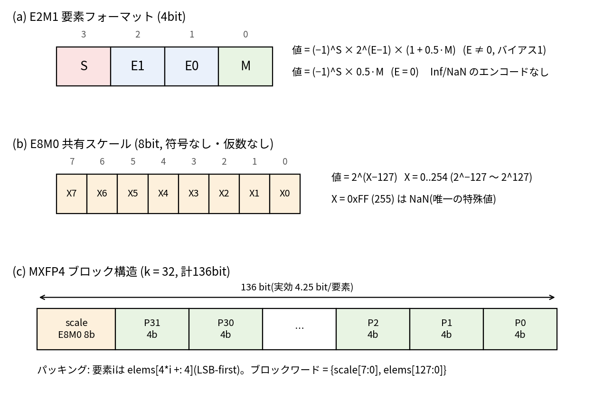
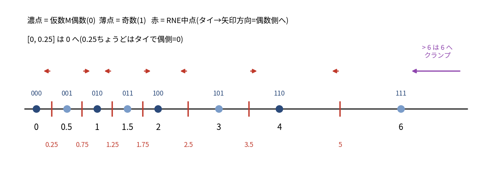
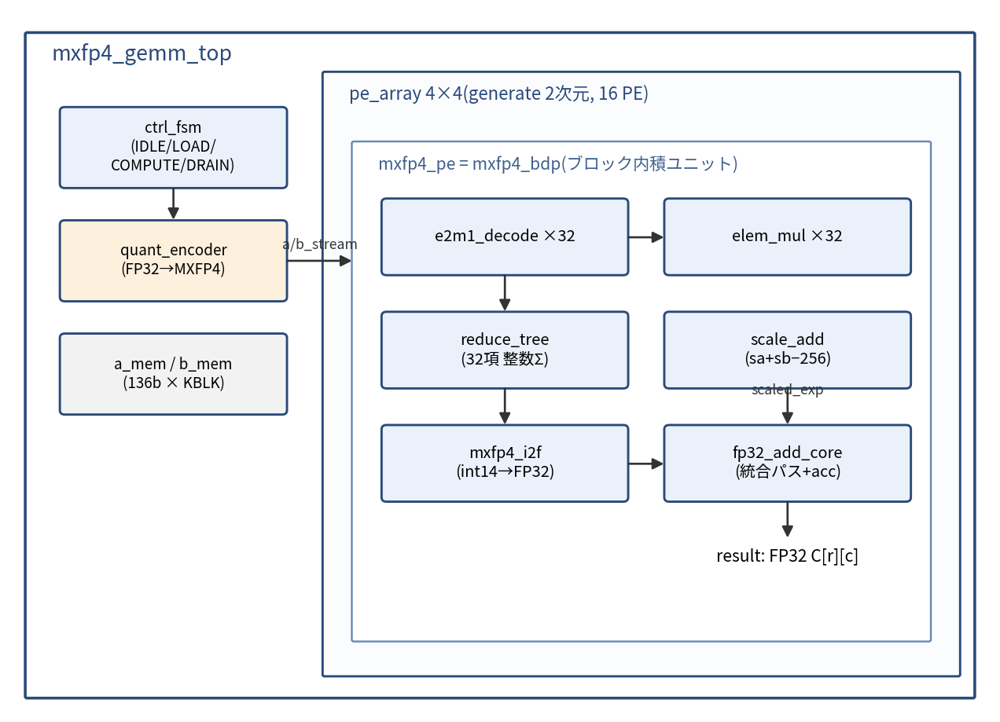
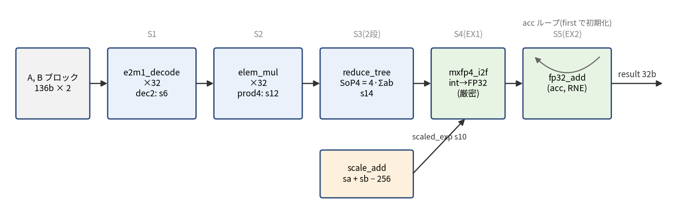
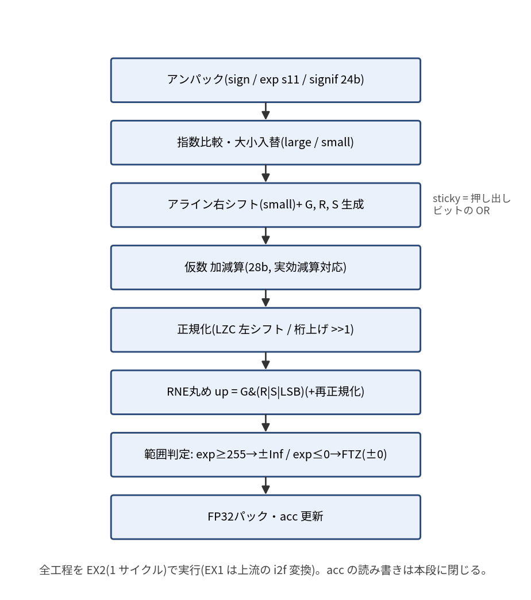
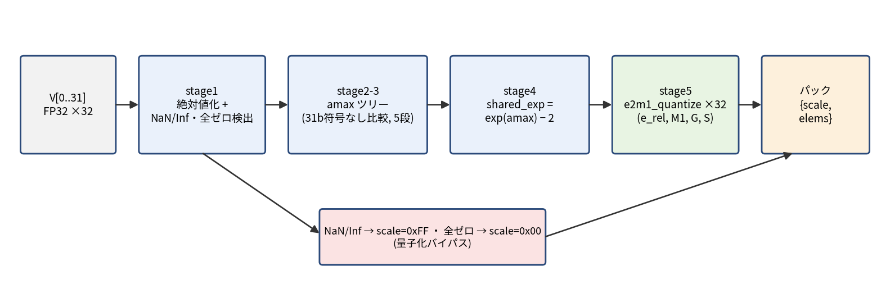
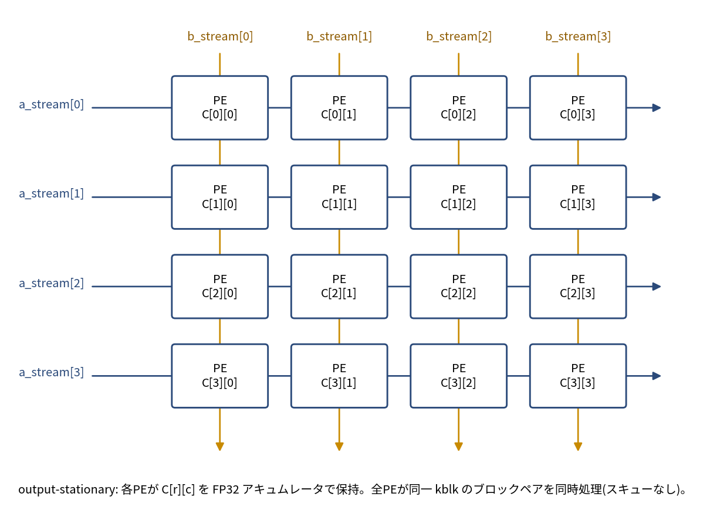
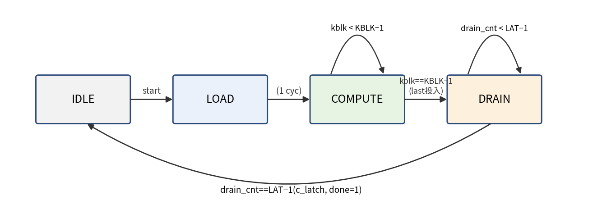
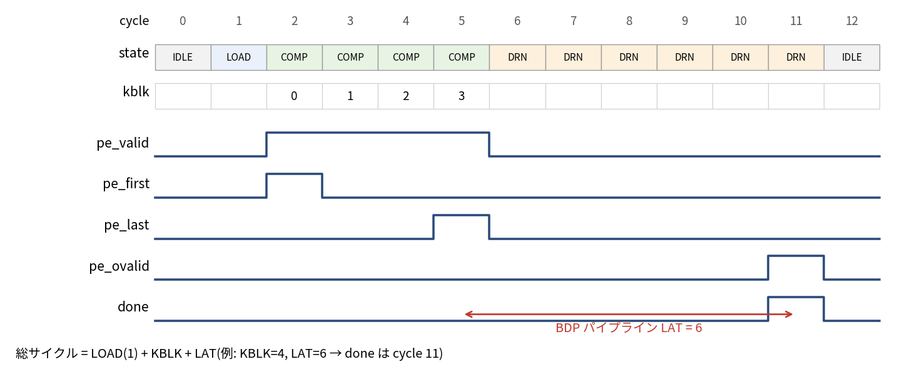

# ブロックスケール MXFP4 演算器 設計仕様書

| 項目 | 内容 |
|---|---|
| 文書名 | ブロックスケール MXFP4 演算器 設計仕様書(統合版) |
| 版数 | Rev. 1.1 |
| 日付 | 2026-08-10 |
| 作成 | sukimaengineer |
| 準拠 | OCP Microscaling Formats (MX) Specification v1.0 / IEEE 754-2019 / IEEE 1800-2023 |

本書は、OCP MX 仕様 v1.0 に準拠したブロックスケール MXFP4 演算器(ブロック内積ユニット、FP32→MXFP4 量子化エンコーダ、4×4 GEMM エンジン)の RTL 実装仕様である。学習用途と、自作 IEEE 1800-2023 準拠 SystemVerilog シミュレータ sukimasim の検証ターゲットという 2 つの目的を持つ。基本仕様(Rev.0.1)とマイクロアーキテクチャ補遺 A1〜A4(Rev.0.2)を統合し、章構成を再編、図(PNG)と表を追加した。Rev.1.1 では RTL 実装からのフィードバック(spec_feedback_rev1.0.md 第 2 版、commit 3e92496)を反映した。

## 改訂履歴

| 版 | 日付 | 内容 |
|---|---|---|
| 0.1 | 2026-08-09 | 基本仕様 初版(フォーマット、BDP、エンコーダ、GEMM、検証) |
| 0.2 | 2026-08-09 | マイクロアーキテクチャ補遺(A1: FP32 アキュムレータ、A2: 範囲外規約、A3: エンコーダ RTL 詳細、A4: GEMM 制御 FSM) |
| 1.0 | 2026-08-09 | 統合版。章再編、図・表の追加、タイミング整合(LAT=6 基準)、引用の要約化 |
| 1.1 | 2026-08-10 | 実装フィードバック反映。FP32 加算器の丸めビット位置修正と桁上げ時 sticky 保存(B1/A1)、EX1/EX2 段割りの修正(B2)、量子化コードの丸め割当修正と is_zero 外出し(B3/B4)、リファレンスのスライス修正(B5)、covergroup 段別分割と ignore_bins(C1/C2)、X_biased 上限・二重丸め・出力読み出しタイミングの注記(C3〜C5)、加算器単体テスト R2f 追加、運用ノート追加 |

## 目次

1. はじめに
2. データフォーマット仕様
3. アーキテクチャ概要
4. ブロック内積ユニット(mxfp4_bdp)
5. FP32 アキュムレータ(fp32_accum)詳細
6. 数値規約: FP32 範囲外の扱い
7. 量子化エンコーダ(quant_encoder)
8. GEMM エンジン(mxfp4_gemm_top)
9. 検証仕様
10. sukimasim 検証ターゲットとしての観点
11. 実装ロードマップ
12. 実装定義事項と注意
13. 参考文献

## 図表一覧

| 図番号 | 内容 | 掲載節 |
|---|---|---|
| 図1 | E2M1 / E8M0 / ブロック構造のビットレイアウト | 2.1〜2.3 |
| 図2 | E2M1 数直線と RNE 中点・クランプ | 2.1, 7.2 |
| 図3 | モジュール階層ブロック図 | 3.1 |
| 図4 | ブロック内積ユニットのデータパスとパイプライン段 | 3.2, 4.1 |
| 図5 | FP32 加算器(統合パス)のデータフロー | 5.3 |
| 図6 | 量子化エンコーダのパイプライン | 7.6 |
| 図7 | 4×4 output-stationary GEMM アレイ | 8.1 |
| 図8 | 制御 FSM 状態遷移図 | 8.3 |
| 図9 | GEMM タイミングチャート(KBLK=4, LAT=6) | 8.4 |

注: 図は本ファイルと同じフォルダに置いた PNG を相対パスで参照している。閲覧時は Markdown と PNG を同じフォルダに配置すること。

---

## 1. はじめに

### 1.1 目的

本プロジェクトは 2 つの目的を持つ。第一に、ブロックスケール MXFP4 演算を RTL で実装しながら、ブロック浮動小数点演算・量子化・GEMM データフローを学ぶこと。第二に、自作シミュレータ sukimasim(IEEE 1800-2023 準拠、sv-tests 100% パス)の検証ターゲットとして、合成可能サブセットの RTL と、UVM 非依存だが言語機能を幅広く使うテストベンチを供給することである。

### 1.2 適用範囲

実装対象は次の 3 階層である。

| 階層 | モジュール | 規模 | 主目的 |
|---|---|---|---|
| L0 | E2M1 デコーダ / 量子化エンコーダ | 組合せ〜数段 | 形式変換の学習と単体検証 |
| L1 | ブロック内積ユニット(BDP) | k=32 要素、FP32 アキュムレート | MX 内積の中核 |
| L2 | 4×4 GEMM エンジン | 16 PE、output-stationary | 小規模行列積のデータフロー学習 |

### 1.3 準拠規格・主要参照

- OCP Microscaling Formats (MX) Specification v1.0(2023 年 9 月批准)。E2M1 / E8M0 / ブロック定義と変換セマンティクスの一次仕様。
- Rouhani et al., "Microscaling Data Formats for Deep Learning"(arXiv:2310.10537)。スケール決定 Algorithm 1 の出典。
- IEEE Std 754-2019(roundTiesToEven、オーバーフロー/アンダーフロー処理)。
- IEEE Std 1800-2023(SystemVerilog。RTL とテストベンチの記述言語)。

### 1.4 用語と略語

| 用語 | 意味 |
|---|---|
| MXFP4 | E2M1 要素 ×32 + E8M0 共有スケールから成る OCP MX の 4bit 形式 |
| E2M1 | 符号 1 + 指数 2 + 仮数 1 の 4bit 浮動小数点要素形式(バイアス 1) |
| E8M0 | 符号なし 8bit の 2 のべき乗スケール形式(バイアス 127、0xFF=NaN) |
| BDP | Block Dot Product。ブロック内積ユニット(mxfp4_bdp) |
| dec2 | E2M1 値を 2 倍して整数化した内部表現(−12..+12) |
| SoP4 | Sum of Products の 4 倍。1 ブロックの要素積和 ×4(signed 14bit) |
| i2f | int14→FP32 変換ユニット(mxfp4_i2f) |
| GRS | guard / round / sticky。丸め判定用の 3 ビット |
| RNE | roundTiesToEven(最近接偶数丸め) |
| FTZ | flush-to-zero。アンダーフロー結果を ±0 にする方式 |
| DAZ | denormals-are-zero。デノーマル入力を 0 として扱う方式 |
| LZC | leading zero counter(先頭ゼロ計数) |
| PE | processing element。GEMM アレイの演算要素(=BDP 1 個) |
| output-stationary | 各 PE が出力要素の部分和をローカル保持するデータフロー |
| KBLK | K 方向のブロック数(K/32) |
| LAT | BDP パイプラインレイテンシ(本書の参照構成では 6) |

### 1.5 設計方針一覧

| 項目 | 決定 | 主な根拠 |
|---|---|---|
| 累積方式 | late accumulation(整数 SoP → FP32 変換 → FP32 加算) | ブロック内をビット厳密にでき検証が容易(5 章) |
| FP 加算器 | 統合パス(single-path)、GRS 3bit、RNE | 学習・検証優先。near/far 分割は発展課題(5.7 節) |
| オーバーフロー | 同符号 ±Inf へ飽和 | IEEE 754 の RNE 規定に整合(6.2 節) |
| アンダーフロー | FTZ(符号保持で ±0) | ハードコスト低減、GPU 系演算器の慣行(6.3 節) |
| デノーマル入力 | DAZ(0 扱い) | コーナーケース排除(6.4 節、7.5 節) |
| 丸め | roundTiesToEven(全変換点) | OCP 仕様が FP4 変換で RNE サポートを必須化 |
| ハンドシェイク | valid ベース(ready 拡張可) | 段階的実装のため(3.3 節) |
| データフロー | 4×4 output-stationary、スキューなし | FP32 累積と自然に一致(8.1 節) |
| パッキング | LSB-first、elems[4*i +: 4] | PyTorch / ONNX の FP4 パッキング慣習に整合(2.3 節) |
| 検証 | プレーン SystemVerilog、real リファレンス、必要に応じ $shortrealtobits 照合 | sukimasim 優先、UVM 非依存(9 章) |
| RTL 記述 | IEEE 1800-2023 の一般的合成可能サブセット | real/shortreal は TB とリファレンスのみ |

---

## 2. データフォーマット仕様

### 2.1 E2M1(FP4 要素)

ビット並び(MSB→LSB)は [3]=符号 S、[2:1]=指数 E、[0]=仮数 M である(図1(a))。値の解釈は次のとおり。

- E≠0(正規): value = (−1)^S × 2^(E−1) × (1 + 0.5·M)(指数バイアス 1)
- E=0(サブノーマル / ゼロ): value = (−1)^S × 0.5·M



図1: E2M1・E8M0・MXFP4 ブロックのビットレイアウト。

全 16 値のエンコーディングを表に示す(OCP 仕様 Table 5 準拠)。

| bits(SEEM) | S | E | M | 値 | 種別 |
|---|---|---|---|---|---|
| 0000 | 0 | 00 | 0 | +0.0 | ゼロ |
| 0001 | 0 | 00 | 1 | +0.5 | サブノーマル |
| 0010 | 0 | 01 | 0 | +1.0 | 正規(最小) |
| 0011 | 0 | 01 | 1 | +1.5 | 正規 |
| 0100 | 0 | 10 | 0 | +2.0 | 正規 |
| 0101 | 0 | 10 | 1 | +3.0 | 正規 |
| 0110 | 0 | 11 | 0 | +4.0 | 正規 |
| 0111 | 0 | 11 | 1 | +6.0 | 正規(最大) |
| 1000 | 1 | 00 | 0 | −0.0 | ゼロ |
| 1001 | 1 | 00 | 1 | −0.5 | サブノーマル |
| 1010 | 1 | 01 | 0 | −1.0 | 正規(最小) |
| 1011 | 1 | 01 | 1 | −1.5 | 正規 |
| 1100 | 1 | 10 | 0 | −2.0 | 正規 |
| 1101 | 1 | 10 | 1 | −3.0 | 正規 |
| 1110 | 1 | 11 | 0 | −4.0 | 正規 |
| 1111 | 1 | 11 | 1 | −6.0 | 正規(最大) |

要点は次の 4 つ。指数バイアスは 1。Inf/NaN のエンコードは予約されておらず全 16 パターンが有限値である。+0 と −0 が存在し、サブノーマルは ±0.5 の 1 個のみ。OCP 仕様は FP4 への変換で roundTiesToEven のサポートを必須とし、範囲超過は符号保持で最大値へクランプ(飽和)する。表現値の分布(非一様グリッド)と丸め中点は図2 を参照。



図2: E2M1 の表現値(非一様グリッド)と RNE 中点。タイは矢印方向(仮数 LSB が偶数のコード側)へ丸まる。詳細は 7.2 節。

### 2.2 E8M0(共有スケール)

| 項目 | 値 |
|---|---|
| ビット幅 | 8(符号なし、仮数なし) |
| バイアス | 127 |
| 値 | 2^(X−127)、X = 0..254 |
| 表現範囲 | 2^−127 〜 2^127 |
| 0xFF (255) | NaN(唯一の特殊値) |
| Inf / ゼロ | なし |

E8M0 は FP32 のバイアス付き指数フィールドの符号なし表現に相当する。スケール同士の乗算は指数の加算で実現できる: 2^(a−127) × 2^(b−127) = 2^(a+b−254)。

### 2.3 ブロック構造とパッキング

1 ブロック = スケール 1 個(8bit)+ 要素 32 個(各 4bit = 128bit)= 136bit(実効 4.25bit/要素)。OCP 仕様は物理メモリレイアウトを規定していないため、本設計では次のパッキングを採用する(図1(c))。

- 要素 i は elems[4*i +: 4] に配置(LSB 側 = 要素 0)。PyTorch(float4_e2m1fn_x2)や ONNX(FLOAT4E2M1)の LSB-first パッキング慣習に整合する。
- ブロックワードは {scale[7:0], elems[127:0]} の 136bit。SRAM 格納は 136bit を 17 バイトに詰めるか、簡略化のため 144bit(18 バイト)アラインとしてよい。

```systemverilog
localparam int K = 32;              // ブロック長
typedef logic [3:0]  fp4_t;         // E2M1 要素
typedef logic [7:0]  e8m0_t;        // 共有スケール
typedef struct packed {
  e8m0_t            scale;          // X
  logic [K*4-1:0]   elems;          // Pi (elems[4*i +: 4])
} mxfp4_block_t;                    // 136 bit
```

本書のコード例・リファレンスモデルはすべて、この {scale[7:0], elems[127:0]} の 136bit 並び(scale = [135:128]、要素 i = [4*i +: 4])を前提とする。

### 2.4 ブロック値の解釈とエッジケース

OCP 仕様 5.1 のブロック値解釈は次のとおり。スケール X が NaN(0xFF)なら要素 Pi によらず全要素値は NaN。X が NaN でないとき、Pi が Inf/NaN ならその値(E2M1 では発生しない)、X·Pi が FP32 最大値を超える場合の値は実装定義、それ以外は vi = X·Pi。本設計の決定を表に示す。

| 条件 | 動作 |
|---|---|
| X = 0xFF(スケール NaN) | ブロック全 32 要素を NaN 扱い。BDP 出力も NaN(0x7FC00000) |
| E2M1 要素 | NaN/Inf エンコードが存在しないため要素起因の NaN は発生しない |
| 全ゼロブロック(全要素 0) | エンコーダ側で X = 0x00、全 Pi = 0 と規定(7.5 節) |
| X·Pi が FP32 範囲外 | 実装定義。E2M1 最大 6.0 × 2^127 程度に収まるため単一ブロックでは発生しない。内積合成後の範囲外は 6 章で規定 |

---

## 3. アーキテクチャ概要

### 3.1 モジュール階層

トップは mxfp4_gemm_top で、制御 FSM、量子化エンコーダ(前処理)、入力バッファ、4×4 PE アレイから成る。各 PE はブロック内積ユニット mxfp4_bdp のインスタンスである(図3)。



図3: モジュール階層。PE アレイは generate による 2 次元展開で、1 PE の内部構成を展開表示している。

| モジュール | 階層 | 機能 | 実装形態 |
|---|---|---|---|
| mxfp4_gemm_top | L2 | 4×4 GEMM トップ。制御・バッファ・PE アレイ統合 | 順序回路 |
| ctrl_fsm | L2 | IDLE/LOAD/COMPUTE/DRAIN の 4 状態制御(8.3 節) | FSM |
| quant_encoder | L0 | FP32×32 → mxfp4_block_t 変換(7 章) | 5 段パイプ |
| a_mem / b_mem | L2 | 136bit × KBLK のブロックバッファ(8.8 節) | レジスタファイル |
| mxfp4_bdp(= mxfp4_pe) | L1 | 1 ブロックペアの内積 + FP32 累積(4 章) | 6 段パイプ |
| e2m1_decode | L0 | E2M1 → dec2(value×2 整数)(4.2 節) | 組合せ |
| elem_mul | L1 | dec2 同士の要素積 prod4(4.3 節) | 組合せ+段レジスタ |
| reduce_tree | L1 | 32 項整数加算ツリー(4.4 節) | 2 段 |
| scale_add | L1 | E8M0 指数合成 sa+sb−256(4.5 節) | 組合せ |
| mxfp4_i2f | L1 | int14 → 内部拡張 FP32 変換(5.2 節) | EX1 内 |
| mxfp4_fp32_add_core | L1 | 統合パス FP32 加算器(5.3 節) | EX1/EX2 |

### 3.2 パイプライン構成

BDP の参照パイプラインを次のとおり定める(LAT = 6。パラメータ化し、変更時は 8.5 節の DRAIN カウンタと機械的に一致させる)。

| 段 | 名称 | 処理 | 主要データ幅 |
|---|---|---|---|
| S1 | mul | e2m1_decode(組合せ)+ elem_mul、段レジスタ | dec2: s6 ×64、prod4: s12 ×32 |
| S2 | reduce-a | 加算ツリー前半(32→8) | 部分和 s14 |
| S3 | reduce-b | 加算ツリー後半(8→1)= SoP4 | SoP4: s14 |
| S4 | EX1 | i2f 変換(絶対値・LZC・仮数配置)+ scale_add 合成 | e_conv: s11、signif: 24b |
| S5 | EX2 | acc アンパック + 指数比較 + アライン(GRS)+ 加減算 + 正規化 + RNE 丸め + 範囲判定 + acc 更新 | 28b → 24b |
| S6 | out | 出力レジスタ(result / out_valid) | FP32 |

注: acc を参照する処理(アンパック・指数比較・アライン・加減算・acc 更新)はすべて S5 に閉じる。EX1 側で acc を読む配分は、8.4 節の 1 ブロック/サイクル連続投入で RAW ハザード(各ブロックが直前ブロックの寄与を含まない acc を読む)となるため禁止する(5.5 節)。



図4: ブロック内積ユニットのデータパス。scale_add の出力 scaled_exp は i2f の指数合成に入る。acc は first で初期化されるループを持つ。

### 3.3 ハンドシェイク

valid ベースのシンプルなハンドシェイクから始め、後段で ready を追加できる構成とする(初期実装は in_ready 常時 1)。in_valid でブロックペア(136bit×2)を投入し、first で内積列の先頭(アキュムレータ初期化)、last で末尾(結果確定)を示す。last 投入から LAT サイクル後に out_valid = 1 で result が確定する。

```text
clk      __/~\__/~\__/~\__/~\__/~\__/~\__
in_valid __/~~~~~~~~~~~~~\__________
in_ready ~~~~~~~~~~~~~~~~~~~~~~~~~~~
a/b_block <B0><B1><B2>-----------
first    __/~\_____________________
last     __________/~\_____________
out_valid ________________/~\______   (last から LAT 後)
result   ----------------<C>-------
```

ready を追加する場合は、in_valid かつ in_ready 非成立の間、valid とデータを保持する規約とする(9.5 節の SVA で検証)。

---

## 4. ブロック内積ユニット(mxfp4_bdp)

### 4.1 演算アルゴリズム

内積の定義は OCP 仕様 6.1 に従う。

C = Dot(A, B) = X(A) · X(B) · Σ(i=1..K) ( Pi(A) · Pi(B) )

OCP 仕様は内積の内部精度と演算順序を実装定義としている。本設計は「ブロック内は整数で厳密に積和し、ブロック間を FP32 で累積する」方式を採る。1 ブロック分の擬似コードを示す。

```text
function fp32 block_dot(mxfp4_block_t A, B):
    if A.scale == 0xFF or B.scale == 0xFF: return NaN
    int sop4 = 0
    for i in 0..31:
        a2 = decode2(A.elems[4*i +: 4])   // value×2 の整数
        b2 = decode2(B.elems[4*i +: 4])
        sop4 += a2 * b2                    // = 4·(Pa·Pb)
    // 合成スケール: X(A)·X(B) = 2^(A.scale + B.scale − 254)
    // sop4 は Σ の 4 倍(= 2^2)なので指数から 2 を引く
    scaled_exp = A.scale + B.scale − 254 − 2
    return fp32( sop4 × 2^scaled_exp )     // ハードでは i2f + 指数合成(5 章)
```

K 方向がブロック複数(KBLK > 1)の場合は、各ブロックの項を FP32 で順に累積する。

```text
acc = 0
for j in 0..KBLK−1:
    acc = fp32_add(acc, block_dot(A[j], B[j]))
```

演算順序と精度に関する規定は次のとおり。

- ゼロ要素(±0)は dec2 = 0 となり積 0。全ゼロブロックは項 0。スケール NaN は NaN 伝播。
- 加算順序はブロック昇順・要素昇順とし、リファレンスモデルと RTL で同一順序を厳守する。ブロック内の 32 項整数和はビット厳密であり、FP32 丸めが入るのはブロック間加算のみである。

### 4.2 e2m1_decode

E2M1 値はすべて 0.5 刻みなので、2 倍した整数 dec2(= value×2、範囲 −12..+12)で扱うと乗算器を整数化できる。

| 信号名 | 方向 | 幅 | 説明 |
|---|---|---|---|
| code_i | in | 4 | E2M1 コード |
| dec2_o | out | signed 6 | value×2 の整数(−12..+12) |
| is_zero_o | out | 1 | ±0 判定 |

大きさのデコード表(mag2 = 絶対値 ×2):

| E | M=0 | M=1 |
|---|---|---|
| 00 | 0 | 1 (0.5) |
| 01 | 2 (1.0) | 3 (1.5) |
| 10 | 4 (2.0) | 6 (3.0) |
| 11 | 8 (4.0) | 12 (6.0) |

```text
mag2 = lut(E, M);          // {0,1,2,3,4,6,8,12}
dec2 = S ? -mag2 : mag2;   // 符号で 2 の補数化
```

### 4.3 elem_mul

dec2 表現同士を掛けると積 = (a×2)(b×2) = 4·(a·b)。すなわち要素積の実際値の 4 倍が得られる。

| 信号名 | 方向 | 幅 | 説明 |
|---|---|---|---|
| a2_i, b2_i | in | signed 6 ×2 | 各要素の value×2 |
| prod4_o | out | signed 12 | value 積 ×4(−144..+144) |

### 4.4 reduce_tree

32 個の prod4 を整数加算する。合計 SoP4 = 4·Σ(ai·bi)、最大絶対値 32×144 = 4608 で signed 14bit に収まる。log2(32) = 5 段の平衡加算ツリーを 2 パイプライン段(S2/S3)に折り畳む。

| 信号名 | 方向 | 幅 | 説明 |
|---|---|---|---|
| prod4_i | in | signed 12 × 32 | 32 要素の積 |
| sop4_o | out | signed 14 | Σ の 4 倍 |

### 4.5 scale_add

X(A) = 2^(sa−127)、X(B) = 2^(sb−127) より合成指数 e = sa + sb − 254。SoP4 は Σ の 4 倍(2^2)なので、最終値 = SoP4 × 2^(e−2)。

| 信号名 | 方向 | 幅 | 説明 |
|---|---|---|---|
| sa_i, sb_i | in | 8 ×2 | E8M0 スケール |
| sop4_i | in | signed 14 | Σ×4 |
| scaled_exp_o | out | signed 10 | e − 2 = sa + sb − 256(−256..+252) |
| nan_o | out | 1 | sa==0xFF または sb==0xFF |

### 4.6 mxfp4_bdp トップポート

| 信号名 | 方向 | 幅 | 説明 |
|---|---|---|---|
| clk, rst_n | in | 1 | クロック / 非同期リセット(負論理) |
| in_valid | in | 1 | ブロックペア入力有効 |
| in_ready | out | 1 | 受理可能(初期実装は常時 1) |
| a_block | in | 136 | mxfp4_block_t A |
| b_block | in | 136 | mxfp4_block_t B |
| first | in | 1 | アキュムレータ初期化(内積列の先頭) |
| last | in | 1 | 内積列の末尾(結果確定) |
| out_valid | out | 1 | 結果有効(last から LAT 後) |
| result | out | 32 | FP32 内積結果 |

---

## 5. FP32 アキュムレータ(fp32_accum)詳細

### 5.1 構成と方式選択

late accumulation 方式に従い、アキュムレータは次の 2 ユニットから成る。

1. int14→FP32 変換ユニット(mxfp4_i2f): 整数 SoP4(signed 14bit)と scaled_exp(signed 10bit)を受け取り、内部拡張 FP32 形式(符号・広い指数 s11・24bit 有効仮数)へ変換する。
2. FP32 加算器本体(mxfp4_fp32_add_core): 変換結果と既存アキュムレータ(FP32)を統合パスで加算し、roundTiesToEven で丸めて FP32 へ格納する。

方式は統合パス(single-path)構成を採用する。Berkeley HardFloat や PULP FPnew(OpenHW cvfpu)は高性能化のために near-path/far-path 分割や leading-zero anticipator(LZA)を用いるが、本設計は学習・検証優先のため、指数比較→アライン→加算→正規化→丸めを単一データパスで直列に流す。参照実装から取り込んだ設計の要点は次の 2 つ。

- HardFloat は内部で recoded 形式を用い、raw 演算段と丸め段(roundRawFNToRecFN 系)を分離する構造をとる。本設計は recode は行わず標準 IEEE 形式で扱うが、「加算・正規化」と「丸め」を段境界で分ける思想は踏襲する。
- cvfpu(fpnew_fma_multi.sv)はオーバーフロー前処理として、丸め前の仮数に最大正規値を据え、round/sticky 側の条件でオーバーフローを反映する構成をとる。本設計は 6.2 節のとおり検出即飽和の直截な方式とするが、丸めと範囲判定の順序関係(丸め後判定)は共通である。

### 5.2 int14→FP32 変換ユニット(i2f)

手順:

1. 符号抽出と絶対値化: sign = SoP4[13]、mag13 = 絶対値(13bit。−4608..+4608 の絶対値は 13bit に収まる)。
2. ゼロ検出: is_zero = (mag13 == 0)。
3. LZC による正規化: mag13 の先頭ゼロ数 clz(0..12)から MSB 位置 p = 12 − clz。
4. 仮数配置: mag13 を MSB が最上位に来るよう左シフトし、暗黙の先頭 1 を含む 24bit 有効仮数とする。
5. 指数合成: e_conv = p + 127 + scaled_exp(内部拡張指数 s11、範囲 −129..+391)。
6. NaN: nan_in(4.5 節)を後段へ伝播。

変換が厳密である根拠: SoP4 の最大絶対値 4608 = 2^12 + 2^9 は有効ビット数 13。FP32 の有効仮数は暗黙ビット込み 24bit なので、任意の SoP4 は仮数枠内にゼロ拡張だけで収まり、GRS がすべて 0 になる。したがって i2f 単体では丸めが発生しない。丸めが入るのはブロック間 FP32 加算のみである。

### 5.3 FP32 加算器データパス

統合パスの処理順を図5 に示す。



図5: 統合パス FP32 加算器。図の全工程は EX2(1 サイクル)で実行され、acc の読み書きは本段に閉じる(EX1 は上流の i2f 変換)。

1. アンパック: 両オペランドを sign / exp(内部 s11)/ 有効仮数 24bit(暗黙 1 付き)に分解。デノーマル入力は 6.4 節の方針で 0 扱い(DAZ)。
2. 指数比較: 大きい方を large、小さい方を small に振り分ける。
3. アライン右シフト: small の有効仮数を GRS 付き幅へ拡張し指数差だけ右シフト。シフト量は 26(= 24 + G + R)で飽和させ、押し出されるビットの OR を sticky とする。
4. 実効加減算: 符号が同じなら加算、異なれば実効減算。幅は桁上げ 1 + 24 + G + R + S = 28bit。
5. 正規化: 加算で桁上げ(bit27 = 1)が出たら右シフト 1・指数 +1(押し出しビットを sticky へ OR)。実効減算で先頭ゼロが出たら LZC で左シフト・指数を同量減算。完全相殺(全ゼロ)は +0(RNE の規定)。
6. RNE 丸め: round_up = G & (R | S | LSB) で +1 加算。丸めで仮数がオーバーフロー(24→25bit)したら右シフト 1・指数 +1 して再正規化。
7. 範囲判定と格納: 内部指数を FP32 格納形式へ写像し、オーバーフロー / アンダーフローを判定(6 章)。

### 5.4 内部信号ビット幅表

| 信号 | 幅 | 説明 |
|---|---|---|
| SoP4 | signed 14 | 加算ツリー出力(−4608..+4608) |
| scaled_exp | signed 10 | sa + sb − 256(−256..+252) |
| mag13 | 13 | SoP4 絶対値 |
| clz / p | 4 | 先頭ゼロ数 / MSB 位置(0..12) |
| e_conv | signed 11 | p + 127 + scaled_exp(−129..+391) |
| 有効仮数 | 24 | 暗黙 1 + frac23 |
| aligned(GRS 付) | 28 | 桁上げ 1 + 24 + G + R + S |
| exp_diff | signed 11 | 指数差 |
| align_shift | 6 | アライン右シフト量(26 で飽和) |
| add_result | 28 | 加減算結果 |
| norm_lzc | 5 | 正規化左シフト量(0..27) |
| exp_internal | signed 11 | 正規化・丸め後の内部指数 |
| result | 32 | FP32 {sign, exp[7:0], frac[22:0]} |

28bit フレームのビット割当は bit27 = 桁上げ、bit[26:3] = 24bit 有効仮数(MSB = bit26)、bit[2] = G、bit[1] = R、bit[0] = S とする。丸め判定はこの割当に厳密に従う(丸め前の LSB = bit3)。

### 5.5 パイプライン分割(EX1 / EX2)

- EX1(変換段): i2f 変換(絶対値・LZC・仮数配置・e_conv 合成)のみ。段末レジスタに項の符号・内部指数(s11)・24bit 有効仮数・ゼロ / NaN フラグを格納する。acc を参照する処理をこの段に置いてはならない。EX1 で acc を読み EX2 で書く配分にすると、8.4 節の 1 ブロック/サイクル連続投入で RAW ハザードが生じ、各ブロックが直前ブロックの寄与を含まない acc を読む(累積が偶奇 2 本のチェーンに分裂し、KBLK ≥ 2 で全滅する)。
- EX2(加算・丸め段): acc のアンパック + 指数比較 + アライン右シフト + GRS 生成 + 実効加減算 + 正規化 + RNE 丸め + 再正規化 + 範囲判定 + FP32 パック + アキュムレータ更新。acc の読みと書きを同一段(1 サイクル)に閉じることでハザードを避ける。クリティカルパスは EX2 に集中するが、5.1 節の学習・検証優先の方針と整合し、LAT = 6 は維持できる。

first 信号でアキュムレータをゼロ初期化(実質、初回は i2f 結果をそのまま格納)。NaN 時は acc = 0x7FC00000 固定。

### 5.6 主要データパスの骨格コード

```systemverilog
// int14(SoP4) + scaled_exp -> 内部拡張FP32 (i2f)
module mxfp4_i2f (
  input  logic signed [13:0] sop4,
  input  logic signed [9:0]  scaled_exp,
  input  logic               nan_in,
  output logic               o_sign,
  output logic signed [10:0] o_exp,     // 内部拡張指数
  output logic [23:0]        o_signif,  // 暗黙1込み24bit
  output logic               o_zero,
  output logic               o_nan
);
  logic [12:0] mag13;
  logic [3:0]  clz;
  logic [3:0]  p;
  logic [23:0] shifted;

  always_comb begin
    o_sign  = sop4[13];
    mag13   = sop4[13] ? (~sop4[12:0] + 13'd1) : sop4[12:0];
    o_zero  = (mag13 == 13'd0);
    o_nan   = nan_in;
    // 先頭ゼロ数(13bit)。実装は優先エンコーダまたはループ
    clz = 4'd12;
    for (int i = 12; i >= 0; i--)
      if (mag13[i]) begin clz = 4'd12 - i[3:0]; break; end
    p = 4'd12 - clz;
    // MSBがbit23へ来るよう左寄せし、暗黙1を含む24bitを作る
    shifted  = {mag13, 11'd0} << clz;   // 下位は0埋め = 厳密
    o_signif = shifted;
    o_exp    = $signed({7'd0, p}) + 11'sd127 + scaled_exp;
  end
endmodule
```

```systemverilog
// 統合パスFP32加算器(骨格) EX2 の組合せ論理主要部(全体が1段に収まる)
module mxfp4_fp32_add_core (
  input  logic               a_sign, b_sign,
  input  logic signed [10:0] a_exp,  b_exp,
  input  logic [23:0]        a_sig,  b_sig,     // 暗黙1込み
  output logic               r_sign,
  output logic signed [10:0] r_exp,
  output logic [23:0]        r_sig,             // 正規化・丸め後(暗黙1込み)
  output logic               r_carry_ovf        // 丸めオーバーフロー痕跡
);
  // ---- EX2 前半: 大小判定とアライン ----
  logic               a_ge;
  logic signed [10:0] exp_l, exp_diff;
  logic               s_l, s_s;
  logic [23:0]        sig_l, sig_s;
  logic [27:0]        aligned_s;   // {1 carry, 24 sig, G, R, S}
  logic [5:0]         sh;
  logic               sticky;

  always_comb begin
    a_ge = (a_exp > b_exp) || ((a_exp == b_exp) && (a_sig >= b_sig));
    exp_l    = a_ge ? a_exp : b_exp;
    exp_diff = a_ge ? (a_exp - b_exp) : (b_exp - a_exp);
    s_l   = a_ge ? a_sign : b_sign;   s_s = a_ge ? b_sign : a_sign;
    sig_l = a_ge ? a_sig  : b_sig;    sig_s = a_ge ? b_sig  : a_sig;

    sh = (exp_diff > 11'sd26) ? 6'd26 : exp_diff[5:0];
    // GRS付き幅へ拡張してから右シフト。押し出しビットのORをstickyへ
    logic [27:0] ext_s; logic [27:0] shifted;
    ext_s   = {1'b0, sig_s, 3'b000};
    shifted = ext_s >> sh;
    sticky  = |(ext_s & ~({28{1'b1}} << sh));
    aligned_s = {shifted[27:1], (shifted[0] | sticky)};
  end

  // ---- EX2 後半: 加減算・正規化・丸め ----
  logic               eff_sub;
  logic [27:0]        sig_l_ext, sum;
  logic [4:0]         nlz;
  logic [27:0]        norm;
  logic signed [10:0] exp_n;
  logic               g, rnd, stk, lsb, round_up;

  always_comb begin
    eff_sub   = (s_l ^ s_s);
    sig_l_ext = {1'b0, sig_l, 3'b000};
    sum       = eff_sub ? (sig_l_ext - aligned_s) : (sig_l_ext + aligned_s);

    // 正規化
    if (sum[27]) begin           // 桁上げ: 右シフト1(押し出しビットを sticky へ OR)
      norm    = sum >> 1;
      norm[0] = norm[0] | sum[0];
      exp_n   = exp_l + 11'sd1;
    end else begin               // LZCで左詰め
      nlz = 5'd0;
      for (int i = 26; i >= 0; i--)
        if (sum[i]) begin nlz = 5'd26 - i[4:0]; break; end
      norm  = sum << nlz;
      exp_n = exp_l - $signed({6'd0, nlz});
    end

    // 丸め(RNE)。norm[26:3]が24bit有効, [2]=G, [1]=R, [0]=S
    lsb = norm[3]; g = norm[2]; rnd = norm[1]; stk = norm[0];
    round_up = g & (rnd | stk | lsb);

    logic [24:0] rounded;
    rounded = {1'b0, norm[26:3]} + round_up;
    if (rounded[24]) begin       // 丸めで桁上げ: 再正規化
      r_sig = rounded[24:1];
      r_exp = exp_n + 11'sd1;
      r_carry_ovf = 1'b1;
    end else begin
      r_sig = rounded[23:0];
      r_exp = exp_n;
      r_carry_ovf = 1'b0;
    end
    r_sign = s_l;
  end
endmodule
```

注: 可読性優先の骨格である。for ループによる LZC は合成時に優先エンコーダへ展開される。sukimasim 検証では $clog2 を用いた期待値と突き合わせると安心である。段レジスタ(always_ff)は EX1 末(i2f 出力)と EX2 末(acc・出力レジスタ)に挿入し、本モジュールの組合せ論理はすべて EX2 に置く(5.5 節)。丸め経路(特に桁上げ + sticky)は BDP 経由のテストでは覆えないため、検証には加算器単体の R2f(9.3 節)を併用する。完全相殺時(sum 全ゼロ)は正規化をバイパスして +0 を出力する分岐を実装時に追加すること。

### 5.7 発展課題(非採用)

near/far 二経路分割、LZA による正規化前倒し、HardFloat 流 recoded 形式は、面積・遅延最適化のための発展課題として言及にとどめる。学習・検証目的では統合パスで十分であり、リファレンスモデルとのビット一致検証も単純化できる。

本章で使用する SystemVerilog 言語機能(sukimasim 検証観点): always_comb / always_ff 分離、logic による X 伝播、$signed と符号付き演算、手続きブロック内の一時 logic 宣言、for ループ(LZC / sticky)。

---

## 6. 数値規約: FP32 範囲外の扱い

### 6.1 背景

5.4 節のとおり内部指数 e_conv および加算後 exp_internal は −129..+391 まで振れる。FP32 の正規格納指数は 1..254(値域 2^−126 〜 約 3.4×10^38)。したがって上側(オーバーフロー)と下側(アンダーフロー / デノーマル域)の両方に規約が必要である。

### 6.2 オーバーフロー規約(±Inf 飽和)

IEEE 754-2019 の roundTiesToEven では、丸め後の値が表現可能な最大有限値を超える場合、結果は同符号の無限大となる(トラップ無効時)。本設計はこれに従う。

- RTL 検出条件: 丸め後の内部指数 exp_internal ≥ 255。
- 動作: result = {sign, 8'hFF, 23'h0}(±Inf)。
- Inf の伝播は IEEE 準拠(Inf + 有限 = Inf、Inf − Inf = NaN = 0x7FC00000)。本演算器の項入力は i2f 由来で有限のみであり、Inf/NaN になり得るのは acc 側のみである点に注意。

### 6.3 アンダーフロー規約(flush-to-zero)

本設計はデノーマル出力を持たず、正規最小(2^−126)未満はゼロへフラッシュする(符号保持)。

- 理由 1: デノーマル対応はアライン・正規化・丸めに追加ロジックとコーナーケースを生み、統合パスの単純さを損なう。
- 理由 2: GPU 系低精度演算の慣行と一致する。NVIDIA CUDA ではグローバルメモリ上の FP32 アトミック加算が常に FTZ で動作すると規定され(PTX の add.rn.ftz.f32 相当)、コンパイラオプション -ftz=true は全デノーマルをゼロへフラッシュする。NVIDIA は n 体シミュレーションで FTZ により約 20% の高速化例を報告している。MXFP4 アキュムレータはこの低精度・高スループット系の慣行に属する。
- RTL 検出条件: 丸め後の内部指数 exp_internal ≤ 0。
- 動作: result = {sign, 31'h0}(±0、符号保持)。
- gradual underflow(デノーマル対応)は発展課題。対応する場合は、指数を 1 に固定して仮数を右シフトし、GRS を維持したまま RNE 丸めする追加パスが要る。

### 6.4 デノーマル入力の扱い(DAZ)

- i2f 経路: SoP4 は整数で p ≥ 0、e_conv = p + 127 + scaled_exp。極端な scaled_exp で e_conv ≤ 0 となった変換結果は最終段の FTZ 判定でゼロへ落ちる。i2f がデノーマル FP32 を生成することはない。
- acc 初期値 / エンコーダ FP32 入力: first 初期化直後の acc はゼロ。ホストが与える FP32 やエンコーダ入力がデノーマルの場合は、入力段で DAZ(0 扱い)とする。これによりアライン・比較のコーナーケースを排除する(7.5 節と共通方針)。

### 6.5 リファレンスモデル側の整合

リファレンスは real(double)で厳密計算しつつ、各累積ステップで FP32 への RNE 丸め + FTZ + ±Inf 飽和を模擬する。方針は 2 通り。

- 方針 1(shortreal 利用): 累積を shortreal(IEEE binary32)で行い、各ステップ後に FTZ 補正(絶対値が 2^−126 未満かつ非ゼロなら 0)を掛ける。ビット照合は $shortrealtobits で行う。
- 方針 2(純 real エミュレーション): double を $realtobits で 64bit に落とし、指数 / 仮数を抽出して FP32 へ手動 RNE 丸めする。$shortrealtobits が使えない環境でのフォールバック兼、基準器としての二重チェック用。
- 方針 3(広幅整数の厳密加算。境界系の基準器): acc と項を共通指数の広幅整数(128bit 程度)へ展開して厳密に加算し、各ステップで 1 回だけ RNE で FP32 へ丸める。二重丸めが原理的に発生せず、RTL の 28bit GRS パス(アライン量 26 での飽和)とアルゴリズムが独立になるため、飽和シフトの正しさ自体が検証対象になる。

```systemverilog
// 方針2: double -> FP32 (RNE + FTZ + Inf飽和) の擬似実装
function automatic logic [31:0] real_to_fp32_rne_ftz(input real x);
  logic [63:0] bits64;
  logic        s;
  logic [10:0] e11;
  logic [51:0] m52;
  int          E, ef;
  logic [23:0] frac_c;   // carry + frac23
  logic        g, restnz, round_up;
  begin
    bits64 = $realtobits(x);
    s   = bits64[63];
    e11 = bits64[62:52];
    m52 = bits64[51:0];
    if (e11 == 11'd0)    return {s, 31'b0};                      // 0 / denorm -> 0
    if (e11 == 11'd2047) return (m52 != 0) ? 32'h7FC00000        // NaN
                                           : {s, 8'hFF, 23'b0};  // Inf
    E  = int'(e11) - 1023;
    ef = E + 127;
    // 仮数 52 -> 23 の RNE(落とす29bitで判定)
    g       = m52[28];
    restnz  = |m52[27:0];
    round_up = g & (restnz | m52[29]);   // LSB = m52[29]
    frac_c = {1'b0, m52[51:29]} + round_up;
    if (frac_c[23]) begin ef = ef + 1; frac_c = frac_c >> 1; end
    if (ef >= 255) return {s, 8'hFF, 23'b0};   // overflow -> Inf
    if (ef <= 0)   return {s, 31'b0};          // underflow -> FTZ 0
    return {s, ef[7:0], frac_c[22:0]};
  end
endfunction
```

注: この簡約版は guard = m52[28]、sticky 相当 = 下位 28bit の OR としている。より厳密には guard/round/sticky を 3 分割する。二重丸めの適用範囲について: 両オペランドが binary32 で表現可能な加算では、binary64(53bit)経由の丸めは直接の binary32 丸めと一致することが知られている(中間精度 ≥ 2p + 2 = 50bit)。したがって方針 1 / 2 は R2a の範囲内用途では厳密である。項が binary32 範囲外となる R2b / R2c や飽和境界近傍では保証がないため、境界系(R2b〜R2d および R2f の境界ケース)は方針 3 を正とする。範囲外テストの分割(R2a〜R2f)は 9.3 節にまとめる。

本章で使用する SystemVerilog 言語機能(sukimasim 検証観点): $realtobits / $shortrealtobits、automatic function、符号付き比較。合成側は指数比較器と定数飽和のみ。

---

## 7. 量子化エンコーダ(quant_encoder)

### 7.1 スケール決定アルゴリズム

FP32 → MXFP4 変換は OCP 仕様 6.3 と Rouhani et al. の Algorithm 1 に従う。要点は次のとおり。

- shared_exp = floor(log2(amax)) − emax_elem。ここで amax はブロック内絶対値最大、emax_elem は要素形式の最大正規数の指数。E2M1 の最大正規数は 6.0 = 2^2 × 1.5 なので emax_elem = 2。
- X = 2^shared_exp。E8M0 格納のため X_biased = clamp(shared_exp + 127, 0, 254)(バイアス加算とクランプは格納のための実装詳細)。
- 各要素は Pi = quantize(Vi / X)。丸めは roundTiesToEven(OCP 仕様が FP4 変換で必須化)。丸め後に範囲を超える値は符号保持で最大値(±6.0)へ飽和し、丸め後に最小サブノーマル未満の値は 0 へ変換する。NaN からの変換は実装定義。FP32 サブノーマル入力を 0 とするのは論文 Algorithm 1 の簡略化と一致する(7.5 節の DAZ)。

擬似コード:

```text
function encode_block(real V[0:31]) -> mxfp4_block_t:
    amax = max(|V[i]|)
    if amax == 0:                       // 全ゼロブロック
        return {scale: 8'h00, elems: all zero}
    shared_exp = floor(log2(amax)) - 2
    X_biased   = clamp(shared_exp + 127, 0, 254)
    X = 2.0 ** (X_biased - 127)
    for i in 0..31:
        P[i] = quantize_e2m1_rne(V[i] / X)   // RNE + クランプ(±6)
    return {scale: X_biased, elems: pack(P)}
```

log2/floor は FP32 指数フィールドの読み出しで実装でき(7.4 節)、除算 V/X は指数フィールドの減算で実装できる。real 演算はリファレンス側のみで使用する。

### 7.2 roundTiesToEven 閾値の確定

E2M1 コードの仮数 LSB(M)の偶奇:

| code | 値 | M | 偶奇 |
|---|---|---|---|
| 000 | 0 | 0 | 偶 |
| 001 | 0.5 | 1 | 奇 |
| 010 | 1.0 | 0 | 偶 |
| 011 | 1.5 | 1 | 奇 |
| 100 | 2.0 | 0 | 偶 |
| 101 | 3.0 | 1 | 奇 |
| 110 | 4.0 | 0 | 偶 |
| 111 | 6.0 | 1 | 奇 |

各中点でのタイ丸め先(偶数仮数側)を全点検証した確定表(図2 と対応):

| 中点 | 下側候補(M) | 上側候補(M) | タイ丸め先 |
|---|---|---|---|
| 0.25 | 0(偶) | 0.5(奇) | 0 |
| 0.75 | 0.5(奇) | 1.0(偶) | 1.0 |
| 1.25 | 1.0(偶) | 1.5(奇) | 1.0 |
| 1.75 | 1.5(奇) | 2.0(偶) | 2.0 |
| 2.5 | 2.0(偶) | 3.0(奇) | 2.0 |
| 3.5 | 3.0(奇) | 4.0(偶) | 4.0 |
| 5.0 | 4.0(偶) | 6.0(奇) | 4.0 |

これより非負 scaled 値 v の量子化区間は次のとおり(端点の [ ] はタイが当該コードへ入ることを示す。負値は符号分離し絶対値で同一処理)。

| 区間(v) | E2M1 コード | 値 |
|---|---|---|
| [0, 0.25] | 000 | 0 |
| (0.25, 0.75) | 001 | 0.5 |
| [0.75, 1.25] | 010 | 1.0 |
| (1.25, 1.75) | 011 | 1.5 |
| [1.75, 2.5] | 100 | 2.0 |
| (2.5, 3.5) | 101 | 3.0 |
| [3.5, 5.0] | 110 | 4.0 |
| (5.0, +∞) | 111 | 6.0(クランプ) |

注: 「0.25 未満は 0、0.25〜0.5 は 0.5」という表現は、厳密には「0.25 ちょうどはタイで偶側 = 0、0.25 超〜0.75 未満が 0.5」である。

### 7.3 RTL 実装方式(相対指数 + M1 / G / S)

scaled 値 v = Vi / X を二進帯(binade)で見ると、各 binade [2^E, 2^(E+1)) 内の E2M1 代表点は x.0(仮数 f = 0)と x.5(f = .5)の 2 点のみ。よって FP32 仮数 23bit のうち丸め判定に要るのは次の 3 情報だけである。

- M1 = `frac[22]`(E2M1 仮数 1bit に対応、x.5 か否か)
- guard = frac[21]
- sticky = OR( frac[20:0] )

相対指数を e_rel = exp_field(v) − 127 とし(V/X は指数フィールド減算なので exp_field(v) = exp_field(Vi) − shared_exp)、次で場合分けする。

| e_rel | 区間 | 出力 |
|---|---|---|
| ≤ −3 | v < 0.25 | 000(0 へ) |
| −2 | [0.25, 0.5) | 0.25 ちょうど(M1=G=S=0)はタイ→000、それ以外→001 |
| −1 | [0.5, 1) | m1 単独判定で 001 or 010(この binade の代表点は 0.5 のみで x.5 = 0.75 は表現不能。中点 0.75 のタイは偶側の 1.0) |
| 0 | [1, 2) | 010 / 011 / 100(1.75 以上は次 binade の 2.0 へ繰り上げ) |
| 1 | [2, 4) | 100 / 101 / 110(3.5 以上は 4.0 へ繰り上げ) |
| 2 | [4, 8) | 110 / 111(繰り上げ先 8 は表現不能のため 6 へクランプ) |
| ≥ 3 | v ≥ 8 | 111(6 へクランプ) |

```systemverilog
// e_rel = 実指数(= exp_field - 127), frac = v の仮数23bit
// 戻り値 mag3 は E2M1 の下位3bit(符号は別途)
module e2m1_quantize (
  input  logic signed [9:0] e_rel,
  input  logic [22:0]       frac,
  input  logic              is_zero,
  output logic [2:0]        mag3
);
  logic m1, g, s, up, rm1, carry;
  always_comb begin
    m1    = frac[22]; g = frac[21]; s = |frac[20:0];
    up    = g & (s | m1);           // binade内RNEの増分(仮数LSB = m1)
    rm1   = m1 ^ up;                // 丸め後の仮数ビット
    carry = m1 & up;                // 次の binade への繰り上がり
    if (is_zero) begin
      mag3 = 3'b000;                // DAZ: ゼロ/デノーマル入力
    end else begin
      unique case (1'b1)
        (e_rel <= -10'sd3):   mag3 = 3'b000;             // < 0.25
        (e_rel == -10'sd2): begin
          // [0.25, 0.5): 0.25ちょうど(m1=g=s=0)はタイ->0、それ以外0.5
          mag3 = (~m1 & ~g & ~s) ? 3'b000 : 3'b001;
        end
        // [0.5, 1): 代表点は 0.5 のみ。0.75 は表現不能なので m1 単独判定
        (e_rel == -10'sd1):   mag3 = m1 ? 3'b010 : 3'b001;
        (e_rel ==  10'sd0):   mag3 = carry ? 3'b100 : {2'b01, rm1}; // 1.0/1.5/2.0
        (e_rel ==  10'sd1):   mag3 = carry ? 3'b110 : {2'b10, rm1}; // 2.0/3.0/4.0
        // [4, 8): 繰り上がり先 8.0 は表現不能なので 6.0 へクランプ
        (e_rel ==  10'sd2):   mag3 = carry ? 3'b111 : {2'b11, rm1};
        default:              mag3 = 3'b111;             // >= 8 -> 6 クランプ
      endcase
    end
  end
endmodule
```

注: 丸め後の値は m1 + up で決まる。rm1 = m1 ^ up が丸め後の仮数ビット、carry = m1 & up が次の binade への繰り上がりであり、up を 2 択のセレクタとして使うと m1 = 1 の入力(1.5、3.0 等)がすべて 1 段下のコードへ落ちる誤りになる。e_rel = −1 の binade だけは代表点が 0.5 のみで x.5 の枠組みが使えず、m1 単独判定となる。is_zero(DAZ)は e_rel = −X_biased として case 条件と同時成立し得るため、unique case の外の if で判定する(外出し後も e_rel 側の網羅・重複検査は unique case として残る)。境界のタイ(0.25、0.75、1.75、5.0 等)が 7.2 節の確定表と一致することを、e_rel × 代表 frac の全数照合で確認すること(9.3 節 D5)。

### 7.4 amax 比較器ツリーと shared_exp

IEEE 754 のバイアス指数採用により、符号ビットを落とした 31bit(指数 8bit と仮数 23bit の連結)を符号なし整数として比較すると、絶対値の大小が単調に一致する。よって amax は通常の符号なしコンパレータで求まる。

- 前処理: `key[i] = f[i][30:0]`(符号ビット除去)。
- 特殊検出: is_special[i] = (f[i][30:23] == 8'hFF) を並列算出。ブロック内に 1 つでもあればブロック単位で scale = 0xFF(NaN)を出力し量子化をバイパス。
- 全ゼロ検出: 全 key[i] == 0 なら scale = 0x00、全要素 000。
- ツリー: 32 入力 → 16 → 8 → 4 → 2 → 1 の 5 段トーナメント。

```systemverilog
// 32入力 amax(符号なし31bit比較, 5段)
module amax_tree32 (
  input  logic [30:0] key [0:31],
  output logic [30:0] amax
);
  logic [30:0] l1[0:15], l2[0:7], l3[0:3], l4[0:1];
  always_comb begin
    for (int i = 0; i < 16; i++) l1[i] = (key[2*i] > key[2*i+1]) ? key[2*i] : key[2*i+1];
    for (int i = 0; i < 8;  i++) l2[i] = (l1[2*i]  > l1[2*i+1])  ? l1[2*i]  : l1[2*i+1];
    for (int i = 0; i < 4;  i++) l3[i] = (l2[2*i]  > l2[2*i+1])  ? l2[2*i]  : l2[2*i+1];
    for (int i = 0; i < 2;  i++) l4[i] = (l3[2*i]  > l3[2*i+1])  ? l3[2*i]  : l3[2*i+1];
    amax = (l4[0] > l4[1]) ? l4[0] : l4[1];
  end
endmodule
```

shared_exp 計算: 正規数なら amax の指数フィールド amax[30:23] が floor(log2(amax)) + 127 そのもの。よって X_biased = clamp(amax[30:23] − 2, 0, 254)。LZC は不要である。amax がデノーマル(指数 0)のときは 7.5 節の DAZ により実質全ゼロ扱いとなる。

上限クランプ 254 は表現上のものであり到達しない。amax_exp は最大でも 0xFE = 254(0xFF は NaN/Inf として 7.5 節でバイパス)なので、X_biased の最大は 252 である。したがって実装は下限クランプ(0)のみでよい。上限側の比較を 8bit 幅で素直に書くと定数側が桁溢れして条件が常時真になり得る(例: 8'd254 + 8'd2 = 8'd0。Verilator の UNSIGNED 警告で検出可能)ため、上限側の比較は実装しないこと。

### 7.5 エッジケース

| 入力 | 動作 |
|---|---|
| 全ゼロブロック | amax = 0 → scale = 0x00、全要素 0000 |
| NaN 入力 | ブロックに 1 つでもあれば scale = 0xFF(ブロック単位 NaN)。E2M1 に NaN エンコードがないための本設計の選択(実装定義領域) |
| Inf 入力 | 同上、scale = 0xFF |
| FP32 デノーマル入力 | DAZ(0 扱い)。正確対応は LZC による実効指数計算が要り発展課題 |
| amax が極小で shared_exp + 127 < 0 | X_biased 下限 0 でクランプ(相対指数が飽和し量子化誤差が増える点に注意。12 章) |

### 7.6 ポートとパイプライン分割

| 信号名 | 方向 | 幅 | 説明 |
|---|---|---|---|
| clk, rst_n | in | 1 | クロック / リセット |
| in_valid | in | 1 | 入力有効 |
| v_i | in | 32 × 32 | FP32 入力 32 個 |
| blk_o | out | 136 | mxfp4_block_t |
| out_valid | out | 1 | 出力有効 |

| 段 | 処理 |
|---|---|
| stage1 | 絶対値化(符号除去)+ NaN/Inf 検出 + 全ゼロ検出 |
| stage2〜3 | amax トーナメント(5 段を 2 ステージに折り畳み) |
| stage4 | shared_exp / X_biased 計算 |
| stage5 | 32 並列量子化(e2m1_quantize ×32、相対指数減算 + 比較)とパック |



図6: 量子化エンコーダの 5 段パイプライン。NaN/Inf と全ゼロは量子化をバイパスして scale を直接決める。

### 7.7 学習ノート: 3/4 スケーリング unbiased 変形

OCP 純正 Algorithm 1 をそのまま使うと、scaled 最大値が 6〜8 に達してクランプが起き、統計的に正方向へ偏る(バイアスが生じる)。Tseng, Yu, Park(arXiv:2502.20586)は、要素を 3/4 倍してからエンコードする変形が入力の 3/4 の不偏推定(unbiased estimate)になることを証明し、この手法で学習 FLOPs の過半を MXFP4 化して逆伝播を FP8 比 1.3 倍超・BF16 比 1.7 倍超に高速化しつつ、BF16 との最終困惑度差を 0.1 未満に抑えたと報告している。本設計はデフォルトを Algorithm 1 とし、学習用オプションとして 3/4 スケーリング版を併設できる構成とする(パラメータで切替)。

本章で使用する SystemVerilog 言語機能(sukimasim 検証観点): unique case(相対指数の網羅性・重複禁止の実行時検査)、unpacked 配列 key[0:31]、for ループによる比較ツリー、指数フィールドのビットスライス。

---

## 8. GEMM エンジン(mxfp4_gemm_top)

### 8.1 構成とデータフロー

推奨サイズは 4×4(16 PE)。行列 C[M×N] = A[M×K] × B[K×N]、M = N = 4、K は 32 の倍数(KBLK = K/32)。データフローは output-stationary を採用する(図7)。



図7: 4×4 output-stationary アレイ。A 行ブロックを行方向ブロードキャスト、B 列ブロックを列方向ストリームし、全 PE が同一 kblk を同時処理する(スキューなし)。

採用理由は次の 2 つ。

- 各 PE が出力要素 C[m][n] をローカル FP32 アキュムレータで保持し、K 方向のブロック内積を累積する。MXFP4 のブロック内積(FP32 累積)と自然に一致し、部分和の移動が不要で学習に見通しが良い。
- weight-stationary(TPU 型)は重み常駐 + 活性ストリームで高スループットだが、部分和の斜め伝播やスキュー(対角ウェーブフロント)が複雑になる。発展課題とする。

### 8.2 PE アレイと generate

各 PE は mxfp4_bdp のインスタンスである。

```systemverilog
genvar r, c;
generate
  for (r = 0; r < 4; r++) begin: ROW
    for (c = 0; c < 4; c++) begin: COL
      mxfp4_bdp u_pe (
        .clk(clk), .rst_n(rst_n),
        .in_valid(pe_valid),
        .a_block(a_stream[r]),
        .b_block(b_stream[c]),
        .first(pe_first), .last(pe_last),
        .out_valid(pe_ovalid[r][c]),
        .result(c_mat[r][c])
      );
    end
  end
endgenerate
```

| パラメータ | 既定値 | 説明 |
|---|---|---|
| ROWS / COLS | 4 / 4 | アレイ寸法 |
| KBLK | 可変 | K 方向ブロック数(K/32) |
| LAT | 6 | BDP パイプライン段数。BDP 実装と機械的に一致させる |

### 8.3 制御 FSM



図8: 制御 FSM。COMPUTE と DRAIN は自己ループを持つ。

状態遷移表:

| 状態 | 意味 | 遷移条件 | 遷移先 |
|---|---|---|---|
| IDLE | 待機 | start == 1 | LOAD |
| IDLE | 待機 | start == 0 | IDLE |
| LOAD | 初期アドレス設定 / first 準備 | 常に(1 サイクル) | COMPUTE |
| COMPUTE | k ブロックペア投入 | kblk < KBLK−1 | COMPUTE |
| COMPUTE | 最終ブロック投入 | kblk == KBLK−1 | DRAIN |
| DRAIN | パイプライン排出待ち | drain_cnt < LAT−1 | DRAIN |
| DRAIN | 排出完了 | drain_cnt == LAT−1 | IDLE(done = 1) |

各状態での制御信号:

| 信号 | IDLE | LOAD | COMPUTE | DRAIN |
|---|---|---|---|---|
| pe_valid | 0 | 0 | 1 | 0 |
| pe_first | 0 | (kblk==0) 準備 | (kblk == 0) | 0 |
| pe_last | 0 | 0 | (kblk == KBLK−1) | 0 |
| a_addr | − | row_base | row_base + kblk | − |
| b_addr | − | col_base | col_base + kblk | − |
| c_latch | 0 | 0 | 0 | (drain_cnt == LAT−1) |
| done | 0 | 0 | 0 | (drain_cnt == LAT−1) |
| busy | 0 | 1 | 1 | 1 |

LOAD を省略して COMPUTE に kblk == 0 を含める簡略化も可能だが、本書は可読性のため 1 サイクルの LOAD を置く。

### 8.4 スケジューリングとタイミング

kblk カウンタ(0..KBLK−1)を 1 サイクル 1 インクリメントし、1 サイクルに 1 ブロックペアを全 16 PE へ同時投入する。first = (kblk == 0)、last = (kblk == KBLK−1)。KBLK = 4、LAT = 6 の例を図9 に示す。総サイクル数は LOAD(1) + KBLK + LAT で、done は cycle 11 に立つ。



図9: KBLK = 4、LAT = 6 のタイミング。last 投入(cycle 5)から LAT = 6 サイクル後の cycle 11 に pe_ovalid と done が立つ。

```text
cycle : 0    1    2    3    4    5    6 .. 10   11
state : IDLE LOAD COMP COMP COMP COMP DRN..DRN  DRN
kblk  : -    -    0    1    2    3    -  ..  -   -
valid : 0    0    1    1    1    1    0  ..  0   0
first : -    -    1    0    0    0    -  ..  -   -
last  : -    -    0    0    0    1    -  ..  -   -
ovalid: 0    0    0    0    0    0    0  ..  0   1
done  : 0    0    0    0    0    0    0  ..  0   1
```

### 8.5 DRAIN とレイテンシ管理

drain_cnt を 0 から LAT−1 まで数える。drain_cnt == LAT−1 で全 PE の pe_ovalid が確定するので c_mat[4][4] を全並列ラッチし done = 1 とする。LAT は mxfp4_bdp の実パイプライン段数と機械的に一致させる(BDP の localparam LAT をトップから配る。マジックナンバー禁止)。

### 8.6 出力インターフェース

c_mat[4][4] の FP32 結果は、DRAIN 完了時に 16 本の出力レジスタへ全並列ラッチする簡略方式を推奨する(学習用に最も単純)。c_latch と done は同一サイクルに立ち、出力レジスタが更新されるのはそのサイクルの末である。したがって出力が読めるのは done アサートの次サイクル以降で、結果は次の start まで保持される。ホストは done 検出後の任意のサイクルで読み出せばよい。done と同一サイクルで組合せ的に読むと 1 つ前の GEMM の結果を読むことになる点に注意する。面積を抑える場合は行単位読み出し(4 サイクルで 1 行ずつ)へ変更できるが、読み出し用サブ FSM を追加する。

### 8.7 FSM 実装例

```systemverilog
module gemm_ctrl_fsm #(
  parameter int KBLK = 8,
  parameter int LAT  = 6            // BDPパイプライン段数
) (
  input  logic clk, rst_n, start,
  output logic pe_valid, pe_first, pe_last,
  output logic [$clog2(KBLK)-1:0] a_kblk, b_kblk,
  output logic c_latch, done, busy
);
  typedef enum logic [1:0] { IDLE = 2'b00,
                             LOAD = 2'b01,
                             COMP = 2'b10,
                             DRN  = 2'b11 } state_e;
  state_e state, next;

  logic [$clog2(KBLK)-1:0]  kblk;
  logic [$clog2(LAT+1)-1:0] drain_cnt;

  // 状態レジスタ
  always_ff @(posedge clk or negedge rst_n) begin
    if (!rst_n) state <= IDLE;
    else        state <= next;
  end

  // kblk / drain_cnt カウンタ
  always_ff @(posedge clk or negedge rst_n) begin
    if (!rst_n) begin
      kblk <= '0; drain_cnt <= '0;
    end else begin
      unique case (state)
        LOAD:    begin kblk <= '0; drain_cnt <= '0; end
        COMP:    kblk <= (kblk == KBLK-1) ? kblk : kblk + 1'b1;
        DRN :    drain_cnt <= drain_cnt + 1'b1;
        default: ;
      endcase
    end
  end

  // 次状態
  always_comb begin
    next = state;
    unique case (state)
      IDLE: if (start)               next = LOAD;
      LOAD:                          next = COMP;
      COMP: if (kblk == KBLK-1)      next = DRN;
      DRN : if (drain_cnt == LAT-1)  next = IDLE;
      default:                       next = IDLE;
    endcase
  end

  // 出力(Moore + kblk による修飾)
  always_comb begin
    pe_valid = 1'b0; pe_first = 1'b0; pe_last = 1'b0;
    c_latch  = 1'b0; done = 1'b0; busy = 1'b0;
    a_kblk   = kblk; b_kblk = kblk;
    unique case (state)
      IDLE: ;
      LOAD: busy = 1'b1;
      COMP: begin
        busy = 1'b1; pe_valid = 1'b1;
        pe_first = (kblk == '0);
        pe_last  = (kblk == KBLK-1);
      end
      DRN: begin
        busy = 1'b1;
        if (drain_cnt == LAT-1) begin c_latch = 1'b1; done = 1'b1; end
      end
      default: ;
    endcase
  end
endmodule
```

### 8.8 SRAM / バッファ簡略方針

学習用途では入力 A/B を logic [135:0] a_mem [0:ROWS*KBLK-1] 等のレジスタファイルで持てばよく、DMA やピンポンバッファは省略可とする。ホスト / メモリとの橋渡しに valid/ready FIFO を置く構成は発展課題とする。

本章で使用する SystemVerilog 言語機能(sukimasim 検証観点): typedef enum logic(明示エンコード幅・不正状態検出)、always_ff / always_comb 分離、unique case(全状態網羅と重複禁止の実行時チェック)、$clog2 によるカウンタ幅、generate / genvar、parameter 構成。

---

## 9. 検証仕様

### 9.1 テストベンチ構成(プレーン SystemVerilog)

UVM は使わず、クラスベースの軽量 TB を組む。sukimasim の言語機能検証を兼ねるため、クラス・mailbox・制約付きランダム・covergroup・SVA を意図的に使用する。

```text
tb_top.sv
 ├─ clk/rst 生成、DUT インスタンス(mxfp4_bdp / gemm_top)
 ├─ class BlockGen      … 制約付きランダムでブロック生成(rand logic [3:0] elems[32] 等)
 ├─ class Driver        … mailbox #(BlockPair) で受け取り DUT へ駆動
 ├─ class Monitor       … 出力を観測し mailbox へ
 ├─ class Scoreboard    … リファレンスモデルと比較(ビット照合)
 ├─ function ref_*      … real ベースのリファレンス(9.2 節)
 ├─ covergroup          … 9.4 節
 └─ SVA                 … 9.5 節(bind でも直書きでも可)
```

### 9.2 リファレンスモデル方針

照合戦略は「ブロック内 = 整数厳密、ブロック間 = FP32 丸め模擬」の 2 層とする。

- ブロック内: dec2 デコードと 32 項整数和は RTL と完全一致するはずなので、real ではなく整数で組んで SoP4 をビット照合する(切り分けが容易)。
- ブロック間: 6.5 節の関数で各累積ステップに FP32 丸め(RNE)+ FTZ + ±Inf 飽和を適用し、最終 32bit をビット照合する。加算順序は 4.1 節の規定どおり RTL と同一にする。

```systemverilog
// 1ブロックの厳密リファレンス(整数部)
function automatic int ref_sop4(input logic [135:0] a, b);
  int s;
  s = 0;
  for (int i = 0; i < 32; i++)
    s += dec2_of(a[4*i +: 4]) * dec2_of(b[4*i +: 4]);
  return s;   // = SoP4
endfunction

// ブロック列の累積リファレンス(FP32丸め模擬)
function automatic logic [31:0] ref_dot_series(
    input logic [135:0] a_blk [], input logic [135:0] b_blk []);
  real acc, term;
  logic [31:0] acc32;
  acc32 = 32'h0000_0000;
  foreach (a_blk[j]) begin
    if (a_blk[j][135 -: 8] == 8'hFF || b_blk[j][135 -: 8] == 8'hFF)
      return 32'h7FC0_0000;   // NaN(scale = [135:128])
    term = real'(ref_sop4(a_blk[j], b_blk[j]))
         * 2.0 ** (int'(a_blk[j][135 -: 8]) + int'(b_blk[j][135 -: 8]) - 256);
    acc  = fp32_to_real(acc32) + term;
    acc32 = real_to_fp32_rne_ftz(acc);   // 6.5 節
  end
  return acc32;
endfunction
```

(スライス位置は 2.3 節の {scale[7:0], elems[127:0]} 並びに準拠する。ref_dot_series は方針を示す骨格であり、実装時は fp32_to_real 等の補助関数を併せて用意する。)

### 9.3 テストシナリオ一覧

| ID | 種別 | 対象 | 内容 | 合否基準 |
|---|---|---|---|---|
| D1 | ダイレクト | e2m1_decode | 全 16 コードのデコード | dec2 が 2.1 節の表と全一致 |
| D2 | ダイレクト | elem_mul + reduce_tree | 全ゼロ / 全 +6×+6(SoP4=+4608)/ 全 −6×+6(−4608)/ 単一要素のみ非ゼロ | SoP4 が手計算と一致(境界含む) |
| D3 | ダイレクト | scale_add / NaN | sa または sb = 0xFF、scale 境界(0x00, 0xFE) | NaN 出力 0x7FC00000、scaled_exp 境界一致 |
| D4 | ダイレクト | BDP first/last | KBLK = 1 / 2 / 3 の累積列 | acc 初期化と累積が参照一致 |
| D5 | ダイレクト | e2m1_quantize 単体 | タイ 7 点(0.25/0.75/1.25/1.75/2.5/3.5/5.0)± 1ulp、6 超クランプ、繰り上げ先クランプ。単体インスタンスに e_rel を直接駆動し、統合エンコーダでは到達しない default 分岐(e_rel ≥ 3)も検査する | 7.2 節の確定表と全一致(e_rel × 代表 frac の全数照合) |
| R1 | ランダム | BDP(スケール固定 127) | 要素一様ランダム、10 万ブロック以上 | SoP4 整数照合 100% |
| R2a | ランダム | fp32_accum(範囲内) | scaled_exp を −120..+110 に制約、要素ランダム | $shortrealtobits または 6.5 節関数とビット一致 100% |
| R2b | ダイレクト | オーバーフロー | scaled_exp ≥ +200 固定、非ゼロ SoP4、符号両極性 | ±Inf 飽和が参照一致 |
| R2c | ダイレクト | アンダーフロー | scaled_exp ≤ −200 固定 | FTZ で ±0(符号保持)が参照一致 |
| R2d | ダイレクト | 境界近傍 | exp_internal = 0/1、254/255 近傍で丸め繰り上げによる指数遷移 | 参照一致(不一致時は 6.5 節の方針 3 を正とする) |
| R2f | ランダム + ダイレクト | mxfp4_fp32_add_core 単体 | 両オペランドに任意の FP32 を直接駆動。同符号・指数差 1..30 の狙い撃ち(桁上げ + sticky 経路)を含む | 厳密リファレンスとビット一致 100% |
| R3 | ランダム | エンコーダ往復 | FP32 ランダム → encode → decode → 相対誤差測定 | 理論量子化誤差範囲内、クランプ / フラッシュ率をログ |
| E1 | エッジ | 全ゼロ | 全ゼロブロック同士 | 出力 +0 |
| E2 | エッジ | 相殺 | SoP4 = 0 になる要素配置(+x と −x のペア) | 出力 ±0(RNE では +0) |
| E3 | エッジ | GEMM | 単位行列 × 任意行列、KBLK / LAT 掃引 | C = A 一致、done サイクル = 1 + KBLK + LAT に一致 |

注(R2f を独立に置く理由): BDP 経由のテスト(R2a 等)では、項が i2f 由来で有効仮数が 13bit(下位 11bit 以上が常に 0)のため、アライン量 14 以下では sticky が立たず、桁上げ + sticky の丸め経路を構造的に踏めない。指数差を掃引しても同様である。加算器の丸め経路は、任意の 24bit 仮数を直接与えられる単体テスト(R2f)でのみ全域を覆える。

### 9.4 機能カバレッジ(covergroup)

```systemverilog
// 段ごとに分割し、それぞれ対応する段の valid でサンプルする。
// 単一 covergroup を in_valid でサンプルすると、sop4_dbg / exp_internal_dbg は
// 3〜4 サイクル前に投入された別ブロックの値を拾い、cross の相関が崩れる。
covergroup cg_bdp_in @(posedge clk iff in_valid);
  cp_a_scale: coverpoint a_block[135:128] {
    bins zero    = {8'h00};
    bins mid     = {[8'h01:8'hFE]};
    bins nan     = {8'hFF};
  }
  cp_first: coverpoint first;
  cp_last:  coverpoint last;
  cp_first_last: cross cp_first, cp_last;           // 1ブロック列(first&last同時)含む
endgroup

covergroup cg_bdp_sop @(posedge clk iff sop_valid_dbg);   // S3 の valid
  cp_sop_sign: coverpoint sop4_dbg[13];             // 正負
  cp_sop_zero: coverpoint (sop4_dbg == 0);
endgroup

covergroup cg_bdp_exp @(posedge clk iff exp_valid_dbg);   // S5 の valid
  cp_exp_region: coverpoint exp_internal_dbg {
    bins uf   = {[-300:0]};
    bins norm = {[1:254]};
    bins ovf  = {[255:400]};
  }
endgroup

covergroup cg_enc @(posedge clk iff enc_valid);
  cp_code: coverpoint mag3_dbg { bins all_codes[] = {[0:7]}; }
  cp_erel: coverpoint e_rel_dbg {
    bins low = {[-300:-3]};        // 実値域は -252..2(7.4 節)
    bins b_m2 = {-2}; bins b_m1 = {-1};
    bins b0 = {0}; bins b1 = {1}; bins b2 = {2};
    // e_rel = exp_field(Vi) - X_biased、X_biased = max(0, amax_exp - 2)、
    // exp_field(Vi) <= amax_exp より、統合エンコーダ内で e_rel >= 3 は構造的に発生しない
    ignore_bins hi = {[3:10]};
  }
  cp_tie: coverpoint tie_hit_dbg;                    // タイ点命中
endgroup
```

デバッグ用に SoP4 / exp_internal / e_rel を観測ポート(*_dbg)として引き出し、それぞれに対応する段の valid(sop_valid_dbg、exp_valid_dbg 等)も併せて引き出す。カバレッジ 100%(ignore_bins による除外を明記)を回帰の合格条件とする。

### 9.5 アサーション(SVA)

```systemverilog
// out_valid は last から LAT サイクル後にのみ立つ
property p_latency;
  @(posedge clk) disable iff (!rst_n)
  (in_valid && last) |-> ##LAT out_valid;
endproperty
a_latency: assert property (p_latency);

// NaN スケール入力なら結果は qNaN
property p_nan;
  @(posedge clk) disable iff (!rst_n)
  (in_valid && last && (a_block[135:128] == 8'hFF || b_block[135:128] == 8'hFF))
    |-> ##LAT (out_valid && result == 32'h7FC00000);
endproperty
a_nan: assert property (p_nan);

// ready 拡張時: valid はアクセプトまで保持
property p_hold;
  @(posedge clk) disable iff (!rst_n)
  (in_valid && !in_ready) |=> in_valid;
endproperty
a_hold: assert property (p_hold);

// FTZ: 出力は正規 / ゼロ / Inf / NaN のみ(デノーマル禁止)
property p_no_denorm;
  @(posedge clk) disable iff (!rst_n)
  out_valid |-> !((result[30:23] == 8'h00) && (result[22:0] != 23'h0));
endproperty
a_no_denorm: assert property (p_no_denorm);
```

---

## 10. sukimasim 検証ターゲットとしての観点

本設計を検証ターゲットとして流すことで踏める sukimasim の言語機能を整理する。

| 分類 | 機能 | 本設計での使用箇所 |
|---|---|---|
| データ型 | packed struct / typedef、logic 多次元 | mxfp4_block_t、c_mat[4][4] |
| 〃 | unpacked 配列とその引数渡し | amax_tree32 の key[0:31]、reduce_tree |
| 〃 | enum(明示幅)と不正値検出 | gemm_ctrl_fsm の state_e |
| 〃 | real / shortreal、$realtobits / $shortrealtobits / $bitstoreal 系 | リファレンスモデル(6.5, 9.2 節) |
| 演算 | signed 演算、$signed キャスト、部分選択 +: | dec2 / prod4 / SoP4、elems[4*i +: 4] |
| 手続き | always_comb / always_ff 分離、ブロック内一時宣言、for + break | i2f、add_core の LZC |
| 制御 | unique case(1'b1 パターン含む) | e2m1_quantize、FSM |
| 構造 | generate / genvar 2 次元、階層名 ROW[r].COL[c] | PE アレイ |
| パラメータ | parameter / localparam、$clog2 | KBLK / LAT、カウンタ幅 |
| TB | class / mailbox / 制約付きランダム(rand, constraint) | BlockGen、R1/R2a |
| 〃 | covergroup(bins、cross、iff) | 9.4 節 |
| 〃 | SVA(property、\|->、##N、disable iff) | 9.5 節 |
| 〃 | function automatic、foreach | ref_* 関数 |

運用上の注意を 5 点にまとめる。第一に、shortreal と $shortrealtobits の対応可否を早期に確認し、未対応なら 6.5 節の方針 2 / 方針 3 を基準器とする。第二に、既存シミュレータ(Verilator、Icarus 等)との差分比較は sv-tests での相対的な網羅率の違いも踏まえ、機能ごとに参照シミュレータを替えて三者比較すると切り分けが速い。第三に、Verilator の PROCASSINIT 警告を抑制しないこと。TB の駆動信号に宣言時初期値を付けるとプロセスからの駆動が反映されず DUT に 0 が入り続けるため、駆動信号には初期値を付けず、リセットシーケンスで初期化する。第四に、SVA の $past(expr, N) は N をパラメータで与えたときの履歴の数え方がシミュレータ間で一致しないことがあるため使わず、last の投入数と out_valid の観測数の一致などの計数照合をスコアボード側で行う。第五に、Icarus Verilog(12.0 時点)は 5.6 節の for + break を未サポートのため、本設計の参照シミュレータには使えない。なお IEEE 1800-2023 は IEEE GET Program で無償入手できるため、仕様条文との突き合わせをテスト設計に組み込みやすい。

---

## 11. 実装ロードマップ

| 段階 | 実装物 | 検証 | 完了基準 |
|---|---|---|---|
| 1 | e2m1_decode(+ dec2 表) | D1 | 全 16 コード一致 |
| 2 | elem_mul + reduce_tree | D2、R1 | SoP4 整数照合 100%(境界 ±4608 含む) |
| 3 | mxfp4_i2f + mxfp4_fp32_add_core(統合パス) | R2a かつ R2f | 両方でビット一致 100%。不一致が 1 件でも残る間は次段へ進まない(R2a のみでは桁上げ + sticky 経路を覆えない。9.3 節の注) |
| 4 | 範囲外規約(±Inf / FTZ)+ scale_add 統合 → mxfp4_bdp | D3、D4、R2b〜R2d、SVA | 境界の指数遷移一致、SVA 全パス |
| 5 | quant_encoder(amax ツリー + e2m1_quantize) | D5、R3 | タイ 7 点すべて確定表一致、cg_enc 100% |
| 6 | gemm_ctrl_fsm + pe_array → mxfp4_gemm_top | E1〜E3 | done サイクル = 1 + KBLK + LAT に一致、C 行列ビット一致、cg_bdp 100% |
| 7 | 発展(任意) | 回帰 | near/far 二経路・LZA、gradual underflow、デノーマル正確対応、ready/FIFO、3/4 スケーリング。導入時は統合パスとのビット一致回帰を必須とする |

判断の閾値: R2a と R2f のビット不一致ゼロが次段への前提。タイ丸めは近似で妥協せず 7.2 節の確定表に一致させる(MXFP4 精度の根幹)。LAT は BDP 実装段数と機械的に一致させ、タイミング検証(E3)で 1 + KBLK + LAT を機械照合する。

---

## 12. 実装定義事項と注意

1. OCP MX v1.0 は内積の内部精度・演算順序、NaN からの変換、物理レイアウトを実装定義としている。本書の選択(整数厳密 + FP32 累積、NaN→scale 0xFF、LSB-first 136bit)は他実装と相互運用する際に要確認である。
2. スケール決定の詳細アルゴリズムは OCP 仕様本文の規範ではなく、Rouhani et al. の Algorithm 1 を採用した(X_biased のクランプや amax=0 の扱いは実装詳細)。
3. X_biased の下限 0 クランプは極小 amax で相対指数を飽和させ量子化誤差を増やす。学習用途では許容するが、実データ投入時はクランプ発生率をログすること(R3)。
4. FTZ と DAZ は IEEE 754 の既定(gradual underflow)からの意図的逸脱である。リファレンスモデルも同じ FTZ/DAZ を模擬しないとビット一致しない(6.5 節)。
5. real→shortreal キャスト時の丸めモードは処理系依存の可能性があるため、方針 2 の純 real エミュレーション関数を基準器として二重チェックする。
6. タイ点は「値」ではなく FP32 ビットパターンで判定される。ダイレクトテストの中点は real リテラル経由ではなくビットパターン直接生成で与えること(double 丸めで中点からずれるのを防ぐ)。
7. 最適化(near/far、LZA 等)を導入する場合、統合パス版とのビット一致回帰を必ず維持する(丸めが変わるのは典型的バグ源)。
8. 本書の E2M1/E8M0 は OCP MX の定義であり、NVFP4(16 要素ブロック + E4M3 スケール)とは別物である。混同しないこと。
9. 単一ブロックの積 X·Pi は FP32 範囲に収まるが、累積後は範囲外があり得る。範囲外規約(6 章)は BDP 出力にのみ適用され、エンコーダ入力の範囲外は 7.5 節の規定に従う。
10. LAT・KBLK 等の構成パラメータはトップから一元配布し、モジュール内での重複定義を禁止する。
11. FP32 加算器の丸め経路(特に桁上げ + sticky)は BDP 経由のテストでは構造的に覆えない(9.3 節の注)。加算器・丸めに関わる変更を入れた場合は必ず R2f を再実行する。

---

## 13. 参考文献

1. OCP Microscaling Formats (MX) Specification v1.0(2023 年 9 月批准)。E2M1 / E8M0 / ブロック定義、Table 5(FP4 encoding details)、6.1(Dot 定義)、6.3(変換セマンティクス)。 https://www.opencompute.org/documents/ocp-microscaling-formats-mx-v1-0-spec-final-pdf
2. B. D. Rouhani et al., "Microscaling Data Formats for Deep Learning," arXiv:2310.10537。Algorithm 1、emax_elem 定義、FP32 サブノーマル入力→0 の簡略化。 https://arxiv.org/abs/2310.10537
3. IEEE Std 754-2019, IEEE Standard for Floating-Point Arithmetic。roundTiesToEven、オーバーフロー / アンダーフロー処理。
4. IEEE Std 1800-2023, IEEE Standard for SystemVerilog。$realtobits / $shortrealtobits、enum、unique case、always_ff / always_comb、covergroup、SVA。(IEEE GET Program で無償入手可)
5. Berkeley HardFloat(J. Hauser)。recoded 形式、raw / 丸め段分離(roundRawFNToRecFN 系)。 https://www.jhauser.us/arithmetic/HardFloat.html / https://github.com/ucb-bar/berkeley-hardfloat
6. OpenHW cvfpu / PULP FPnew(fpnew_fma_multi.sv)。丸め・正規化・オーバーフロー前処理の実装例。 https://github.com/openhwgroup/cvfpu
7. NVIDIA CUDA C++ Programming Guide, Floating-Point Computation。グローバルメモリ FP32 アトミック加算の FTZ 規定。 https://docs.nvidia.com/cuda/cuda-c-programming-guide/
8. NVIDIA Developer Blog, "CUDA Pro Tip: Flush Denormals with Confidence"。-ftz=true の挙動と高速化例。 https://developer.nvidia.com/blog/cuda-pro-tip-flush-denormals-confidence/
9. NVIDIA CUDA Math API。__nv_fp4_e2m1 / __nv_fp8_e8m0(E2M1 エンコード、E8M0 の 0xFF=NaN・バイアス 127)。 https://docs.nvidia.com/cuda/cuda-math-api/
10. ONNX, FLOAT4E2M1 仕様(16 値表、LSB-first パッキング)。 https://onnx.ai/onnx/technical/float4.html
11. Tseng, Yu, Park, "Training LLMs with MXFP4," arXiv:2502.20586。3/4 スケーリングによる不偏量子化と学習高速化。 https://arxiv.org/abs/2502.20586
12. B. Parhami, Computer Arithmetic; Muller et al., Handbook of Floating-Point Arithmetic。FP 加算の GRS・正規化・丸めの標準記述。
13. IEEE 754 ビットパターンの符号なし整数比較による単調性(参考解説)。 https://quuxplusone.github.io/blog/2021/09/05/float-format/

以上
