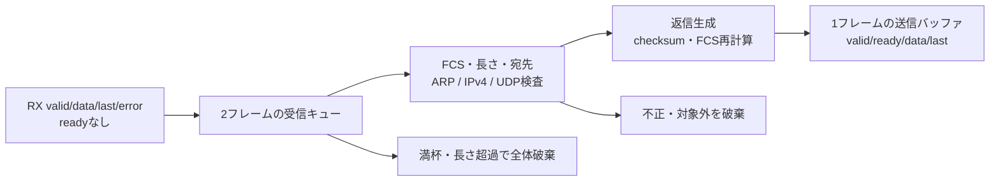

# Ethernet FCS・ARP・IPv4／UDPエコーIP

受信を停止できないバイト列からフレームを蓄積し、FCS・ヘッダー・宛先を検査してARP要求またはUDPエコーへ応答します。[ネットワークの検証手順](../../docs/method/network-verification.md)と、実際のCPUが応答を作る[ネットワークSoC](../local-network-soc/README.md)へつながる単体IPです。

## 入出力と処理



受信の`rx_valid`が1の立上りエッジごとに1バイトが到着します。空白サイクルは許しますが、`rx_last`までを1フレームとして扱います。`rx_error`は有効バイトとともに与え、そのフレーム全体のリンクエラーとして保持します。送信は`tx_valid && tx_ready`でのみ進み、停止中はvalid・data・lastを保持します。

RXはEthernet宛先MACの先頭からFCSの末尾までです。プリアンブル、SFD、IFG、MII／GMII／RGMII、PHY、オートネゴシエーションは含みません。TXのreadyも教材のフレームインターフェースであり、実配線へ送信し始めたEthernetを途中で停止できるという意味ではありません。

## 固定した対応範囲

| 項目 | 仕様 |
| --- | --- |
| 構成 | 最大96／128バイト。最小64バイト。長さはEthernetヘッダーとFCSを含む |
| 宛先 | MAC `02:00:00:00:00:01`、IPv4 `192.0.2.1`、UDPポート1234 |
| Ethernet | Ethernet II、ARP `0x0806`／IPv4 `0x0800`。ARPのみブロードキャスト宛先も受理 |
| FCS | 反転形多項式`0xedb88320`、初期値`0xffffffff`、最終反転、下位バイトから4バイト |
| ARP | Ethernet／IPv4、要求opcode 1、自IP宛て、送信元MAC整合。返信opcode 2 |
| IPv4 | version 4・IHL 5、TTLは正、UDP、フラグはDFのみ許可。全長・ヘッダーチェックサム検査 |
| UDP | 長さ8以上、IPv4全長との整合、宛先IP／ポート検査。受信チェックサム0は許可、それ以外は疑似ヘッダーも含め検査 |
| 返信 | MAC・IP・ポートの送受信元を交換、TTL 64、TOS 0、ID／DF・ペイロードを維持。チェックサムとFCSを再計算 |
| パディング | Ethernet本文が60バイト未満なら0で埋める。UDPペイロードへ混ぜない |
| 未対応 | VLAN、IPv4オプション・断片、IPv6、TCP、ARPキャッシュ、通常MTU、実ネットワークへの接続 |

UDPの奇数バイト末尾はチェックサム計算だけ0で補います。計算結果が0なら送信値を`0xffff`にします。[RFC 768](https://www.rfc-editor.org/rfc/rfc768.html)のUDPチェックサムと、[RFC 894](https://www.rfc-editor.org/rfc/rfc894.html)のEthernetパディングを、明示した限定構成で学ぶ例です。完全なホストやEthernet MACの規格適合を示すものではありません。

## 満杯と破棄の契約

先頭バイト時点で受信スロットがなければ、末尾まで破棄します。フレームの途中で空きができても、その途中から取り込みません。同じエッジで古い完全フレームを取り出せる場合は、そのスロットを新しい先頭に使えます。最大長を超えた場合も、部分的なフレームをキューへ公開しません。

キューの2枠と送信バッファの1枠を使い、送信を停止した5フレームの連続入力では先頭3件を返し、残り2件を破棄します。別ケースでは4件目の途中で送信を再開し、4件目は破棄したまま5件目を受理することを確認します。単なるバイト欠落ではなく、フレーム単位の破棄を照合します。

| カウンター | 内容 |
| --- | --- |
| `accepted` | 完全なフレームとしてキューへ公開した数。プロトコル検査前 |
| `full_drops`／`long_drops` | 先頭受信時の満杯、または受信中のサイズ超過でキューへ公開しなかった数 |
| `rejected` | 公開後、FCS・リンク・長さ・形式・宛先等の検査で破棄した数 |
| `transmitted` | TXの最終バイトが受理された返信数 |

リセットは途中のRX・キュー・TX・各カウンターを初期化します。末尾のないフレームへのタイムアウトや、フレーム境界自体の故障からの回復は対象外です。

## 自動判定と検出力

Pythonモデルは`struct`でヘッダーを組み立て、`zlib.crc32`でFCSを計算します。RTLのシフトレジスタやキュー状態を写していません。既知の`123456789`のFCS末尾`26 39 f4 cb`と、チェックサムの手計算ベクトルでもモデルを確認します。

[要求カタログ](requirements.json)は4要求・23観測目標です。通常ケースの成功ログだけを構成ごとに集計し、全目標を要求します。これは手続き的な機能カバレッジで、ネイティブcovergroup DBやコードカバレッジの計測とは別です。

| ケース | 確認内容 |
| --- | --- |
| directed | ARP、空／奇数／最大UDP、受信チェックサム0、計算結果0xffff、入力パディング除去 |
| reject | FCS・短過ぎ・リンク・宛先・形式・IP／UDPチェックサム・未対応ヘッダー・長過ぎ。その後の正常受信 |
| overflow／recover | RXを止めずに満杯にし、全体破棄・途中で空いた場合・次フレームの回復を確認 |
| reset-rx／reset-tx | 受信途中／送信停止中にリセットし、新しいフレーム列を確認 |
| random | 再現可能なペイロード・長さ・ID・ポート、受信の空白 |

| 変異 | 誤実装 | 期待する検出 |
| --- | --- | --- |
| 1 | 不正FCSを無視 | `NET_UNEXPECTED` |
| 2 | 返信UDPチェックサムの誤り | `NET_FRAME` |
| 3 | 奇数ペイロードの最終バイトを欠落 | `NET_FRAME` |
| 4 | TXの停止中に次のバイトへ進む | `NET_HOLD` |

コンパイル失敗、時間切れ、別の失敗ラベルを変異検出として採用しません。送受信件数・送信全バイト・破棄数・reset数・キューの排出も要求し、比較0件や未完了での合格を防ぎます。

## 実行と証跡

Python 3、Icarus Verilog、vvpを使い、リポジトリのルートから実行します。

```sh
python3 examples/local-network-echo/run.py --profile smoke --out artifacts/network-echo-smoke
python3 examples/local-network-echo/run.py --profile nightly --out artifacts/network-echo-nightly
```

2構成で、JUnitはsmoke 26件／nightly 30件です。nightlyはランダムseedを1→3、各seedのフレームを4→10へ増やします。`manifest.json`、`executions.json`、構成別`coverage.json`、ケースごとの入力・期待フレーム・長さの`.hex`、`vectors.txt`、VCD・ログを保存します。生成入力もハッシュへ含め、保存後の変更を検出します。[追加と再検証の記録](../../PROVENANCE.md#network-20261101)も参照してください。

回路は全フレームの組合せ検査・返信生成を含む学習用構成です。実機のクロック周波数、メモリ推論、面積、ラインレートを保証する実装ではありません。
