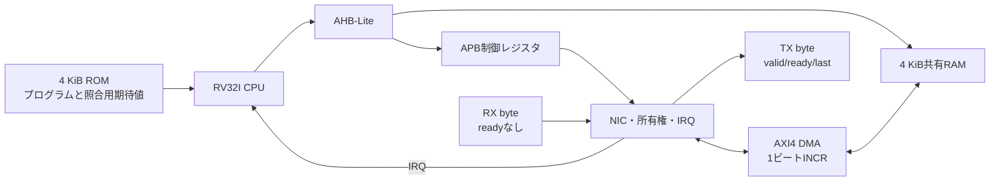

# CPU・DMA・Ethernet NICを接続したネットワークSoC

RV32I CPUがROMから起動し、NICの割り込みを受け、共有RAM上でARP／UDP応答を組み立てます。IPv4／UDPチェックサムとEthernet FCSも実際のCPU命令で計算し、送信DMAへ渡します。[単体エコーIP](../local-network-echo/README.md)と同じ限定プロトコルを、ハードウェアとソフトウェアの境界まで検証する例です。

## 接続と処理の順序



1. CPUがROM先頭の読み戻し、割り込み設定、NICのRUN許可を実行する。
2. NICが完全な受信フレームのFCS・ARP／IPv4／UDPを検査する。
3. 正常なフレームをRX RAMへDMA転送し、**最後のB応答を受けてから**RX_DONE／IRQを通知する。
4. CPUのハンドラーがSTATUSを保存しW1Cで解除する。RXバッファの所有権は保持する。
5. CPUがMAC・IP・ポートを交換し、ペイロードをコピーし、パディング・チェックサム・FCSを作る。
6. CPUが生成した全バイトをROMの独立期待値と比較し、TX_STARTを書く。
7. DMAが送信フレーム全体を読み込む。Rエラーが1件でもあれば送信しない。
8. TXの最後のバイトが受理されてからTX_DONE／IRQを通知する。CPUがRX_RELEASEを書いて次フレームへ進む。

ROMの期待値を応答の材料としてコピーしていません。[ファームウェア](firmware.py)の応答生成ループ、チェックサムとCRC-32の演算、生成後の比較ループをCPUが実行します。既存の[RV32Iコア](../local-riscv-iss/README.md)・[デコーダ](../local-riscv-decoder/README.md)と、[画像処理SoC](../local-image-soc/README.md)のAHBアダプター・ブリッジ・メモリを再利用します。

## メモリとバスの契約

| 領域 | 用途 |
| --- | --- |
| `0x0000–0x07ff` | ROM命令領域。Cコンパイラーなしで既存RV32Iアセンブラーから生成 |
| `0x0800–0x0fff` | ROMの照合用テーブル。長さ1ワード＋各返信のバイト値1ワードずつ |
| `0x1000` | RXバッファ。元の受信フレームをFCSまで保存 |
| `0x1400` | CPUが作るTXバッファ |
| `0x1ffc` | 成功`0x600d600d`／不一致`0xbad0bad0`の終了署名 |
| `0x40000000–0x400000ff` | APBのNICレジスタ |

RAM全体は`0x1000–0x1fff`です。1バイトを1個の32ビット整列ワードの下位8ビットに置き、RX DMAは上位24ビットも0として`WSTRB=1111`で書きます。CPUは整列LW／SWだけを使います。画像処理SoCの部分書込みとは別の配置契約です。

AHB-Liteは1件ずつのNONSEQ/SINGLE、APBはsetup/accessと待ち、AXI4はID 0・1ビートINCR・各方向1件までです。AXIのAW/W/BとAR/Rの独立した受理、データ保持、アドレス・LAST・応答を照合します。RAMモデルは1〜4ビートに対応しますが、このNICが発行するのは1ビートです。一般のバーストや多重未完了転送は[個別バス例](../README.md#バスレジスタアドレス)で学べます。

## APBレジスタと所有権

| オフセット | 名前 | 内容 |
| --- | --- | --- |
| `0x00` | CTRL | bit 0 RUN、bit 1 TX_START、bit 2 RX_RELEASE。通常の書込みは1／3／5 |
| `0x04` | STATUS | W1C: bit 0 RX_DONE、1 TX_DONE、2 DMA_ERROR、3 DROP。RO: bit 4 RX busy、5 TX busy、6 RX owned |
| `0x08`／`0x0c` | RX_PTR／TX_PTR | 初期値`0x1000`／`0x1400`。RUN前だけ変更可能 |
| `0x10`／`0x14` | RX_LEN／TX_LEN | FCS込みのフレーム長。RXはRO、TXは送信中の変更禁止 |
| `0x18` | DROP_COUNT | 満杯、サイズ超過、プロトコル検査で破棄した総数 |
| `0x1c`／`0x20` | RX_OK／TX_OK | 正常なRX DMA完了／最終TXバイトの受理数 |
| `0x24` | LAST_ERROR | 1: RX書込み応答、2: TX読出し応答のエラー |
| `0x28` | IRQ_MASK | STATUS下位4ビットの通知許可。ファームウェアは7で完了とDMAエラーを許可 |
| `0x2c` | RX_KIND | RO。1: ARP、2: UDP |

RUNはリセットまで保持し、途中の停止は受け付けません。ポインターは4バイト整列、最大フレーム分がRAM内に収まること、RX／TX領域が重ならないことを検査します。不正なレジスタ・操作はPSLVERRを返し、状態を変更しません。TX_STARTはRX所有中かつRX DMA完了後、TX長64〜MAX_FRAME、TX停止中だけ受理します。RX_RELEASEはRX所有中かつRX／TX停止中だけ受理します。TX_STARTとRX_RELEASEの同時指示は拒否します。

**割り込みの解除とバッファの返却は別操作です。** W1CでRX_DONEを消しても、新しいフレームでRAMを上書きしません。CPUの明示的なRX_RELEASEまで所有権を保持します。1個の所有中フレームと受信キュー2枠があり、5件の短い連続入力では先頭3件を処理し残り2件を全体破棄します。

イベントのセットは同じエッジのW1Cより優先し、複数イベントもORして保持します。DROPはカウンター反映時にセットします。RX／TXのDMAエラーは正常完了数に加えません。RXのエラーは全受信書込み応答、TXのエラーは全読出し応答を排出して通知します。RX RAMのロールバックは行いません。

## 自動判定と実行

| ケース | 確認内容 |
| --- | --- |
| arp-udp／boundaries | ARP・空／奇数／最大UDP、0xffffチェックサム、CPUによる応答生成と全バイト比較 |
| reject／overflow | 不正フレームの破棄、受信停止なしの満杯、所有権を維持した連続処理 |
| rx-error／tx-error | B／RへSLVERRを注入し、正常完了や部分的な送信を出さない |
| bus-errors | 非整列・上限の桁あふれ・領域重複・所有前の返却・未定義レジスタを拒否し、元のポインターで正常処理 |
| reset-rx／reset-dma-tx／reset-wire-tx | RX DMA・TX DMA・送信待ち中に全体リセットし、入力を巻き戻してROMから再起動 |
| random | 再現可能な長さ・ペイロード・ID・ポートと、バス／TXのランダムな待ち |

[要求カタログ](requirements.json)は4要求・14観測目標です。通常成功ケースの観測だけで構成ごとの達成を確認します。4種類の変異は、RXの早過ぎる完了`NET_SOC_RX_ORDER`、誤DMAアドレス`NET_SOC_AXI`、W1Cでの誤返却`NET_SOC_OWNERSHIP`、送信前の完了`NET_SOC_TX_ORDER`で検出します。

```sh
python3 examples/local-network-soc/run.py --profile smoke --out artifacts/network-soc-smoke
python3 examples/local-network-soc/run.py --profile nightly --out artifacts/network-soc-nightly
```

Python 3・Icarus Verilog・vvpを使います。最大96バイト・WAIT 0と、128バイト・WAIT 2の2構成で、JUnitはsmoke 34件／nightly 38件です。nightlyはランダムseedを1→3へ増やします。

送信全バイト、件数・破棄数・reset数、全DMAのアドレスと応答、RAM読戻し、ROMに一致するリタイア命令列、CPUのRAM読出し、終了署名を照合します。生成入力・期待値・ROMのハッシュ、`ram-readback.hex`、`retirement.log`、VCD・ログ・要求別観測を保存します。リセットケースのRAMとリタイアログは再起動後の実行分で、reset数は別に残します。証跡を[全体ランナー](../../tools/REGRESSION.md)から監査できます。

## 適用範囲

対応するフレーム、エンドポイント、未対応プロトコルは[単体IPの仕様](../local-network-echo/README.md#固定した対応範囲)と同じです。NIC内の共通codecは妥当性検査に使い、返信生成出力は接続していません。返信を作る主体はCPUです。

単一クロック、キャッシュ・OSなしのデジタルモデルです。全体リセットはCPU・NIC・バス・RAMを同時に初期化し、CPUへは2段で解除します。片側リセット、PHY、ネットワークへの実接続、性能、合成・物理特性、ネイティブcovergroup DB・コードカバレッジ、SoC全体のフォーマル証明は対象外です。CPUにはバスフォルト入力がないため、AHB ERRORはアクセスフォルト例外へ変換せず`bus_fault`で監視します。

[ネットワーク分野の検証手順](../../docs/method/network-verification.md)と[追加・再検証の記録](../../PROVENANCE.md#network-20261101)に、要求への分解と確認範囲をまとめています。
