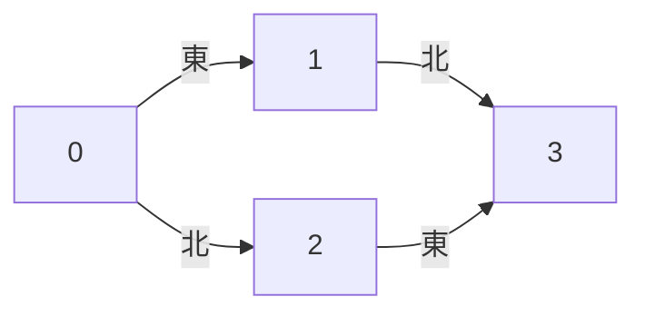

# 2×2 NoCの経路とバックプレッシャを検証する

4ノードを正方形に並べ、東、北の順に12ビットのパケットを届けます。各入力のFIFO深さを `buf1`（1個）と `buf2`（2個）に切り替え、混雑時にも受理済みのパケットが正しい出口へ1回届くことを確かめます。



## 回路と期待値

- ノード番号は `2*y+x` です。各パケットは宛先2ビット、送信元2ビット、通番4ビット、データ4ビットで構成します。自ノード宛はローカル出口へ届けます。西または南への移動が必要なパケットは注入時に破棄します。
- 各ルータには3入力FIFOと3出力保持段があります。同じ出力を要求した入力はラウンドロビンで仲裁し、サービス後は選ばれた入力の次に優先権を移します。受信側はリンク用FIFOの登録済み満杯フラグで流量を制御します。
- Pythonモデルはキューを使ってエッジ前の入力受付・リンク詰まりを計算します。TBは各行でこれらのピンを照合し、受理したパケットの宛先・送信元・通番・データを記録します。配信時に表から照合して消すため、誤配信、改変、余分な配信を区別できます。出口で停止中は有効信号と全データの保持も検査します。
- 全出口を開けて注入・配信が止まり、未配信が200サイクルを超えると失敗です。リセットでは未配信の表も破棄し、復帰後に新しいパケットを送ります。固定試験は自己宛、1・2ホップ、到達不能宛、複数流、下流閉塞、連続配信とリセットを通ります。

[要求カタログ](requirements.json)には経路、流量制御・先頭詰まり、有限時間での排出、リセットの13目標があります。`live/cyclic-drain` は本教材で同時に発生する複数の送信元の流れを観測します。配線は有向・単一VCで、任意の循環網のデッドロック自由性は証明対象外です。

## 変異と検出結果

1. 東リンクのデータ4ビットを0にする。期待データの比較で `MESH_DATA`。
2. ローカル出口で転送済みパケットの有効を残す。重複配信で `MESH_BP`。
3. ローカル出口の仲裁を止める。最初の単独パケットが排出期限を超えて `MESH_LIVE`。
4. 経路計算の宛先Xビットを反転する。配信先の比較で `MESH_ROUTE`。

## 実行と確認範囲

```sh
python3 examples/local-noc-mesh/run.py --out artifacts/noc-mesh-smoke
python3 examples/local-noc-mesh/run.py --profile nightly --out artifacts/noc-mesh-nightly
python3 -m unittest discover -s examples/local-noc-mesh/tests -v
```

2026-11-23にIcarus Verilogで2構成を実行しました。smokeは各構成で固定列、ランダム200反復×1 seed、変異4件の計6件です。nightlyは1000反復×3 seedとして各8件です。全体は12／16実行、JUnitはカバレッジ判定を含めて14／18件、各構成13／13目標、各4／4変異を検出しました。セルフテストは6件です。パケット単位の同期転送を扱い、独立クロック間の転送や物理リンクの符号化は対象外です。
