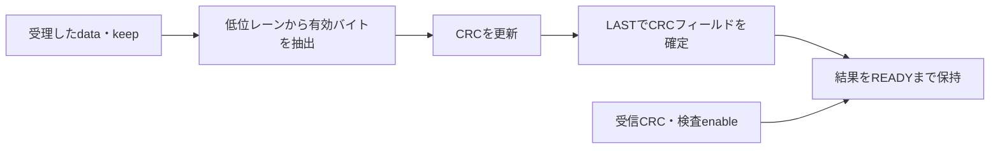

# CRCの生成・受信値の検査とパケット境界を検証する

32ビット入力の有効バイトをCRCへ取り込み、パケット末尾で8ビットのCRCフィールドと検査結果を返す教材です。CRC値は別出力で通知し、ペイロードを再送してCRCバイトを直列に挿入する回路ではありません。送信側のCRC生成と、受信CRC値との比較を同じエンジンで確認します。

## 計算とハンドシェイク



幅8、多項式0x07、入力・出力の反転なし、最終XORなしで、初期値0／0xFFを別構成にします。ビート内は低位バイトレーンから取り込み、各バイト内はMSBから計算します。空パケットとTKEEP=0も扱います。

| 条件 | 動作 | 独立した照合 |
| --- | --- | --- |
| 部分・疎なTKEEP | 有効レーンだけ計算 | 抽出したバイト列の多項式除算 |
| 検査enable=1 | 算出値と受信CRCを比較 | 正常CRCと1ビット破損CRC |
| 出力待ち | CRC・error・VALIDを保持 | 毎クロックの比較 |
| パケット終了・リセット | 次の計算を初期値から開始 | 連続パケット・途中破棄・復帰 |

Pythonはメッセージ全体の整数を多項式除算し、RTLの逐次バイト・ビット更新を写しません。初期値0では`123456789`のCRC=0xF4も確認します（[CRC RevEngのCRC-8/SMBUS定義](https://reveng.sourceforge.io/crc-catalogue/all.htm#crc.cat.crc-8-smbus)）。初期値0xFFは本教材の比較用設定で、SMBus全体を検証した結果ではありません。

## 実行

```sh
python3 examples/local-packet-crc/run.py --out artifacts/packet-crc
python3 examples/local-packet-crc/run.py --profile nightly
python3 -m unittest discover -s examples/local-packet-crc/tests -v
```

[共通手順](../local-common/README.md)を使います。各構成8目標、多項式・TKEEP無視・パケット間初期化・検査結果の4変異です。smoke30パケット、nightly200パケット×3 seedへ固定ケースを加えます。JUnit14／18件、確認5件。CRCの誤検出確率や任意の誤り検出能力の評価、Ethernetのフレーム全体の検証は含みません。
