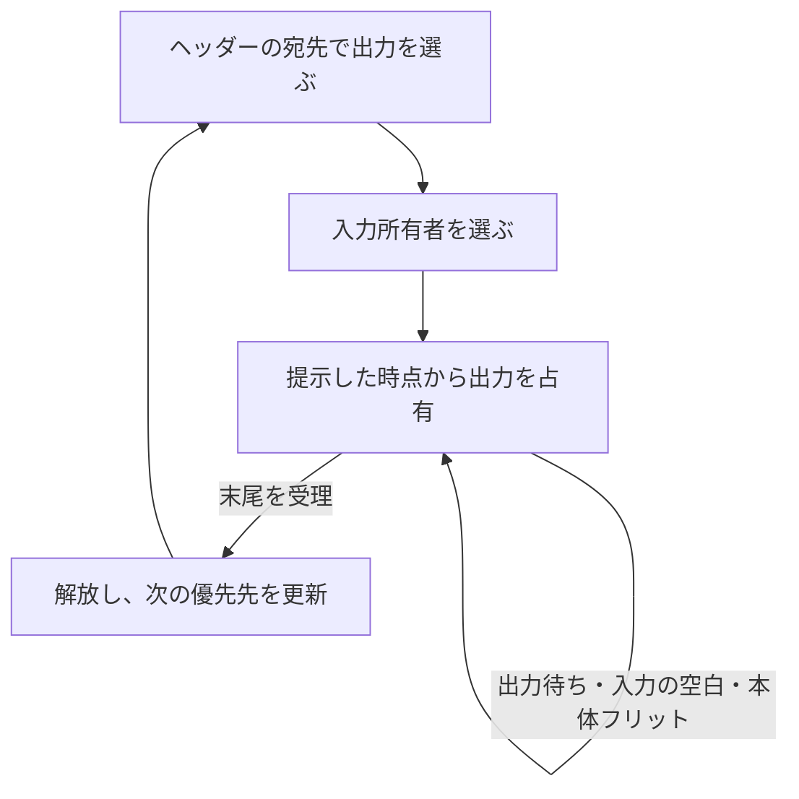

# パケット単位の仲裁と経路保持を検証する

2入力・2出力のパケットスイッチです。既存の[アービタ](../local-arbiter/README.md)と[クレジット通信](../local-credit-link/README.md)に加え、ヘッダーで選んだ経路、パケットの途中で入力が途切れた場合の出力占有、末尾が受理された後の仲裁を確認します。[gem5 Garnetの経路選択・スイッチ仲裁の説明](https://www.gem5.org/documentation/general_docs/ruby/garnet-2/)を分野の参照先としていますが、Garnetの構成・プロトコル・ソースを取り込んだものではありません。

## 経路と占有の規則



各入力は`valid/ready`、`data`、`dest`、`last`を持ちます。最初のフリットの`dest`が出力0／1を選びます。先頭が受理された後は経路を保持し、本体・末尾の`dest`は無視します。1フリットのパケットは先頭と末尾を兼ねます。

同じ出力への要求はパケット単位のラウンドロビンで仲裁します。リセット直後は入力0を優先し、末尾の受理時にもう一方を次の優先先にします。フリットごとに優先先を変えません。別の出力への転送は同時に進められます。

ヘッダーは、出力へ**提示した時点**で占有します。まだ受理されていなくても、後から到着した競合入力へ切り替えません。占有中は、入力が途切れても他のパケットを割り込ませません。末尾が`valid && ready`で受理されるまで占有を保ちます。

送信元は、提示したフリットが受理されるまで`valid`と全ペイロードを保持します。単一クロック、バッファなしの組合せ転送で、出力の`ready`が入力へ伝わります。リセットは同期・Low有効で、占有・経路と途中パケットを取り消し、送信元も次のヘッダーから再開します。

## 実行と判定

Python 3.10以上とIcarus Verilogを用い、リポジトリのルートで実行します。

```sh
python3 examples/local-packet-switch/run.py
python3 examples/local-packet-switch/run.py --profile nightly
python3 -m unittest discover -s examples/local-packet-switch/tests -v
```

`width8`と`width16`はフリットのデータ幅が8／16ビットです。ソフトウェアの占有・仲裁モデルで受理先と転送順を決め、RTLの全有効出力を照合します。テストベンチにも、受理した入力をヘッダーの宛先別に記録し、出力のデータと末尾を比較するスコアボードを置きます。期待データをDUTの内部経路から作りません。

固定シナリオだけで、両出力の同時転送、同一出力の競合、先頭・末尾の待ち、遅れて来る競合入力、パケット内の入力の空白、本体の宛先変更、途中リセットを含む14目標に到達します。ランダムケースでは両入力の宛先・長さ・データ・間隔と出力の待ちを変えます。終了時の未完了・未照合も検査します。

| 変異 | 誤り | 検出ラベル |
| --- | --- | --- |
| 1 | パケットによる出力の占有を無視する | `PACKET_FLOW` |
| 2 | 同時競合で入力0を常に優先する | `PACKET_FLOW` |
| 3 | 本体の宛先で経路を変える | `PACKET_FLOW` |
| 4 | 全フリットを末尾として出力する | `PACKET_DATA` |

セルフテスト7件には、パケット単位の受理順、ヘッダー提示後の競合、本体の経路保持、途中リセットを含みます。通常ケースへの`--demo-bug 1..4`も失敗します。JUnitはsmoke 14件／nightly 18件で、証跡の形式は[共通手順](../local-common/README.md)に従います。

2026-10-31に両構成のsmoke／nightly、7セルフテスト、全構成・変異0〜4のVerilator lint、両構成のYosysによる読込み・`proc; opt; check -assert`を確認しました。

## 確認範囲

2×2スイッチ単体で、仮想チャネル、入力FIFO、クレジット、メッシュ接続、マルチキャスト、CRC、再送はありません。有限長パケットが末尾まで供給され、受信側が転送を再開する条件で次の仲裁へ進みます。入力の無期限停止に耐える公平性や、ネットワーク全体のデッドロック回避を証明した例ではありません。再送は[別のリンク例](../local-retry-link/README.md)を参照してください。

## ネイティブ機能カバレッジ

[Verilatorによる計測例](../local-functional-coverage/README.md)で、実際のcoverpoint・crossとDBを確認できます。各構成14 binの全ヒットと、独立したイベント集計との件数一致を要求します。既存の`COVER`目標とは別の計測計画です。

```sh
python3 examples/local-functional-coverage/run.py --example packet-switch
```
