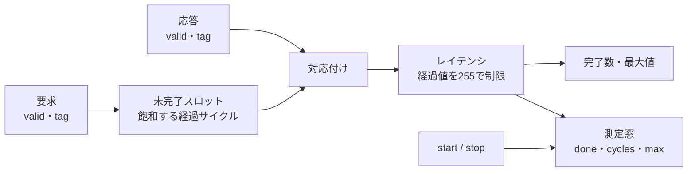
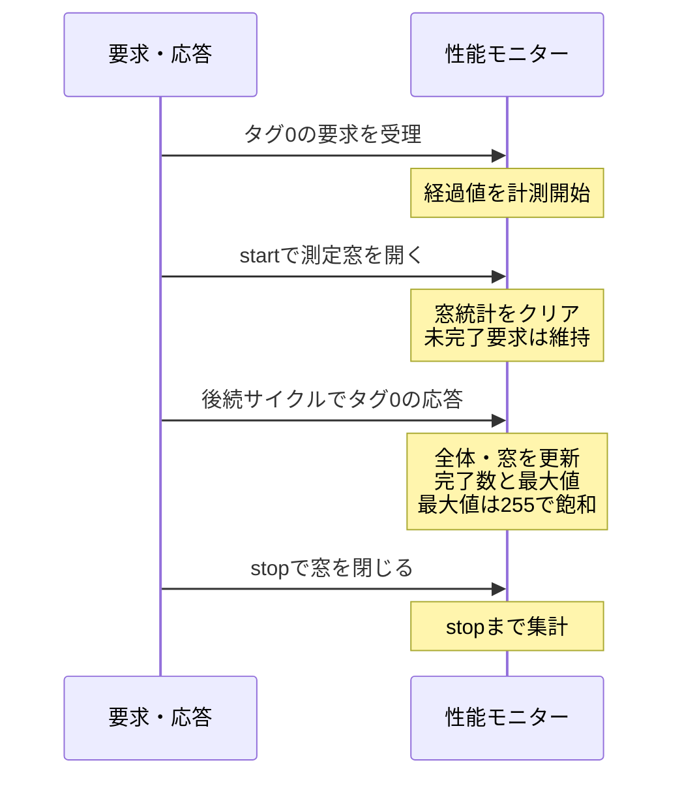

# 未完了数・レイテンシ・測定窓を性能モニターで検証する

タグ付き要求と応答を追跡し、未完了数、完了数、レイテンシの最大値、測定窓の完了数と経過サイクルを数える回路です。性能の平均値だけでなく、最大待ち、同時未完了、測定窓の境界、不正な応答を分けて確認します。

## 測定の関係



図はタグで対応付ける測定の構成です。バスのプロトコルや仲裁方式を再現した図ではありません。

## 仕様

- 最大`SLOTS`件の要求を同時に保持します。有効タグは0〜SLOTS−1です。範囲外タグの要求は受理せず、同じタグが未完了の間も`req_ready=0`で止まります。
- 応答が未完了タグと一致すれば、要求の受理から応答の受理までのサイクル差を計測し、完了数と最大値を更新します。応答と要求が同じサイクルでも、更新前の未完了状態で判定します。
- `total_done`と`total_max`はリセットまで保持します。`total_max`と`window_max`は8ビットで、255サイクル以上は255へ飽和します。
- `start`は測定窓の`window_done`・`window_cycles`・`window_max`と`error`をクリアし、窓を開きます。同じサイクルの応答は全体統計だけへ加算し、窓へは加算しません。
- `stop`はそのサイクルまで窓へ加算し、次のサイクルから閉じます。`start`と`stop`が同時なら`start`を優先します。
- 未完了でないタグへの応答は`error=1`にし、`start`またはリセットまで保持します。
- `window_cycles`は窓が開いているサイクル数です。完了数だけで帯域を判断せず、経過サイクルと併記します。

## 測定窓の境界と長いレイテンシ

要求から応答までの全期間をレイテンシとし、測定窓内で完了した要求を窓統計へ含めます。要求の発行が窓の外でも、応答が窓の対象サイクルに入れば加算します。



| 同時に起きる入力 | 要求・応答の扱い | 窓・errorの扱い |
| --- | --- | --- |
| startと有効応答 | 全体の完了数・最大値へ反映 | 窓統計は0、errorも0。窓には未加算 |
| 開いている窓でstopと有効応答 | 応答を完了 | このサイクルを窓へ含め、その後閉じる |
| startとstop | 未完了要求は維持 | startを優先し、新しい窓を開く |
| 同じ未完了タグへの要求と応答 | 応答を完了し、要求はready=0で未受理 | 新しい要求は次の受理機会まで待つ |
| 範囲外タグの応答（start=0） | 完了数を増やさない | errorをセットし保持 |

RTLは要求ごとの経過値を飽和させ、Pythonは幅制限のない時刻差を255で制限して照合します。窓の完了数／経過サイクルは取引のスループットであり、転送バイト数を含む帯域ではありません。

## 独立した期待値と構成

Pythonはスロットの開始時刻と窓の状態を保持し、RTLのカウンター更新順を写さずに各サイクルの期待値を求めます。固定シナリオは連続要求、全スロット使用、タグの入替え、長い待ち、不正応答、窓の開始・停止、リセット復帰を含みます。

| 構成 | 同時未完了 |
| --- | --- |
| `slots2` | 2 |
| `slots4` | 4 |

[要求カタログ](requirements.json)は4要求・13目標です。ランダム刺激は現在の未完了タグを参照して応答を選ぶため、合法な完了と不正な応答の両方を作ります。

## 意図的な誤実装

| 番号 | 誤実装 | 期待する検出ラベル |
| --- | --- | --- |
| 1 | 最大レイテンシを更新しない | PERF_LATENCY |
| 2 | 未完了でない応答を記録しない | PERF_ERROR |
| 3 | `start`で窓の完了数をクリアしない | PERF_WINDOW |
| 4 | 応答後も未完了スロットを解放しない | PERF_COUNT |

変異4は`req_ready`と未完了数の不一致で検出します。負の試験の観測は通常の13目標へ加算しません。

## 実行

```sh
python3 examples/local-performance-monitor/run.py --out artifacts/perf-monitor
python3 examples/local-performance-monitor/run.py --profile nightly --out artifacts/perf-nightly
python3 -m unittest discover -s examples/local-performance-monitor/tests -v
```

smokeは200操作×1 seed、nightlyは1000操作×3 seedを固定シナリオへ加えます。各構成7／9件、全体14／18件のJUnitで、確認テストは7件です。

## 確認範囲

2026-10-28にPython 3.14.7、Icarus Verilog 14.0開発版で両構成のsmoke／nightly、13目標、4変異、確認5件が成功しました。

2026-10-29のレビュー修正後も両構成のsmoke／nightlyが成功し、確認テストは7件です。再発防止ケースと図表を追加し、実行したソースハッシュを現行ファイルと照合しています。

レイテンシはシミュレーションのクロックサイクルであり、実周波数での時間や帯域を保証しません。最大値は255で飽和するため、それ以上の長さは区別できません。完了数と窓サイクル数は16ビットで65536で折り返します。バスの帯域制限、仲裁、QoS、クロック周波数、STA、シリコン実測は対象外です。
