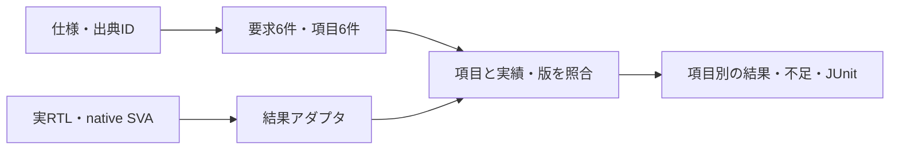

# 検証項目表と実行結果を自動照合する

割り込みコアの[短い仕様](spec.md)から、出典付きの6要求と6検証項目を[計画JSON](plan.json)へ記録し、実際の[SVA例](../local-sva/README.md)の結果を対応付けます。独立した[`verification_plan.py`](../../tools/verification_plan.py)で、対応漏れ、予定テストの実績の欠落、比較・到達不足、一覧に載った証跡の変更や古い版を拒否します。

## 計画から判定まで



| 対応 | 本例の定義 |
| --- | --- |
| 仕様の出典 | `spec.md`のS01〜S06 |
| 要求 | SET-WINS、SET-ONLY、CLEAR-ONLY、HOLD、RESET、IRQ |
| 検証項目 | TI01〜TI06。各要求へassertと2つのnative coverを対応付ける。 |
| 実行単位 | `irq1`構成の`sva-functional`。子の正常ケース群を一つにまとめる。 |
| 合格 | 子の全計画が成功し、正常ケースのSVAと12 cover、版・項目の対応が一致する。 |

この6項目は、基本の6アサーションを確認する計画です。[仕様書から項目を作る実例](../../docs/method/spec-to-test-items-walkthrough.md)の8項目表が要求する、全組合せ・順序を自動判定する計画とは区別します。

| 本例の項目 | 条件 | 期待値と観測 |
| --- | --- | --- |
| TI01：SET-WINS | リセット解除中、イベントとクリアを同時受理 | 更新後PEND=1を次のSVAサンプルで確認する。 |
| TI02：SET-ONLY | リセット解除中、イベントだけを受理 | 更新後PEND=1を次のSVAサンプルで確認する。 |
| TI03：CLEAR-ONLY | リセット解除中、クリアだけを受理 | 更新後PEND=0を次のSVAサンプルで確認する。 |
| TI04：HOLD | リセット解除中、イベントもクリアもない | PENDの保持を次のSVAサンプルで確認する。 |
| TI05：RESET | PENDを保持しているとき同期リセットを受理 | 更新後PEND=0と、そのリセットの前件・結果を確認する。 |
| TI06：IRQ | リセット解除中の安定した観測 | 同じサンプルでIRQ=PEND AND IRQ_EN。マスク中・許可中の保持状態にも到達する。 |

アダプタは子の固定計画・ビルド・ソースハッシュを検査し、正常ケースの実ログとnative DBを再読込します。`checkers`の回数は、成功したSVA実行と対応する状態更新の前件・結果、IRQのマスク中／許可中のnative coverから導いた確認回数です。ツール内部のassert評価回数ではありません。変異・刺激不足の診断は正常実績へ加えません。

## 実行

POSIX、Python 3.10以上、Verilator 5.052、C++20コンパイラーとmakeを用意します。UVMライブラリは不要です。

```sh
python3 examples/local-plan-traceability/run.py --out artifacts/plan-demo
python3 examples/local-plan-traceability/run.py --profile nightly --out artifacts/plan-nightly

# 正規化した証跡は、汎用ツールだけで再確認できる
python3 tools/verification_plan.py \
  --root . --plan examples/local-plan-traceability/plan.json \
  --evidence artifacts/plan-demo/evidence.json --out artifacts/plan-check
```

親ランナーのsmoke・nightlyは、子の実行、アダプタ、正常照合と11診断を合わせてJUnit 14件です。子SVAのJUnitはsmoke 10件／nightly 12件で、親ランナーとは別集計です。汎用ツールの正常照合は6項目と整合性の7判定になります。

## 意図した不足・変更を拒否する

予定テストの欠落・重複、比較0件、チェッカー確認0件、必要なcoverの不足、異なる計画の版、仕様・RTL等の版の変化、別構成の実績、未対応の要求追加、元のログ・DB等の変更、別テストからのchecker確認とgoal到達の持寄りを診断します。各診断は、照合コマンドが終了コード1を返し、予定した理由を記録することを要求します。

`evidence.json`に正規化した実績、`irq/`に子の証跡、`plan/report/`に正常照合、各診断ディレクトリに変更内容と拒否理由を保存します。ソースと実行証跡のハッシュを保持し、出力先は上書きしません。

## ツールが確かめること・確かめないこと

| 確かめること | 確かめないこと |
| --- | --- |
| 計画のハッシュと`sources`の現物の一致 | 証跡JSONの`results`の値が実際の実行から来たこと |
| 要求・項目・テスト・構成の対応と、`results`の予定との一致 | 実行そのもの。ツールはシミュレーターを起動しない |
| 比較件数、checker・goalの回数、状態 | checker・goalの回数が要求を検査した回数であること |
| `artifacts`に載ったファイルの存在とハッシュ | 載っていないファイル。一覧は1件以上あればよく、中身や`results`との対応は問わない |

`artifacts`の一覧は実行と結び付いていません。手入力の`results`と無関係なファイル1つでも、汎用ツールの照合は合格します。実行に結び付けているのは本例のアダプタ`run.py`で、子の固定計画・ビルド・ソース・ログ・DBを検査してから証跡を作ります。汎用ツールだけの合格を、実行の証明として扱わないでください。

汎用ツールの形式と適用上の責任は[手法書](../../docs/method/verification-plan-automation.md)を参照してください。対応表・アダプタの意味の妥当性、要求の抽出漏れ、人の承認までを自動的に保証するものではありません。

追加時の実行と最終補強の確認は[2026-10-31の記録](../../PROVENANCE.md#verification-workflow-expansion-20261031)を参照してください。
