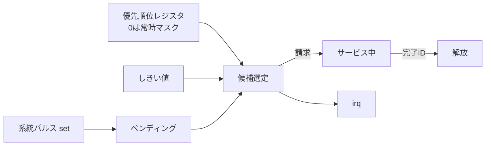
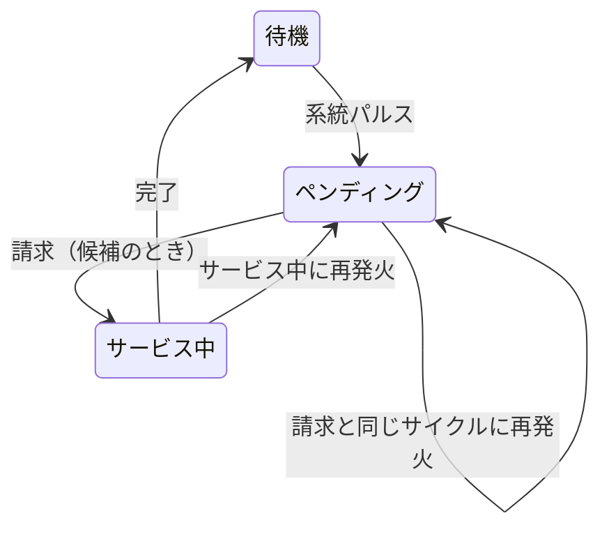

# 優先順位つき割り込みコントローラの請求と完了を検証する

4系統または6系統の割り込みを受け取り、優先順位・しきい値・請求（claim）・完了（complete）で1系統ずつ処理するPLIC風のコントローラを扱う教材です。割込線の点灯だけでなく、請求したID、サービス中の保持、取りこぼしを別々のラベルで判定します。

## 回路の契約



| 条件 | 要求する動作 |
| --- | --- |
| 候補 | ペンディングで、サービス中でなく、優先順位がしきい値より**大きく**、優先順位が0でない |
| 請求（読み出し） | 最も優先順位の高い候補のID（1始まり）を返し、ペンディングを消してサービス中へ移す。同順位なら小さいID |
| 候補なしの請求 | ID 0を返し、状態を変えない |
| 完了（書込み） | サービス中のIDだけを解放する。0・範囲外・サービス中でないIDは無視 |
| 請求と同じサイクルの再発火 | 新しい発火は消さない。完了後は再び請求できる |
| `irq` | 候補が1つ以上ある間だけ立つ |

リセットは優先順位・しきい値・ペンディング・サービス中をすべて0に戻します。

## 請求と完了の状態



請求読み出しのIDは更新前の状態から決まります。同じサイクルにその系統の発火があっても、返すIDは変わらず、発火は消えません。サービス中に同じ系統が再発火すると、ペンディングだけが立ち、次回の請求まで待ちます。

## 独立した期待値と構成

Pythonは優先順位・しきい値・ペンディング・サービス中を保持し、毎サイクルの読み出し値・`irq`・2本の状態ピンをRTLと別に求めます。固定シナリオは請求と解放、同順位の請求、しきい値と等しい優先順位の拒否、優先順位0の常時拒否、請求中の再発火、無効な完了（0・範囲外・サービス中でない）、NS数の外の系統パルス、リセット復帰を含みます。

| 構成 | 系統数 |
| --- | --- |
| `n4` | 4系統（5・6系統目のパルスは無視） |
| `n6` | 6系統 |

[要求カタログ](requirements.json)は4要求・12目標です。ペンディングとサービス中はピンとして毎サイクル比較するため、読み出しの検査漏れがあっても状態のずれを先に捕まえます。

## 意図的な誤実装

| 番号 | 誤実装 | 期待する検出ラベル |
| --- | --- | --- |
| 1 | `irq`がしきい値以上で立つ（候補は正しくても余計に点灯） | PLIC_IRQ |
| 2 | 完了がサービス中ではなくペンディングを消す | PLIC_STATE |
| 3 | 同順位の請求で大きいIDを返す | PLIC_CLAIM |
| 4 | 請求と同じサイクルの再発火を消す | PLIC_STATE |

変異2と4はペンディングまたはサービス中のピン比較で先に検出するため、どちらも`PLIC_STATE`です。判定は状態ピン→`irq`→読み出し値の順で行い、検出ラベルを決定的にしています。

## 実行

```sh
python3 examples/local-plic/run.py --out artifacts/plic
python3 examples/local-plic/run.py --profile nightly --out artifacts/plic-nightly
python3 -m unittest discover -s examples/local-plic/tests -v
```

smokeは200操作×1 seed、nightlyは1000操作×3 seedを固定シナリオへ加えます。各構成6／8件、全体12／16件の回帰に構成別の目標ゲート2件を足したJUnitです。

## 確認範囲

2026-11-22にPython 3.14.7、Icarus Verilog 14.0開発版で両構成のsmoke（回帰12件・JUnit 14・目標12/12・変異4/4検出）とnightly（回帰16件・JUnit 18）が成功し、セルフテスト9件も成功しました。

この教材は実際のPLICやAIAの仕様には対応しません。コンテキストは1つだけ、優先順位の書込みは1回で全系統、ベクトル割り込みのレベル／エッジ設定、UARTのような個別ソース周辺機能、マルチコンテキストの仲裁、割り込み遅延の実測は対象外です。
