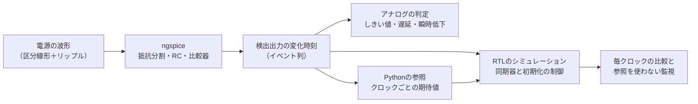

# 電源の立上りとパワーオンリセットを、SPICEとRTLをつないで確かめる

電源が立ち上がるとき、瞬間的に下がるとき、いったん切れて入り直すときに、リセットが正しく出て正しく外れるかを確かめる例です。電源と検出回路は[固定版のngspice](../../tools/ENVIRONMENT.md#ngspiceとspice協調例)で解き、検出回路の出力が変わる時刻をRTLのシミュレーションへ渡します。RTLは、リセットの同期器と、リセットが外れた後の初期化の順序を持つ小さな制御回路です。

回路の素子の値、しきい値、時間は、この教材のために決めた架空の値です。検出回路は抵抗分割・RC・比較器を式で表した動作モデルで、実際のプロセスのトランジスタやPDKは使っていません。実際のリセットICや電源監視回路の特性を示すものではありません。

## 全体の流れ



SPICEを先に解いてから、その結果をRTLへ渡します。[RC電圧制御の例](../local-spice-cosim/README.md)のように両方を同じ時刻で進める方式にしなかったのは、この回路ではデジタル側からアナログ側へ戻る信号がないからです。検出出力は電源の波形だけで決まるので、先に解いても結果は同じで、RTL側はIcarusだけで動かせます。デジタル側が電源を制御する回路（電源スイッチの制御など）には、この方式は使えません。

## アナログ側：電源と検出回路

[`por.cir.in`](por.cir.in)が回路の雛形です。

- 電源`vdd`は区分線形の電圧源で、遅いランプの場面だけ、正弦波のリップル（振幅30 mV、20 kHz）を直列に足します。
- 抵抗分割（`R1`・`R2`）が電源を半分にし、`C1`とのRCが分割点`vdiv`の変化を遅らせます。
- 比較器は、利得2000（1/V）の滑らかな関数で、自分の出力`det`を入力へ戻してしきい値を動かします（ヒステリシス）。出力は1 kΩと1 nF（1 µs）のRCを通ります。比較器の基準電圧は、電源に依らず常に正しいと仮定しています。
- `det`が0.5を横切る時刻を、検出出力`pwr_ok`の変化として取り出します。これは理想のバッファーで2値にする、という仮定です。

構成は2つで、アナログとデジタルの値を組にしています。

| 構成 | 分割点の時定数 | しきい値（`vdiv`、立上り／立下り） | 電源でのしきい値 | 同期器の段数 | 待ちクロック数 | キャリブレーションの時間切れ |
| --- | --- | --- | --- | --- | --- | --- |
| `tau10-sync2` | 10 µs | 0.80／0.70 V | 1.60／1.40 V | 2 | 4 | 8クロック |
| `tau20-sync3` | 20 µs | 0.83／0.67 V | 1.66／1.34 V | 3 | 2 | 5クロック |

電源の公称値は1.8 V、クロックは250 kHz（周期4 µs）です。

### 解析で分かる値

[`model.py`](model.py)は、素子の値から次の量を式で求め、ngspiceの結果と比べます。分割比を`k`、分割点の時定数を`τ`、出力の時定数を`τo`、`vdiv`の立上り・立下りのしきい値を`Vr`・`Vf`、電源の公称値を`V`とします。

| 量 | 式 | `tau10-sync2` | `tau20-sync3` |
| --- | --- | --- | --- |
| 急な立上りから検出までの遅延 | `τ·ln(kV/(kV−Vr))`以上、それに`τo·ln2`を足した値以下 | 21.97〜22.67 µs | 51.08〜51.77 µs |
| 深さ`Vd`の瞬時低下がリセットになる幅の境界 | `τ·ln((kV−kVd)/(Vf−kVd))`（`kVd`が`Vf`以上なら、どれだけ長くてもリセットにならない） | 1.0 Vで6.93 µs | 1.0 Vで17.11 µs |
| リセットの最短の幅 | `τ·ln((kV−Vf)/(kV−Vr))` | 6.93 µs | 23.79 µs |

遅延の下限は、分割点が立上りのしきい値に届く時刻です。比較器の出力はそこから`τo`のRCを通りますが、出力が上がり始めるとヒステリシスがしきい値を下げるので、単純なRCの遅れ（`τo·ln2`）より早くなります。そこで、この2つの値のあいだにあることを判定にしています。

リセットの最短の幅は、この回路の大事な性質です。いったん検出出力が下がると、分割点が立下りのしきい値から立上りのしきい値まで上り直すまで、出力は戻りません。そのため、瞬時低下がどれだけ境界ぎりぎりでも、リセットのパルスはこの幅より短くなりません。2構成とも1クロック（4 µs）より長いので、アナログ側が作るパルスは必ずクロックをまたぎます。ヒステリシスを0にすると、この保証はなくなります。

### 判定と許容誤差

| 判定 | ラベル | 許容の値と、その理由 |
| --- | --- | --- |
| 測定値がそろっていて有限、イベントが低から始まって交互 | `ANALOG_MEASURE` | 許容なし |
| 遅いランプの上りと下りで、イベントがちょうど2個 | `ANALOG_CHATTER` | 許容なし。リップルで何度も切り替わらないこと |
| 検出が「良」になる前に、電源が立上りのしきい値に届いている | `CROSS_EARLY` | 10 mV＋リップルの振幅。直前の`5τ`の区間の電源の最大値で見る |
| イベントの時刻の`vdiv`と電源が、しきい値に合う | `ANALOG_THRESHOLD` | `vdiv`は5 mV（比較器の利得の逆数の2倍で1 mV、傾き×出力の遅れで最大1 mV、残りは余裕）。電源は10 mV＋リップルの振幅 |
| ヒステリシスの幅（上りと下りの`vdiv`の差） | `ANALOG_HYSTERESIS` | 5 mV。2つのしきい値のずれは同じ向きに出るので、幅の誤差は個々より小さい |
| 急な立上りからの遅延が、上の範囲に入る | `ANALOG_DELAY` | 範囲の両側に0.2 µs（ソルバーの刻みの2倍）と、電源の立上りの0.1 µs |
| リセットのパルスが最短の幅以上 | `ANALOG_PULSE` | 0.2 µs |
| 瞬時低下ごとの結果（リセットになる／ならない）が、解析の分類と合う | `ANALOG_BROWNOUT` | 境界から0.5 µs以内（リセット側は`τo·ln2`も足す）の幅は分類しない |
| ソルバーの設定を変えても、イベントの時刻が動かない | `ANALOG_SETTINGS` | 0.2 µs（刻みの2倍） |

測った値は次のとおりです（手元のmacOSでの値。OSで最後の桁が違いうるので、判定にはこの値ではなく上の許容を使います）。

| 量 | `tau10-sync2` | `tau20-sync3` |
| --- | --- | --- |
| 急な立上りからの遅延 | 22.66 µs | 51.55 µs |
| 遅いランプでの`vdiv`（上り／下り） | 0.7996／0.7003 V | 0.8293／0.6708 V |
| そのときの電源（リップルを含む） | 1.619／1.379 V | 1.691／1.307 V |
| 瞬時低下の場面でのリセットの幅 | 11.4、73.8、73.8 µs | 27.8、153.0、153.7 µs |
| 設定を変えたときのイベントの時刻の動き（最大） | 7 ns | 65 ns |

ソルバーの設定は、最大刻み0.1 µs、`reltol=1e-5`、Gear法（2次）に固定しています。設定の確認では、瞬時低下の場面を、刻みを半分にした設定と、台形法で`reltol=1e-6`にした設定で解き直します。

## デジタル側：同期器と初期化の制御

RTLは3つのモジュールです。

- [`por_reset_sync.sv`](rtl/por_reset_sync.sv)：`pwr_ok`が下がると、クロックを待たずにリセット`rst_n`を出します。`pwr_ok`が上がった後は、`STAGES`個のクロックを数えてから、クロックの立上りで`rst_n`を外します。
- [`por_init_ctrl.sv`](rtl/por_init_ctrl.sv)：リセットが外れると、`WAIT`クロック待ち、ストラップ入力`strap`を1回だけ`cfg`へ取り込み（`cfg_load`）、キャリブレーションを要求します（`cal_start`）。`CAL_TIMEOUT`クロック以内に`cal_done`が来れば`ready`、来なければ`init_fail`になり、次のリセットまでそのままです。`por_flag`はリセットのたびに1になり、リセットが外れているあいだの`flag_clr`でだけ0になります。
- [`por_sequence.sv`](rtl/por_sequence.sv)：上の2つをつなぎます。

守ること（要求）は次の7つです。

| 要求 | 内容 |
| --- | --- |
| `POR-DETECT` | 検出回路が、設計した電源の値・ヒステリシス・遅延で切り替わり、リップルのある遅いランプで何度も切り替わらない |
| `POR-BROWNOUT` | 瞬時低下は、最短の幅以上のリセットを1回出すか、何も出さないかのどちらかで、その境界が分割点のRCで決まる |
| `POR-RELEASE` | リセットは、電源が立上りのしきい値に届いた後に、クロックの立上りで、決めたクロック数の後に外れる |
| `POR-REINIT` | 検出出力が下がれば、どの状態でも、どんな幅のパルスでも、すべてのレジスタがすぐにリセット値へ戻る |
| `POR-SEQUENCE` | 待ち、ストラップの取り込み、時間切れつきのキャリブレーションの順に進み、その後でだけ`ready`になる |
| `POR-FLAG` | `por_flag`は、リセットのたびに立ち、リセットが外れているあいだの消去の要求でだけ消える |
| `POR-SOLVER` | 検出のイベントが、ソルバーの刻みや積分法に、刻み2つ分を超えて依存しない |

「瞬時低下で中途半端な状態にならない」ことは、2か所で確かめます。アナログ側では、パルスの最短の幅と、瞬時低下ごとの「リセットになる／ならない」の分類です。デジタル側では、検出出力が下がった1 ns後に、出力と内部のレジスタ（同期器の段、状態、カウンター）がすべてリセット値であることを、テストベンチが直接見ます。

### 期待値の作り方

クロックごとの期待値は[`model.py`](model.py)の`expect`が作ります。回路のようなフリップフロップや状態遷移としては書かず、検出出力が上がるたびに、時刻の式で区間を決めます。

- `rst_n`が上がるクロックは、検出出力が上がった後の`STAGES`個目のクロックです。そのクロックまでに検出出力が下がっていれば、リセットは外れません。
- 制御回路が動き始めるのは、その次のクロックからです。そこから`WAIT`個目のクロックの後に`cfg_load`が見え、次のクロックで`cfg`が決まり、その後の`CAL_TIMEOUT`クロックのうち最初に`cal_done`が1だったクロックで`ready`になります。
- 検出出力が下がった時刻より後の比較点は、すべてリセット値です。

セルフテストには、同じ動作をフリップフロップとして1クロックずつ進める3つ目の実装があり、手で書いたパルスの場面と、ランダムな60本のイベント列で、`expect`と全クロック一致することを確かめます。

### テストベンチ

[`por_tb.sv`](tb/por_tb.sv)は、検出出力のイベントをその時刻（ns単位）のまま入れ、デジタルの入力をクロックごとに与え、各クロックの立上りの1900 ns後に全出力を期待値と比べます。イベントは、クロックの立上りと比較点から50 ns以内には置きません（近いものは50 ns後ろへずらします）。同じ時刻のイベントの実行順に結果が依らないようにするためです。クロックの位相は場面ごとに変えます。

参照を使わない監視も入れています。

| ラベル | 検査 |
| --- | --- |
| `POR_STATE` | 全出力（`rst_n`、`cfg_load`、`cal_start`、`ready`、`init_fail`、`por_flag`、`cfg`）が、毎クロック、期待値と一致する |
| `POR_UNKNOWN` | 比較点で、出力にXがない |
| `POR_RELEASE` | `rst_n`が上がるのはクロックの立上りの時刻で、検出出力が上がってから`STAGES`個以上のクロックの後 |
| `POR_PARTIAL` | 検出出力が下がった1 ns後に、出力と内部のレジスタがすべてリセット値 |
| `POR_ORDER` | `cal_start`の前に`cfg_load`があり、`ready`の前に`cal_start`と`cal_done`が同じクロックで成立している |

テストベンチには待ち合わせの打切り（タイムアウト）はありません。入力の行をクロックごとに読むだけで、回路の応答を待つ箇所がないためです。

## 場面

| 場面 | 電源の波形 | 確かめること |
| --- | --- | --- |
| `powerup` | 0 Vから1.8 Vへ0.1 µsで立ち上げる | 遅延の範囲、最初の初期化、`por_flag`の消去 |
| `slow-ramp` | 5 msで上げ、1 ms保ち、5 msで下げる。リップルつき | 上りと下りのしきい値、ヒステリシスの幅、イベントが2個だけであること |
| `brownout` | 立ち上げた後に、5つの瞬時低下 | 下の表 |
| `repower` | 50 µsで0 Vへ下げ、200 µs切り、50 µsで戻す、を3回 | 入り直しのたびの再初期化、時間切れ、`por_flag`の立ち直し |
| `dipmap` | 深さ3通り（nightlyは5通り）の瞬時低下。立下りのしきい値に届く深さでは、境界の前後の幅4通り。合わせて9個（nightlyは17個）。SPICEだけ | 解析の分類と合うこと |
| `random-<seed>` | 深さと幅をランダムに選んだ6つの瞬時低下、ランダムな位相と入力 | 上と同じ判定 |
| `async-pulses` | SPICEを使わず、手で書いた検出出力 | アナログ側が作らない短いパルスを含む、下の表 |

`brownout`の5つの瞬時低下は、次のとおりです（幅は`tau10-sync2`／`tau20-sync3`）。

| 瞬時低下 | 深さと幅 | 結果 |
| --- | --- | --- |
| 浅い | 1.5 V、100 µs | 立下りのしきい値に届かず、何も起きない |
| 短い | 1.0 V、境界より1.5 µs短い（5.43／15.61 µs） | 何も起きない |
| 最短のリセット | 1.0 V、境界より2.5 µs長い（9.43／19.61 µs） | リセットが1回。幅は最短の幅以上 |
| 長い | 0.6 V、`6τ` | リセットが1回 |
| 初期化の途中 | 0.6 V、`6τ`。4つ目からの復帰でキャリブレーションを待っているあいだに落ちるよう、時刻を式で決める | キャリブレーション中のリセットと、最初からのやり直し |

5つ目の時刻が外れてキャリブレーション中に当たらなくなった場合は、合格にせず、場面が壊れたものとしてランナーがエラーにします。

リセットが外れるたびのデジタルの入力は、場面ごとの計画で決めます。`cal_done`を、最初のクロック、時間切れの最後のクロック（ちょうど）、その次のクロック（1つ超えて時間切れ）、待ちのあいだ（無視される）、時間切れの後（無視される）に置きます。ストラップは取り込みの後で変えます（`cfg`は変わらない）。`flag_clr`は、リセットが外れる1つ前のクロック（無視される）と、外れた最初のクロックに置きます。

`async-pulses`は、検出出力を手で書いた場面です。アナログ側はヒステリシスのおかげで1クロックより短いパルスを作りませんが、同期器の要求は「どんな幅でも」なので、デジタル側だけで確かめます。2 nsのパルス、クロックをまたがないパルスとまたぐパルス、1周期のあいだの2つのパルス、待ち・取り込み・キャリブレーション・`ready`・`init_fail`の各状態でのパルス、リセットが外れる前にもう一度下がる場面を含みます。

### 目標

目標は34個で、2構成とも、ランダムな場面なしで全部に届きます。デジタルの目標は、テストベンチが回路の出力から出します。アナログの目標は、判定に合格した場面にだけ付きます。

| 要求 | 目標 |
| --- | --- |
| `POR-DETECT` | `analog/step-delay`、`analog/rise-threshold`、`analog/fall-threshold`、`analog/hysteresis-width`、`analog/no-chatter` |
| `POR-BROWNOUT` | `brownout/ignored-shallow`、`brownout/ignored-short`、`brownout/reset-shortest`、`brownout/reset-long`、`brownout/reset-in-cal`、`analog/min-pulse`、`analog/boundary-map` |
| `POR-RELEASE` | `cross/good-after-supply`、`release/synchronous`、`release/aborted` |
| `POR-REINIT` | `reset/in-wait`、`reset/in-load`、`reset/in-cal`、`reset/in-ready`、`reset/in-fail`、`pulse/between-clocks`、`pulse/across-clock`、`repower/full-off` |
| `POR-SEQUENCE` | `init/ready`、`init/timeout`、`init/done-first-clock`、`init/done-last-clock`、`init/late-done-ignored`、`init/early-done-ignored`、`cfg/held` |
| `POR-FLAG` | `flag/cleared`、`flag/clear-in-reset-ignored`、`flag/set-again` |
| `POR-SOLVER` | `analog/solver-settings` |

## 誤りと、見つける検査

### RTLの変異（9種類）

| 番号 | 誤り | 場面 | ラベル |
| --- | --- | --- | --- |
| 1 | 同期器が1段早くリセットを外す | `powerup` | `POR_RELEASE` |
| 2 | `rst_n`が検出出力をそのまま通す（クロックに同期しない） | `powerup` | `POR_RELEASE` |
| 3 | 同期器の段を、クロックの立上りでだけ消す（非同期に消さない） | `brownout` | `POR_PARTIAL` |
| 4 | リセットで`por_flag`が0になる | `powerup` | `POR_STATE` |
| 5 | 待ちが1クロック短い | `powerup` | `POR_STATE` |
| 6 | 待ちのあいだに来た`cal_done`を覚えていて、キャリブレーションを飛ばす | `brownout` | `POR_ORDER` |
| 7 | 時間切れが1クロック長い | `repower` | `POR_STATE` |
| 8 | キャリブレーションのあいだもストラップを取り込み続ける | `brownout` | `POR_STATE` |
| 9 | `cfg`にリセットがない | `powerup` | `POR_UNKNOWN` |

変異3は、アナログ側のパルスが必ず1クロックより長いので、クロックの立上りでは必ずリセットがかかります。それでも、検出出力が下がった直後にはリセットが出ていないので、1 ns後の検査が見つけます。毎クロックの比較だけでは、比較点の位置によっては見えません。

### アナログ側の負例（4種類）

素子の値を変えたネットリストを解き、判定が予定のラベルで不合格にすることを確かめます。

| 負例 | 変える値 | 場面 | ラベル |
| --- | --- | --- | --- |
| `no-hysteresis` | ヒステリシスを0にする | `slow-ramp` | `ANALOG_CHATTER`（イベントが8個／6個） |
| `divider-early` | `R2`を1.2倍にする（低い電源で「良」になる） | `slow-ramp` | `CROSS_EARLY` |
| `divider-late` | `R2`を0.9倍にする | `slow-ramp` | `ANALOG_THRESHOLD` |
| `slow-rc` | `C1`を2倍にする | `powerup` | `ANALOG_DELAY` |

### 解けなかったときの扱い

ngspiceは場面ごとに別のプロセスで動かします（[`solve.py`](solve.py)）。次のどれでも、その検査は不合格です。負例の「検出」にも数えません。

- 回路を読み込めない、解析が最後の時刻まで進まない、解がない、行列が特異。
- 必要なノード（`vdd`・`vdiv`・`det`）の波形がない、長さが合わない、値がNaNや無限大、時刻が増えていない。
- 測定の窓の中にソルバーの点がない。
- 時間上限（`--timeout`）を超えた。

セルフテストが、解のない回路（出力が自分の否定を要求する式）、2つの電圧源を並列につないだ回路、検出のノードのない回路、構文の誤った回路、点のない窓、刻み0、時間上限0.01秒で、それぞれエラーになり測定結果のファイルが残らないことを確かめます。

## 実行

[固定版のngspiceの共有ライブラリー](../../tools/ENVIRONMENT.md#ngspiceとspice協調例)とIcarus Verilogを使います。Verilatorは使いません。

```sh
python3 examples/local-por-sequence/run.py \
  --ngspice-config artifacts/toolchains/ngspice/install/bin/lsi-ngspice-config \
  --out artifacts/por-smoke
python3 examples/local-por-sequence/run.py --profile nightly \
  --ngspice-config artifacts/toolchains/ngspice/install/bin/lsi-ngspice-config \
  --out artifacts/por-nightly
python3 -m unittest discover -s examples/local-por-sequence/tests
```

`lsi-ngspice-config`にPATHが通っていれば、`--ngspice-config`は省けます。セルフテストは、PATHにこのコマンドとIcarusがなければ失敗します（skipはしません）。

JUnitはsmokeが57件、nightlyが65件です。構成ごとの内訳は、SPICEの場面6（nightlyは8）、RTLの場面6（8）、ソルバーの設定1、アナログの負例4、RTLの変異9、目標の判定1で、ほかにツールの確認2と入力の変更の確認1があります。nightlyは、ランダムな場面を3 seedに増やし、`dipmap`の深さを5通りにします。

### 証跡

- `<構成>/spice-<場面>/`：解いたネットリスト（`detector.cir`）、測定の指定（`request.json`）、測定結果（`measured.json`：イベントの時刻と、その時刻の電源・分割点の電圧）、間引いた波形（`waveform.csv`）。
- `<構成>/rtl-<場面>/`：入力と期待値（`vectors.txt`）、検出出力のイベント（`events.txt`、ns単位）、ログ、波形（`wave.vcd`）。
- `coverage.json`、`summary.json`、`junit.xml`、`manifest.json`（入力のハッシュ）、`ngspice-source.json`（使ったライブラリーの記録）。

## 確認範囲

- 検出回路は式で書いた動作モデルです。比較器の基準電圧が電源の立上りの途中でも正しい、という仮定を置いています。実際の回路で難しいのは、電源が低いあいだの基準と比較器そのものの動作で、この例では扱っていません。温度、素子のばらつき、電源の出力抵抗、負荷電流も扱いません。
- `det`を0.5で2値にするのは理想化です。入力バッファーのしきい値の幅や、ゆっくり変わる入力での貫通電流は扱いません。
- RTLのシミュレーションでは、フリップフロップの最小パルス幅、リセットの解除とクロックの時間関係（recovery／removal）、メタスタビリティは現れません。`async-pulses`の2 nsのパルスで全レジスタが消えるのは、RTLの動作としての確認です。実際のセルで短いパルスが一部のレジスタだけを消す問題は、アナログ側でパルスの最短の幅を保証し、タイミング解析で確かめる範囲です。
- デジタル側からアナログ側へ戻る経路はありません。
- イベントをクロックの立上りと比較点から50 ns離す処理は、シミュレーターの実行順に結果が依らないようにするためのもので、その50 nsの中で起きることは確かめていません。
- 瞬時低下は、0.1 µsで下がって0.1 µsで戻る台形だけです。境界から0.5 µs以内の幅は分類していません。
- 解析の式は、この教材で導いたものです。文献や規格とは照合していません。
- 検出と見逃しの結果は、この例の場面についてのものです。

## 確認記録

2026-11-21に、macOS arm64、Python 3.13、Icarus Verilog 14.0開発版、固定版のngspice 47（共有ライブラリー）で確かめました。Linuxとkirimasimでは実行していません。

- smoke（seed 17・3・99）とnightly（`--timeout 60`、seed 17）が合格しました。JUnitは57件と65件です。実行時間は、smokeが約7秒、nightlyが約8秒です。
- セルフテスト26件が合格しました（約14秒。smokeの実行1回を含みます）。
- RTLの3モジュールは、2構成と変異0〜9について、Verilator 5.052の`--lint-only --Wall`で警告0件です。`tools/check_tb_races.py`の候補は0件です。
- 既存の変異とは別に、作業用の写しのRTLへ小さな誤りを14個入れてsmokeにかけました。12個は、2構成とも固定の場面が不合格になりました（同期器の3個は`POR_RELEASE`、制御回路の9個は`POR_STATE`か`POR_ORDER`）。合格のまま残った2個は、状態を移るときにカウンターを0へ戻す処理を片方だけ外したもので、もう片方の遷移でも0へ戻しているので動作に差が出ません。
- ネットリストの値にも誤りを7個入れました（しきい値を30 mV上げる、`R1`を10%増やす、比較器の利得を1/40にする、出力のRCを20倍にする、ヒステリシスを半分にする、ヒステリシスの符号を逆にする、`C1`を10%減らす）。7個とも、2構成で、少なくとも1つの場面の判定が不合格にしました。`C1`を10%減らす誤りは、`tau10-sync2`では`powerup`の遅延の判定だけが見つけます。
