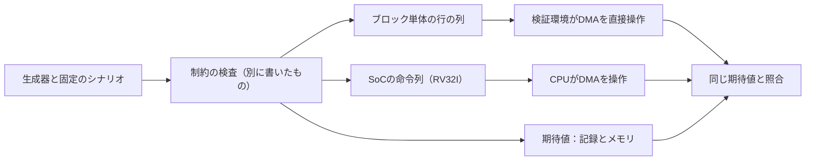

# 1つのシナリオから、ブロック単体の刺激とSoC上のプログラムを作って結果を照合する

テストの意図を、回路の外側の形に依らずに書いて再利用する教材です。DMAの転送・完了の待ち・メモリの照合を、資源（DMAのチャネル、メモリの領域）と制約とともに「シナリオ」としてPythonで書きます。同じシナリオから、次の2つを作ります。

- **ブロック単体の実現**：検証環境がDMAのレジスタを直接書き、メモリの役も担う行の列。
- **SoCの実現**：CPU（[コアとISSの比較の例](../local-riscv-iss/README.md)のRV32Iのコア）が実行する命令列。

2つの実行は、同じシナリオIDで、同じ期待値（結果の記録とメモリ）と照合します。

これは、Portable Stimulus（1つの意図から、ブロック・SoC・ソフトウェアの複数の実現を作る考え方）を数百行のPythonへ小さく写したものです。写したのは、アクション・資源・制約でシナリオを書くこと、制約を満たすシナリオだけを生成すること、1つの意図を複数の実現へ展開すること、シナリオ空間のカバレッジを測ることの4つです。AccelleraのPortable Test and Stimulus Standard（PSS）の言語は読まず、実行もしていません。PSSのツールの機能（制約ソルバー、スケジューリング、型の継承など）とは比べていません。規格の版と節番号とも照合していません。

## 構成



| ファイル | 内容 |
| --- | --- |
| [`scenario.py`](scenario.py) | シナリオのモデル：アクション、制約の検査、期待値、生成器、固定のシナリオ、2つの実現への展開、シナリオ空間のカバレッジ |
| [`rtl/scn_dma.sv`](rtl/scn_dma.sv) | 2チャネルの語単位のコピー回路（ブロック単体の対象で、SoCの中でも同じものを使う） |
| [`rtl/scn_soc.sv`](rtl/scn_soc.sv) | コア、256語のRAM、DMAをつないだSoC。RAMはコアとDMAが1つのポートを共有する |
| [`tb/portable_tb.sv`](tb/portable_tb.sv) | 最初の行で実現を選び、どちらでも同じ期待値の行と照合する検証環境 |
| [`run.py`](run.py) | [共通シミュレーションランナー](../local-common/README.md)のプラグイン |
| [`requirements.json`](requirements.json) | 6要求・25目標 |
| [`tests/`](tests/) | セルフテスト19件 |

## シナリオのモデル

### アクション

| アクション | 意味 | 結果の記録 |
| --- | --- | --- |
| `fill(region, values)` | 領域の16語へ値を書く | なし |
| `copy(ch, src, dst, len)` | チャネル`ch`で、語の番号`src`から`dst`へ`len`語のコピーを始める。終わるのを待たない | なし |
| `wait(ch)` | そのチャネルの完了を待ち、完了の印を消し、チャネルの状態を読む | 状態の語（エラー、動かした語数） |
| `check(region, len)` | 領域の先頭から`len`語を読み、署名（1ビット回してXOR）を作る | 署名 |

メモリは256語で、語64から16語ずつの領域が8つあります。語0〜29が結果の記録、語31が終わりの印です。

### 資源と制約

制約の検査（`check`）は生成器とは別に書き、シナリオを初めから再生して、最初に破った規則を理由つきで拒否します。

| 理由 | 規則 |
| --- | --- |
| `channel-busy` | チャネルは、開始からその`wait`までの間、ほかのコピーに使えない |
| `wait-idle`、`unwaited` | 待つのは動いているチャネルだけで、すべてのコピーは最後までに待つ |
| `conflict` | 動いているコピーの書き先は、ほかのどのアクションも読み書きしない。読み元は、ほかのアクションが書かない（同時に読むのはよい） |
| `undefined-read` | 書いたことのない語は読まない |
| `same-region`、`out-of-range` | 成功させるコピーは、別々の2つの領域の間で1〜16語を動かす |
| `mailbox-full` | 記録は30語まで |

DMAが拒否するコピー（長さ0、長さ17以上、終わりが語255を越えるもの）は、エラーとして完了するアクションとして扱い、チャネルの規則だけを当てます。

### 結果は順序に依らない

制約のおかげで、同時に動くコピーどうし、コピーとほかのアクションは、同じ語を取り合いません。そのため期待値は、各コピーを開始の時点で一度に行ったとして計算でき、実際の進み方（どちらのチャネルが先に終わるか、CPUがいつ書くか）に依りません。2つの実現は、時間の進み方がまったく違っても、同じ期待値と比べられます。

### 生成器

生成器（`generate`）は、資源の状態を持ちながら、その時点で許されるアクションだけを選びます。固定のシナリオ4つ（`basic`、`errors`、`both-pending`、`contention`）は、構造の目標18個のすべてに届きます。ランダムなシナリオは、smokeで2個、nightlyで3つのseedの4個ずつです。

生成器が規則を破るシナリオを作らないことは、2つの方法で確かめます。ランナーは、計画を作るときに全シナリオを制約の検査に通し、1つでも拒否されれば計画を作りません。セルフテストは、資源の確保を忘れる誤りを生成器に入れ（`ignore_locks`）、制約の検査がそのシナリオを`conflict`で拒否し、計画が止まることを確かめます。

## 2つの実現

| アクション | ブロック単体（検証環境が実行） | SoC（CPUが実行） |
| --- | --- | --- |
| `fill` | 検証環境のメモリへ直接書く（時間を使わない） | 16語の`sw` |
| `copy` | レジスタ4つの書込み。間に空きのクロックを入れる | `addi`と`sw`の組を4つ |
| `wait` | `IRQ_PEND`を1クロックごとに読む。1500クロックで諦めて、時間切れの印を記録する | `IRQ_PEND`を読む繰返し。400回で諦めて、同じ時間切れの印を記録する |
| `check` | 検証環境のメモリを読んで署名を作る | `lw`と回転・XORで署名を作り、記録の語へ書く |

SoCの実現をCのプログラムにしなかったのは、このリポジトリの固定版の環境に、RV32IのCのコンパイラーとリンカーがないためです（`llvm-mc`はアセンブルだけで、[Cドライバーの例](../local-c-driver/README.md)のCはホスト向けにコンパイルします）。命令列は、[ISSの例](../local-riscv-iss/README.md)の`iss.py`のアセンブラーで作ります。Cで書いたテストと同じ役割を、生成した命令列が担います。

ブロック単体のメモリは、`WAIT`クロック後に応答します。固定のシナリオ`contention`とランダムな半数では、3クロックに1回、応答を止めます。SoCでは、コアがRAMのポートを使う間、DMAの要求が待たされます。

## 回路

### DMA（`scn_dma`）

| オフセット | レジスタ |
| --- | --- |
| `0x10*c + 0x0`／`0x4`／`0x8` | チャネル`c`のSRC、DST（語の番号）、LEN |
| `0x10*c + 0xC` | CTRL（1を書くと、止まっているときに開始）／STATUS（ビット0 busy、ビット1 エラー、ビット12〜8 動かした語数） |
| `0x20` | IRQ_PEND（完了したチャネルのビット。1を書いたビットを消す） |

1語ずつ「読む・書く」を行い、動いているチャネルを交互に受け持ちます。メモリのポートは、`mem_ready`が来るまで要求を保ちます。

### SoC（`scn_soc`）

データの番地は、RAMが`0x2000`〜`0x23ff`、DMAのレジスタが`0x40000000`からです。データのアクセスは、すべて`WAIT`クロック待ちます。RAMのポートは1つで、コアのアクセスが優先します。命令は、検証環境が持つROMから取り込みます。

## 実行と判定

```sh
python3 examples/local-portable-scenario/run.py --out artifacts/portable-smoke
python3 examples/local-portable-scenario/run.py --profile nightly --out artifacts/portable-nightly
```

構成は`wait0`と`wait2`（データのアクセスの待ちのクロック数）の2つです。

| 区分 | smoke | nightly |
| --- | --- | --- |
| 通常のケース（シナリオ×2つの実現） | 12 | 32 |
| 変異の検出 | 10 | 10 |
| 診断（SoCだけの誤りを、ブロック単体が見逃すことの確認） | 2 | 2 |
| 合否判定 | 1 | 1 |
| 構成あたりの合計 | 25 | 45 |
| JUnit（2構成） | 50 | 90 |

検証環境のラベルは次のとおりです。

| ラベル | 検査 |
| --- | --- |
| `SCN_RESULT` | 結果の記録が期待値と違う。ブロック単体では記録の語数も、SoCでは終わりの印も照合する |
| `SCN_MEMORY` | 終わった後のメモリが期待値と違う（記録の照合の後に調べる） |
| `SCN_PORT` | ブロック単体で、待たされたメモリの要求が、受け取られる前に変わった |
| `SCN_X` | 出力に不定の値がある |
| `SCN_TIMEOUT` | 検証環境の時間の上限。検査とは別のラベル |

`COUNT`で、記録の語数（ブロック単体は検証環境が作った数、SoCはCPUが記録の語へ書いた回数）と、コピーの開始の回数を照合します。

## 要求と目標

[要求カタログ](requirements.json)は6要求・25目標です。目標は2種類あります。

- **構造の目標（18個）**：シナリオの形を表す札です（アクション、同時に動くこと、資源の再使用、待ちの順序、エラー、境界）。そのシナリオの実行が合格したときだけ数えます。どのシナリオがどの札を持つかは、モデルが計算し、行で検証環境へ渡します。
- **観測の目標（7個）**：回路から観測するものです（両チャネルが同時に動いた、後から始めたチャネル1が先に終わった、待ちに2回以上の確認が要った、ブロック単体でメモリが待たせた、SoCでCPUとDMAがRAMを取り合った、2つの実現）。

2構成とも、固定のシナリオだけで25目標のすべてに届きます。

シナリオ空間のカバレッジは、`scenario.coverage`で別に数えます。構造の目標18個に届いた割合と、続けて現れたアクションの種類の組（`fill`・`copy`・エラーになる`copy`・`wait`・`check`の5種類の、25通りの順序つきの組）に届いた割合です。

| シナリオの集合 | 構造の目標 | アクションの組 |
| --- | --- | --- |
| smoke（固定4＋ランダム2） | 18／18 | 20／25 |
| smokeのランダムな2個だけ | 16／18（エラーの2種類が欠ける） | 13／25 |
| nightly（固定4＋ランダム12） | 18／18 | 24／25 |

nightlyで欠ける組は「エラーになるコピーの直後に、エラーになるコピー」です。

## 変異

| 番号 | 場所 | 誤り | 検出する実現 | ラベル |
| --- | --- | --- | --- | --- |
| 1 | DMA | 1語早く終わる | 両方 | `SCN_RESULT` |
| 2 | DMA | 書き先の終わりを調べない | 両方 | `SCN_RESULT` |
| 3 | DMA | 完了の印を消すと、ほかのチャネルの印も消える | 両方 | `SCN_RESULT` |
| 4 | DMA | チャネル1が書き先から読む | 両方 | `SCN_RESULT` |
| 5 | SoC | コアがRAMを使っている間もDMAを通し、DMAの書込みが失われる | SoCだけ | `SCN_RESULT` |
| 6 | SoC | DMAの番地の窓を、番地のビット4なしで解く（チャネル1への操作がチャネル0へ行く） | SoCだけ | `SCN_RESULT` |

変異3では、ブロック単体でもSoCでも、2つ目の待ちが諦めて時間切れの印を記録し、その記録の照合で見つかります。

変異5と6は、ブロック単体の実現では見えない結合の誤りです。同じシナリオのブロック単体の実行が、変異を入れても合格することを、診断のケース（`survive-mutation5-contention`、`survive-mutation6-basic`）として毎回確かめます。同じ意図をブロックとSoCの両方で実行する理由の例です。

## 確認範囲と残る制限

- **シナリオの言語**：PSSの言語は使っていません。制約は、生成器が守る形（構成による生成）と、別に書いた検査で表し、制約ソルバーは使っていません。
- **制約が禁じる使い方は試されない**：動いているチャネルへの開始は、制約が禁じるので、生成するどのシナリオにも現れません。その扱いの誤りは、このやり方では見つかりません（下の「追加で入れた誤り」の6）。誤った使い方への耐性は、シナリオの外の負例で別に確かめる必要があります。
- **時刻に依る値は比べない**：期待値は順序に依らない値だけです。コピーの途中のSTATUS（busy）や、どちらのチャネルが先に終わるかは、観測の目標にするだけで、期待値にはしていません。
- **RAMの読出し**：このRAMは、コアの読出しとDMAの読出しを別の経路で返すので、読出しどうしは実際には衝突しません。ポートを取り合うのは書込みと、DMAの読出しの番地です。
- **規模**：チャネル2本、語単位のコピー、256語のRAMです。割り込みは使わず、待ちは状態の読出しの繰返しです。
- **未実行**：Linux、kirimasimでは実行していません。

## 確認記録

2026-11-21に、macOS（arm64）、Python 3.13、Icarus Verilog 14.0開発版、Verilator 5.052（lint）で次を確かめました。

- smoke（seed 17・3・100）と、nightly（`--timeout 60`）が合格しました。JUnitは50件／90件です。`--demo-bug 1`は終了コード1で終わります。
- セルフテスト19件が合格しました。Icarusがなければ、skipせずに失敗します。
- lint：`scn_dma`（変異0〜4）と`scn_soc`（既定、`WAIT=2`、変異5・6）で、`--lint-only --Wall`の警告は0件です。
- `check_tb_races.py`：この例の検証環境の候補は0件です。

### 追加で入れた誤り

既存の変異とは別に、作業用の写しのRTLへ小さな誤りを12個入れ、smokeにかけました。最初の固定のシナリオでは5個が合格のまま残り、そのうち2個（チャネル0がエラーを持ち越す、チャネル1が語数を数え直さない）は試験の抜けでした。エラーの後や2回目の使用で、同じチャネルが成功のコピーをする場面がなかったためで、`errors`と`both-pending`にその場面を足しました。足した後の結果です。

| 誤り | 結果 |
| --- | --- |
| 動いているチャネルの交互の受け持ちを壊す（チャネル1が止まったままになる） | 検出 |
| 拒否したコピーが完了の印を立てない | 検出 |
| チャネル0が前のエラーを持ち越す | 検出（場面を足した後） |
| チャネル1が開始で語数を0に戻さない | 検出（場面を足した後） |
| チャネル0のLENを4ビットで受ける | 検出 |
| 書込みを読み元へ行う | 検出 |
| 完了の印を消すとき、書いた値のビット0だけを見る | 検出 |
| コアが語の最上位バイトを書かない | 検出（SoCだけ） |
| 受け持ちの順番が回らない | 通常のケースは合格。観測の目標`observed/ch1-first`が欠け、変異3の検出も失われるので、実行は不合格になる |
| 動いているチャネル0への開始で、やり直す | 合格のまま。制約が禁じる使い方で、どのシナリオにも現れない |
| コアの読出しではRAMのポートを取らない | 合格のまま。このRAMでは読出しどうしが衝突しないので、動作に差が出ない |
| チャネル1のSTATUSがbusyを示さない | 合格のまま。待ちの後にだけSTATUSを読むので、busyが1の時刻に読むシナリオがない |

合格のまま残った3個のうち、動作に差が出ないのは1個です。残る2個は、このやり方の限界として上の「確認範囲と残る制限」に書きました。
