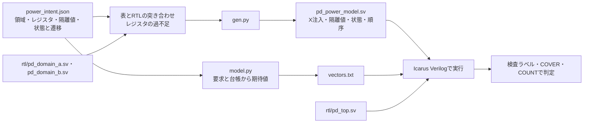

# 2つの電源ドメインを、電源意図の表から生成したX注入とチェッカーで検証する

電源を切った領域のレジスタは値を失います。通常のRTLシミュレーションは電源を扱わないので、領域を切ってもレジスタは値を持ち続け、隔離の抜けや初期化漏れが見えません。この教材では、電源意図を1つの表（JSON）に書き、その表から「OFFの間、領域内の全レジスタをXにするラッパー」と「隔離値・電源状態・制御の順序のチェッカー」を生成します。期待値のモデルも同じ表を読みます。

表は、この教材のために決めた独自の形式です。UPF（IEEE 1801）ではなく、UPFを読み込むパワーアウェアなシミュレーションの代わりにもなりません。分野全体の進め方と、このリポジトリで実行できない範囲は[低電力設計の検証](../../docs/method/low-power-verification.md)にあります。

[低電力制御の例](../local-power/README.md)は、1つの領域・隔離値0・手で書いたXの注入で、排出から復帰までの順序を扱います。この例は、次の点を加えます。

| 観点 | [低電力制御の例](../local-power/README.md) | この例 |
| --- | --- | --- |
| 領域 | 1つ | 常時動作と、依存関係のある2つ（BはAがONのときだけON） |
| Xの注入と検査 | RTLとテストベンチに手で書く | 電源意図の表から生成する |
| 隔離値 | 0 | 0・1・直前の値の3種類 |
| 保持 | 領域全体で保持する／しない | 1つの領域の中に、保持するレジスタとしないレジスタが混在 |
| 順序 | 1領域の排出・保存・隔離・停止 | 領域間の投入順序と、隔離・リセット・電源の順序 |

## 表から生成するもの



[`gen.py`](gen.py)が出力するモジュール`pd_power_model`は、3つの部分を持ちます。ビルドのたびに作るので、表より古くなることはありません。

- **X注入**：領域の電源が0の間、表にある全レジスタへ`force`でXを与えます。電源が1に戻ると`release`します。`release`した変数は、次に代入されるまでXのままです。リセットや復元で書き直されなかったレジスタは、Xのまま残ります。
- **隔離値の検査**：隔離が有効な間、出力が表の値（0、全ビット1、隔離の前に見えていた値）であることを、クロックごとに比べます。常時動作側の出力にXが1ビットでも現れれば、値の比較より先に失敗にします。
- **電源状態と順序の検査**：表にない電源状態、表にない遷移、隔離より先の電源断、安定待ちが足りないリセット解除と隔離解除を失敗にします。復帰が終わった時点で、保持するレジスタは切る前の値、保持しないレジスタはリセット値であることも比べます。

## 電源意図の表

[`power_intent.json`](power_intent.json)の内容は次のとおりです。

| 領域 | レジスタ | 保持 | 出力と隔離値 | 必要とする領域 |
| --- | --- | --- | --- | --- |
| A | `acc`（8ビット） | する | `a_sum`：0 | なし |
| A | `scratch`（8ビット）、`fired`（1ビット） | しない | `a_last`：直前の値、`a_idle_n`：1 | |
| B | `mode`（4ビット） | する | `b_mode`：直前の値 | A |
| B | `count`（8ビット） | しない | `b_count`：0 | |

| 電源状態 | A | B |
| --- | --- | --- |
| `all-off` | OFF | OFF |
| `a-only` | ON | OFF |
| `all-on` | ON | ON |

合法な遷移は、`a-up`（`all-off`→`a-only`）、`b-up`（`a-only`→`all-on`）、`b-down`、`a-down`の4つです。「AがOFFでBがON」という状態は表にありません。BはAの出力（`a_sum`のbit 0）を隔離なしで使うので、この状態では、OFFの領域の値がBへ流れ込みます。

生成器は、表を読むときに次を確かめます。

- 必要とする領域がOFFのまま領域をONにする状態がないこと。
- 各遷移が、ちょうど1つの領域だけを切り替えること。
- 隔離のない領域間の信号について、受け側がONで送り側がOFFの状態が表にないこと。
- 表のレジスタと、領域のRTLが宣言する`reg`が一致すること。表に書き忘れたレジスタがあると、そのレジスタはXにならず、検査もされません。

## 対象回路

[`pd_top.sv`](rtl/pd_top.sv)は常時動作の領域で、電源制御[`pd_ctrl.sv`](rtl/pd_ctrl.sv)、保持用の写し、出力の隔離を持ちます。[`pd_domain_a.sv`](rtl/pd_domain_a.sv)は値を足し込む回路、[`pd_domain_b.sv`](rtl/pd_domain_b.sv)はモードとカウンターの回路です。電源スイッチそのものはなく、`pwr_a`・`pwr_b`という信号が電源の状態を表します。

| 入力 | 意味 |
| --- | --- |
| `req_a`・`req_b` | 領域の電源の要求。Bは、`req_a`と`req_b`の両方が1のときだけONにします |
| `op_valid`・`op_sel`・`op_data` | 演算の要求。`op_sel`が0ならA（`acc`へ加算し、`scratch`へ記録）、1ならB（bit 7が1なら`mode`へ書込み、0なら`count`へ加算） |

`op_ready`が1のサイクルだけ、演算を受け付けます。領域が切替えの途中か、OFFの間は0です。

制御の順序は次のとおりです。動かす領域は一度に1つで、始めた手順は最後まで実行します。

| 向き | 手順（1行が1サイクル。安定待ちだけ`SETTLE`サイクル） |
| --- | --- |
| 停止 | 受付の停止 → 保持する値の保存 → 隔離 → リセット → 電源断 |
| 起動 | 電源投入 → リセットのまま`SETTLE`サイクル待つ → リセット解除 → 保持した値の復元 → 隔離の解除と受付の再開 |

- 両方を止めるときはBが先、両方を起動するときはAが先です。
- 電源断の要求と同じサイクルに受け付けた演算は、保存より前に反映します。
- 全体リセットは、両方の領域をOFFにし、保持用の写しも消します。その後、要求に従って起動します。
- 「直前の値」の隔離は、隔離を有効にする前の最後のクロックで見えていた値を、常時動作側のレジスタに取っておく方式です。ラッチは使いません。

## 期待値の作り方

[`model.py`](model.py)は、制御回路の状態やサイクル数を持ちません。持つのは、領域ごとのON／OFF、レジスタの値の台帳、隔離で保持している値だけです。

- **電源の要求**：要求から目標の電源状態を求め、表の遷移だけをたどって移動します。領域をOFFにするとき、「直前の値」の出力が見せていた値を記録します。ONにするとき、保持しないレジスタを表のリセット値に戻します。保持するレジスタは台帳の値のままです。
- **演算**：対象の領域がONなら台帳を更新し、OFFなら拒否とします。
- **見える値**：領域がONなら演算結果、OFFなら表の隔離値です。

テストベンチ[`pd_tb.sv`](tb/pd_tb.sv)は、1行の操作を行い、制御回路が落ち着くのを待ってから、5つの出力と2つの電源の状態を期待値と比べます。待つサイクル数は数えません。手順の途中の順序は、生成したチェッカーがクロックごとに見ます。

| 行の種類 | 操作 |
| --- | --- |
| 0 | 全体リセット |
| 1 | 演算1件。受け付けるか拒否するかも期待値に含む |
| 2 | 電源の要求を変え、落ち着くまで待つ |
| 3 | 電源断の要求と同じサイクルに、その領域への演算を出す（受け付けて、保持にも反映する） |
| 4 | 要求の1サイクル後に、切替え中の領域への演算を出す（拒否する） |
| 5 | 電源断を要求し、1〜15サイクル後に元の要求へ戻す（一度OFFになってから起動し直す） |

種類3〜5は、1つの領域だけが切り替わる要求に限ります。2つの領域が続けて動く途中で要求を変えると、結果がサイクル単位のタイミングで変わり、サイクル数を持たないモデルでは期待値を決められないためです。

## 検出する誤り

変異は7種類で、すべてRTL側の誤りです。構成ごとに、固定シナリオで実行します。

| 番号 | 誤り | 検査ラベル | 見つかる場面 |
| --- | --- | --- | --- |
| 1 | `a_sum`の隔離が、電源が入っている間しか働かない | `PD_XLEAK` | AがOFFの間、Xが常時動作側の出力に出る |
| 2 | `a_idle_n`の隔離値が1でなく0 | `PD_ISO` | 隔離中の値が表と違う |
| 3 | Bの`mode`を復元しない | `PD_RETAIN` | Bの復帰後、`mode`が切る前の値でない |
| 4 | Aの`scratch`にリセットがない | `PD_INIT` | Aの起動後、`scratch`がリセット値でなくXのまま |
| 5 | BがONのまま、Aを先に止める | `PD_STATE` | 表にない状態「AがOFF、BがON」 |
| 6 | 隔離を、電源断と同じサイクルまで有効にしない | `PD_SEQ` | 電源が落ちる前のクロックで隔離が0 |
| 7 | 停止を始めても、隔離まで演算を受け付ける | `PD_ACCEPT` | 要求の1サイクル後の演算に`op_ready`が1 |

変異1は、X注入があって初めて見つかります。AをOFFにする手順は、電源断の前に領域をリセットするので、`acc`は0になります。0は`a_sum`の隔離値と同じなので、Xを入れなければ、隔離が外れていても出力は表の値と一致します。セルフテストで、`acc`をX注入から外すと変異1が合格してしまうことを確かめています。表とRTLのレジスタの突き合わせは、この種の抜けを防ぐためのものです。

変異4は、最初の起動で見つかります。Icarus Verilogでは、リセットのないレジスタはシミュレーションの開始時からXだからです。2回目以降の起動でも、X注入によって同じ検査が働きます。

`PD_TRANSITION`（表にない遷移）、`PD_POWER`と`PD_DATA`（落ち着いた後の電源と出力の値）、`PD_TIMEOUT`（200サイクル以内に落ち着かない）は、どの変異の予定ラベルでもありません。`PD_DATA`と`PD_ISO`は、期待値や表を書き換えるセルフテストで、正しい回路に対して働くことを確かめています。

## 固定シナリオと目標

固定シナリオは35行です。演算の受付16件・拒否4件、電源の要求18回、全体リセット3回を含みます。[要求カタログ](requirements.json)は6要求・23目標で、どちらの構成でも固定シナリオだけで全目標に達します。

| 要求 | 目標 |
| --- | --- |
| `PD-STATE` | 3つの電源状態と4つの遷移 |
| `PD-ISO` | 隔離値0、1、0でない直前の値（領域がOFFの間に確認） |
| `PD-RETAIN` | `acc`と`mode`が0でない値で戻ること、`scratch`と`count`が0でない値からリセット値に戻ること |
| `PD-ORDER` | 両方の停止、両方の起動、Aなしでの Bの要求 |
| `PD-FLOW` | 要求と同じサイクルの演算、切替え中の拒否、OFF中の拒否、停止の途中の再要求 |
| `PD-RESET` | ONの間の全体リセット、OFFの間の全体リセット |

状態・遷移・隔離値・保持の目標は、生成したチェッカーが、検査に合格した時点で出力します。ランダム刺激は、演算、電源の要求、種類3〜5の操作、全体リセットを、モデルの状態から選べるものだけ選びます。

通常ケースは、`COUNT`の4項目（受付、拒否、電源の要求、リセット）が予定と一致することも要求します。

## 実行

Icarus Verilogだけで動きます。リポジトリのルートから実行します。

```sh
python3 examples/local-power-domains/run.py --out artifacts/power-domains
python3 examples/local-power-domains/run.py --profile nightly --out artifacts/power-domains-nightly
python3 -m unittest discover -s examples/local-power-domains/tests -v
```

[共通手順](../local-common/README.md)を使います。構成は`settle2`と`settle4`で、安定待ちのサイクル数が違います。smokeは60行×1 seed、nightlyは400行×3 seedのランダム刺激を、固定シナリオに加えます。JUnitはsmoke 20件／nightly 24件、セルフテストは21件です。`--demo-bug 1..7`で、通常ケースに変異を入れられます。

## 証跡

共通手順の証跡に加えて、次を残します。

- `<構成>-m<変異>/pd_power_model.sv`：そのビルドで生成したX注入とチェッカー。SHA-256は`builds.json`に記録します。
- `manifest.json`：電源意図の表、生成器、モデルのSHA-256も含みます。
- 各ケースの`simulation.log`：`COVER`、`COUNT`、失敗時の`CHECK_FAIL`と行番号・時刻。

## 確認範囲

2026-11-20に、macOS arm64のPython 3.14.7、Icarus Verilog 14.0開発版で、2構成のsmoke／nightly、23目標、7変異の検出（2構成で14件）、セルフテスト21件が成功しました。RTLの4モジュールは、Verilator 5.052の`--lint-only -Wall`で警告0件です（`pd_ctrl`と`pd_top`は`SETTLE`が2と4の両方）。YoWASP版Yosys 0.70の`synth`でも、変異0〜7を読み込め、ラッチは推論されません（変異0でフリップフロップ69個）。Linuxでは実行していません。

この教材で確かめていないことは次のとおりです。

- UPFは読み込みません。表が正しくても、UPFの記述が正しいことは分かりません。UPFと回路の静的な検査、UPFから挿入した隔離セル・保持セル・電源スイッチでのシミュレーションは、対応した商用ツールの範囲で、このリポジトリでは実行しません。
- 隔離と保持は、RTLの論理として書いたものです。実際の隔離セル、保持セル（保存・復元の制御と常時電源）、レベルシフター、電源網、スイッチの段階的な投入、突入電流、IRドロップ、保持電圧は扱いません。
- 電源は`pwr_a`・`pwr_b`という1本ずつの信号です。電源が落ちる途中や立ち上がる途中の中間の電圧はありません。安定待ちは、サイクル数で数えるだけです。
- Xになるのは、表に書いたレジスタだけです。領域内の組合せ回路の出力は、レジスタのXから伝わります。Xの伝わり方はシミュレーターの規則に従うので、Xが途中で消える場合があります（[Xの楽観と悲観](../../docs/method/gate-level-and-timing-verification.md#4-xの楽観と悲観)）。
- 領域のクロックは止めません。クロックゲーティングは扱いません。
- 表とRTLの突き合わせは、領域のモジュールの`reg`宣言を文字列として読むだけです。下位の階層、メモリ、生成ブロックの中の宣言には対応していません（変異4の`scratch`は、生成ブロックの外で宣言しています）。
- 種類3〜5の操作は、1つの領域だけが切り替わる場合に限ります。2つの領域が続けて動く途中で要求を変える操作は、刺激に含めていません。
- 証明ではありません。与えた刺激が通った範囲の確認です。

## 参考にした一次資料

- IEEE Std 1801（Unified Power Format）：電源領域、隔離、保持という概念の名称を使いました。構文と本文は使っていません。
- IEEE Std 1800-2023 10.6.2（`force`と`release`）：変数への`release`の後、次の手続き代入まで値が残ることを、X注入に使いました。変数の一部ではなく全体へ`force`をかけています。
- [低電力設計の検証](../../docs/method/low-power-verification.md)：RTLの動作モデルとパワーアウェアなシミュレーションの違い。
