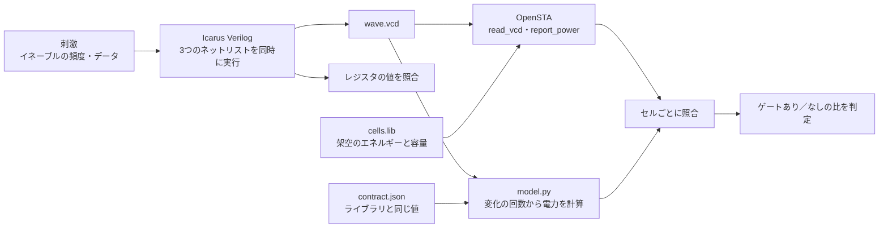

# シミュレーションの活動率から電力を見積もり、クロックゲーティングの効果を比べる

動的な消費電力は、信号が何回変化したかで決まります。この教材では、ゲートレベルのシミュレーションが書き出したVCDをOpenSTAに読ませ、セルごとの電力を見積もります。題材は、ロードイネーブルつきの8ビットのレジスタです。イネーブルをマルチプレクサで作った回路と、クロックゲートで作った回路を、同じ刺激で比べます。

見積りの数値は、教材用の架空のライブラリから出たものです。実際の回路の電力ではありません。確かめるのは、数値の大きさではなく、次の3点です。

- OpenSTAが、シミュレーションの活動率を回路の全ピンへ正しく取り込んだこと。
- OpenSTAの見積りが、VCDの変化の回数とライブラリの値から別に計算した値と一致すること。
- クロックゲートの効果が、ロードの頻度に応じて予定した範囲にあること。

クロックゲートの回路そのもの（短いパルスが出ないこと）は、この教材の対象ではありません（[クロックゲーティングの例](../local-clock-gating/README.md)で扱います）。低電力設計の検証の全体は、[低電力設計の検証](../../docs/method/low-power-verification.md)にまとめています。

## 流れ



## 対象回路

[`bank.v`](design/bank.v)は、手で書いたセルレベルのネットリストです。合成ツールの出力ではありません。どのモジュールも、クロックの入口にバッファ`ckbuf`を1個持ちます。

| モジュール | 作り | セル |
| --- | --- | --- |
| `bank_plain` | 各フリップフロップの前のマルチプレクサが、新しい値か今の値かを選ぶ。クロックは毎サイクル8個すべてに届く | `BUF` 1、`MUX2` 8、`DFF` 8 |
| `bank_gated` | クロックゲート`ICG`が、ロードするサイクルだけクロックを通す。マルチプレクサはない | `BUF` 1、`ICG` 1、`DFF` 8 |
| `bank_stuck` | 誤りの例。クロックゲートを入れたが、そのイネーブルを、1に固定されたテスト用のバイパス入力につないだ。マルチプレクサも残っている | `BUF` 1、`ICG` 1、`MUX2` 8、`DFF` 8 |

3つとも、レジスタとしての動作は同じです。`bank_stuck`は機能の試験では見つかりません。

## ライブラリと電力の計算

[`cells.lib`](design/cells.lib)は、この教材のために作った架空のライブラリです。エネルギーはピンごとに1つの定数で、入力の傾きにも負荷にも依存しません。電源電圧は1 V、入力ピンの容量はすべて0.01 pFです。

| セル | 内部エネルギー（pJ／変化） | リーク（nW） |
| --- | --- | --- |
| `BUF` | 出力0.002 | 1 |
| `MUX2` | 出力0.003 | 2 |
| `DFF` | クロック入力0.004、出力0.010 | 4 |
| `ICG` | クロック入力0.002、出力0.003 | 3 |

OpenSTAは、ピンの活動率（単位時間あたりの変化の回数）から、セルごとに3つの電力を出します。[`model.py`](model.py)は、同じ量を次の式で計算します。

- 内部電力：エネルギー×そのピンの活動率を、エネルギーを持つピンについて合計します。
- スイッチング電力：出力ごとに、0.5×負荷容量×電圧²×活動率です。負荷容量は、その出力がつながる入力ピンの容量の和です。レジスタの出力ポートには0.02 pFの負荷を与えます。配線の容量は0です。
- リーク電力：セルの定数です。

例えば、`bank_plain`のフリップフロップのクロック入力は、10 nsの周期で2回変化します。活動率は0.2回／nsで、内部電力は0.004 pJ×0.2回／ns＝0.8 µWです。

活動率は、[`model.py`](model.py)がVCDを読んで数えます。最初の値は変化に数えず、不定値への変化があればエラーにします。OpenSTAの数え方には頼りません。ライブラリの値と[`contract.json`](contract.json)の値が同じであることは、セルフテストで確かめます。

## シミュレーション

[テストベンチ](tb/power_tb.sv)は、3つのネットリストを同じ入力で動かします。毎サイクル、レジスタの値をPythonの期待値と照合し、3つの値が等しいこと、不定値がないことも確かめます。VCDには3つのネットリストの全ネットを書き出します。

刺激は320サイクルです。データは毎サイクル乱数で変え、イネーブルは決めた間隔で1にします。

| 構成 | ロードの間隔 | ロードの回数 |
| --- | --- | --- |
| `low` | 16サイクルに1回 | 20 |
| `mid` | 4サイクルに1回 | 80 |
| `high` | 毎サイクル | 320 |

ランナーは、ネットリストとは別に、VCDのクロックの変化が3つのネットリストで同じ回数であることと、ゲートを通ったクロックの変化がロードの回数の2倍であることを確かめます。

[セルのシミュレーションモデル](design/cells.v)は、遅延のないモデルです。フリップフロップとラッチは0から始めます。そのため、活動率にグリッチは含まれません。

## 判定

[`power.tcl`](power.tcl)は、活動率を取り込めたピンの集計と、セルごとの電力を出力するだけです。判定は[`run.py`](run.py)が行います。

| 順 | 条件 | ラベル |
| --- | --- | --- |
| 1 | VCDから活動率を取り込んだピンが0個 | `POWER_ACTIVITY` |
| 2 | 取り込めなかったピンがある、または取り込んだ数がネットリストの全ピン数と違う | `POWER_SCOPE` |
| 3 | どれかのセルの内部・スイッチング・リークのどれかが、別に計算した値と0.01%を超えて違う | `POWER_VALUE` |
| 4 | ゲートありの合計とゲートなしの合計の比が、構成ごとの範囲にない | `POWER_SAVING` |
| 5 | どれでもない | `PASS` |

比の範囲は[`contract.json`](contract.json)にあります。

| 構成 | 範囲 | 手元の値（ゲートなし／ゲートあり、µW） | 比 |
| --- | --- | --- | --- |
| `low` | 0.35以下 | 15.682／3.275 | 0.209 |
| `mid` | 0.60以下 | 18.149／7.574 | 0.417 |
| `high` | 0.80以上 | 28.224／24.895 | 0.882 |

`high`は、毎サイクルロードするのでゲートが閉じません。それでも比が1を下回るのは、`bank_gated`にマルチプレクサがないからです。この構成では、大きな節約がないこと（0.80以上）を確かめます。3つの構成をすべて実行したときは、比が`low`＜`mid`＜`high`の順に大きくなることも確かめます（`activity-order`）。

範囲の値は、この回路と架空のライブラリについて、手元の比に余裕を持たせて決めたものです。ほかの回路の目標値にはなりません。

## 4種類の誤り

誤りは、ゲートありの解析に入れます。

| 番号 | 誤り | ラベル | 起きること |
| --- | --- | --- | --- |
| 1 | VCDを読まずに見積もる | `POWER_ACTIVITY` | OpenSTAは既定の活動率（入力0.1）を回路へ伝えて計算し、もっともらしいワット数を出す。取り込みの集計だけが、VCDを使っていないことを示す |
| 2 | VCDの中の別のネットリストのスコープ（`power_tb/plain`）を指定する | `POWER_SCOPE` | 同じ名前のネットとピンに活動率が入る。フリップフロップのクロック入力には、ゲートを通らないクロックの活動率が入り、内部電力が約10倍になる。ゲートの出力の1ピンだけが取り込めずに残る |
| 3 | フリップフロップのクロック入力のエネルギーが2倍のライブラリで見積もる | `POWER_VALUE` | 8個のフリップフロップの内部電力だけが、計算した値より大きい |
| 4 | ゲートなしの代わりに`bank_stuck`を「ゲートあり」として見積もる | `POWER_SAVING` | 全セルの値は計算と一致する。合計はゲートなしより大きい（`low`で1.09倍） |

検出は、ラベルが合うだけでは数えません。誤り2と3ではフリップフロップの内部電力が大きい側へずれていること、誤り3ではそれ以外のセルが一致していること、誤り4では全セルが一致していることを確かめます。ツールのエラー、時間切れ、不完全なレポートは、検出に数えません。

誤り4は、`high`の構成では見えません。この構成の範囲は「0.80以上」で、`bank_stuck`の比（1.07）も範囲に入るからです。診断として実行し、検出には数えません。検出は11件、「見えない」は1件です。

誤り2は、スコープの指定が違っても、名前が合えばツールが受け付けることを示します。この例では取り込めないピンが1個残るので見つかります。2つのネットリストのネットとピンの名前がすべて同じなら、集計では見つかりません。その場合に見つけるのは、条件3の、別に計算した値との照合です。

## 実行

OpenSTAとIcarus Verilogが要ります。OpenSTAの準備は[OpenSTAの実行例](../local-sta/README.md#オープンソース環境の準備)と同じです。リポジトリのルートで実行します。

```sh
python3 examples/local-power-estimate/run.py --out artifacts/power-estimate
python3 examples/local-power-estimate/run.py --configuration low --seed 42 --out artifacts/power-low
python3 -m unittest discover -s examples/local-power-estimate/tests -v
```

- `--configuration`：`all`（既定）、`low`、`mid`、`high`。1つだけ実行したときは、`activity-order`は計画に入りません。
- `--seed`：データの乱数の種です。既定は17です。イネーブルの間隔は変わりません。
- `--demo-bug 1..4`：通常のゲートありの解析にも誤りを入れます。終了コードは1になります（誤り4の`high`を除く）。
- `--sta`、`--iverilog`、`--vvp`：ツールの場所です。`--sta`の既定は、このリポジトリ内に構築した実行ファイルで、それがなければPATHの`sta`です。
- `--timeout`：ツールの1回の起動に適用する秒数です。既定は30秒です。smokeとnightlyの区別はありません。

## 証跡

- `manifest.json`：全ケースの計画、seed、入力ソースのSHA-256、OpenSTAの実行ファイルの位置・SHA-256・版、Icarus Verilogの版の取得結果。
- `<構成>-simulation/`：刺激`vectors.txt`、シミュレーションのログ、`wave.vcd`、ロードの回数とクロックの変化の回数。
- 解析ごとのディレクトリ：使ったライブラリ、ネットリスト、VCD、起動スクリプト、OpenSTAのログ、`result.json`。`result.json`には、取り込みの集計、全ピン数、セルごとの測定値と計算値、ずれたセルと向き、合計、ゲートなしとの比を記録します。
- `summary.json`：予定と完了の件数、検出数、構成ごとの比、全結果。
- `junit.xml`：3構成×（シミュレーション1＋解析2＋誤り4）の21件、`activity-order`、証跡検査の**23件**。

予定した22件の順序と名前が結果と一致しなければ、不合格にします。シミュレーションが合格しなかった構成の解析は、エラーにします。

## 確認範囲

2026-11-20に、macOS arm64のPython 3.14、Icarus Verilog 14.0開発版、OpenSTA 3.1.0で、3構成のシミュレーションと解析、4種類の誤りの検出11件と「見えない」1件、`activity-order`、セルフテスト13件が成功しました。Linuxでは実行していません。

セルフテストは、VCDの変化の数え方（最初の値、別のスコープ、不定値）、フリップフロップ1個の電力の手計算との一致、ネットリストのセルの構成とピン数、ライブラリと契約の値の一致、判定の順序、小さなずれの扱い、予定した証拠のない検出を数えないこと、実際のツールによる全ケース、誤りを入れた解析の不合格、OpenSTAがない場合を確かめます。

この教材で確かめていないことは次のとおりです。

- エネルギー、容量、リークは架空の定数です。実際のセルライブラリ（傾きと負荷の表、状態に依存するリーク、条件つきの内部電力）は使いません。配線の容量も0です。絶対値には意味がありません。
- 活動率は、遅延のないシミュレーションから取ります。グリッチによる電力は含みません。SDFの遅延をつけたシミュレーションのVCDは使っていません。
- 見積りは平均電力です。ピークの電流、IRドロップ、突入電流、温度は扱いません。
- 刺激は320サイクルの人工的な列です。実際の使い方を代表する刺激の選び方は扱いません。
- ネットリストは手で書いたものです。合成ツールによるクロックゲートの挿入、挿入の前後の等価性、ゲートのイネーブルのタイミング（セットアップとホールド）は確かめていません。
- 別に計算した値との一致は、OpenSTAとこの教材のモデルが同じ式を使っていることを示すだけです。式が実際の回路の電力を表すことは示しません。
- 確かめたOpenSTAは3.1.0だけです。1つの出力に、入力ごとに違うエネルギーが定義されているときの配分は確かめていません。この教材のライブラリでは、1つの出力のエネルギーをすべて同じ値にして、配分によらない結果にしています。
- OpenSTA 3.1.0では、クロックゲートのイネーブルを定数（`1'b1`）につないだとき、ゲートの出力の内部電力が計算に入りませんでした。原因は調べていません。`bank_stuck`がイネーブルを入力ポートにつないでいるのは、この影響を避けるためです。
- SAIFの読込み（`read_saif`）と、活動率を手で与える方法（`set_power_activity`）は使っていません。

## 参考にした一次資料

- [OpenSTAのコマンドの説明](https://opensta.readthedocs.io/en/latest/Commands/)：`read_vcd`、`report_power`、`report_activity_annotation`。
- [OpenSTAのリポジトリ](https://github.com/parallaxsw/OpenSTA)：構築手順とライセンス（GPL v3以降）。固定したコミットは[STAの例の`toolchain.json`](../local-sta/toolchain.json)に記録しています。
- Libertyの電力の属性（`internal_power`、`cell_leakage_power`、`clock_gating_integrated_cell`）は、公開されている属性名に従って教材用の値を書いたものです。仕様の本文は写していません。
