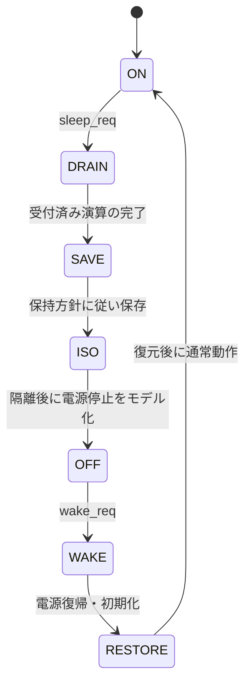

# 低電力制御の排出・隔離・状態保持を検証する

演算を受け付ける小さな回路を、転送排出→状態保存→隔離→停止→復帰→状態復元の順で制御します。RTL上の動作モデルで、UPF・実電源・クロックゲーティングセルのシミュレーションではありません。

## 排出・隔離・保持・復帰の順序

受付済み演算を排出してから保存・隔離・停止し、復帰後も初期化と復元が終わるまで隔離します。



RTL上の動作モデルです。実クロックは止めず、UPFや実電源セルを実行する構成ではありません。

| 確認する場面 | 期待する動作 | 主な照合対象 |
| --- | --- | --- |
| 停止前 | 新規受付を抑止して排出 | 受付・完了・保存値 |
| OFF | 内部Xを外へ漏らさず0へ隔離 | result・isolation |
| 復帰 | retainの受付時方針で復元 | 保持あり／なしの結果 |

## 動作仕様

通常時は8ビット値を1件ずつ受け付け、LATENCY個の待ちクロックの後、受付エッジからLATENCY+1で加算を完了します。演算結果は8ビットで折り返します。sleep_reqが立つと新規受付を止め、受付済みの演算を完了してから保存へ進みます。

retainはsleep_reqを受け付けた時点で保存します。停止中に入力が変わっても、その停止の保持方針は変えません。隔離を有効にしてからpower_goodを下げ、OFF中の内部状態にはXを入れます。外部resultは隔離で0へ固定します。

wake_reqはOFFで受け付けます。電源復帰後も隔離を保ち、内部初期化、保存値の復元を経て通常動作へ戻ります。retain=0なら結果は0です。clock_enableはOFFで0を示しますが、実クロックは止めず、常時動作する制御を含む振る舞いモデルとして実装しています。リセットでは通常状態・結果0へ戻り、保持値も破棄します。

## 検査

Pythonは演算の完了予定時刻、保存値と電源制御の仕様から、各クロックの受付可否、完了、隔離、電源・クロック許可、sleep_ack、外部結果を生成します。SVで全出力を照合し、OFFで隔離が外れたりXが漏れたりすれば失敗です。

固定ケースは、実行中のsleep、新規受付の抑止、保持あり／なし、停止中のretain変更、復帰、停止シーケンス中のリセットです。ランダム検証は加算データ、保持方針、演算を残したsleep、リセットを変更します。

[要求カタログ](requirements.json)は4要求・10目標です。受付・完了・停止クロックを数えます。4変異は、排出を飛ばす停止、保存値の復元漏れ、OFFでの隔離解除、DRAIN中の新規受付です。

## 実行と範囲

```sh
python3 examples/local-power/run.py
python3 examples/local-power/run.py --profile nightly
python3 -m unittest discover -s examples/local-power/tests -v
```

[共通手順](../local-common/README.md)に従い、Xを扱うIcarusの4値シミュレーションで動かします。`latency1`／`latency3`の2構成、smokeは24回×1 seed、nightlyは200×3 seed。1ランダム操作は演算と停止・復帰の組で、checksはクロックごとのベクトル数です。JUnitは14／18件です。

電源電圧、アイソレーションセル・保持セル、レベルシフター、UPFとの整合、実クロック停止、復帰時のタイミング、低電力回路のサインオフは含めません。モデルの合格を電源認識検証の結果として扱わないでください。
