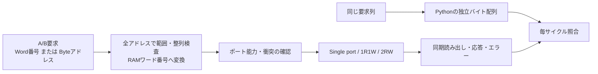

# RAMのポート構成とWord／Byteアドレスの検証

Single port、1 Read/1 Write、True dual portのSystemVerilog実行例です。ポートの使い分けだけでなく、**WordアドレスとByteアドレスの変換、Byte enable、同一番地の衝突、同期読み出しのタイミング**を自己判定します。[アドレスマップ](../local-address-map/README.md)や[ロード・ストア](../local-load-store/README.md)と併せて使えます。

次の教材として、[ECC付き部分書込み・画像ダブルバッファ・同期RAM型FIFO・非整列アクセスの4例](../local-memory-common/README.md)を用意しています。

## 実行方法

Python 3、Icarus Verilog、vvpを使い、リポジトリのルートから実行します。外部Pythonパッケージは不要です。出力先は毎回新しくします。

```sh
python3 examples/local-ram-ports/run.py --out artifacts/ram-ports-smoke
python3 examples/local-ram-ports/run.py --profile nightly --seed 17 --out artifacts/ram-ports-nightly
python3 examples/local-ram-ports/run.py --waves --out artifacts/ram-ports-wave
python3 -m unittest discover -s examples/local-ram-ports/tests -v
```

smokeは38件、nightlyは62件のJUnit判定です。標準12構成ごとの通常試験と目標の到達、12種類の誤実装の検出、ツール、ソースの更新有無を確認します。通常試験には固定ケースとseed付き乱数を含み、nightlyはランダム部を96→384サイクル、seedを1→3個へ増やします。固定ケースはどちらでも省略しません。

## 3種類のRAMを区別します

| 構成 | この例の意味 | 1クロックで可能な操作 |
| --- | --- | --- |
| Single port RAM、1RW | Aに読み書き共用の1ポートがあります | 読み出しか書き込みのどちらか1操作です |
| 1 Read/1 Write RAM、1R1W、Simple dual port | Aは書き込み専用、Bは読み出し専用です | 異なる番地への1書き込みと1読み出しを同時に行えます |
| True dual port RAM、2RW | A・Bの両方で読み書きできます | 2読み出し、異なる番地への2書き込み、1読み出し＋1書き込みが可能です |

「Dual port」「2PRAM」「2P」はプロジェクトやマクロで意味が異なるため、**各ポートのR/W能力を確認します**。本教材では上表の意味で使います。初版はすべて共通クロックです。ポート数とクロック数は別の軸であり、Dual portだから非同期とは限りません。異なるクロックで使う例は[非同期FIFO](../local-async-fifo/README.md)や[画像パイプライン](../local-video-async/README.md)を参照してください。



## 作成したファイル

| ファイル | 役割 |
| --- | --- |
| [ram_sp.sv](rtl/ram_sp.sv) | 読み書き共用1ポートです。書き込み中は読み出し出力を保持します |
| [ram_1r1w.sv](rtl/ram_1r1w.sv) | 独立した書き込みポートと読み出しポートです |
| [ram_tdp.sv](rtl/ram_tdp.sv) | 両ポートで読み書きでき、同じワードへの有効な二重書き込みを拒否します |
| [ram_address_adapter.sv](rtl/ram_address_adapter.sv) | Word／Byte変換、整列・範囲検査、Byte enableを扱います |
| [ram_ports_top.sv](rtl/ram_ports_top.sv) | 共通の要求・応答形式でRAM構成を選び、未対応操作を拒否します |
| [ram_ports_tb.sv](tb/ram_ports_tb.sv) | 入力・応答、読み出し遅延、保持、衝突、全サイクルのデータを検査します |
| [model.py](model.py) | 独立したバイト配列モデルと固定／ランダム刺激を生成します |
| [run.py](run.py)／[requirements.json](requirements.json) | 4要求・22目標、構成ごとの到達、変異、JUnitと証跡を管理します |
| [test_ram.py](tests/test_ram.py) | 既知値、誤実装、弱い読み戻し試験の限界、Xと遅延の検出を確認します |

## インターフェースと初期化

ラッパーは比較用にA・Bの共通要求を持ちます。`KIND=0/1/2`がそれぞれ1RW／1R1W／2RWです。Single portのB、1R1WのA読み出し・B書き込みは、エラー応答だけを返し、RAMにはアクセスしません。共通ラッパーが2要求を持つことと、RAM本体のポート数を混同しません。

各要求は`valid/write/word/addr/wdata/strb`です。`ready=rst_n`で、立ち上がり直前の`valid && ready`を受理し、そのエッジのNBA更新後に`rsp_valid`と応答を出します。読み出しデータも登録出力です。連続サイクルで要求でき、応答側のバックプレッシャーは設けません。受信側は各サイクルの応答を取り込みます。

書き込み・エラー・idleでは読み出し出力を保持します。`rsp_valid`は書き込み応答やエラー応答にも立ちます。要求がないサイクルは`rsp_valid/error/collision`を0にし、過去のエラーを残しません。未整列、範囲外、ポート能力に反するアクセスは状態を変えません。

リセットは同期・アクティブLowです。応答と読み出し出力は0に戻しますが、**RAMの配列はリセットしません**。電源投入直後の内容は未規定です。試験では全ワードを既知値で書いてから読み、Python側も未初期化バイトの比較を禁止します。処理中のリセットに重ねた書き込みは無効とし、初期化済み内容が保持されることを再読出しで確認します。

<a id="word-byte"></a>

## WordとByteのアドレスを対応付けます

各要求の`word=1`はRAMのネイティブWord番号、`word=0`はByteアドレスです。通常の製品バスでは単位をインターフェース仕様で固定します。このフラグは同じRAMを両方の視点で試すための教材用ラッパーです。Byteアドレス側だけが`BASE_ADDR`を使います。

```text
bytes_per_word = DATA_W / 8
Byte address  = BASE_ADDR + Word index * bytes_per_word
Word index    = (Byte address - BASE_ADDR) / bytes_per_word
```

| 構成 | ワード数／容量 | Word番号 | 許可するByteアドレスの先頭／末尾 | 範囲直後 |
| --- | --- | --- | --- | --- |
| 32 bit × 16 words | 16／64 bytes | 0〜15 | 0x100／0x13C、4バイト刻みです | 0x140です |
| 64 bit × 8 words | 8／64 bytes | 0〜7 | 0x100／0x138、8バイト刻みです | 0x140です |
| 32 bit × 13 words | 13／52 bytes | 0〜12 | 0x100／0x130、4バイト刻みです | 0x134です |

たとえばByteアドレス`0x108`は、32ビットRAMならWord番号2、64ビットRAMならWord番号1です。32ビットで正しかった「常に2ビット右シフト」を64ビットにも使うと誤ります。

この例のByte側は、**ワード境界に整列した転送＋Byte enable**です。`0x101`のような未整列アドレスを、自動的に丸めたり別ワードへ分割したりはしません。部分書き込みは、整列したワードのアドレスと、そのワード内の`strb`で指定します。任意のByteアドレスからのバイト／ハーフワード操作は[ロード・ストア例](../local-load-store/README.md)で扱います。

Byte enableのbit 0は`wdata[7:0]`、bit 1は`wdata[15:8]`に対応するlittle endianの契約です。たとえばWord 2へ`0x11223344`を書いた後、同じWordへ`wdata=0x00AA0000, strb=0b0100`を与えると`0x11AA3344`になります。非選択バイトは保持し、`strb=0`は正常な無変更書き込みです。

範囲は**アドレス全体で検査してから**RAMの狭いインデックスを有効にします。16ワードRAMだからと先に下位4ビットへ切ると、範囲外のWord 16がWord 0へ折り返します。13ワード構成では4ビットのアドレス線があっても、Word 13〜15を使えるとは扱いません。

32ビット16ワードのWord番号を4ビットへ切り詰める場合、ベース0x100の減算忘れが折り返しで隠れることもあります。ベース0x108の固定構成を加え、その相殺を避けて検査します。セルフテストでは、減算忘れがベース0x100で生き残り、0x108で検出されることも実演します。

## 同一番地と同時アクセスの契約

1R1Wと2RWでは、片方が読み、他方が同じワードへ有効な書き込みを行う場合を比較します。`RDW_MODE`は次の意味です。

| 値 | 読み出し結果 | 検査の要点 |
| --- | --- | --- |
| 0：READ_FIRST | そのエッジの書き込み前のワードです | 過去の出力値ではなく、対象番地の旧値を返します |
| 1：WRITE_FIRST | Byte enableを適用した更新後のワードです | 未選択バイトは旧値なので、生の`wdata`をそのまま返す実装は誤りです |
| 2：NO_CHANGE | 直前の読み出し出力を保持します | 別番地の直前値を使い、READ_FIRSTとの違いを検出します |

読書き衝突は`a_read_collision/b_read_collision`で示します。NO_CHANGEの衝突時は、応答があっても要求番地の新しい値ではありません。利用側は衝突フラグとモードを見て再読出し等を行います。ゼロマスクの書き込みは値を変えないため、読書き衝突には数えません。

2RWの同じワードへの二重書き込みは、両方のマスクが非ゼロなら**両方を拒否し、両ポートにエラーを返し、内容を保持**します。非重複のByte enableでも拒否します。片方がゼロマスクなら有効な側だけを反映します。これは教材の保護契約で、実マクロが同じ番地の二重書き込みを自動拒否するという意味ではありません。

異なる番地への同時読み書き、2読み出し、2書き込みも別に確認します。同じ番地の2読み出しは許可します。Single portは1回の操作を読みか書きで選ぶため、同一ポートへ同時に独立した読書き要求を出す構成ではありません。

## 不具合を検出する試験

PythonモデルはRAMを**バイトの配列**として保持します。Word番号はバイト位置へ乗算し、Byte側はベースとの差を使い、RTLのビット切り出しや右シフトをコピーしません。現在のDUT内容を期待値に使いません。

- 全ワードをWord番号側から異なる値で初期化し、Byte側で全域を読み、逆順にWord側でも読みます。逆向きの書き込みと別ポートからの読出しも行います。
- 先頭・末尾・隣接ワード、アドレスの各ビットが異なる組、32／64ビット、非2のべき乗深さ13を使います。
- 全Byteレーン、ゼロ／全マスク、非選択バイト、隣接ワードの保持、全0／全1／交互ビットを確認します。
- 未整列・ベース未満・末尾直後・高位アドレスの書き込みを拒否し、**エラー表示だけでなく再読出しで副作用も検査**します。
- 同一番地の読書きと3モード、二重書き込み拒否、別番地の同時アクセス、未対応ポート操作を確認します。
- 入力は立ち下がりに変更し、次の立ち上がり前にも応答が変わらないことを検査します。NBA後1 nsで応答を照合し、同期読み出しを組み合わせ読み出しに変えた負例も検出します。
- リセット中の要求無効化、内容の保持、idle中の出力保持、seed付き乱数と最後の全域再読出しを行います。

### 同じ経路の読み戻しだけでは隠れる場合があります

Byte側だけがWord番号0と1を入れ替える誤りを考えます。その誤った変換で書き、同じ変換で読むと、同じ場所を往復するためデータが一致し得ます。全ワードをByte側だけで初期化して読む弱い試験では、この誤実装が生き残ることをセルフテストで実演します。

続いて、ネイティブWord番号で初期化しByte側で読む通常試験を与えると、不一致を検出します。ログの`EXPECTED_LIMITATION symmetric_address_permutation_survives_self_readback`は、RAMが正しいという意味ではなく、弱い試験の限界を確認した結果です。通常の変異検出とは分けます。

### 意図的な誤実装

| MUTATION | 誤実装 | 検出するラベル |
| --- | --- | --- |
| 1 | ByteアドレスをWord番号へ変換せず使用します | `RAM_DATA`です |
| 2 | Wordサイズの変換を二重に行います | `RAM_DATA`です |
| 3 | 64ビットでも固定で2ビット右シフトします | `RAM_DATA`です |
| 4 | 未整列チェックを省略します | `RAM_STATUS`です |
| 5 | 範囲外を狭いインデックスへ折り返して受理します | `RAM_STATUS`です |
| 6 | エラーを返しながらRAMを更新します | `RAM_DATA`です |
| 7 | Byte enableのレーン順を逆にします | `RAM_DATA`です |
| 8 | Byte enableを無視して全バイトを更新します | `RAM_DATA`です |
| 9 | WRITE_FIRSTでも旧値を返します | `RAM_DATA`です |
| 10 | 同一番地の二重書き込みを拒否しません | `RAM_STATUS`です |
| 11 | Byte側だけのWord番号を一対一で入れ替えます | `RAM_DATA`です |
| 12 | Byte側のBASE_ADDR減算を省略します | `RAM_DATA`です |

変異は検証の検出力を見るフックです。通常構成は`MUTATION=0`を使います。変異が残る、コンパイルだけ失敗する、時間切れになる、別ラベルで終了する場合は検出成功にしません。Xを含む読み出しも`!==`で不一致とし、通常比較をすり抜けさせません。セルフテストにはXデータと同期遅延の負例も含みます。

## 構成・証跡・波形

標準12構成は、32ビット×16ワードのSingle portと1R1W／2RWの各3モード、64ビット×8ワードの3構成、32ビット×13ワードの2RW、ベース0x108の2RWです。Single portには読書き衝突モードを適用しません。各構成で必要な目標だけを集計し、実行できない2ポート操作をSingle portの未達として数えません。

```sh
python3 examples/local-ram-ports/run.py --width 64 --depth 12 --base 0x800 --seed 123 \
  --waves --out artifacts/ram-ports-custom
```

主構成の幅は32／64、深さは4〜256、ベースは8バイト整列の0x8〜0x8000です。固定のwide構成、深さ13構成、ベース0x108構成も残します。`--help`に全引数があります。

各ケースへ`vectors.txt`、`manifest.json`、`simulation.log`、`result.json`、`--waves`時の`trace.vcd`を保存します。ベクトルには要求とPythonの期待値、試験段階が含まれます。最上位にはソースハッシュ、ツール版、JUnit、通常ケースだけの目標到達を保存します。これはログによる機能目標で、ネイティブcovergroup DB、コードカバレッジ、物理RAMの故障カバレッジではありません。

波形は、たとえば`tdp-write-first-w32-d16/seed17/trace.vcd`を開き、要求の`a/b_word`・`addr`・`strb`、内部`a/b_index`、応答の`rsp_valid/error/rdata`、衝突フラグを比較します。`phase`は0が初期化、1がWord／Byte対応、2がByte enable、3が境界・範囲、4が同時アクセス、5がリセット、6が乱数、7が全域再読出しです。

失敗時は`CHECK_FAIL`と、テスト名・seed・行番号・段階・構成・幅・深さ・モード・両ポートの要求・マスク・期待値・実測値・フラグを英語で表示し、非ゼロ終了します。全予定行数と読書き・エラー・衝突・リセットの件数も照合し、比較0件や途中終了をPASSにしません。

## 実行確認と対象外

2026-11-19にIcarus Verilog／vvp 14.0 (devel、`s20260301-411-gca6b8d376`)で、通常12構成、読書き衝突の3モード、12種類の変異、smoke／nightlyを実行しています。10件のセルフテストには既知値・保持・衝突・再現性、弱い読み戻し試験とその補強、ベースアドレスによる相殺、Xと非同期読み出しの検出を含みます。

この例は共通クロックのRTL機能モデルです。Byteアドレスの任意の非整列分割、独立クロックの衝突窓、非同期リセット、ECC、MBIST、SRAMのセル故障、実マクロへのマッピング、STA、配置配線、実機は対象外です。他のシミュレータでTBを実行した結果とも扱いません。

実マクロではポート能力、Byte enableの粒度、read-during-write、同一番地の禁止条件、クロック条件、初期値をデータシートで確認します。WRITE_FIRSTの転送や二重書き込み拒否には周辺ロジックが必要な場合もあり、このRTLが指定SRAMやFPGAメモリへそのまま推論されるとは保証しません。[AlteraのRAM構成の説明](https://docs.altera.com/r/docs/683423/25.1.1/stratix-10-embedded-memory-user-guide/on-chip-memory-ram-and-rom-fpga-ips)と[AMDのメモリ推論の説明](https://docs.amd.com/r/2022.2-English/ug901-vivado-synthesis/Inference-Capabilities)も参照し、製品ごとの仕様と合成結果を確認してください。
