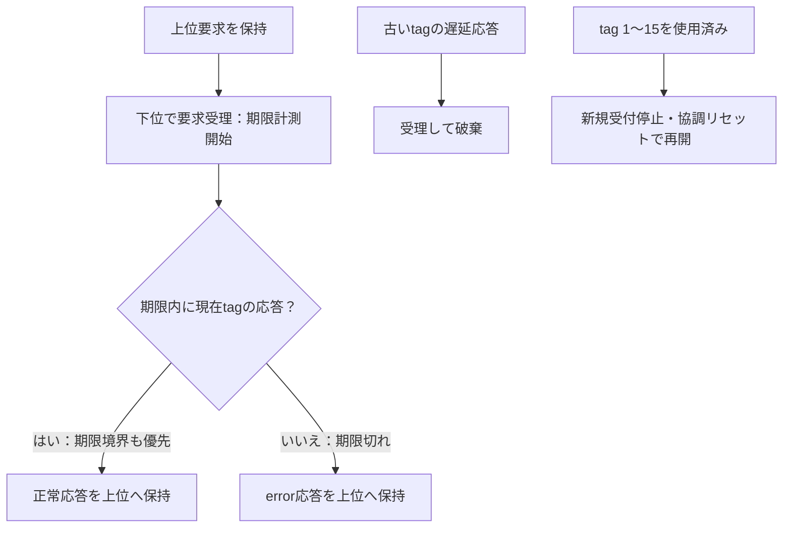

# タイムアウト・遅延応答・復旧を検証する

tag付きの要求／応答ラッパーで、応答停止、タイムアウト、遅れて届く応答、その後のトランザクションを検証する教材です。AXIのトランザクション取消しや再試行を実装したものではなく、独自の下位インターフェースを使います。

## 期限切れと古い応答の扱い

下位が受理してから期限を数え、現在のtagだけを上位へ返し、期限切れ後の古い応答を捨てます。



期限切れは下位トランザクションの取消しではありません。図は処理の分類で、上位応答の受理前に次要求を始める意味ではありません。

| 確認する場面 | 期待する動作 | 主な照合対象 |
| --- | --- | --- |
| 下位の受付前 | タイムアウトを開始しない | VALIDと要求保持 |
| 期限と同じエッジ | 現在tagの正しい応答を優先 | 期限境界 |
| tag枯渇 | 再利用せず停止 | 下位も含むリセット後の復帰 |

## タイムアウトとtagの規則

上位要求を1件保持して下位へ渡し、**下位が要求を受理した後**から4／8クロックを数えます。下位が要求を受けない間のタイムアウトはありません。

期限までに現在のtagの応答が届けば正常完了です。期限と同じエッジの正しい応答を優先します。期限切れは上位へerror=1・result=0を返します。その応答も上位のREADYまで保持し、次の要求は受け付けません。下位要求が無かったことにはせず、後から届いた古いtagは受理して捨てます。

16ビットのtagポートに、教材では4ビットの連番1〜15を載せます。0は使いません。**一周して古いtagを再利用せず、15に達した後は新規要求を停止**します。再開には、ラッパーと下位の未処理応答をまとめて破棄するリセットが必要です。ラッパーだけをリセットし、古い応答が残る状態で連番を戻す使い方は契約外です。

この例の下位はテストベンチから応答を与えるモデルです。下位を実際のAXIへ置き換える場合は、受付済みトランザクションの完了・隔離・IDの再利用を含む別の設計が必要です。

## 検査

Pythonは受付時刻と期限、未完了要求、上位へ保持する結果を記録し、毎クロックの出力を生成します。SVでVALID／READY、tag、データ、エラー、破棄パルスを比較します。

固定ケースには正常応答、下位の受付待ち、上位の応答待ち、期限切れ、応答保持中の遅延応答、新しい要求待ち中の古い応答、期限境界の正常応答、tag枯渇と協調リセット後の復帰を含めます。ランダム検証はデータ、正常／無応答、古い応答の注入、受付・応答待ちを変更します。連番枯渇時は下位モデルも破棄し、前のepochの応答を新しいepochへ注入しません。

[要求カタログ](requirements.json)は3要求・10目標。受付、完了、タイムアウト、古い応答の破棄を照合します。4種類の変異は、古いtagの受入れ、期限の1クロックずれ、tagを常に0にする誤り、READYを待たない上位応答消失です。古い応答があるだけで成功にせず、予定チェッカーと異常終了を要求します。

## 実行

```sh
python3 examples/local-recovery/run.py
python3 examples/local-recovery/run.py --profile nightly
python3 -m unittest discover -s examples/local-recovery/tests -v
```

[共通手順](../local-common/README.md)を利用します。`timeout4`／`timeout8`の2構成、smokeは32要求×1 seed、nightlyは300×3 seedです。固定試験・連番枯渇時の協調リセットの追加クロックはiterationsとは別です。checksはクロックごとのベクトル数で、JUnitは14／18件です。

任意の下位装置に対する安全な取消し、リセット後も残る応答、無限時間の活性、実機の障害回復を保証する例ではありません。遅延応答・tagの寿命・再開の条件を先に仕様化する教材です。
