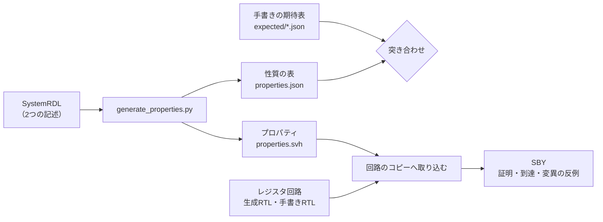

# SystemRDLからフィールド属性ごとのプロパティを生成して証明する

レジスタの記述（SystemRDL）から、フィールドの属性ごとにフォーマル検証のプロパティを生成し、レジスタ回路がその記述どおりに動くことをSBYで証明する教材です。[レジスタ仕様の例](../local-register-spec/README.md)は、同じ記述からRTL・Cヘッダー・UVM RALを生成して、シミュレーションで確かめます。この教材は、同じ記述から性質を生成し、与えた操作列の範囲ではなく、すべてのバス操作について示します。

性質を生成器で作ると、生成器の誤りはすべての性質に同じ形で入ります。弱すぎる性質は、正しい回路の証明を通してしまうので、証明の合格からは見えません。この教材では、手で書いた小さな期待表と生成結果を突き合わせ、生成器に入れた誤り5種類が見つかることを確かめます。

## 検査の構成



対象の回路は2つです。

| 構成 | 記述 | 回路 | 記述と回路の関係 |
| --- | --- | --- | --- |
| `spec` | [レジスタ仕様の例の`registers.rdl`](../local-register-spec/registers.rdl) | その例の生成器が実行時に作る`rdl_regs.sv` | RTLの生成器と性質の生成器は別のプログラム。同じ記述を別々に読む |
| `wide` | この教材の[`registers.rdl`](registers.rdl) | 手書きの[`reg_block.sv`](rtl/reg_block.sv) | RTLは記述から生成していない |

`spec`の記述は、1レジスタに1フィールドで、どのフィールドもビット0から始まります。`wide`は、1レジスタに複数のフィールドと、その間の予約ビットを持ちます。

## 仕様（契約）

`wide`のレジスタは次のとおりです。[手書きの期待表](expected/wide.json)は、この表から書きました。

| 番地 | レジスタ | フィールド | ビット | 属性 | リセット値 |
| --- | --- | --- | --- | --- | --- |
| 0x00 | `ctrl` | `enable` | 0 | RW | 0 |
| 0x00 | `ctrl` | `mode` | 6:4 | RW | 5 |
| 0x00 | `ctrl` | `rev` | 11:8 | RO | 9 |
| 0x04 | `status` | `done` | 0 | W1C（イベントを保持） | 0 |
| 0x04 | `status` | `err` | 5:4 | W1C（イベントを保持） | 0 |
| 0x08 | `limit` | `value` | 31:0 | RW | 0 |
| 0x0c | `id` | `value` | 31:0 | RO | 0x57494445 |

`spec`のレジスタは、[レジスタ仕様の例](../local-register-spec/README.md)にあります（0x00の8ビットRW、0x04の32ビットRO、0x08の4ビットW1C）。

SystemRDLの記述に書かれていない、バス側の約束があります。これは[`bindings.json`](bindings.json)に構成ごとに書きます。

| 項目 | `spec` | `wide` |
| --- | --- | --- |
| 記憶素子の名前 | レジスタ名（`cfg`など） | `レジスタ名_フィールド名`（`ctrl_mode`など） |
| ROだけのレジスタへの書込み | エラー応答 | エラーにせず無視 |
| W1Cのイベントの入力 | `events[3:0]` | `events[0]`が`done`、`events[2:1]`が`err` |
| 待ちサイクル | パラメーター`WAIT_CYCLES`（0または2） | なし |

マップにない番地は、どちらもエラー応答で、読出し値は0です。

## 生成するプロパティ

フィールドの属性ごとに、次のプロパティを作ります。1つの行が、同じ名前のアサーション1個になります。

| 種類 | 対象 | 内容 |
| --- | --- | --- |
| `reset` | 全フィールド | リセットの次のサイクルに、記述のリセット値を持つ |
| `write` | RW | 自分のレジスタへの受理された書込みの次のサイクルに、書いたビットを持つ |
| `hold` | RW | それ以外のサイクルでは値が変わらない。別の番地への書込み、エラーになった書込み、読出しを含む |
| `const` | RO | 値がリセット値から変わらない |
| `event` | W1C | イベントが来たビットは、同じサイクルにクリアの書込みがあっても、次のサイクルに1になる |
| `w1c` | W1C | イベントが来ていないビットは、1を書いたときだけ0になり、ほかは変わらない |
| `read` | 全フィールド | 読出しデータの自分のビット位置が、記憶している値に等しい |
| `reserved` | 予約ビットを持つレジスタ | 読出しデータの予約ビットが0 |
| `ro_write` | ROだけのレジスタ | 書込みの応答が、バス側の約束どおり（エラー、または無視） |
| `unmapped_error`・`unmapped_read` | マップ全体 | マップにない番地はエラー応答で、読出し値は0 |
| `mapped_ok` | マップ全体 | マップにある番地への、拒否されない操作はエラーにならない |

「アドレスの別名なし」は、3つで確かめます。生成器は同じ番地のレジスタが2つあれば拒否します。`hold`は、ほかの番地への書込みで値が変わらないことを示します。`unmapped_error`は、マップにない番地がどのレジスタも選ばないことを示します。

アサーションの数は、`spec`が17個、`wide`が32個です。前提は4個で、最初にリセットを1回かけること（`as_reset`）と、APBの転送がsetupとaccessの順に進み、その間は番地・方向・書込みデータが変わらないこと（`as_select`・`as_phase`・`as_stable`）です。リセットは、その後いつ入ってもかまいません。

### プロパティの置き場所

プロパティは記憶素子を直接見るので、レジスタ回路の中から見える場所に置く必要があります。固定版のYosys（0.70）で小さく試したところ、次のとおりでした。

- `bind`は構文エラーになります。
- 上位のモジュールから`u.q`のように階層参照を書くと、エラーにならず、「暗黙に宣言した」という警告だけで別の線になります。そのまま証明すると、性質は回路とつながらずに成立します。

そこでランナーは、回路のファイルを実行先へコピーし、最後の`endmodule`の前に`` `include "properties.svh"``を1行入れます。追跡しているRTLには手を入れません。プロパティがモデルに入ったことは、Yosysが書き出すモデルのアサーション・前提・到達目標の名前を、期待表の名前と照合して確かめます。1個でも欠けるか余ると、そのタスクは不合格です。

## 生成器の誤りを見つける

生成器は、記述を読んで[性質の表](#生成するプロパティ)を作り、その表からSystemVerilogを書きます。ランナーは、性質の表を手書きの期待表（[`expected/spec.json`](expected/spec.json)、[`expected/wide.json`](expected/wide.json)）と行ごとに比べます。比べるのは、名前・種類・番地・ビット位置・幅・値（リセット値、予約ビットのマスク、応答の方針）です。

生成器の`--demo-bug`で、記述の読み方に誤りを入れます。`wide`での結果は次のとおりです。

| 番号 | 入れる誤り | 期待表との比較 | 正しい回路の証明 | 見逃す変異 |
| --- | --- | --- | --- | --- |
| 1 | 予約ビットの性質を作らない | 不一致 | 合格のまま | 変異5（予約ビットが読める） |
| 2 | `onwrite=woclr`を無視し、W1CをRWとして扱う | 不一致 | 不合格（`hold`の反例） | — |
| 3 | リセット値をすべて0とする | 不一致 | 不合格（`reset`・`const`の反例） | — |
| 4 | マップにない番地の性質を作らない | 不一致 | 合格のまま | —（変異6は`hold`が見つける） |
| 5 | 最上位のフィールドより上だけを予約ビットとする | 不一致 | 合格のまま | 変異5 |

誤り1・4・5は性質を弱くするだけなので、正しい回路の証明は合格のままです。証明だけを見ていると気づけません。誤り1・5では、変異5を入れた回路の証明も合格します。この2つの「合格」は、診断として実行して記録します。

誤り5は、`spec`の記述では何も変えません。どのレジスタもフィールドが1つでビット0から始まるので、「フィールドより上」と「フィールド以外」が同じになるためです。単純な記述だけを期待表にしていると、この誤りは表からも見えません。これも確認の1つとして実行します（`generator-bug5-invisible-on-spec`）。

`spec`では、もう1つ突き合わせを行います。この生成器が読んだフィールド（名前・番地・幅・リセット値・属性）を、[レジスタ仕様の例の手書きの契約](../local-register-spec/contract.json)と比べます（`spec-contract`）。

期待表が確かめるのは、性質の表までです。表からSystemVerilogを書く部分の誤りは、表からは見えません。そこは、正しい回路の証明、変異の反例、モデルに入った名前の照合の3つで確かめます。

## 構成

| ファイル | 内容 |
| --- | --- |
| [`registers.rdl`](registers.rdl) | `wide`の記述 |
| [`rtl/reg_block.sv`](rtl/reg_block.sv) | `wide`の手書きの回路。パラメーター`MUTATION`で変異1〜8 |
| [`generate_properties.py`](generate_properties.py) | SystemRDLを読み、性質の表とプロパティを書く生成器 |
| [`bindings.json`](bindings.json) | 構成ごとの、記述に書かれていないバス側の約束 |
| [`expected/`](expected/) | 手書きの期待表 |
| [`requirements.json`](requirements.json) | 要求と、それを示す確認の対応 |
| [`run.py`](run.py) | 生成、期待表との比較、SBYの実行、判定 |
| [`tests/`](tests/) | ランナーと生成器のセルフテスト |

テストベンチはありません。フォーマルだけの教材です。

生成器が対応するのは、階層のないアドレスマップ、32ビットのレジスタ、3種類のフィールド（`sw=rw; hw=r`のRW、`sw=r; hw=r`のRO、`sw=rw; hw=w; onwrite=woclr; stickybit; precedence=hw`のW1C）だけです。配列、入れ子、読出しの副作用、リセット値の省略、ハードウェアが書けるRWなどは、読み飛ばさずに拒否します。

## 実行方法

SystemRDLのコンパイラーが入ったPythonと、フォーマルのツール（YoWASP版のYosys・SBY、Z3）が要ります。準備は[実行環境](../../tools/ENVIRONMENT.md)にあります。

```sh
python3 examples/local-register-formal/run.py --out artifacts/register-formal-smoke
python3 examples/local-register-formal/run.py --profile nightly --out artifacts/register-formal-nightly
python3 -m unittest discover -s examples/local-register-formal/tests -v
```

ランナーを動かすPythonにSystemRDLのコンパイラーがないときは、`--rdl-python`で、それが入ったPythonを指定します。2つの生成器（この教材のものと、レジスタ仕様の例のもの）だけを、そのPythonで起動します。

| オプション | 内容 |
| --- | --- |
| `--profile` | `smoke`（既定）または`nightly`。`nightly`は、`spec`の回路を待ち2サイクルにした証明・到達・変異3種類を加える |
| `--seed` | 記録するだけで、結果には影響しない（乱数を使わない） |
| `--out` | 新しい保存先 |
| `--rdl-python` | SystemRDLのコンパイラーが入ったPython。既定はランナーと同じ |
| `--jobs` | 並行に動かすSBYのタスク数（既定4） |
| `--formal-timeout` | SBYのタスク1個の上限（既定300秒）。`--timeout`は、版の取得と生成の上限 |
| `--demo-bug` | 通常の証明を変異つきの回路で実行する（1〜8。`spec`の回路は1〜3だけ）。不合格で終わることを確かめるためのもの |
| `--sby`・`--yosys`・`--smtbmc`・`--witness` | 実行ファイル |

保存先には、`manifest.json`（計画と入力のハッシュ）、`tools.json`、`generated/`（生成したRTL、性質の表、プロパティ）、`generator-bugs.json`（誤りごとの期待表との差）、タスクごとのディレクトリ（`dut.sv`、SBYの設定とログ、反例の波形、`result.json`）、`coverage.json`、`requirements.json`、`summary.json`、`junit.xml`が残ります。

## 要求と目標

| 要求 | 内容 |
| --- | --- |
| RG-RESET | リセットの後、全フィールドが記述のリセット値を持つ |
| RG-RW | RWのフィールドは、自分のレジスタへの受理された書込みで書いたビットを持ち、ほかでは変わらない |
| RG-RO | ROのフィールドは変わらない。ROだけのレジスタへの書込みの応答は、バス側の約束どおり |
| RG-W1C | W1Cのフィールドは、イベントのビットを必ず1にし（同じサイクルのクリアより優先）、1を書いたビットだけをクリアする |
| RG-READ | 読出しは、各フィールドを自分のビット位置に返し、予約ビットを0で返す |
| RG-ALIAS | マップにない番地はエラー応答で、読出し値は0、どのフィールドも変えない |
| RG-NONVACUOUS | 生成したプロパティの条件は実際に起こる。到達目標に届き、転送を始めない環境は検出される |
| RG-GENERATOR | 生成器の出力は期待表に一致し、入れた誤りは、証明からは見えないものも含めて期待表で拒否される |

要求は8個です。目標は、確認の名前で数えて、smokeが34個、nightlyが39個です。

到達目標（cover）は、`spec`が8個、`wide`が16個です。RWの書込みでリセット値以外になること、W1Cのイベントでのセットと書込みでのクリア、各フィールドの読出し、ROだけのレジスタへの書込み、マップにない番地へのアクセスを含みます。深さ16の範囲で全部に届くことを確かめます。

`*-overconstrained`は、転送を1回も始めないという前提（`as_idle`）を足した診断です。転送が要る到達目標にはどれも届かず、イベントでのセットだけに届くことを確かめます。前提が強すぎると、証明は合格のまま何も確かめなくなります。

## 変異

`spec`の回路の変異は、[レジスタ仕様の例](../local-register-spec/README.md)の生成器が入れる3種類です。`wide`の回路の変異は8種類です。それぞれ、証明が不合格になり、予定したアサーションが反例に含まれ、波形とwitnessが残ることを確かめます。

| 構成 | 番号 | 誤り | 反例になるアサーション |
| --- | --- | --- | --- |
| `spec` | 1 | `cfg`のリセット値が1ビット違う | `ap_cfg_value_reset` |
| `spec` | 2 | `cfg`の書込みが下位4ビットだけ | `ap_cfg_value_write` |
| `spec` | 3 | 同じサイクルのクリアがイベントに勝つ | `ap_pending_value_event` |
| `wide` | 1 | `mode`のリセット値が違う | `ap_ctrl_mode_reset` |
| `wide` | 2 | `mode`の書込みが下位2ビットだけ | `ap_ctrl_mode_write` |
| `wide` | 3 | ROの`rev`に書ける | `ap_ctrl_rev_const` |
| `wide` | 4 | `err`が書いた値をそのまま持つ（W1Cでない） | `ap_status_err_w1c` |
| `wide` | 5 | 予約ビット3が値を持ち、読める | `ap_ctrl_reserved` |
| `wide` | 6 | 番地の上位4ビットを見ない（0x10が0x00の別名になる） | `ap_unmapped_error` |
| `wide` | 7 | 同じサイクルのクリアがイベントに勝つ | `ap_status_done_event` |
| `wide` | 8 | `done`を読出しデータのビット1に返す | `ap_status_done_read` |

smokeでは11件、nightlyでは待ち2サイクルの`spec`の3件を加えた14件を検出します。

## 確認範囲と残る制限

- 証明はk帰納法（Z3、深さ6）による非有界の証明です。どのプロパティも1サイクルの関係か組合せの関係なので、補助の不変条件は使っていません。
- 対象は単一クロック、2値、同期リセットです。X、非同期リセット、クロックの乗換えは扱いません。
- バスはAPBの基本の転送だけです。PSTRB、PPROT、ビットごとの書込み許可は扱いません。`spec`の回路が待ちの後に必ず応答すること（前進性）は、性質にしていません。到達目標で、待ち2サイクルでも転送が終わる例があることを確かめているだけです。
- 生成器が対応する属性は、RW、RO、イベントを保持するW1Cの3種類です。読出しでクリアするフィールド、ハードウェアが書くRO（状態の表示）、カウンター、割り込みの属性、レジスタの配列やメモリは対応していません。汎用のSystemRDLからの性質の生成器ではありません。
- 記憶素子の名前と、ROだけのレジスタへの書込みの応答は、SystemRDLの記述ではなく`bindings.json`から取ります。ここを誤ると、期待表では見つからず、証明の失敗か、モデルの読込みの失敗として見つかります。
- 期待表は、性質の表までを確かめます。表からSystemVerilogを書く部分は、証明・変異・名前の照合で確かめており、期待表とは独立に検算していません。
- `spec`の回路は、同じ記述から別の生成器が作ったものです。記述そのものが意図と違っていれば、回路も性質も同じように違い、証明は合格します。記述と意図の突き合わせは、手書きの契約（`spec-contract`）と期待表が担います。
- SystemRDLの属性の意味（`stickybit`、`precedence`、`onwrite`）は、[レジスタ仕様の例](../local-register-spec/README.md)の読み方に合わせています。この教材では、規格の節番号との照合はしていません（未照合）。
- 生成したRTLと性質は、実行先にだけ保存し、リポジトリには置きません。

## 確認記録

2026-11-21に、macOS arm64、Python 3.13、systemrdl-compiler 1.30.1、YoWASP版Yosys 0.70（`28ba3cb92`）と同梱のSBY、Z3 4.15.3で実行しました。

- smoke：48件すべて合格（約13秒）。nightly：53件すべて合格（約21秒）。SBYのタスクは29個（nightly）で、1個あたり3秒以内でした。
- フォーマル用のPythonからランナーを起動し、`--rdl-python`で別のPythonを指定する形でも、smokeの48件が合格しました。
- セルフテスト：19件が合格（約32秒。smokeの実行、変異つきの回路で不合格になること、SystemRDLのコンパイラーがないと証明の前に止まることを含みます）。
- `rtl/reg_block.sv`は、Verilator 5.052の`--lint-only -Wall`で、変異0〜8のどれも警告0件でした。

Linuxとkirimasimでは実行していません。Icarusだけでは動かない教材です。
