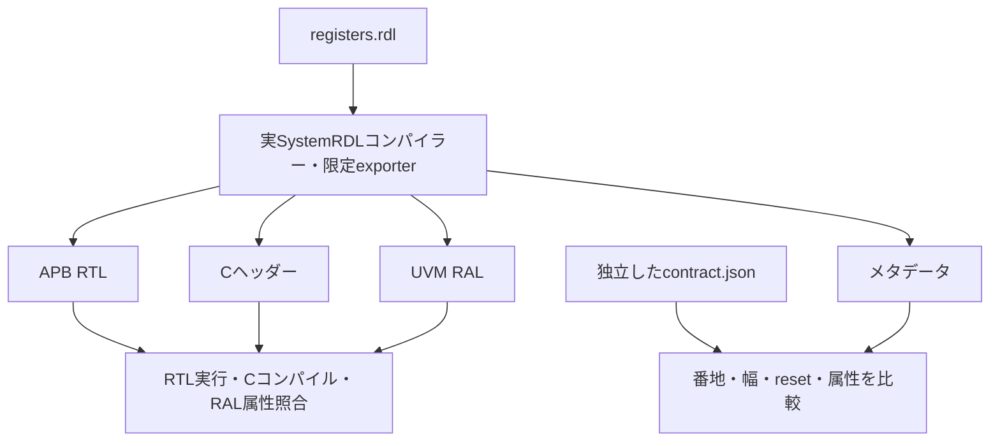

# SystemRDLからRTL・Cヘッダー・RALを生成して照合する

`registers.rdl`を実際のSystemRDLコンパイラーでエラボレーションし、独自の小さなexporterでAPB RTL、Cヘッダー、UVM RALを生成します。生成物は実行先に保存し、別に手書きした`contract.json`と照合します。GitLabは使いません。

## 共通生成物と独立契約の照合

SystemRDLから複数ビューを生成し、共通する仕様誤りは別に手書きした契約と照合して検出します。



生成ビュー同士が一致するだけでは合格にしません。生成器が対応しない属性や階層は拒否します。

| 確認する場面 | 期待する動作 | 主な照合対象 |
| --- | --- | --- |
| メタデータ | 独立契約と全項目を照合 | 共通原本の誤りを検出 |
| 生成RTL | APBを駆動して機能を比較 | RO・W1C・reset・待ち |
| C・RAL | C定数と実UVMモデル属性を照合 | RAL frontdoor接続は含まない |

## 原本と生成物の検査

教材の原本は、0x00の8ビットCONFIG（RW、reset 0x12）、0x04の32ビットID（RO、0x52444c31）、0x08の4ビットPENDING（W1C、reset 0）です。PENDINGは`stickybit; precedence=hw;`を明示し、イベント入力の各ビットを保持して、同一エッジのW1Cクリアより優先します。SystemRDLの`precedence`の既定値は`sw`なので、省略した原本は本生成器で拒否します（[SystemRDL 2.0の9.9.1・9.10節](https://www.accellera.org/images/downloads/standards/systemrdl/SystemRDL_2.0_Jan2018.pdf)）。

- コンパイラーの番地・幅・reset・アクセス属性・ハードウェア更新方式・競合優先順位・volatile属性を、別の契約ファイルと比較します。
- 生成RTLをIcarusで実行し、手書きした番地・期待値モデルで読書き、部分フィールド、RO拒否、W1C競合、待ち0／2を確認します。
- 生成CヘッダーをC11のプログラムへ取り込み、9個の番地・マスク・reset定数を照合します。
- 生成RALをUVMライブラリとコンパイルし、実オブジェクトの番地・フィールド幅・アクセス属性・reset・volatile属性を照合します。PENDINGはハードウェア更新可能なのでvolatile、CONFIGとIDは非volatileです。ここではRALのfrontdoorで生成RTLを駆動せず、RTLの機能検証とは別に行います。

原本のresetを誤らせて全ビューを生成し直し、生成物同士が同じ誤りを共有しても独立契約が拒否することを確認します。契約ファイル自体の正しさは仕様レビューで確認する必要があります。

## 対応する範囲

exporterは`cfg`・`idreg`・`pending`という3レジスタ、32ビットのスカラー、各1フィールド、LSB 0、RW／RO／W1C、明示的な整数resetという限定した形式です。配列、階層、多フィールド、RC、singlepulseなどの未対応属性は拒否します。ハードウェア側はcfg／idregが読出し専用、pendingが`stickybit`とハードウェア優先を指定したイベント保持だけに対応し、追加の属性を読み飛ばしません。汎用SystemRDL exporterではありません。

## 準備と実行

```sh
python3 -m venv /tmp/lsi-rdl-venv
/tmp/lsi-rdl-venv/bin/python -m pip install -r examples/local-register-spec/tools-requirements.txt
/tmp/lsi-rdl-venv/bin/python examples/local-register-spec/run.py \
  --uvm-home /tmp/lsi-uvm-library/1800.2-2020.3.2 --out artifacts/register-spec
/tmp/lsi-rdl-venv/bin/python -m unittest discover -s examples/local-register-spec/tests -v
```

Python 3.10以上、systemrdl-compiler 1.30.1、Icarus、Cコンパイラー、Verilator 5.052、[外部のUVMライブラリ](../local-uvm/README.md)を使います。Python依存はrequirementsへ固定しています。`--profile nightly`はRTLランダム操作を24×1 seedから150×3 seedへ増やします。固定10操作は各実行に含みます。

reset誤り・フィールドマスク誤り・W1C優先順位のRTL変異3件、Cヘッダーの番地破損、構築したRALのreset破損・volatile属性の欠落も検出します。これらのC／RAL側の診断と原本の誤りの診断はRTL変異率へ加えません。予定ラベルと非ゼロ終了を要求します。

生成ファイルとハッシュ、使用ライブラリsrcのハッシュ、コンパイラー版、入力、ビルド・実行ログ、RTL波形、JUnitを保存します。CとRALの検査は定数・モデルの検査で、波形を保存する実RTLの試験とは区別します。JUnitは17／21件、確認テストは6件です。

[SystemRDL標準](https://www.accellera.org/downloads/standards/systemrdl)、[コンパイラーAPI](https://systemrdl-compiler.readthedocs.io/en/stable/api/compiler.html)、[プロパティの既定値](https://systemrdl-compiler.readthedocs.io/en/stable/properties.html)を参照しています。外部ライブラリのソースはリポジトリへ転載していません。

## 生成したRTLとRALを実バスで接続する

[frontdoor結合例](../local-generated-ral/README.md)は、本原本・生成器・独立契約を再利用し、実APB操作、独立scoreboard、UVM_CHECKのミラー照合まで行います。本例の構造・属性確認とは別の計画・JUnitです。PENDINGはvolatileのまま使い、その際の既知のUVM警告も件数・種類を照合します。
