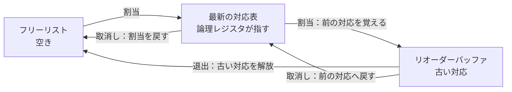

# リネーム表・フリーリスト・リオーダーバッファの保存則を証明する

アウトオブオーダーのプロセッサは、命令が書く論理レジスタに、命令ごとに別の物理レジスタを割り当てます（レジスタリネーミング）。物理レジスタは、フリーリストから取り出し、要らなくなったらフリーリストへ返します。返し忘れると、空きが減り続けて、いつか止まります（リーク）。2回返すと、同じ物理レジスタが2つの命令に渡り、値が壊れます（二重解放）。どちらも、起きてから長い時間がたって初めて症状が出るので、シミュレーションの出力の比較だけでは見つけにくい誤りです。

この教材では、リネーム表・フリーリスト・リオーダーバッファだけを持つ小さな回路について、「どの物理レジスタも、ちょうど1か所にある」という保存則を、すべての入力列についてフォーマルに証明します。あわせて、リネームをしない逐次実行のモデルと、シミュレーションで比べます。

プロセッサの検証全体での位置付けは、[プロセッサの検証手順](../../docs/method/processor-verification.md)にあります。命令そのものの実行は、[コアとISSの比較](../local-riscv-iss/README.md)で扱います。

## 保存則

物理レジスタの居場所は、次の3つです。



| 居場所 | 意味 |
| --- | --- |
| 空き | フリーリストにある |
| 割当済み | 最新の対応表で、どれかの論理レジスタが指している |
| 退出待ち | バッファの中の命令が「自分が置き換えた古い対応」として覚えている。その命令が退出すると解放される |

保存則は、「どの物理レジスタも、この3つのうちちょうど1か所にある」です。0か所ならリーク、2か所以上なら二重解放か対応表の壊れです。

同じ物理レジスタを、持ち主から見ることもできます。持ち主は、フリーリスト、退出済みの対応表（コミット済みの状態）、バッファの中の命令（自分の結果を書く先）のどれか1つです。この2つ目の見方は、「コミット済みの値を、実行中の命令が上書きしない」ことの証明に使います。

保存則から、空きの数についての関係も出ます。物理レジスタの数をP、論理レジスタの数をL、バッファの中の命令の数をnとすると、空きの数は常にP−L−nです。したがって、フリーリストが空になるのは、n＝P−Lのときだけです。バッファの大きさとP−Lの小さいほうが、同時に実行できる命令の数の上限になります。

## 対象回路

[`rename_rob.sv`](rtl/rename_rob.sv)は、1サイクルに1命令を割り当て、1命令を退出させます。命令は、論理レジスタを1つ書くものだけです。

| 操作 | 入力 | 動作 |
| --- | --- | --- |
| 割当 | `alloc_valid`・`alloc_dst` | 番号の最も小さい空きの物理レジスタと、バッファの末尾の場所（`alloc_tag`）を与える。`alloc_ready`が0なら受け付けない |
| 完了 | `done_valid`・`done_tag`・`done_value`・`done_exc` | その命令の結果を物理レジスタへ書き、完了の印を付ける。例外つきの完了もある |
| フラッシュ | `flush_valid`・`flush_tag` | `flush_tag`の命令より若い命令をすべて取り消す。`flush_tag`の命令は残る（分岐の予測外れ） |
| コミット | `commit_en` | 先頭の命令が完了していれば、そのサイクルに退出（`retire_valid`）または例外（`trap_valid`）を出す |
| 読出し | `rd_addr` | コミット済みの値（`rd_value`） |

決めたことは次のとおりです。

- **受け付けない条件**：バッファが満杯のとき、空きの物理レジスタがないとき、取消しの途中、フラッシュか例外を受けたサイクル。同じサイクルの退出で空く場所とレジスタは、そのサイクルの割当には使えません。
- **取消しの方式**：チェックポイントは持ちません。バッファの末尾から1サイクルに1命令ずつ戻します（巻戻し）。戻す命令の論理レジスタに古い対応を書き戻し、その命令の物理レジスタをフリーリストへ返します。途中は`walking`が1で、割当・退出・新しいフラッシュを受け付けません。完了は受け付けます。
- **精密な例外**：例外つきで完了した命令は退出しません。先頭に来たときに`trap_valid`を出し、その命令自身と、それより若い命令をすべて巻き戻します。巻戻しが終わると、最新の対応表は退出済みの対応表と同じになり、コミット済みの値は例外の命令の直前の状態です。
- **完了の無視**：バッファにない場所への完了と、すでに完了した命令への2回目の完了は、何も変えません。取り消した命令の場所が次の命令に使われた後は、古い命令の完了を送らないことが、環境側の約束です。
- **リセット**：同期リセットです。論理レジスタiは物理レジスタiに対応し、値は0、残りの物理レジスタが空きになります。

## フォーマルで証明すること

[`formal.py`](formal.py)は、[共通フォーマル手順](../local-formal-common/README.md)で、RTLの中の`` `ifdef FORMAL``の部分に書いた性質を証明します。入力には、最初にリセットをかけること以外の制約を置きません。割当・完了・フラッシュ・コミットは、どの値でも、どの順でも、同時にでも来ます。

保存則は、「自由に選んだ1本の物理レジスタ」について書きます。番号を表す定数`f_p`を、ソルバーが自由に選べる値（`anyconst`）にして、その1本の居場所を数えます。どの番号を選んでも成り立つことを証明するので、全部の物理レジスタについての証明になります。全レジスタをループで数える書き方では、証明が時間内に終わりませんでした（[証明の大きさ](#証明できた大きさ)）。

| 検査 | 内容 |
| --- | --- |
| `ap_no_leak` | 選んだ物理レジスタは、空き・割当済み・退出待ちのどこかにある |
| `ap_no_double` | 2か所以上にはない |
| `ap_owner` | 持ち主は、フリーリスト・退出済みの対応表・バッファの中の命令の、ちょうど1つ |
| `ap_restore` | 最新の対応表は、どの論理レジスタについても、それを書く最も若い命令の物理レジスタを指す。なければ退出済みの対応を指す。巻戻しの後に対応表が正しく戻ることと、バッファが空のとき2つの対応表が一致することを含む |
| `ap_stall` | 割当を受けるのは、バッファに空きがあり、空きの物理レジスタがあるときだけ |
| `ap_trap` | 例外つきの命令は退出しない |
| `ap_flush_keeps` | フラッシュで名指しされた命令は、巻戻しが終わるまでバッファに残る |
| `ap_committed_stable` | 選んだ物理レジスタがコミット済みであり続ける間、その値は変わらない |

帰納法には、補助の不変条件が3つ要りました。これらも同じタスクで証明します。仮定（assume）にはしていません。

| 補助 | 内容 |
| --- | --- |
| `ai_chain` | 命令が覚えている古い対応は、同じ論理レジスタを書く直前の命令の物理レジスタである。なければ退出済みの対応である |
| `ai_range` | 表の中の番号は、存在する物理レジスタと論理レジスタを指す |
| `ai_count` | 命令の数はバッファの大きさ以下 |

`ai_chain`がないと、巻戻しで書き戻す古い対応が正しいことを、1ステップの帰納法では示せません。

`scenario-cover`は、受け付けない割当、退出と同じサイクルの割当、同じ論理レジスタを書く2命令の巻戻し、若い命令を持つ例外、巻戻しの後の割当の5つに到達できることを確かめます。

### 証明できた大きさ

証明は、Z3によるk帰納法（深さ4）です。有界の検査ではなく、すべての長さの入力列についての証明です。

| 構成 | 論理・物理・バッファ | 上限を決めるもの | 証明 |
| --- | --- | --- | --- |
| `rob4` | 4・10・4 | バッファ（空きは6本ある） | 成立（約110秒） |
| `free3` | 4・7・4 | フリーリスト（空きは3本） | 成立（約30秒） |

バッファが8エントリー（4・7・8）の証明は、手元では200秒で終わらず、証明できていません。8エントリーの構成は、シミュレーションだけで確かめています。有界の検査が通ったことを、証明とは書きません。

証明しているのは、表の管理（保存則、対応表、受付、例外とフラッシュの扱い）と、コミット済みの値が変わらないことです。実行中の命令の値が正しく退出することは、証明していません。シミュレーションで確かめます。

## シミュレーションで確かめること

[`model.py`](model.py)は、リネームをしないモデルです。実行中の命令をプログラムの順に並べたリストと、論理レジスタごとのコミット済みの値だけを持ちます。物理レジスタ、ポインター、フリーリストは持ちません。受け付けられる命令の数は、「バッファの大きさと、P−Lの小さいほう」という仕様から求めます。

テストベンチ[`rename_rob_tb.sv`](tb/rename_rob_tb.sv)は、1行に1操作を実行します。`alloc_tag`は実装が決める値なので、命令の通し番号との対応をテストベンチが覚えます。物理レジスタの番号は、期待値と比べません。

| 検査ラベル | 内容 |
| --- | --- |
| `RR_READY` | 割当を受けるか断るかが、モデルと同じ |
| `RR_RETIRE` | 退出する命令と順序、退出しないはずのサイクルに退出しない |
| `RR_VALUE` | 退出する値 |
| `RR_TRAP` | 例外の命令は退出せず、例外として報告され、バッファが空になる |
| `RR_FLUSH` | フラッシュの後に残る命令の数 |
| `RR_STATE` | コミット済みの値を全論理レジスタについて読んだ結果 |
| `RR_RESTORE` | 毎サイクル：最新の対応表が、最も若い命令か退出済みの対応を指す |
| `RR_DOUBLE`・`RR_LEAK` | 毎サイクル：物理レジスタが2か所以上にある・どこにもない |
| `RR_RESET`・`RR_WALK`・`RR_X` | リセット後に空であること、巻戻しが終わること、出力と表にXがないこと |

毎サイクルの3つの検査は、回路の表（検査用の出力ポート）をテストベンチが数え直すものです。フォーマルの性質と同じ内容を、別の書き方（全レジスタのループ）で見ています。

### 固定シナリオと目標

固定シナリオは66操作で、構成によらず同じ手順です。同じ論理レジスタを書く2命令のフラッシュ、上限までの割当と断られる割当、2回目の完了、若い命令のないフラッシュ、退出と同じサイクルの割当（断られる場合と受けられる場合）、若い命令を持つ例外、取り消した命令への完了、単独の例外、命令が残っている状態でのリセットを含みます。ランダム刺激は、これらの操作を重み付きで選びます。

[要求カタログ](requirements.json)は6要求・17目標です。どちらの構成でも、固定シナリオだけで17目標に達します。完了件数は、操作の数、受け付けた割当、退出、例外、フラッシュの5種類を照合します。

## 6つの誤りと、見つける検査

| 番号 | 誤り | シミュレーション | フォーマルの反例 |
| --- | --- | --- | --- |
| 1 | 巻戻しで、取り消した命令の物理レジスタをフリーリストへ返さない（リーク） | `RR_LEAK` | `ap_no_leak` |
| 2 | 退出で、古い対応に加えて、いまコミットした物理レジスタも解放する（二重解放） | `RR_DOUBLE` | `ap_no_double` |
| 3 | 巻戻しで、1つ前の対応ではなく、退出済みの対応を書き戻す | `RR_RESTORE` | `ap_restore` |
| 4 | 割当が、バッファと空きの残りを見ない | `RR_READY` | `ap_stall` |
| 5 | フラッシュが、名指しされた命令まで取り消す | `RR_FLUSH` | `ap_flush_keeps` |
| 6 | 例外つきの命令を、そのまま退出させる | `RR_TRAP` | `ap_trap` |

- **変異1**は、出力には長い間現れません。受け付けられる命令が1つずつ減っていき、空きがなくなって初めて止まります。保存則の検査は、返し忘れたそのサイクルに見つけます。
- **変異2**では、解放された物理レジスタは対応表にも残っています。次の割当がそれを取ると、2つの論理レジスタが同じ物理レジスタを指し、コミット済みの値が上書きされます。フォーマルでは、持ち主が2つになるので`ap_owner`も同時に失敗します。
- **変異3**は、同じ論理レジスタを書く命令が2つ実行中で、若いほうだけを取り消すときにだけ現れます。同じ論理レジスタを書く命令が1つなら、1つ前の対応と退出済みの対応は同じです。固定シナリオは、この並びを作っています。
- **変異4**は、構成`rob4`では満杯のバッファの先頭を上書きし、構成`free3-rob8`では空きのないフリーリストから割り当てます。どちらも、断るはずの割当を受けた時点で見つけます。

フォーマルの反例は、有界検査（深さ12）で、表の検査が失敗することを要求します。ビルドの失敗、時間切れ、別の検査だけの失敗は、検出に数えません。

## 実行

シミュレーションはIcarus Verilogだけで動きます。フォーマルは[共通フォーマル手順](../local-formal-common/README.md)の固定版のYosys・SBY・Z3を使います。

```sh
python3 examples/local-rename-rob/run.py --out artifacts/rename-rob
python3 examples/local-rename-rob/run.py --profile nightly --out artifacts/rename-rob-nightly
. artifacts/toolchains/formal-venv/bin/activate
python3 examples/local-rename-rob/formal.py --out artifacts/rename-rob-formal
python3 -m unittest discover -s examples/local-rename-rob/tests -v
```

シミュレーションは[共通手順](../local-common/README.md)を使います。構成は`rob4`（論理4・物理10・バッファ4）と`free3-rob8`（論理4・物理7・バッファ8）です。smokeは300操作×1 seed、nightlyは3,000操作×3 seedで、固定シナリオが加わります。`--demo-bug 1..6`は、通常の検証へ変異を入れて失敗させます。フォーマルの`--demo-bug`は、共通手順の都合で1〜4だけを受け付けます。変異5と6の反例は、通常の計画の`detect-mutation5`・`detect-mutation6`で確かめます。

## 証跡

シミュレーションは、共通手順の`manifest.json`、`builds.json`、ケースごとの`vectors.txt`・`simulation.log`・`wave.vcd`・`result.json`、`coverage.json`、`summary.json`、`junit.xml`を残します。フォーマルは、タスクごとのSBYの作業ディレクトリ、コンパイルされた性質の一覧（`inventory`）、反例と到達例の波形とその証人ファイル、`coverage.json`、`summary.json`、`junit.xml`を残します。性質の一覧が計画と違えば、証明が成立しても不合格です。

## 確認範囲

2026-11-21に、macOS arm64のPython 3.14、Icarus Verilog 14.0開発版、YoWASP版Yosys 0.70（SBYを含む）、Z3 4.15.3で、次が成功しました。

- シミュレーション：2構成のsmoke 18件／nightly 22件（JUnit）、17目標、6変異の検出（構成ごと）。追加のseed 1・2・3・99の2,000操作も合格。
- フォーマル：2構成×8タスクの16件（JUnit）。証明2件、到達5目標×2構成、6変異の反例×2構成。所要時間は全体で約4分、証明は約110秒（`rob4`）と約30秒（`free3`）でした。
- セルフテスト18件。`verilator --lint-only -Wall`は、既定と2構成のパラメーターで警告0件。YoWASP版Yosysの`synth`でラッチなし。

Linuxとkirimasimでは実行していません。

この教材で確かめていないことは次のとおりです。

- 命令の実行そのものは扱いません。発行キュー、オペランドの待ち合わせ、ロード・ストアキュー、分岐の予測、命令のデコードはありません。命令は論理レジスタを1つ書くものだけで、書かない命令や、ゼロレジスタの特別扱いもありません。
- 1サイクルに1命令の割当と1命令の退出だけです。複数命令の同時割当・同時退出（スーパースカラー）は扱いません。
- 取消しは巻戻しだけです。チェックポイントによる1サイクルの復元や、巻戻しの間の性能は扱いません。
- フォーマルで証明した大きさは、論理4・物理10または7・バッファ4です。バッファ8は証明できていません。実行中の命令の値と退出の順序は、シミュレーションだけで確かめています。
- 取り消した命令の場所が再利用された後に届く古い完了は、環境が送らない約束です。実際のコアでは、実行側の取消しと合わせて検証する必要があります。
- 実際のコアへの統合、面積、動作周波数は扱いません。

## 参考にした一次資料

- J. E. Smith and A. R. Pleszkun, "Implementing Precise Interrupts in Pipelined Processors," IEEE Transactions on Computers, vol. 37, no. 5, 1988：リオーダーバッファによる精密な例外の考え方。本文や図は引用していません。
- K. C. Yeager, "The MIPS R10000 Superscalar Microprocessor," IEEE Micro, vol. 16, no. 2, 1996：対応表・フリーリスト・古い対応を退出時に解放する方式の、公開された説明。この教材の回路は、その方式の考え方だけを使った独自のものです。
- [BOOM（Berkeley Out-of-Order Machine）のリネーム段の説明](https://docs.boom-core.org/en/latest/sections/rename-stage.html)：公開されているアウトオブオーダーのコアでの、対応表とフリーリストの構成。
- [SBYの文書](https://yosyshq.readthedocs.io/projects/sby/en/latest/)：k帰納法と`anyconst`の扱い。
- [フォーマル検証の手順](../../docs/method/formal-verification.md)：補助の不変条件を仮定にせず証明すること、有界検査と証明の読み分け。
