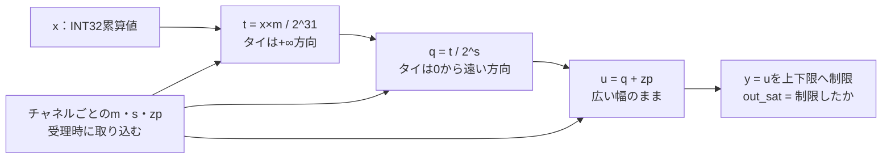

# INT32→INT8の再量子化で2段階の丸めと上下限を検証する

INT8推論では、行列演算のINT32累算値を次の層の入力となるINT8へ戻します。この再量子化（requantization）では、チャネルごとの倍率・シフト量・ゼロ点を使い、2回丸めてから上下限で制限します。この教材では、丸め規則を出典から書き下し、タイ（ちょうど中間）とその前後を全シフト量で検査します。設定を書き換えたときに処理中のデータへ影響しないことと、パイプラインの空き段の扱いも確認します。

## 2回の丸めと上下限



図は計算の順序です。RTLでは3段のパイプラインに分かれ、各段は空いていれば前段の値を受け取ります。

| 確認する場面 | 期待する動作 | 主な照合対象 |
| --- | --- | --- |
| 1段目のタイ | 負の値も+∞方向（例：-1.5→-1） | s=0での出力 |
| 2段目のタイ | 0から遠い方向（例：-1.5→-2） | 全32通りのsでの出力 |
| 上下限の外 | 広い幅のまま比較してから8ビットへ | `out_data`・`out_sat` |
| 設定の書換え | 受理済みの値には旧設定を使う | 同じエッジ・処理中の書換え |

## 丸め規則とその出典

```text
t = round(x × m / 2^31)      タイは+∞方向
q = round(t / 2^s)           タイは0から遠い方向
u = q + zp
y = min(max(u, ACT_MIN), ACT_MAX)
```

- `x`は符号付き32ビット、倍率`m`は0〜2^31-1（Q31形式で0以上1未満）、`s`は0〜31、`zp`は符号付き8ビットです。
- この2つの丸めは、TensorFlow Liteの整数量子化で使われる[gemmlowpの固定小数点関数](https://github.com/google/gemmlowp/blob/master/fixedpoint/fixedpoint.h)、`SaturatingRoundingDoublingHighMul`と`RoundingDivideByPOT`の丸め方を書き下したものです。
  - 1段目は、積に`2^30`（負なら`1-2^30`）を足して`2^31`で割り、0方向へ切り捨てます。結果として、タイは正負とも+∞方向へ丸まります。
  - 2段目は、余りがしきい値を超えたら1を足します。しきい値は、余りの最大値の半分に、負の値なら1を加えたものです。結果として、タイは0から遠い方向へ丸まります。
- `m`を0以上に限るので、元の関数が飽和させる「両方が-2^31の積」は起きません。
- この教材はgemmlowpやTensorFlow Liteのコードを実行して比べたものではありません。規則を教材の仕様として固定し、RTLとPythonを別々に実装しています。

2回丸めるため、正確な値`x×m/2^(31+s)`を1回だけ丸めた結果とは一致しないことがあります。例えば`x=5, m=2^30, s=1`は、1段目で`2.5→3`、2段目で`1.5→2`となりますが、正確な値`1.25`を1回丸めると1です。期待値は「数学的に最も近い値」ではなく、仕様が定める丸めの手順に従わせます。

## 入出力と制御

| 信号 | 内容 |
| --- | --- |
| `cfg_valid`・`cfg_ch`・`cfg_mult`・`cfg_shift`・`cfg_zp` | チャネルの設定を書きます。常に受け付けます |
| `in_valid`・`in_ch`・`in_x`・`in_ready` | 値を受理します |
| `out_valid`・`out_ready`・`out_data`・`out_sat` | 結果を出します。待たされている間は値を保持します |

- **設定の取り込み**：受理したエッジで、そのチャネルの`m`・`s`・`zp`をデータと一緒に取り込みます。同じエッジに書いた設定は、そのエッジで受理した値には使いません。処理中に書き換えても、受理済みの値には影響しません。
- **空き段の利用**：3段の各段は、空いているか次段へ渡せるときに前段の値を受け取ります。出力が待たされていても前に空き段があれば入力を受理し、3段すべてが埋まると`in_ready=0`になります。
- **リセット**：処理中の値を捨て、全チャネルの設定を0に戻します。設定0のチャネルは0を出力します。

構成は`ch2-full`（2チャネル、上下限-128〜127）と`ch4-narrow`（4チャネル、上下限-20〜100）です。

## 独立した期待値

Pythonは、丸めを有理数の整数演算で計算します。`(2a+b)//(2b)`でタイを+∞方向へ、絶対値を使った同じ式でタイを0から遠い方向へ丸めます。RTLの補正値・切り捨て・マスク・しきい値の手順は使いません。セルフテストでは、gemmlowpと同じ整数の手順を別に書き、極値と2万件の乱数で両者の一致を確かめます。

テストベンチは毎サイクル、`in_ready`・`out_valid`、待たされている間の保持、有効な出力の値と`out_sat`を照合します。カバレッジの分類では、入力と自分で記録した設定から1段目と2段目のタイを判定します。目標への加算は、その値の結果を照合した時点で行います。

## 固定シナリオとランダム刺激

固定シナリオは次の順に実行します。

1. リセット直後の設定0での計算
2. `m=2^30, s=0`で、1段目の正負のタイ（±1、±3、±5）
3. 2回丸めの例`x=5, m=2^30, s=1`
4. `s=1〜31`の全シフト量で、2段目の正負のタイとその±1
5. 上下限の1つ外・ちょうど・1つ内側、32ビットの最大値・最小値、ゼロ点-128と127
6. 受理と同じエッジでの設定の書込み、処理中の書換え
7. 連続投入、出力待ち中の受理、全段が埋まった状態での停止
8. 処理中のリセット

ランダム刺激は、設定と入力を乱数で選び、出力待ち・設定の書換え・まれなリセットを混ぜます。入力の多くは出力範囲の近くに来るよう、設定から逆算して選びます。

[要求カタログ](requirements.json)は5要求・19目標です。両構成とも、固定シナリオだけで19目標に達します。

## 意図的な誤実装

| 番号 | 誤実装 | 期待する検出ラベル |
| --- | --- | --- |
| 1 | 1段目の負のタイを0から遠い方向へ丸める | REQ_DATA |
| 2 | 2段目の負のタイを+∞方向へ丸める | REQ_DATA |
| 3 | ゼロ点を足した値を8ビットに縮めてから上下限を判定する | REQ_DATA |
| 4 | 後段で、取り込んだ値ではなく現在の設定を読む | REQ_DATA |

200値・seed 17〜19のランダム刺激だけで実行すると、変異3・4はすべてのseedで検出できます。変異2は一部のseedでしか検出できず、変異1はどのseedでも検出できません。

ランダム刺激にも1段目の負のタイは1〜9件含まれます。しかし、2段目の丸めや上下限で差が消え、出力には現れません。固定シナリオは`s=0`でタイを直接出力へ出すので、両構成とも18件で差が見えます。セルフテストでこの前提を確認しています。

## 実行

```sh
python3 examples/local-requantize/run.py --out artifacts/requantize
python3 examples/local-requantize/run.py --profile nightly --out artifacts/requantize-nightly
python3 -m unittest discover -s examples/local-requantize/tests -v
```

[共通手順](../local-common/README.md)を使います。smokeは200値×1 seed、nightlyは2000値×3 seedを固定シナリオとは別に実行します。JUnitは各構成7／9件、全体14／18件で、セルフテストは9件です。

## 確認範囲

2026-10-30にPython 3.14.7、Icarus Verilog 14.0開発版で、両構成のsmoke／nightly、19目標、4種類の変異、セルフテスト9件が成功しました。Verilator 5.052の`--lint-only -Wall`で出る警告は、符号付きの幅拡張と定数の切り詰め（`WIDTHEXPAND`・`WIDTHTRUNC`）、64ビット中間値の未使用上位ビット（`UNUSEDSIGNAL`）だけです。

倍率とシフト量を浮動小数点のスケールから求める処理、非対称な量子化の精度評価、チャネル数の多い実装の面積や動作周波数は扱いません。左シフト（倍率が1を超える場合）も対象外です。
