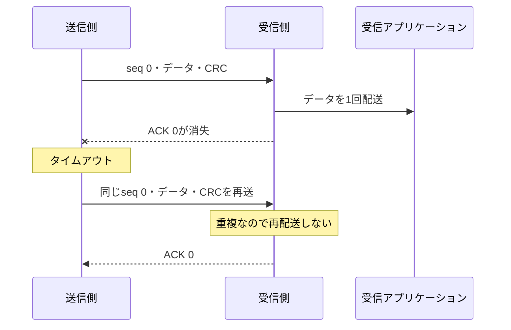

# CRC・ACK・再送・重複排除を結合して検証する

[パケットCRC](../local-packet-crc/README.md)に加え、誤ったデータの破棄、ACKの消失、再送、受信側での重複排除、再送上限を確認する例です。1件を送ってACKを待つstop-and-wait方式とシーケンス番号の考え方は、[RFC 916のRATP](https://www.rfc-editor.org/rfc/rfc916.html)を参照しました。フレーム形式・CRC・ACK符号・インターフェースは本教材独自の仕様で、RATPの実装ではありません。

## ACKが消えても、データを重複配送しない



送信フレームは、1ビットのシーケンス番号・8ビットのデータ・8ビットCRCの計17ビットです。CRCは多項式`0x107`、MSB先行、初期値0・xorout 0で、シーケンス番号も保護します。Pythonの期待値は、RTLのLFSRとは別に多項式の剰余で求めます。古いACKの注入値もベクトルへ明示し、DUTの現在値から作りません。

ACKはseq 0が`0011`、seq 1が`1100`の4ビット符号です。送信側は、有効な符号かつ現在の番号と一致するACKだけを受け付けます。成功時に番号を反転し、再送では番号とデータを保持します。

受信側は1件の出力バッファを持ちます。新しい番号なら空きがある場合にだけ受け取り、ACKを返します。直前のフレームの重複なら、データを再配送せずACKを返します。出力が待たされている間も、既に受け取ったフレームの重複にはACKできます。

ACKは受信バッファへ受理した時点で返すため、送信成功後も受信アプリケーションへの出力が保留される場合があります。

送信要求・出力データ・完了通知は、それぞれvalid/readyで受け渡します。送信フレームは`wire_valid && wire_ready`で通信路へ渡した後にタイムアウトを数え始めます。通信路がフレームを受け取る前の待ちは、再送回数を消費しません。

## 再送上限と配送結果の曖昧さ

初回送信に加えて`RETRIES`回まで再送します。上限に達するとエラーの完了通知と`failed=1`を返し、リセットまで新しい入力を受けません。

エラーは「相手に届かなかった」という意味ではありません。データが届かなかった場合と、データは届いてACKだけがすべて消えた場合の、両方をテストします。後者では、受信アプリケーションへの配送は1回です。この状態で番号だけを進めて通信を続けず、送信側・受信側・通信路の状態をそろえてリセットします。

リセットは保留中の送信・完了通知・受信バッファ・ACKを取り消します。リセットをまたいだアプリケーションの再実行を一意に識別するには、別途取引ID等の設計が必要です。

## 実行と誤実装の検出

Python 3.10以上とIcarus Verilogを使い、リポジトリのルートで実行します。

```sh
python3 examples/local-retry-link/run.py
python3 examples/local-retry-link/run.py --profile nightly
python3 -m unittest discover -s examples/local-retry-link/tests -v
```

`timeout3`はTIMEOUT=3・RETRIES=2、`timeout5`は5・3です。固定シナリオだけで20目標に到達します。JUnitはsmoke 14件／nightly 18件で、[共通手順](../local-common/README.md)に加え、入力・配送・成功・失敗・再送の実測件数も照合します。

| 変異 | 誤り | 検出ラベル |
| --- | --- | --- |
| 1 | 再送時にシーケンス番号を反転する | `LINK_TX` |
| 2 | 受信CRCの不一致を無視する | `LINK_RX` |
| 3 | 重複フレームを新しいデータとして配送する | `LINK_RX` |
| 4 | 異なるシーケンス番号のACKを受け付ける | `LINK_TX` |

`--demo-bug 1..4`では通常ケースも失敗します。セルフテスト7件には、全512メッセージのRTL CRC照合と全17ビット位置の単一誤り、ACK消失時の1回だけの配送、配送済み／未配送の両方の再送上限、通信路の長い待ちを含みます。

2026-10-31に、Python 3.14.7・Icarus Verilog 14.0開発版で両構成のsmoke／nightlyと7セルフテストが成功しました。Verilator 5.052で送受信回路の全構成・変異0〜4をlintしています。

## 確認範囲

単一クロック・1バイト単位の片方向データリンクです。通信路はフレームの消失・指定ビットの破損と、次サイクルに戻るACKの消失・破損をモデル化します。古いACKの注入は現在と反対の番号を使います。番号が一周するほど古いフレームの遅延・再順序化、片側だけのリセット、接続確立、PHY・シリアル化、複数未確認フレーム、暗号学的な認証は扱いません。任意の長さの通信障害に対する配送成功も保証しません。
