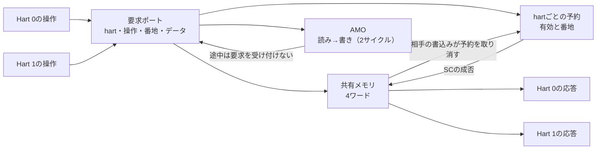

# LR／SCとAMOを、予約の履歴とリトマス試験で検証する

2つのhartが同じメモリの値を「読んで、書き換える」とき、読みと書きの間に相手の書込みが入ると、更新が失われます。RISC-Vの「A」拡張は、これを防ぐ2つの仕組みを定めています。予約つきのロード（LR）と条件つきのストア（SC）の組と、1命令で読み書きするAMOです。この教材では、どの操作がSCを失敗させるか、AMOの途中に他の操作が入らないかを確かめます。さらに、LR／SCで作ったスピンロックなどの小さなプログラムについて、起こりうる結果の集合を抽象モデルの全探索と照合します。

[ストアバッファとFENCEの例](../local-store-buffer/README.md)と同じ手法（抽象モデルの全探索→結果集合→代表の実行列をRTLへ与える）を使います。プロセッサの検証全体での位置付けは、[プロセッサの検証手順](../../docs/method/processor-verification.md)を参照してください。

## 対象回路と操作



[`atomic_mem.sv`](rtl/atomic_mem.sv)は、4ワード×32ビットの共有メモリと、hartごとの予約を持ちます。入力はhart番号を持つ1つの要求ポートで、1サイクルに1操作を受け付けます。**命令を実行するプロセッサコアではありません。** LR／SCとAMOがメモリと予約へ与える効果だけを取り出した回路です。ストアバッファはなく、書込みは受け付けた次のサイクルから全hartに見えます。

| 操作 | 動作 | 応答のデータ |
| --- | --- | --- |
| LOAD | ワードを読む | 読んだ値 |
| STORE | ワードを書く | 0 |
| LR | ワードを読み、そのhartの予約をこの番地にする | 読んだ値 |
| SC | 予約が有効で、番地がLRと同じなら書く。そのhartの予約は成否によらず消える | 成功は0、失敗は1 |
| AMO | 1サイクル目に古い値を読み、2サイクル目に演算結果を書く | 古い値 |

AMOの演算は、32ビットのAMOSWAP・AMOADD・AMOXOR・AMOAND・AMOOR・AMOMIN・AMOMAX・AMOMINU・AMOMAXUの9種類です。64ビットの命令は扱いません。

応答はhartごとに1つで、そのhartが受け取る（`resp_ready`）まで保持します。応答が残っているhartの次の要求は受け付けません。もう一方のhartの要求は受け付けます。

## 予約の規則：ISAが決めていることと、この教材の選択

ISAは、SCがいつ失敗してよいかを広く認めています。SCは理由なく失敗してもかまいません。一方、失敗しなければならない場合は決まっています。この教材の回路は、その中で1つの決まった動作を選んでいます。テストベンチは、ISAではなく、この選択に対して合否を判定します。

| 項目 | ISAの扱い（[12.1.2節](https://docs.riscv.org/reference/isa/v20260120/unpriv/a-st-ext.html#sec:lrsc)を自分の言葉でまとめたもの） | この教材の選択 |
| --- | --- | --- |
| 予約なしのSC | 必ず失敗 | 失敗 |
| 相手のhartが予約集合へ書いた後のSC | 必ず失敗 | 失敗。STORE、成功したSC、AMOのどれでも同じ |
| 自分のSC（成否によらず）の後のSC | 必ず失敗（予約は直近のLRとの組で1回だけ） | 失敗 |
| LRと違う番地へのSC | 予約集合の外なら必ず失敗。中なら実装しだい | 番地が一致しなければ失敗 |
| 予約集合の大きさ | 実装しだい（読んだバイトを含む範囲） | `GRAIN=0`は1ワード、`GRAIN=1`は隣り合う2ワード |
| 自分のSTORE・AMOの後のSC | 実装しだい | 予約を保つ（成功する） |
| 2回目のLR | 予約は新しいLRのものになる | 同じ |
| 理由のない失敗 | 許される | 起こさない |
| 失敗の戻り値 | 0でない値 | 1 |
| リセット | － | 予約・応答・途中のAMOを取り消し、メモリを0にする |

理由のない失敗を起こさない回路なので、テストベンチは「成功するはずのSC」が失敗しても不合格にします（`ATOM_SC`）。ISAに適合する別の実装を、このテストベンチで不合格と判定しても、その実装がISAに違反しているとは限りません。

## 検証すること

### 期待値：操作の履歴から決める

[`run.py`](run.py)の`Plan`は、サイクルごとの全出力（要求の受付、2つのhartの応答、共有メモリの全ワード）を作ります。SCが成功するかどうかは、RTLの予約レジスタを写さず、リセットからの操作の記録を調べて決めます。

1. そのhartの直近のLRまたはSCを探す。なければ失敗。SCなら失敗。
2. そのLRの番地がSCの番地と違えば失敗。
3. そのLRより後に、相手のhartの書込みが同じ予約集合にあれば失敗。
4. どれにも当たらなければ成功。

AMOの結果は、各演算の定義から直接計算します（符号つきの比較は、Pythonで符号つきの整数に直して比べます）。

### 固定シナリオ

リセットの後、次の場面を順に与えます。SCごとに、シナリオが成功か失敗かを先に宣言し、`Plan`の判定と違えばエラーにします。

- 成功するSCと、その直後の2回目のSC。予約のないSC。
- LRとSCの間の、相手のSTORE・成功したSC・AMO。相手の失敗したSCは何も書かないので、予約は残ります。
- LRと違う番地へのSC。LRを2回続けた後の、新しい番地へのSC（成功）と古い番地へのSC（失敗）。
- 自分のSTORE・AMOの後のSC（成功）。
- 隣のワードへの相手のSTORE。`GRAIN=0`では成功、`GRAIN=1`では失敗します。別の予約集合への書込みは、どちらでも成功です。
- 9種類のAMO。MINとMAXは、符号つきと符号なしで大小が逆になる値（`0x80000000`と1など）を含みます。
- AMOの2サイクル目に、相手のhartと同じhartの要求を出す。どちらも待たされます。
- 2つのhartの応答が同時に待つ場面。応答が残っているhartの要求は待たされます。
- 知らない操作番号とAMOの演算番号（受け付けない）。
- AMOの2サイクル目、かつ予約がある状態でのリセット。リセット後のSCは失敗します。

### リトマス試験

[`litmus.py`](litmus.py)は、2つのhartが同じプログラムを実行するときの、すべての実行順を探索します。1つのメモリ操作を1ステップとし、どちらのhartを次に進めるかをすべて試します。共有するカウンターを両方のhartが1ずつ増やし、最後の値を結果にします。

| プログラム | 各hartの操作 | 状態数 | 結果（カウンター、SCが失敗したhart） |
| --- | --- | --- | --- |
| `spinlock` | LRでロックを読み、0でなければやり直す。SCで1を書き、失敗ならやり直す。カウンターを読んで＋1を書く。ロックへ0を書く | 62 | 2（失敗なし）、2（hart 0が失敗）、2（hart 1が失敗） |
| `lrsc` | LRでカウンターを読み、SCで＋1を書く。失敗ならやり直す | 17 | 同上の3通り |
| `amoadd` | AMOADDで1を足す | 5 | 2 |
| `plain` | LOADで読み、STOREで＋1を書く | 13 | 1、2 |
| `taslock` | LOADでロックを読み、0でなければやり直す。STOREで1を書く。以下は`spinlock`と同じ | 64 | 1、2 |

- `spinlock`では、2つのhartが同時にクリティカルセクション（カウンターを読んでからロックを放すまで）にいる状態は、62状態の中に1つもありません。
- `taslock`は、ロックの確認と取得が別の操作なので、両方が入る状態が13あります。カウンターが1になる結果は、必ずこの重なりを通ります。
- 両方のhartのSCが失敗する結果はありません。片方のSCが失敗するのは、相手のSCが先に成功したときだけで、成功した側はもうSCを実行しないからです。

ランナーは、結果ごとに最短の実行列を1つ取り出し（全部で12本）、RTLへ与えます。そのとき、抽象モデルが予想した応答と`Plan`の期待値が、すべての操作で一致することも確かめます。2つは別々に書いたモデルです。

テストベンチは、リトマス試験の結果を**RTLの実際の応答**から求めます。

- 最後のカウンターの値を共有メモリから読み、SCが失敗したhartを応答から記録して、`COVER litmus/…`として出します。
- `spinlock`・`lrsc`・`amoadd`でカウンターが2でなければ`ATOM_LITMUS`です。
- `spinlock`の実行中は、ロックへのSCが成功したhartを「保持者」として覚え、保持者がロックへ0を書くまでに別のhartのSCが成功したら`ATOM_MUTEX`です。

RTLの誤りは、たいてい応答やメモリの照合（`ATOM_SC`など）が先に見つけます。`ATOM_LITMUS`と`ATOM_MUTEX`は、Pythonの探索や期待値のほうが誤っていた場合に止めるための検査です。この2つが働くことは、セルフテストで確かめています。

これは、与えた実行列についての確認です。RTLのすべての実行順を探索したという意味ではありません。

### 検査ラベル

| ラベル | 検査 |
| --- | --- |
| `ATOM_SC` | SCの応答（成功0／失敗1）が期待と違う |
| `ATOM_DATA` | LOAD・LR・AMO・STOREの応答が期待と違う |
| `ATOM_MEMORY` | 共有メモリの全ワードのどれかが期待と違う |
| `ATOM_AMO` | AMOの2サイクル目に、要求を受け付けた |
| `ATOM_FLOW` | 要求の受付、応答の有無が期待と違う |
| `ATOM_X` | 受付・応答・メモリにXがある |
| `ATOM_LITMUS`・`ATOM_MUTEX` | リトマス試験の結果が、そのプログラムで起こりえない |

### 目標と件数

[要求カタログ](requirements.json)は5要求・40目標です。2つの構成のどちらでも、固定シナリオとリトマス試験（391行）だけで40目標に達します。`reason/…`の目標は、シナリオがその場面を意図して出した要求が受け付けられたことを示します。SCの成否そのものは、応答の照合で確かめます。

完了件数として、行数、LOAD・STORE・LR・AMOの受付数、受け取ったSCの成功数と失敗数を、テストベンチがRTLの信号から数え、計画と照合します。

ランダム刺激は、毎サイクル、hart・操作・番地・データ・応答の受取りを乱数で決めます。SCとLRの割合を高くし、符号の境界の値を混ぜ、まれにリセットを入れます。

## 誤実装の検出

| 番号 | 誤り | 検出ラベル | 見つける場面 |
| --- | --- | --- | --- |
| 1 | 相手のhartのSTOREで予約を取り消さない | `ATOM_SC` | LR→相手のSTORE→SC |
| 2 | SCが番地を見ない | `ATOM_SC` | LRと違う番地へのSC |
| 3 | 成功したSCが予約を残す | `ATOM_SC` | 2回目のSC |
| 4 | AMOの2サイクル目にメモリを押さえない | `ATOM_AMO` | AMOの途中の相手のSTORE |
| 5 | 失敗したSCが書き込む | `ATOM_MEMORY` | 応答は正しく1だが、メモリが変わる |
| 6 | AMOMIN・AMOMAXを符号なしで比べる | `ATOM_MEMORY` | `0x80000000`と1の比較 |

変異5は、応答だけを見るテストでは見つかりません。共有メモリの全ワードを毎サイクル照合しているので検出できます。

`--demo-bug 1..6`を指定すると、通常ケースにも変異を入れます。終了コード1が期待どおりの結果です。

## 実行

Python 3.10以上とIcarus Verilogを使い、リポジトリのルートで実行します。

```sh
python3 examples/local-riscv-atomic/litmus.py
python3 examples/local-riscv-atomic/run.py --out artifacts/riscv-atomic
python3 examples/local-riscv-atomic/run.py --profile nightly --out artifacts/riscv-atomic-nightly
python3 -m unittest discover -s examples/local-riscv-atomic/tests -v
```

[共通手順](../local-common/README.md)を使います。構成は`word`（`GRAIN=0`）と`pair`（`GRAIN=1`）です。smokeは600サイクル×1 seed、nightlyは6,000サイクル×3 seedのランダム刺激を、固定の391行に加えます（`--iterations`の3倍がサイクル数です）。JUnitはsmoke 18件／nightly 22件です。

## 証跡

共通手順の証跡が出力先に残ります。

- `manifest.json`：全ケースの入力と期待値、構成、seed、ソースと`litmus.py`のSHA-256。
- ケースごとの`vectors.txt`・`simulation.log`・`wave.vcd`・`result.json`。
- `coverage.json`：構成ごとの40目標と、到達したケース。
- `summary.json`・`junit.xml`：予定数と完了数、変異の検出、総合判定。

セルフテストは13件です。共通の3件（seedの再現、全構成と6変異、`--demo-bug`）に加えて、次を確かめます。

- 探索を使わずに数えた`plain`の結果集合（1と2）が、探索の結果と一致する。
- `spinlock`と`lrsc`の結果は3通りだけで、カウンターは必ず2。`spinlock`に重なりの状態はなく、`taslock`にはある。5つのプログラムの状態数。
- 操作の履歴からのSCの判定（予約なし、隣のワード、読出しは影響しない、相手のSCの後）。
- AMOの演算（符号で大小が変わる値、桁あふれ、未定義の番号）。
- 固定シナリオだけで全目標に達する。
- どの変異も使わない検査（`ATOM_DATA`・`ATOM_FLOW`・`ATOM_X`と、常に失敗するSCに対する`ATOM_SC`）が、RTLを書き換えると働く。
- 正しい操作と一貫した期待値でも、プログラムにありえない結果なら`ATOM_LITMUS`・`ATOM_MUTEX`で止まる。
- `pair`用のベクトルを`GRAIN=0`の回路へ与えると、隣のワードの場面で`ATOM_SC`になる。

## 確認範囲

2026-11-21に、macOS arm64のPython 3.14.7、Icarus Verilog 14.0開発版（`ca6b8d3`）で、2構成のsmoke 18件とnightly 22件、40目標、6変異の検出（2構成で12件）、セルフテスト13件が成功しました。seed 1・2・3・99の4,500サイクルも合格しています。Verilator 5.052の`--lint-only -Wall`は、`GRAIN`が0と1、変異0〜6のすべてで警告0件です。YoWASP版Yosys 0.70の`synth`で読めることも確かめました。Linuxとkirimasimでは実行していません。

この教材で確かめていないことは次のとおりです。

- **コアへの統合**：命令のデコード、パイプライン、割り込みや例外でのLR／SCの扱い（トラップで予約を消すかどうか）、文脈の切替えは扱いません。
- **メモリモデル全体**：RVWMOの公理（とくにLR／SCの対に関するもの）との照合、ストアバッファやキャッシュがある場合の予約の実装、3つ以上のhartは対象外です。ストアの可視性の遅れは[ストアバッファの例](../local-store-buffer/README.md)で扱います。
- **予約集合の網羅**：予約集合の大きさは2通りだけです。キャッシュラインの単位、バイト・ハーフワードのアクセス、整列していない番地、番地の一致を見ない実装（集合の中ならSCが成功する実装）は扱いません。
- **理由のない失敗**：この回路は起こしません。ISAが許す失敗を含む実装を検証するには、SCの失敗を「常に許す」チェッカーに作り替える必要があります。
- **前進性**：スピンロックやLR／SCのループが、いつか必ず成功することは確かめていません。ISAは、決められた形の短いループについて最終的な成功を求めています（[12.1.3節](https://docs.riscv.org/reference/isa/v20260120/unpriv/a-st-ext.html#sec:lrscseq)）が、その条件と公平性は対象外です。探索は、やり直しを含む状態が有限であることを使っているだけです。
- **順序の指定**：AMOとLR／SCの`aq`・`rl`ビットは扱いません。この回路の操作は、すべて1つの全順序で実行されます。
- **証明**：フォーマルの証明はありません。結果集合の確認は、抽象モデルの全探索と、その代表の実行列によるものです。

## 参考にした一次資料

- [The RISC-V Instruction Set Manual, Volume I（v20260120）12.1節「"A" Extension for Atomic Instructions, Version 2.1」](https://docs.riscv.org/reference/isa/v20260120/unpriv/a-st-ext.html)：12.1.2節（LR／SCと予約集合、SCが失敗しなければならない場合）、12.1.3節（SCの最終的な成功）、12.1.4節（AMOの種類と意味）。本文は写さず、上の表は自分の言葉でまとめたものです。
- [同 付録「RVWMO Explanatory Material」](https://docs.riscv.org/reference/isa/v20260120/unpriv/mm-eplan.html)：リトマス試験の考え方。
- 番地の幅、操作ポート、応答の保持、予約集合の2通りの大きさ、AMOの2サイクルの実行は、この教材で決めた仕様です。
