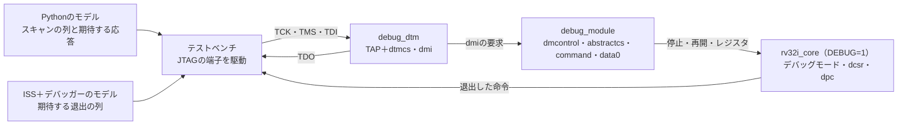

# デバッグの停止・再開・1命令実行を、JTAGからの操作とISSとの比較で確かめる

外部のデバッガーは、プロセッサを止め、レジスタを読み書きし、1命令ずつ進め、また走らせます。止める位置を1命令でも取り違えると、再開した後に命令が抜けるか、同じ命令を2回実行します。この教材は、[RISC-VコアとISSの比較](../local-riscv-iss/README.md)のコアに最小のデバッグ機能を加え、[JTAG TAP](../local-jtag-tap/README.md)からデバッグモジュールを操作します。デバッガーが間に入っても、退出する命令の列がISSの逐次実行と一致することを確かめます。

RISC-V Debug Specificationの考え方を小さく写した教材用の部分実装です。準拠した実装ではありません。分野全体の位置付けは[プロセッサの検証手順](../../docs/method/processor-verification.md)にあります。

## 構成



| ファイル | 役割 |
| --- | --- |
| [`rv32i_core.sv`](../local-riscv-iss/rtl/rv32i_core.sv)（共有） | パラメーター`DEBUG`で、デバッグモード、`dcsr`、`dpc`、1命令実行を加える |
| [`rv32i_debug_core.sv`](rtl/rv32i_debug_core.sv) | コアを`DEBUG=1`でインスタンス化し、デバッグの信号に名前を付ける |
| [`debug_module.sv`](rtl/debug_module.sv) | デバッグモジュール。5つのレジスタと、レジスタアクセスの抽象コマンド |
| [`debug_dtm.sv`](rtl/debug_dtm.sv) | デバッグ転送モジュール。既存のTAPに`dtmcs`と`dmi`を加える |
| [`debug_system.sv`](rtl/debug_system.sv) | 上の3つをつないだ検証対象 |
| [`model.py`](model.py) | デバッガーの操作をスキャンへ直す部分と、ISSから呼ばれるデバッガーのモデル |

共有のコアとTAPは、ほかの例が使うポート一覧を変えずに拡張しています。コアは、`DEBUG=1`のときだけ、割り込み線`irq`の上位に要求（停止、再開、レジスタの書込み、番号、値）を、`halted`の上位に応答（デバッグモード中、番号が有効、読んだ値）を載せます。TAPは、`EXT=1`のときだけ、`pin_in`と`pin_out`の上位に外部のデータレジスタ用の信号を載せます。どちらも既定値は0で、既定の構成の動作とポートの幅は変わりません。ポートを増やすと、コアを使うほかの例のインスタンス化に未接続の警告が出るため、この形にしました。

## 仕様（契約）

### コアのデバッグモード

| 項目 | この教材の動作 |
| --- | --- |
| 入る条件 | 停止要求がある、1命令実行が終わった、`dcsr.ebreakm`が1でEBREAKに来た、のどれか |
| 入る位置 | MEM段に最初に来た命令の前。その命令と後続は何もせずに捨て、`dpc`はその命令を指す |
| 取り消した命令 | 例外を起こすはずだった命令も、割り込みを受けるはずだった位置も、再開の後にもう一度そこから実行する |
| メモリの待ち | メモリがすでに受け取ったアクセスは、完了してから止まる |
| 再開 | `dpc`から実行する。パイプラインは空から始まる |
| 1命令実行 | `dcsr.step`が1で再開すると、1命令が退出するか、1つの例外を受けたところで止まる。その間、割り込みは受けない（`stepie`は0固定） |
| EBREAK | `ebreakm`が0なら従来どおりプログラムの終わり。1ならデバッグモードへ入り、`dpc`はEBREAK自身を指す。そのまま再開すると、もう一度同じ場所で止まる |
| 原因 | `dcsr.cause`は、EBREAKが1、停止要求が3、1命令実行が4 |

デバッグモードの間に読み書きできるレジスタは次のとおりです。

| 番号 | レジスタ | 読み書き |
| --- | --- | --- |
| 0x1000〜0x101f | x0〜x31 | x0は0と読め、書いても変わらない |
| 0x7b0 | `dcsr` | 書けるのは`ebreakm`（ビット15）と`step`（ビット2）。`debugver`は4、`cause`（8:6）は読むだけ、`prv`は3（Mモード）固定 |
| 0x7b1 | `dpc` | 下位2ビットは保持しない（命令は4バイト境界） |

これ以外の番号（`mstatus`などのCSRを含む）は、デバッガーへ見せません。

### デバッグモジュール

| 番地 | レジスタ | 実装した範囲 |
| --- | --- | --- |
| 0x04 | `data0` | 抽象コマンドの引数と結果 |
| 0x10 | `dmcontrol` | `haltreq`（31）、`resumereq`（30、書くと1回だけ再開）、`dmactive`（0）。`haltreq`と同時の`resumereq`、動作中の`resumereq`は無視する。`dmactive`を0にすると初期状態へ戻る。`haltreq`と`resumereq`は、読むと0（仕様では`haltreq`は「何を書いてもよく、読むと0」の欄） |
| 0x11 | `dmstatus` | `version`＝3、`authenticated`＝1、`anyhalted`・`allhalted`、`anyrunning`・`allrunning`、`anyresumeack`・`allresumeack` |
| 0x16 | `abstractcs` | `datacount`＝1、`cmderr`（10:8、1を書くと消える）、`busy`（12） |
| 0x17 | `command` | レジスタアクセス（`cmdtype`＝0）だけ。`aarsize`＝2、`transfer`、`write`、`regno` |

`cmderr`は、次の順に決まります。0でない間は、新しいコマンドを始めません。

| 値 | 条件 |
| --- | --- |
| 1 | コマンドの実行中に、`command`・`data0`・`abstractcs`へ書いた、または`data0`を読んだ |
| 2 | このモジュールにないコマンド（`cmdtype`が0以外、`aarsize`が2以外、`postexec`、`aarpostincrement`）、またはコアにあるがデバッガーへ渡さないCSR（`mstatus`など） |
| 3 | ハートにないレジスタ（浮動小数点レジスタ、このコアにないCSR）。仕様は、レジスタアクセスの失敗の理由がこれなら3にすると決めています |
| 4 | ハートが動作中なのに、レジスタを転送するコマンドを出した |

抽象コマンドは、パラメーター`CMD_CYCLES`（既定512）のクロック数だけ`busy`になります。命令列を実行してコマンドを処理する実装のように、時間のかかる実装を模したものです。1回のスキャンより長くしてあるので、実行中に次の書込みが届く場面を作れます。

### デバッグ転送モジュール

既存のTAPは命令レジスタが4ビットです。仕様の5ビットの符号（0x10、0x11）は使えないので、教材として次の符号を割り当てました。

| 命令 | 符号 | データレジスタ |
| --- | --- | --- |
| IDCODE | 0001 | 32ビット。既存のTAPのまま |
| `dtmcs` | 1000 | 32ビット、読むだけ。`version`＝1、`abits`＝7、`idle`＝1 |
| `dmi` | 1001 | 41ビット：アドレス7、データ32、操作2（0なし、1読出し、2書込み）。Capture-DRでは、アドレス、直前の読出しの値、状態0を返す |

TCKはクロックから作り、周期はクロックの4倍です。デバッグモジュールは次のスキャンより十分前に応答を返すので、`dmi`の状態がビジーになる場面はありません。`dtmcs`の`dmireset`・`dmihardreset`は実装していません。

### 選んだこと

| 項目 | 選択 |
| --- | --- |
| 停止要求と例外・割り込みの重なり | 停止を先にする。例外や割り込みは、再開の後に起きる |
| 1命令実行中の割り込み | 受けない。1命令実行をやめて再開すると、次の命令の前で受ける |
| 1命令実行が終わった位置がEBREAK（`ebreakm`＝1） | 原因は1命令実行（4）。EBREAKはまだ実行していない |
| 停止要求と、終わった1命令実行が同時 | RTLは停止要求（3）を先にする。このデバッグモジュールからは作れない組合せで、確かめていません |
| 動作中のハートへのコマンドと、未対応の番号 | 先にハートの状態（4）を見る |
| コアのリセット | デバッグモジュールとは別。コアが動き出す前に停止要求を出せる |

## 検証すること

### 2つの比較

テストベンチ[`debug_tb.sv`](tb/debug_tb.sv)は、2つのことを並行して行います。

- **退出の比較**：コアが退出した命令を、順に、ISSが作った記録（PC、命令語、書いたレジスタと値、メモリアクセス、トラップの原因）と比べます。最後に、データメモリの全ワードと、退出数も照合します。
- **デバッガーの台本**：JTAGのスキャンを1つずつ流し、返ってきたビット列を期待値と比べます。ポーリング（`dmstatus`や`abstractcs`が期待の値になるまで読む）は回数の上限つきで、届かなければ不合格です。

### 期待値の作り方

期待値は、コアやデバッグモジュールの状態機械を写さずに作ります。

- **スキャンのビット列**：[`model.py`](model.py)の`Script`が、デバッガーの操作（レジスタを読む、コマンドを出して終わるまで待つ、再開する）を、`dmi`の41ビットの値と、次のスキャンで返るはずの値に直します。ビットの位置は、セルフテストが手計算の値と照合します。
- **位置の決まる停止**：コアが動き出す前の停止、`ebreakm`によるEBREAKでの停止、そこからの1命令実行は、プログラムのどの命令の前で止まるかが決まっています。ISSは命令を1つ実行する前に`Debugger`を呼び、`Debugger`はそこでデバッガーの操作（レジスタや`dpc`の書込みを含む）を行います。ISSは書き込まれた値で続きを実行するので、デバッガーが変えた後の退出の列が期待値になります。1命令実行の間は、ISSも割り込みを受けません。
- **位置の決まらない停止**：プログラムが走っている間の停止要求は、どの命令の前で止まるかがクロック単位のタイミングで決まり、Pythonからは分かりません。ここではレジスタや`dpc`を書き換えません。テストベンチが、読んだ`dpc`を「次に退出するはずの命令のPC」（期待する退出の列の、次の行）と比べ、読んだレジスタを「これまでに退出した命令が書いた値」と比べます。止まった位置がどこであっても、命令の抜けと重複があれば、この比較か、その後の退出の比較で見つかります。

### 固定のシナリオ

固定のシナリオは、約1万4千命令が退出し、デバッグモードへ52回入ります。

| 場面 | 確かめること |
| --- | --- |
| 転送モジュール | IDCODEと`dtmcs`の値 |
| 動き出す前の停止 | コアのリセットを解く前に停止要求を出す。最初の命令の前で止まり、`dpc`は0、原因は3。x5へ書いた値を、プログラムがストアして使う |
| EBREAKでの停止 | `ebreakm`を1にした後のEBREAKで止まる。原因は1。レジスタを読み、x6を書き換え、`dpc`を次の命令へ進める |
| コマンドの誤り | ないコマンド4種類、渡さないCSR（`cmderr`＝2）、ハートにないレジスタ2つ（`f0`と`tselect`、`cmderr`＝3）、誤りが残る間はコマンドが動かないこと、実行中の2つ目のコマンドとデータの書込み、消した後は動くこと |
| 4回の1命令実行 | 順に、通常の命令、成立する分岐（`dpc`は飛び先）、ロード、境界に合わないロード（例外。`dpc`はハンドラー） |
| 割り込みと1命令実行 | 割り込み線を上げてから止まり、許可する命令と次の命令を1つずつ進める。割り込みは受けない。1命令実行をやめて再開すると、次の命令の前で受ける |
| 同じ場所での再停止 | `dpc`を動かさずに再開すると、同じEBREAKでもう一度止まる。次に`dpc`を別のラベルへ動かし、間の命令が実行されないことを確かめる |
| 走っている間の停止要求（6回） | ロード・ストア、毎回の例外、1回おきに成立する分岐、割り込みを含むループの中へ、遅れを変えて要求する |
| 走っている間のコマンド | ハートが動作中のコマンドは`cmderr`が4になる |
| 停止要求の後の1命令実行（4回） | 割り込みのないループの中で止め、1〜4回の1命令実行のたびに`dpc`を次の退出のPCと比べる |
| 1クロックずつずらした停止要求（20回） | 割り込み線を毎回上げる短いループの同じ場所へ、要求を1クロックずつ遅らせて出す。割り込みを受けるはずのサイクルと重なる回を作るためです |
| EBREAKを元へ戻す | 最後に`ebreakm`を0へ戻し、プログラムを最後のEBREAKで終える |

停止要求がパイプラインの何と重なったかは、テストベンチが、デバッグモードへ入るサイクルのコアの内部信号を見て記録します。分岐の予測外れによる取消しの最中、例外を起こす命令の前、割り込みを受けるはずの命令の前、メモリの待ちの後、の4つです。この4つの目標への到達は、両方の構成で確かめています。

### ランダムなシナリオ

ISSのランダムな命令列（ループあり）の途中へEBREAKを3つ入れます。各EBREAKで、seedで決まる操作（書込み済みのレジスタの読出し、x1〜x9への書込み、1〜3回の1命令実行、`dpc`を動かさない再開）を行います。ループの中のEBREAKは、回るたびに止まります。命令列の後ろに割り込みのないループを置き、走っている間の停止要求を2回（1命令実行つき）出します。

### 要求と目標

[要求カタログ](requirements.json)は6要求・29目標です。両方の構成とも、固定のシナリオだけで29目標に達します。

### 変異

| 番号 | 場所 | 誤り | 検出するラベル |
| --- | --- | --- | --- |
| 24 | コア | `dpc`が、捨てた命令の次を指す（命令が1つ抜ける） | `DBG_DPC` |
| 25 | コア | 1命令実行が2命令進む | `DBG_DPC` |
| 26 | コア | 再開が`dpc`の1つ前から始まる（同じ命令を2回実行する） | `ISS_FLOW` |
| 27 | コア | `ebreakm`を見ない（EBREAKがそのまま退出する） | `ISS_FLOW` |
| 28 | デバッグモジュール | 抽象コマンドが隣のレジスタ（番号の最下位ビットが逆）を読み書きする | `DBG_DATA` |
| 29 | デバッグモジュール | コマンドの実行中の書込みを受け付ける | `DBG_CMDERR` |

`--demo-bug 1..6`が、この順に変異24〜29を選びます。変異のケースは、長いループを除いた短いシナリオで実行します。6種類とも、位置の決まる停止で検出されるためです。

セルフテストは、これとは別に、デバッグの回路を10か所書き換えて比較が落ちることも確かめます（1命令実行中に割り込みを受ける、捨てたはずのアクセスがメモリへ届く、再開が確認されない、誤りが残らない、など）。期待値の側を書き換えて、検査ラベル`DBG_DPC`・`DBG_DATA`・`DBG_DTM`・`DBG_CMDERR`・`DBG_STATUS`・`ISS_MEM`が働くことも確かめます。

## 実行

Icarus Verilogだけで動きます。

```sh
python3 examples/local-riscv-debug/run.py --out artifacts/riscv-debug
python3 examples/local-riscv-debug/run.py --profile nightly --out artifacts/riscv-debug-nightly
python3 -m unittest discover -s examples/local-riscv-debug/tests -v
```

[共通手順](../local-common/README.md)を使います。構成は`debug`（予測なし）と`debug-predict`（動的な分岐予測）の2つです。smokeは固定のシナリオとランダム1 seed（ランダムな部分が120命令）、nightlyはランダム3 seed（500命令）です。固定のシナリオは約40万クロックをシミュレーションするので、`--timeout`の既定値をこの例だけ60秒にしています。JUnitはsmoke 18件／nightly 22件、セルフテストは11件です。

## 証跡

共通手順の証跡（`manifest.json`、`builds.json`、ケースごとの`vectors.txt`・`simulation.log`・`wave.vcd`・`result.json`、`coverage.json`、`summary.json`、`junit.xml`）を保存します。`vectors.txt`には、プログラム、期待する退出の列、デバッガーの台本の全行が入ります。完了件数として、退出数、ロード数、ストア数、デバッグモードへ入った回数、スキャンの回数を照合します。波形には、JTAGの端子、デバッグモジュールの状態、退出の信号を入れ、クロックは入れていません。

## 適用範囲と対象外

2026-11-21に、macOS arm64のPython 3.14、Icarus Verilog 14.0開発版で、2構成のsmoke 18件とnightly 22件、29目標、6変異の検出、セルフテスト11件が成功しました。追加で、seed 1・2・3・7・8・9・99・1234・4242のランダム400命令も合格しました。Verilator 5.052の`--lint-only -Wall`は、この例の4つのRTLとコアの`DEBUG=1`の構成で、新しい警告がありません（取り込んだTAPに、以前からある未使用の`localparam`の警告が1件あります）。YoWASP版Yosys 0.70で`debug_system`を合成でき、ラッチは残りません。Linuxとkirimasimでは実行していません。

この教材で確かめていないことは次のとおりです。

- **準拠していません。** RISC-V Debug Specificationの一部を写した教材です。命令レジスタの符号は仕様と違い、多くの必須でない機能と一部のフィールドがありません。仕様と照合した結果は、下の「仕様との照合」にあります。
- **実装していない機能**：プログラムバッファ、システムバスアクセス、トリガー、複数ハートと`hartsel`、認証、`ndmreset`・`hartreset`、リセット時の停止（`resethaltreq`）、`keepalive`、CSRやメモリへの抽象コマンド、`dmi`のビジー状態と`dmireset`。
- **特権**：Mモードだけです。`dcsr.prv`は3固定で、`PRIV=1`の構成（Uモード、PMP）と`DEBUG=1`の組合せは確かめていません。
- **クロック**：TCKをクロックから作る前提です。TCKが非同期の場合の乗換えは対象外です。
- **独立性の限界**：ISSとデバッガーのモデルは自作で、外部のデバッガー（OpenOCDなど）とは照合していません。
- **走っている間の停止要求**：与えた時刻の範囲の確認です。すべてのサイクルの重なりを網羅したものではありません。フォーマルの証明もありません。
- **性能カウンター**：デバッグモードへ入るときに捨てた分岐も数えます。この例では比べていません。
- **WFIの途中の停止**、1命令実行と停止要求の同時は確かめていません。

## 仕様との照合

2026-11-21に、批准済みのRISC-V Debug Specification 1.0（リポジトリのタグ`1.0`、コミット`5695c0aaa7a3`）のレジスタ定義と本文を読み、この例が実装している範囲だけを突き合わせました。節番号は、その版の本文の章立てから数えたものです。本文は写していません。

一致した点：

- **DMIのレジスタの番地**（3.14）：`data0`＝0x04、`dmcontrol`＝0x10、`dmstatus`＝0x11、`abstractcs`＝0x16、`command`＝0x17。
- **`dmcontrol`のビット**（3.14）：`haltreq`＝31、`resumereq`＝30、`dmactive`＝0。`haltreq`と同時の`resumereq`を無視すること、停止していないハートへの`resumereq`が働かないこと、`dmactive`を0にするとモジュールが初期状態へ戻ること。
- **`dmstatus`のビット**（3.14、3.13）：`allresumeack`・`anyresumeack`＝17・16、`allrunning`・`anyrunning`＝11・10、`allhalted`・`anyhalted`＝9・8、`authenticated`＝7、`version`＝3（版1.0を表す値）。
- **`abstractcs`**（3.14）：`busy`＝12、`cmderr`＝10:8（1を書くと消える）、`datacount`＝3:0。実行中に`command`・`abstractcs`へ書くか`data0`を読み書きすると`cmderr`が1、ハートが期待した状態にないと4になること。
- **レジスタアクセスの書式**（3.7.1）：`cmdtype`＝31:24（0がレジスタアクセス）、23は予約、`aarsize`＝22:20（2が32ビット）、`aarpostincrement`＝19、`postexec`＝18、`transfer`＝17、`write`＝16、`regno`＝15:0。番号はGPRが0x1000〜0x101f、CSRが0x0000〜0x0fffで、`dcsr`と`dpc`はCSRの番号でたどれること。
- **`dcsr`と`dpc`**（4.9）：CSR番号0x7b0・0x7b1。`debugver`＝31:28（4は「この仕様のとおり」）、`ebreakm`＝15、`cause`＝8:6、`step`＝2、`prv`＝1:0（Mモードだけなので3）。`cause`の値（EBREAK＝1、停止要求＝3、1命令実行＝4）。
- **停止の原因の優先順位**（4.9）：仕様の順は、停止要求、EBREAK、1命令実行の順に高い。この例の`cause`も、停止要求をEBREAKより優先し、1命令実行の命令自体がEBREAKなら原因をEBREAKにします。
- **1命令実行・停止・再開**（4.5、4.7、4.8）：1命令実行の間は割り込みを受けない（`stepie`＝0）こと、例外を起こした命令の後はハンドラーの最初の命令の前で止まること、再開は`dpc`から始まること。
- **`dtmcs`と`dmi`**（6.1.2）：`dtmcs`の`version`＝3:0（1は版0.13と1.0）、`abits`＝9:4、`idle`＝14:12、`dmistat`＝11:10。`dmi`は、アドレスが34から上、データが33:2、操作が1:0（0なし、1読出し、2書込み。読み返す状態の0は成功）。

照合で見つかり、直した点：

- **`dmcontrol.haltreq`の読出し**：仕様では「何を書いてもよく、読むと0」の欄でした。この例は書いた値を読み返していたので、0を返すように直しました。
- **ハートにないレジスタへのアクセス**：仕様は、失敗の理由が「そのレジスタがハートにない」ことなら`cmderr`を3（exception）にすると決めています。この例はすべて2にしていました。ハートにないレジスタは3、コアにあるがデバッガーへ渡さないCSRは2に分け、固定のシナリオに`f0`（0x1020）と`tselect`（0x7a0）を足しました。直す前の振る舞いに戻すと、固定のシナリオが`DBG_CMDERR`・`DBG_STATUS`で不合格になることを確かめています。

違うまま残した点：

- **命令レジスタの符号**：仕様の`dtmcs`・`dmi`は5ビットの命令（0x10・0x11）ですが、既存のTAPの命令レジスタが4ビットなので、1000・1001を使っています（6.1.2）。
- **実装していないもの**：`dmstatus`の`allhavereset`・`anyhavereset`（ハートのリセットを知らせる）と`dmcontrol`の`ackhavereset`、`ndmreset`・`hartreset`、`dtmcs`の`dmireset`・`dtmhardreset`と`errinfo`（0は「実装していない」の値）、`dmi`のビジーと失敗の状態。
- **抽象コマンドの実行中の`haltreq`・`resumereq`の書込み**：仕様は「無視するべき」としています（推奨）。この例は無視していません。デバッガーの台本にその場面がないので、直していません。

## 参考にした一次資料

- [RISC-V Debug Specification](https://github.com/riscv/riscv-debug-spec)：批准済みの版1.0（タグ`1.0`、コミット`5695c0aaa7a3`）と照合しました（上の「仕様との照合」）。デバッグモジュール（3章）、Sdext（4章）、デバッグ転送モジュール（6章）が対応します。本文は写していません。
- [The RISC-V Instruction Set Manual](https://docs.riscv.org/reference/isa/)：EBREAKと、例外・割り込みの扱い。コア側の仕様は[例外・割り込みの例](../local-riscv-traps/README.md)にあります。
- IEEE Std 1149.1：TAPの状態遷移。既存の[JTAG TAPの例](../local-jtag-tap/README.md)のものを使っています。本文は写していません。
