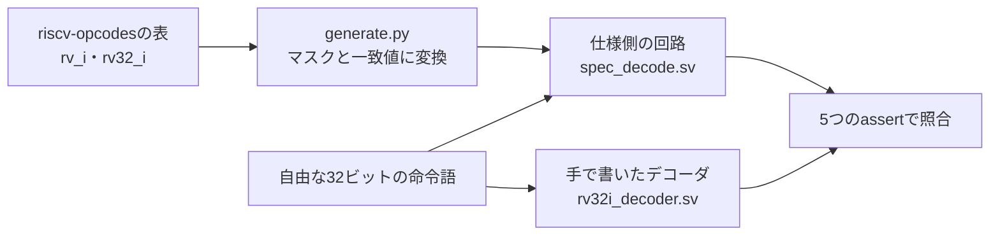

# RISC-Vの命令デコーダを、全命令語についてフォーマルに証明する

命令デコーダは、32ビットの命令語から命令の種類、即値、使うレジスタを決める回路です。誤りは、めったに現れない命令語に潜みます。例えば、RV32では予約のシフト量、M拡張の乗算、予約フィールドを持つFENCE、遠い分岐の即値です。命令語は2^32通りあり、シミュレーションで全数を試すことはできません。この例では、RISC-Vの公式な機械可読の命令表から期待値の回路を生成し、手で書いたデコーダと全命令語について一致することを証明します。

## 公式の命令表から期待値を作る



期待値の元は、RISC-V Internationalの[riscv-opcodes](https://github.com/riscv/riscv-opcodes)の表です。コミット`f24ac23`の`extensions/rv_i`と`extensions/rv32_i`を、ライセンス（BSD-3-Clause）とともに[`upstream/`](upstream/)へそのまま取り込み、取り込み元とSHA-256を[`upstream.json`](upstream.json)に記録しています。

RV32Iは、`rv_i`の疑似命令以外の37行と、`rv32_i`がRV32の形で定義するシフト命令3つの、計40命令です。表の各行は、固定されたビットの値と、オペランドのフィールドを並べたものです。

```text
add     rd rs1 rs2 31..25=0  14..12=0 6..2=0x0C 1..0=3
```

[`generate.py`](generate.py)は、各行をマスクと一致値に変換し、[`spec_decode.sv`](spec_decode.sv)を生成します。生成時には、命令語の全ビットが、固定値かオペランドのどちらか一方で覆われていること、2つの命令が同じ命令語に当たらないことを確かめます。即値は、命令の形式（I・S・B・U・J、シフト量）ごとに、ISAマニュアルの即値の図のとおりに組み立てます。

FENCEの`rs1`・`rd`は、[ISAマニュアル](https://github.com/riscv/riscv-isa-manual/blob/main/src/unpriv/rv32.adoc)の規定により、実装が無視するフィールドです。予約された`fm`・pred・succの組合せも、通常のFENCEとして扱います。そのため、FENCEはレジスタを読み書きしない命令とし、これらのフィールドが何であっても正しい命令とします。

## 予約された命令語の扱い

ISAマニュアルは、予約された命令語を読んだときの動作を規定していません。ただし、プラットフォームによっては不正命令例外を要求します。この例のデコーダは、表にない命令語をすべて不正（`legal=0`）とします。16ビットの圧縮命令、M拡張・CSR命令、RV64だけの命令も、すべて不正です。

## 証明する性質

ハーネス[`decoder_formal.sv`](decoder_formal.sv)は、命令語を自由な入力とし、デコーダと仕様側の回路に同じ値を与えます。デコーダは状態を持たないので、1回の問題で2^32通りすべてを扱えます。

| assert | 内容 |
| --- | --- |
| `ap_unique` | 2つ以上の命令に当たる命令語がない（表の性質） |
| `ap_legal` | デコーダが正しい命令とする命令語は、表のどれかに当たる命令語と完全に一致する |
| `ap_op` | 正しい命令では、命令の番号が表の順序と一致する |
| `ap_imm` | 正しい命令では、即値が命令の形式どおりに一致する |
| `ap_regs` | 正しい命令では、`rd`への書込みと`rs1`・`rs2`の読出しの有無が一致する |

coverは、圧縮命令、予約フィールドを持つFENCE、RV64の形のシフト、M拡張の乗算、CSR命令、即値のビット11と符号が異なる分岐の6つです。比べる命令語の種類が、実際に作れることを確かめます。

## 意図的な誤実装

| 番号 | 誤実装 | 誤る命令語の数 | 反例の命令語 | フォーマルの反例 |
| --- | --- | --- | --- | --- |
| 1 | シフト量をRV64の形で判定し、RV32では予約のビット25を見ない | 98,304（2.3×10^-5） | `0x02405013`（シフト量36のSRLI） | `ap_legal` |
| 2 | FENCEの`rd`・`rs1`が0でなければ不正にする | 4,190,208（9.8×10^-4） | `0x4135000f` | `ap_legal` |
| 3 | 演算命令のfunct7をビット30だけで見分け、M拡張などの命令語を受け付ける | 20,643,840（4.8×10^-3） | `0x20044033`（funct7=`0010000`をXORとする） | `ap_legal` |
| 4 | 分岐の即値のビット11を、`insn[7]`ではなく符号ビットから取る | 12,582,912（2.9×10^-3） | `0x80006063` | `ap_imm` |

かっこ内は、命令語全体に占める割合です。変異1〜3は、不正な命令語を正しいとするか、正しい命令語を不正とする誤りです。変異4は、正しい命令の即値の誤りです。

フォーマルの証明は、4つの誤りをどれも数秒で反例として示します。シミュレーションでは、命令語の作り方で結果が大きく変わります。

| 刺激 | 変異1 | 変異2 | 変異3 | 変異4 |
| --- | --- | --- | --- | --- |
| [ISSとの比較の例](../local-riscv-iss/README.md)の命令列（固定と、seed 17〜19の2000命令、計6098語） | 0 | 0 | 0 | 0 |
| 一様な乱数の命令語10万語（seed 17／18／19） | 1／2／0 | 109／90／84 | 485／506／484 | 272／301／289 |

表の数は、デコーダの出力が期待値と食い違った命令語の数です。ISSとの比較の例は正しいRV32Iの命令だけを作り、分岐の飛び先も近いので、4つとも見つかりません。命令を実行して比べる検証では、不正な命令語の判定の誤りは見えないということです。一様な乱数では、誤る命令語の割合が小さい変異1を、seed 19では1つも見つけられませんでした。

## 実行

[共通フォーマル手順](../local-formal-common/README.md)の固定版ツールを使います。

```sh
. /tmp/lsi-bus-formal-venv/bin/activate
python3 examples/local-riscv-decoder/run.py
python3 examples/local-riscv-decoder/generate.py --check
python3 -m unittest discover -s examples/local-riscv-decoder/tests -v
```

タスクは、証明（深さ1のk-induction）、coverの到達、4種類の変異の反例（深さ8のBMC）の6件で、JUnitも6件です。`run.py`は、生成した`spec_decode.sv`が取り込んだ表と一致しなければ、証明を始めずに止まります。`--demo-bug 1..4`は証明のタスクにも変異を入れ、証明がFAILになることを確かめます。

セルフテストは9件です。
- 取り込んだ表のSHA-256、40命令とデコーダの番号の対応、生成物が最新であること、生成器が重複・覆い漏れ・未知のオペランドを拒否すること
- LLVMの`llvm-mc`が作った命令語（40命令と`fence.tso`・`pause`）を、表が同じ命令と解釈すること
- Icarus Verilogで、表の各命令の命令語と乱数2万語について、デコーダが期待値と一致すること。各変異が反例の命令語で食い違うこと。ISSとの比較の例の命令列では、どの変異も見えないこと

## 確認範囲

2026-10-31に、Python 3.14.7とYoWASP版Yosys・SBY・Z3（[共通フォーマル手順](../local-formal-common/README.md)の固定版）で、6タスクが成功しました（全体で約16秒）。証明のタスクに4種類の変異を入れると、どれもFAILになりました。セルフテスト9件も成功しています（Icarus Verilog 14.0開発版、LLVM 23.1.4の`llvm-mc`）。Verilator 5.052の`--lint-only -Wall`では、変異0〜4のどれでも警告はありません。

対象はRV32Iの基本命令の判定です。圧縮命令（C）、乗算・除算（M）、CSR（Zicsr）、FENCE.I（Zifencei）、特権命令、RV64は、すべて不正として扱います。命令の実行や、パイプラインでの使われ方は、[ISSとの比較の例](../local-riscv-iss/README.md)で扱います。この例のデコーダは、その例のコアのデコード部分とは別に書いたものです。コアは、[例外・割り込みの例](../local-riscv-traps/README.md)で使う`TRAPS=1`のとき、このデコーダの`legal`出力で不正な命令を判定します。
