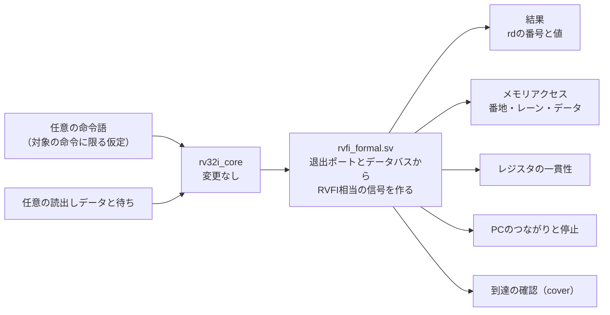

# RISC-Vコアの退出を、RVFI相当の信号でフォーマルに検査する

[ISSとの比較](../local-riscv-iss/README.md)は、与えた命令列の範囲でコアを確かめます。この教材は、同じコア（`TRAPS=0`の既定構成）について、命令列を固定せずに調べます。命令メモリとデータメモリが任意の値を返すものとし、リセットから決めたステップ数までに起こりうるすべての実行について、退出した命令の結果・メモリアクセス・レジスタの一貫性・PCのつながりを有界モデル検査（BMC）で検査します。

[riscv-formal](https://github.com/YosysHQ/riscv-formal)の方式（退出の信号RVFIに対して、命令ごとの検査・レジスタの検査・PCの検査を別々に行う）を小さく写した教材です。riscv-formalそのものは使っていません。検査はすべて有界で、帰納法による証明はありません。プロセッサ検証の全体の中での位置付けは、[プロセッサの検証手順](../../docs/method/processor-verification.md)にあります。

## 検査の構成



コアの[`rv32i_core.sv`](../local-riscv-iss/rtl/rv32i_core.sv)は変更しません。フォーマル用のラッパー[`rvfi_formal.sv`](rvfi_formal.sv)が、コアを名前つきの接続で取り込み、既存のポートだけを使います。

## 仕様（契約）

| 項目 | 内容 |
| --- | --- |
| 対象 | `rv32i_core`の`TRAPS=0`。分岐予測は`PREDICT`0（なし）・1（静的）・2（動的）の3構成 |
| 命令 | RV32IのLUI・AUIPC・JAL・JALR・分岐6種・ロード5種・ストア3種・即値演算9種・レジスタ演算10種・EBREAK。命令メモリはこの範囲の命令語だけを返すと仮定する（`as_legal`） |
| 飛び先 | JALと分岐の飛び先は4の倍数と仮定する。JALRの飛び先はレジスタの値で決まるので制限しない |
| データメモリ | 読出しデータは任意。応答の待ちは、タスクにより「なし」または「任意」 |
| リセット | 最初の1サイクルだけ同期リセットをかけ、その後は解除したまま |
| レジスタ | リセットされないので、初期値は任意。退出した命令が書いたレジスタだけを「値が分かっている」として扱う |
| 停止 | EBREAKが退出したら、その後は何も退出しない |

境界に合わないロード・ストアは、このコアの`TRAPS=0`では対象外です（例外は[例外・割り込みの例](../local-riscv-traps/README.md)の構成で扱います）。境界に合わないアクセスについては、レーンとデータの検査を行いません。

### RVFI相当の信号と、その作り方

コアの退出ポートには、命令が読んだレジスタの値と、次のPCがありません。ラッパーは、コアの外から観測できるものだけで補います。

| 信号 | 作り方 |
| --- | --- |
| `rvfi_valid`・`rvfi_insn`・`rvfi_pc_rdata` | 退出ポートの`ret_valid`・`ret_insn`・`ret_pc`。リセット前の最初のサイクルは除く |
| `rvfi_order` | ラッパーが退出を数える |
| `rvfi_rd_addr`・`rvfi_rd_wdata` | 退出ポートの`ret_rd`・`ret_wdata` |
| `rvfi_rs1_addr`・`rvfi_rs2_addr` | 命令語から。使わない命令では0 |
| `rvfi_mem_addr`・`rvfi_mem_rmask`・`rvfi_mem_wmask`・`rvfi_mem_rdata`・`rvfi_mem_wdata` | 1サイクル前のデータバスの転送（番地、バイトイネーブル、読出しデータ、書込みデータ）から。転送の次のサイクルに、その命令が退出する |
| `rvfi_rs1_rdata` | ロード・ストアについてだけ、バスの番地から即値を引いて求める |
| `rvfi_rs2_rdata` | ワードのストアについてだけ、バスの書込みデータから求める |
| `rvfi_pc_wdata` | コアからは得られない。期待する次のPCを命令語から計算し、次に退出した命令のPCと比べる |
| 停止（halt相当） | EBREAKの退出をラッパーが記録する |

期待する結果は、コアの式を写さず、命令語のフィールドから書いた小さな関数（演算`compute`、分岐条件`branches`、命令の範囲`legal`）で求めます。オペランドの値には、追跡する2本のレジスタの「最後に退出で書かれた値」を使います。追跡するレジスタの番号はソルバーが自由に選ぶ定数（`anyconst`）なので、どのレジスタの組についても検査したことになります。

## 検証すること

検査は4つの群に分かれ、タスクごとに1つの群だけをコンパイルします。結果の検査は、riscv-formalが命令ごとに実行を分けるのと同じ考え方で、演算の種類ごとにさらに分けます。

| 群 | アサーション | 内容 |
| --- | --- | --- |
| 結果 | `ap_rd_addr`・`ap_rd_value` | 書くレジスタの番号が命令語どおりで、x0へは書かない。値が、命令語とオペランドの最新の値から決まる値と一致する |
| メモリアクセス | `ap_bus`・`ap_load`・`ap_store`・`ap_mem_addr` | バスの転送は、次のサイクルに退出するロード・ストアのものだけで、ロード・ストアは必ず1回転送する。ロードの値は番地のレーンから取り出して符号・ゼロ拡張したもの。ストアのバイトイネーブルとデータは命令の幅と番地どおり。番地はrs1＋即値 |
| レジスタの一貫性 | `ap_reg_rs1`・`ap_reg_rs2` | バスに現れた、命令が実際に読んだ値が、そのレジスタへ最後に退出で書かれた値と一致する。x0は0 |
| PCのつながり | `ap_pc_first`・`ap_pc_chain`・`ap_halt` | 最初の退出はPC 0。各退出のPCは、前の退出から決まる次のPC。EBREAKの後は退出しない |

「退出の一意性」は、`ap_pc_chain`と`ap_bus`で見ています。同じ命令が2回退出すれば、2回目のPCは前の退出の次のPCと一致しません（自分自身へ飛ぶ命令を除く）。メモリアクセスが2回行われれば、対応する退出のない転送になります。

### 深さと、その根拠

リセットの解除から、最初の命令が5段のパイプラインを通って退出するまでが6ステップです。

| タスク | smokeの深さ | nightlyの深さ | 退出できる命令数（待ちと取消しがない場合） |
| --- | --- | --- | --- |
| PCのつながり、レジスタの一貫性 | 11 | 12 | smoke 5、nightly 6 |
| 結果（5種類）、メモリアクセス | 10 | 10 | 4 |
| 到達の確認 | 16 | 16 | － |

4命令あれば、1つ前・2つ前・3つ前の命令からの転送、ロード直後の使用（1サイクルの待ち）、分岐とその取消しが起こります。結果とメモリアクセスの検査を浅くしているのは、32ビットのデータパスの探索に時間がかかるためです。深さを11にすると、加減算と論理演算のタスクが1つあたり4〜10分かかり、全体で17分を超えました。この深さを超えて初めて現れる誤りは、この検査では見つかりません。

データメモリの待ちは、探索を大きく広げます。そこで、ほとんどのタスクは待ちなしで行い、待ちを任意にしたタスクを2つだけ別に置きます（加減算の結果と、PCのつながり。シフトと比較の命令を除いた命令列）。

### 到達の確認

`none-scenario-cover`が、次の16個の状況に到達する実行があることを確かめます：LUI、AUIPC、JAL、JALR、分岐の成立（飛んだ先の命令の退出）と不成立、ハーフワードのロード（レーン2）、バイトのストア（レーン3）、即値演算、レジスタ演算、1つ前の命令からの転送、2つ前の命令からの転送、ロード直後の使用、メモリの待ちを経たストア、追跡中のレジスタの読出しの観測、3命令以上の後の停止。

過剰な仮定の診断として、コアをリセットしたままにすると16個のどれにも到達しないことも確かめます（`none-overconstrained`）。

### 変異と、ISSとの比較との違い

コアの変異1〜12について、予定したアサーションで反例が出ることを要求します。下の表の「フォーマル」の列は、この教材で実際に実行した結果です。「ISSとの比較」の列は、各例のREADMEとランナーが記録している結果の引用です。

| 変異 | 誤り | ISSとの比較（既存の例） | フォーマル（この例） | 反例のステップ |
| --- | --- | --- | --- | --- |
| 1 | x0あての結果も転送する | 検出。300命令のランダムでも全seedで検出（[ISS比較](../local-riscv-iss/README.md)） | 検出（`ap_rd_value`） | 7 |
| 2 | ロード直後の使用で待たない | 検出（同上） | 検出（`ap_rd_value`） | 7 |
| 3 | JALRの飛び先に転送前の値を使う | 検出（同上） | 検出（`ap_pc_chain`） | 10 |
| 4 | メモリの待ちの間に転送した値を保持しない | 検出。待ちと転送が重なる命令列が必要で、300命令のランダムでは3 seed中2 seed（同上） | 検出（`ap_rd_value`、待ちを任意にしたタスク） | 9 |
| 5 | 成立と予測して外れた分岐を、飛び先から再開する | 検出（[分岐予測器](../local-branch-predictor/README.md)） | 検出（`ap_pc_chain`、静的予測） | 9 |
| 6 | 予測が当たっても取り消す | 退出の比較では見つからない。性能カウンターで検出（同上） | **見つからない**（PCのつながりは合格） | － |
| 7 | 静的予測の向きが逆 | 退出の比較では見つからない。性能カウンターで検出（同上） | **見つからない**（PCのつながりは合格） | － |
| 8 | IFの予測がEXからの取消しを上書きする | 検出。静的予測の300命令では1 seedだけ（同上） | 検出（`ap_pc_chain`、静的予測） | 9 |
| 9 | LB・LHをゼロ拡張する | 検出（[ロード・ストア](../local-load-store/README.md)） | 検出（`ap_load`） | 6 |
| 10 | ストアが常に最下位のレーンへ書く | 検出。ただしストアの退出の記録は正しく、後でそのワードを読んだときに現れる（同上） | 検出（`ap_store`）。ストアそのもののバスの転送で分かる | 6 |
| 11 | ロードが番地の最下位ビットを無視する | 検出（同上） | 検出（`ap_load`） | 6 |
| 12 | ロードの値を、拡張前のままWBから転送する | 検出。ロードの直後に使う場合だけで、300命令のランダムでは3 seed中2 seed（同上） | 検出（`ap_rd_value`） | 8 |

読み取れることは次のとおりです。

- **命令列に依存する誤り（変異4・8・12）**は、ランダムな命令列では当たるseedと当たらないseedがあります。フォーマルは、深さの範囲で最短の反例を必ず見つけます。
- **結果を変えない誤り（変異6・7）**は、退出の値を見る検査ではどちらの方法でも見つかりません。性能の性質（取消しの回数など）を別に検査する必要があります。この教材は性能の性質を持っていません。
- **ストアの誤り（変異10）**は、ISSとの比較では後の読出しで初めて現れます。バスの転送を直接検査すると、その場で分かります。
- 変異13〜17は`TRAPS=1`の例外・割り込みの誤りで、`TRAPS=0`のこの教材では何も変えません。実行していません。
- 変異18〜27は`PRIV=1`・`DEBUG=1`で加わる機能（特権モード、デバッグ）の誤りで、この教材の対象外です。実行していません。

フォーマルで見つからない誤りもあります。深さを超えて初めて現れる誤り、対象外の命令や境界に合わないアクセスの誤り、性能の誤りです。ISSとの比較は、長い命令列と実際のメモリの内容（書いた値を後で読む）を扱えるので、両方を使います。

## 実行

固定版のYosys・SBY・Z3が必要です（[共通フォーマル手順](../local-formal-common/README.md)）。

```sh
. artifacts/toolchains/formal-venv/bin/activate
python3 examples/local-riscv-formal/run.py --out artifacts/riscv-formal
python3 examples/local-riscv-formal/run.py --profile nightly --out artifacts/riscv-formal-nightly
python3 examples/local-riscv-formal/run.py --demo-bug 3 --out artifacts/riscv-formal-demo   # 終了コード1
python3 -m unittest discover -s examples/local-riscv-formal/tests -v
```

- `--profile nightly`は、PCのつながりとレジスタの一貫性の深さを1つ増やし、静的予測・動的予測の構成でも結果とメモリアクセスの検査を行います。
- `--demo-bug 1..12`は、通常のタスクのコアへ変異を入れます。該当する検査が不合格になり、終了コードは1です。
- `--jobs`（既定4）はタスクの並列数、`--formal-timeout`（既定900秒）は1タスクの上限です。時間はほかの負荷に大きく左右されます。

smokeは28タスク、nightlyは40タスクです。JUnitは、ツールの版・到達目標・要求・入力の不変の4件を加えた32件／44件です。

## 証跡

- `manifest.json`：タスクの計画（構成・深さ・パラメーター）、入力のSHA-256（ラッパー、コア、デコーダ、PMP、ランナー）。
- `tools.json`と版のログ。
- タスクごとのディレクトリ：`task.sby`、コピーしたソース、SBYのログ、反例と到達例のVCD・証人ファイル、`result.json`（判定、所要時間、コンパイルされたアサーション・仮定・カバーの一覧）。
- `coverage.json`（到達した目標）、`requirements.json`（6要求の判定）、`summary.json`、`junit.xml`。

各タスクで、コンパイルされたモデルに含まれるアサーション・仮定・カバーの名前を、計画と照合します。検査が抜けたモデルの合格は、エラーにします。反例は、予定したアサーションで、証人ファイルつきで出ることを要求します。ツールのエラーと時間切れは、検出にも合格にも数えません。

## 適用範囲と対象外

- **有界の検査です。** リセットから10〜12ステップ（4〜6命令）までの実行だけを見ます。結果とメモリアクセスは10ステップ（4命令）までです。すべての命令列についての証明ではありません。帰納法の証明は試していません。
- **演算の値を検査するのは、オペランドが「追跡中で、退出で書かれたレジスタ」かx0の場合だけです。** リセット前から入っていた値を使う命令の結果は、番号だけを検査します。
- **次のPCはコアから直接は得られません。** 次に退出した命令のPCで確かめるので、最後に退出した命令の次のPCは検査されません。
- **命令が読んだレジスタの値を観測できるのは、ロード・ストアの番地とワードのストアのデータだけです。** レジスタの一貫性の検査は、この観測できる読出しについてのものです。
- **命令メモリは、同じ番地でも読むたびに違う命令語を返せます。** 実際のメモリより広い振る舞いを許しています。データメモリも記憶を持たず、書いた値が後で読めることは検査しません。
- FENCE、ECALL、CSR、例外・割り込み（`TRAPS=1`）、特権モード、デバッグ、圧縮命令、M拡張は対象外です。境界に合わないロード・ストアと、JALRによる4の倍数でない飛び先は、結果を規定しません。
- 性能（取消しの回数、予測の当たり外れ）、公平性、待ちが永久に続く場合の進行は検査しません。
- riscv-formalの上流の検査（命令ごとの生成された検査、`liveness`、`causal`、`unique`など）は実行していません。外部の基準との照合ではないので、このラッパーの期待とコアが同じ誤解を共有する危険は残ります。期待はコアと別の書き方にし、ラッパーの期待を1か所誤らせると変更のないコアで反例が出ることを、セルフテストで確かめています。

## 参考にした一次資料

- [riscv-formalのRVFIの説明](https://github.com/YosysHQ/riscv-formal/blob/main/docs/source/rvfi.rst)：退出の信号の定義。[検査の手順](https://github.com/YosysHQ/riscv-formal/blob/main/docs/source/procedure.rst)：命令ごとの検査、レジスタの検査、PCの検査の分け方。ソースは取り込んでいません。
- [The RISC-V Instruction Set Manual, Volume I](https://docs.riscv.org/reference/isa/)のRV32I基本整数命令セットの章：各命令の結果、即値の形式、ロードの拡張。本文は写していません。
- [SBYの文書](https://yosyshq.readthedocs.io/projects/sby/en/latest/)：有界モデル検査とcoverの実行。

## 確認範囲

2026-11-21に、macOS arm64のPython 3.14、YoWASP版Yosys 0.70（SBYを含む）、Z3 4.15.3で、smoke 32件とnightly 44件、セルフテスト14件が成功しました。所要時間は、ほかの負荷がない状態・4並列で、smokeが約1分、nightlyが約3分です。同じマシンで別の重い処理が動いているときは、同じタスクが10倍以上かかることがありました。Linuxでは実行していません。

コアは、この例を作っている間に特権モードとデバッグのパラメーターが加わりました。上の結果は、それらを既定の0にした構成でのものです。
