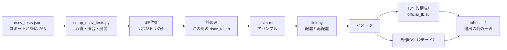

# 公開の試験プログラム（riscv-tests）で、コアと自作ISSを外部の基準と照合する

このリポジトリのプロセッサの例は、コアを自作の命令セットシミュレーター（ISS）と比べています。コアとISSを同じ読み方で書いていると、両方が同じ向きに誤っていても比較は一致します。この教材では、第三者が書いた公開の試験プログラム[riscv-tests](https://github.com/riscv-software-src/riscv-tests)のうち、RV32Iの基本命令を確かめる`rv32ui`の40本を、コアとISSの両方で実行します。試験は自分で合否を判定するので、ISSと独立した基準になります。

位置付けは[プロセッサの検証手順](../../docs/method/processor-verification.md)の「独立した期待値を用意する」にあります。RISC-Vの互換性の認定ではありません。

## 取得からの流れ



## 取得するものとライセンス

取得したソースは、このリポジトリへ転載しません。[`riscv_tests.json`](riscv_tests.json)に、コミットとアーカイブのSHA-256を固定しています。

| 取得するもの | コミット | アーカイブのSHA-256 | ライセンス |
| --- | --- | --- | --- |
| [riscv-tests](https://github.com/riscv-software-src/riscv-tests) | `3df703cd52d5f0d8224e3c50bf03c6cb70efff98` | `26f60be0…70282981` | 同梱の`LICENSE`：カリフォルニア大学評議員会の3条項BSD形式 |
| [riscv-test-env](https://github.com/riscv/riscv-test-env)（上のコミットが指す`env`サブモジュール） | `6de71edb142be36319e380ce782c3d1830c65d68` | `c261a872…eec66edf` | 同梱の`LICENSE`：同じ形式 |

ライセンスは、それぞれの`LICENSE`ファイルを読んで確かめました。各`.S`の先頭は、そのファイルを参照する1行です。取得するのは約590 KBです。

ビルドが読むのは、`isa/rv32ui/*.S`、その実体の`isa/rv64ui/*.S`、`isa/macros/scalar/test_macros.h`です。上流の環境`env/p/riscv_test.h`と`env/encoding.h`は、[環境ヘッダーの選択](#環境ヘッダーの選択)の確認にだけ使います。これら87ファイルのハッシュをまとめた値も固定していて、1つでも変わると実行は不合格になります。

## 対象の試験

`rv32ui`の42本のうち、40本を実行します。

| 分類 | 試験 |
| --- | --- |
| 演算（レジスタどうし） | `add` `sub` `and` `or` `xor` `sll` `srl` `sra` `slt` `sltu` |
| 演算（即値） | `addi` `andi` `ori` `xori` `slli` `srli` `srai` `slti` `sltiu` `lui` `auipc` |
| 分岐とジャンプ | `beq` `bne` `blt` `bge` `bltu` `bgeu` `jal` `jalr` |
| ロードとストア | `lb` `lbu` `lh` `lhu` `lw` `sb` `sh` `sw` `ld_st` `st_ld` |
| そのほか | `simple` |
| 対象外 | `fence_i`：命令を書き換えて実行する試験で、FENCE.I（Zifencei拡張）が要ります。このコアはRV32Iだけです |
| 対象外 | `ma_data`：境界に合わないロード・ストアが正しい値を読み書きすることを確かめます。このコアは、それを境界違反の例外にします。仕様はどちらの実装も認めています |

取得物の`rv32ui`にこの42本以外の試験があれば、実行は不合格になります。上流で試験が増えたことに気付くためです。

## ビルドと簡易リンク

固定環境には、アセンブラー（`llvm-mc`）はありますが、リンカー（`ld.lld`）がありません。そこで、次の3段でイメージを作ります。

1. **前処理**：`clang -E -P -x assembler-with-cpp -D__riscv_xlen=32`。clangはCのプリプロセッサーとしてだけ使います。Apple clangはRISC-Vのコードを出せませんが、前処理には使えます。clangがなければ`cc`を使います。
2. **アセンブル**：`llvm-mc -triple=riscv32 -mattr=-relax,-c -filetype=obj`。
3. **配置と再配置**：[`link.py`](link.py)が、1つのオブジェクトファイルを読み、セクションを決まった番地へ置いて再配置を解決します。

`link.py`の範囲は次のとおりです。これ以外は、読み飛ばさずにエラーにします。

| 項目 | 扱う範囲 |
| --- | --- |
| セクション | `.text.init`（0番地）、`.tohost`・`.text`・`.data`（4 KiB境界）、`.bss`。この順に置く |
| 再配置 | `R_RISCV_PCREL_HI20`・`PCREL_LO12_I`・`PCREL_LO12_S`、`HI20`・`LO12_I`・`LO12_S`、`BRANCH`、`JAL`、`R_RISCV_32` |
| シンボル | 未定義の弱いシンボルは0番地。未定義のシンボルはエラー |
| 大きさ | 64 KiBを超えるイメージはエラー |

40本で実際に現れる再配置は、`PCREL_HI20`と`PCREL_LO12_I`の2種類（各347件）です。ほかの種類はセルフテストで確かめています。

上流のリンクスクリプトは0x80000000からイメージを置きます。このコアはリセット後に0番地から実行するので、この例では0番地から置きます。試験のコードは番地を相対で扱うので、絶対番地の再配置は現れません（現れればエラーになります）。

## 環境ヘッダーの選択

riscv-testsは、起動・終了・合否の報告を`riscv_test.h`のマクロに任せ、対象ごとに差し替える作りです。上流の標準は`env/p`です。まず上流のものをそのまま試し、次の理由で、この例の最小版[`env/riscv_test.h`](env/riscv_test.h)を使うことにしました。試験の本体（`rv64ui/*.S`と`test_macros.h`）は上流のままです。

| 理由 | 確かめたこと |
| --- | --- |
| コアに`mhartid`がない | 上流の初期化は、最初に`mhartid`を読みます。このコアでは不正な命令の例外になり、まだ`mtvec`が0なので0番地へ戻って、同じことを繰り返します。`PRIV=1`のコアで`add`を上流の環境のままビルドして実行し、最初の例外がこの命令（原因2）で、次の退出が0番地であること、時間切れになることを確かめました |
| ISSがFENCEを実行できない | 上流の合格・不合格のマクロは、最初にFENCEを実行します。共有のISSは、この命令を未対応として止まります |
| ISSの終了条件 | 共有のISSは、EBREAKで実行を終えます。上流の環境は、`tohost`へ書いた後、同じ書込みを繰り返します |

1つ目の理由は、ランナーが毎回確かめます（検査`upstream-env-blocked`）。コアに`mhartid`が加わってこの検査が落ちたら、上流の環境へ切り替えられるかを見直す合図です。上流の初期化は、ほかの未実装のCSR（`mnstatus`・`satp`・`medeleg`など）を、直前に`mtvec`を次の命令へ向けることで読み飛ばす作りなので、`PRIV=1`のコアに`mhartid`の読出し（0を返す）があれば、初期化は先へ進む見込みです。そこから先は試していません。

最小版の環境は、次のように動きます。

| マクロ | 動作 |
| --- | --- |
| `RVTEST_CODE_BEGIN` | 全レジスタを0にし、`mtvec`を例外ハンドラーへ向ける。機械モードのまま試験を始める |
| `RVTEST_PASS` | `gp`（試験番号）を1にしてECALL |
| `RVTEST_FAIL` | `gp`を「失敗した試験番号×2＋1」にしてECALL |
| 例外ハンドラー | `mcause`がECALL（11）でなければ、`gp`に0x400を足す。`gp`を`tohost`へ書き、EBREAKで止まる |

上流と違う点は、機械モードだけで動くこと、触るCSRが`mtvec`と`mcause`だけであること、FENCEを使わないこと、EBREAKで止まることです。

## 判定

同じイメージを、コアの3構成と、ISSの2モードで実行します。

| 構成 | コア | 比べるISS |
| --- | --- | --- |
| `traps` | `TRAPS=1` | 例外つきのモード |
| `predict-wait` | `TRAPS=1`、動的な分岐予測、データ側の全アクセスに待ち1サイクル | 同上 |
| `priv` | `TRAPS=1`・`PRIV=1`（M／Uモードとメモリ保護つき）、待ち1サイクル | 特権つきのモード |

[テストベンチ](tb/official_tb.sv)は、命令とデータで1つのメモリ（64 KiB）を持ちます。ある試験が、ある構成で合格する条件は次のすべてです。

- コアが、`tohost`へちょうど1回書いてから停止する。
- `tohost`の値が1である。
- 退出した全命令（PC、命令語、書いたレジスタと値、メモリアクセス）が、ISSの記録と一致する。
- 上限のサイクル数（20,000）以内に終わり、退出の信号とメモリの要求にXがない。

ISSの側も、`tohost`が1で、そこへの書込みがちょうど1回であることを確かめます。ISSは共有のファイルを変えずに取り込み、データメモリの大きさだけを、この例の中で64 KiBへ広げています。

## 検出を確かめる

| 検査 | 内容 | 期待 |
| --- | --- | --- |
| `detect-wrong-data` | `lw`のイメージのデータ1語を書き換える | コアもISSも`tohost`＝5（試験2の失敗）で、退出の列は一致 |
| `detect-bad-relocation` | 簡易リンクの下位12ビットの計算を4だけずらす | `lw`が合格しない |
| `mutation-<番号>` | コアの既存の変異を入れて40本を実行 | 気付く試験の集合が、固定した表と一致 |

変異は、構成`predict-wait`で実行します。smokeは6種類（1・3・5・10・12・13）、nightlyは17種類すべてです。結果は次のとおりで、[`riscv_tests.json`](riscv_tests.json)に固定しています。

| 変異 | 内容 | 公開の試験で | 気付く試験 |
| --- | --- | --- | --- |
| 1 | x0に宛てた結果も転送する | 見つかる | 自己判定で2本。ISSとの退出の比較では40本すべて |
| 2 | ロードの直後の使用で、1サイクル空けない | 見つかる | `lb` `lbu` `lh` `lhu` `lw` `ld_st` |
| 3 | JALRの飛び先を、転送前の値で計算する | 見つかる | `jalr`（時間切れ） |
| 4 | メモリの待ちの間、転送された値を保持し直さない | 見つかる | `sb` `sh` `sw` `ld_st` `st_ld` |
| 5 | 予測外れの分岐を、飛び先から再開する | 見つかる | 34本（多くは時間切れ） |
| 6 | 成立の予測が当たっても、後続を取り消す | **見つからない** | なし（結果を変えない性能の誤り） |
| 7 | 静的予測の向きが逆 | **見つからない** | なし（この構成では使われない） |
| 8 | EXの取り込み直しより、IFの予測を優先する | 見つかる | 分岐の6本 |
| 9 | LB・LHをゼロ拡張する | 見つかる | `lb` `lh` `sb` `sh` `ld_st` `st_ld` |
| 10 | SB・SHを、最下位のレーンに書く | 見つかる | `sb` `sh` `ld_st` `st_ld` |
| 11 | ロードのバイトを、番地のビット1だけで選ぶ | 見つかる | `lb` `lbu` `sb` `ld_st` `st_ld` |
| 12 | WBからの転送路だけ、拡張前のワードを渡す | 見つかる | ロード・ストアの8本 |
| 13 | 例外のmepcに、次の命令の番地を保存する | **見つからない** | なし（この環境はmepcを読まず、MRETもしない） |
| 14 | 割り込みの受付で、mstatus.MIEを見ない | **見つからない** | なし（割り込みを使わない） |
| 15 | 境界に合わないロードでも、rdに書く | **見つからない** | なし（境界に合わないアクセスをしない） |
| 16 | CSRを読んだ直後の命令を待たせない | **見つからない** | なし |
| 17 | メモリの待ちの間に割り込みを受ける | **見つからない** | なし（割り込みを使わない） |

読み取れることは2つです。

- `rv32ui`は、1命令ずつの意味と、基本的な転送・ロード直後の使用を確かめます。例外・割り込み・性能の誤り（変異6・7・13〜17）は見つけません。これらは、[例外・割り込みの例](../local-riscv-traps/README.md)や[分岐予測器の例](../local-branch-predictor/README.md)のように、ISSとの比較や性能カウンターで確かめる範囲です。
- 変異1は、自己判定では2本しか気付きませんが、退出の列をISSと比べると40本すべてで食い違います。公開の試験は、結果のレジスタを最後に比べるので、途中の値の誤りが結果に出ない場合は合格します。

変異18以降（特権とメモリ保護）は、この環境が機械モードだけで動くので、対象にしていません。

## 実行

Icarus Verilog、`llvm-mc`、Cのプリプロセッサー（clangまたは`cc`）が要ります。最初に、取得物を準備します。ネットワークへ接続するのは、この準備だけです。

```sh
python3 examples/local-riscv-official-tests/setup_riscv_tests.py --out artifacts/toolchains/riscv-tests
python3 examples/local-riscv-official-tests/run.py --out artifacts/riscv-official
python3 examples/local-riscv-official-tests/run.py --profile nightly --out artifacts/riscv-official-nightly
python3 -m unittest discover -s examples/local-riscv-official-tests/tests -v
```

- `--riscv-tests-home`：準備した場所。既定は`artifacts/toolchains/riscv-tests`です。取得物がなければ、準備のコマンドを案内して終了コード1で終わります。取得物なしで合格にはなりません。
- `setup_riscv_tests.py --archives <ディレクトリ>`：先に取得しておいたアーカイブ（ファイル名は`<コミット>.tar.gz`）を使います。ハッシュの照合は同じです。
- `--clang`、`--llvm-mc`、`--iverilog`、`--vvp`：ツールの場所。`llvm-mc`がPATHになければ、Homebrewの既定の場所も探します。LLVMの版は固定せず、実行時の版を記録します。
- `--profile nightly`：変異を17種類すべて実行します。40本の試験と3構成は、smokeでも同じです。
- `--timeout`：1回のツール実行の上限（秒）。既定は30です。

セルフテスト17件は、取得物がなくても動きます。簡易リンクは、テストの中で書いた小さなアセンブリで確かめ、準備スクリプトは、テストの中で作ったアーカイブで確かめます。

## 証跡

`artifacts/`はGit管理の対象外です。出力先には次を保存します。

- `manifest.json`：計画（試験、構成、変異、固定したコミット）、検査IDの一覧、この例と共有コア・ISSのソースのSHA-256。
- `tools.json`：clang、llvm-mc、iverilog、vvpの版。
- `sources.json`：取得物の場所、固定値、ビルドが読む87ファイルのSHA-256。
- `build/`：試験ごとの前処理後のアセンブリ、オブジェクト、イメージ（16進）。`images.json`に、イメージのSHA-256・大きさ・`tohost`の番地・再配置の件数。
- `traps/`・`predict-wait/`・`priv/`：試験ごとのログと、退出した命令の列。`results.json`に、判定・退出数・サイクル数。
- `upstream-env/`：上流の環境のままビルドした`add`と、その実行の記録。
- `negative/`、`mutation<番号>/`、`mutations.json`：負例と変異の結果。
- `requirements.json`、`summary.json`、`junit.xml`。

JUnitは、smokeが214件、nightlyが225件です。内訳は、ツールと取得物の検査3、ビルド40、ISS 40、コア120、上流の環境1、負例2、変異6または17、要求と入力の照合2です。[要求カタログ](requirements.json)は6要求です。

## 確認範囲

2026-11-21に、macOS arm64のPython 3.14、Icarus Verilog 14.0開発版、Homebrew版LLVM 23.1.4の`llvm-mc`、Apple clang 21（前処理だけ）で、smoke 214件、nightly 225件、セルフテスト17件が成功しました。40本の試験は、コアの3構成とISSの2モードのすべてで`tohost`＝1になり、退出の列も一致しました。最も長い試験で、967命令・1,512サイクルです。準備は約2秒（取得を含む）、smokeは約1分、nightlyは約1分20秒でした（ほかの作業と並行した手元の値）。

この教材で確かめていないことは次のとおりです。

- **互換性の認定ではありません。** [riscv-arch-test](https://github.com/riscv/riscv-arch-test)（RISC-V Architectural Test Suite）は実行していません。
- **外部のISSとは比べていません。** SpikeやSailモデルの実行記録との比較は、未実施です。自作ISSは、同じ40本を通ることを確かめただけです。
- **上流の環境`env/p`は使っていません。** 試験の本体は上流のままですが、起動と終了はこの例のものです。上流の環境が行うUモードでの実行とCSRの初期化は、確かめていません。
- **イメージは0番地から置いています。** 上流の0x80000000ではありません。
- **`rv32ui`だけです。** `rv32mi`（機械モードの例外とCSR）、`rv32si`、圧縮命令、乗除算、浮動小数点の試験は対象外です。
- **試験の範囲は、1命令ずつの意味が中心です。** 上の表のとおり、例外・割り込み・性能の誤りは見つけません。
- LinuxとGCCの前処理（`cc -E`）では実行していません。kirimasimでも実行していません。

## arch-test・Spike・Sailについて

この教材は、次の3つを読むだけに留めています。どれも実行していません。

- **riscv-arch-test**：RISC-V Internationalの互換性の試験です。READMEによると、現在は`act4`という枠組みで、対象の構成に合わせて自己判定の試験を生成します。生成にはSailモデルと新しいコンパイラーが要り、リポジトリは約600 MBあります。以前の枠組み（RISCOF）は、試験が署名（メモリの決まった範囲の内容）を出し、参照モデルの署名と比べる方式でした。README以外は読んでいません。
- **Spike**（[riscv-isa-sim](https://github.com/riscv-software-src/riscv-isa-sim)）：広く使われている命令セットシミュレーターです。riscv-testsの`tohost`は、Spikeがホストと通信するための仕組みに由来します。
- **Sailモデル**（[sail-riscv](https://github.com/riscv/sail-riscv)）：仕様を実行できる形で書いたモデルで、arch-testの参照に使われます。

次の段階としては、同じイメージをSpikeかSailで実行し、命令ごとの記録を自作ISSと比べる方法があります。自作ISSの誤解を、試験の自己判定より細かく見つけられます。

## 参考にした一次資料

- [riscv-tests](https://github.com/riscv-software-src/riscv-tests)のREADME：試験の構成、対象ごとの環境（TVM）の考え方、`riscv_test.h`が用意するマクロ。本文とソースは転載していません。
- [riscv-test-env](https://github.com/riscv/riscv-test-env)の`p/riscv_test.h`と`p/link.ld`：上流の標準の環境と配置。
- [The RISC-V Instruction Set Manual](https://docs.riscv.org/reference/isa/) Volume I（RV32I、Zifencei、境界に合わないアクセスの扱い）とVolume II（`mhartid`、`mtvec`、`mcause`）。
- RISC-V ELF psABIの再配置の定義（[riscv-elf-psabi-doc](https://github.com/riscv-non-isa/riscv-elf-psabi-doc)）：`link.py`が扱う再配置の種類と計算。
- [riscv-arch-test](https://github.com/riscv/riscv-arch-test)のREADME。
