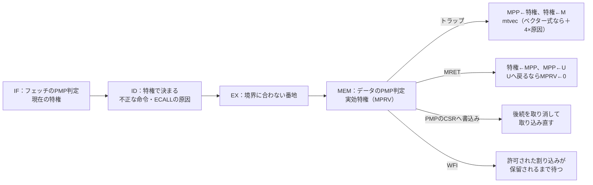

# 特権モードとPMPを、コアへ組み込んでISSと比べる

ユーザーモード（U）のプログラムは、機械モード（M）が許した命令と番地だけを使えます。この境界を作るのは、mstatusのMPP・MPRV、MRET、PMP（物理メモリ保護）、割り込みの許可です。どれも単体では単純ですが、パイプラインへ組み込むと、取り込み済みの命令の扱い、設定を変えた直後の命令、割り込みと重なったときの順序で誤ります。この例では、[例外・割り込みの例](../local-riscv-traps/README.md)のコアにM／Uモードを加え、[PMPの判定回路](../local-riscv-pmp/README.md)を取り込んで、退出した命令を[ISS](../local-riscv-iss/README.md)と1つずつ比べます。

[例外・割り込みの例](../local-riscv-traps/README.md)が対象外としていた、ユーザーモード、命令フェッチとデータのアクセスフォルト、タイマー割り込みとソフトウェア割り込み、ベクター式のmtvec、割り込みの入れ子、WFIを扱います。検証の考え方は[プロセッサの検証手順](../../docs/method/processor-verification.md)にあります。

## 加えた回路と、判定する段



コア[`rv32i_core.sv`](../local-riscv-iss/rtl/rv32i_core.sv)の`PRIV`パラメーターを1にすると（`TRAPS`も1にします）、次が加わります。`PRIV`が0のときの動作、ポート名、既存の変異の番号は変えていません。

- **特権**：1ビットのレジスタ（M／U）。トラップでMへ上がり、MRETでMPPへ戻ります。特権が変わるのはこの2つだけで、どちらも後続の命令をすべて取り消します。そのため、IDで見た特権は、その命令が実行される特権と一致します。
- **PMP**：[`pmp.sv`](../local-riscv-pmp/rtl/pmp.sv)を2つ置きます。1つはフェッチの番地、もう1つはMEMのデータの番地を判定します。2つには同じ書込みを与えます。エントリーは4個、番地は16ビット（64 KiB）です。
- **pmpcfg0の書込み**：判定回路は設定を1バイトずつ受け取るので、pmpcfg0への書込みは、パイプラインを3サイクル止めて4バイトを順に書きます。`rd`へ返す値は、最初のサイクルに読んだ値です。書込みの途中では割り込みを受けません。
- **PMPを書いた後の取り込み直し**：PMPのCSRへ書いた命令の後ろには、古い設定で取り込んだ命令が並んでいます。これらを取り消し、次の番地から取り込み直します。
- **割り込みの線**：`irq`ポートを3ビットにします（ビット0が外部、1がタイマー、2がソフトウェア）。`PRIV`が0のときは、これまでどおり1ビットです。
- **WFI**：MEMで、mieで許可された割り込みが保留されるまで待ちます。待った後のWFIは先に退出し、割り込みは次の命令の前で受けます（mepcはWFIの次の番地）。

## 仕様（契約）

出典は、RISC-V特権仕様（The RISC-V Instruction Set Manual, Volume II）です。節番号は、批准版20211203のものを書きます。本文は写していません。

### CSR

| CSR | 実装したフィールド | 出典 |
| --- | --- | --- |
| mstatus（0x300） | MIE（3）、MPIE（7）、MPP（12:11）、MPRV（17）、TW（21） | 3.1.6 |
| mie（0x304）・mip（0x344） | MSIE／MSIP（3）、MTIE／MTIP（7）、MEIE／MEIP（11）。mipは読出し専用 | 3.1.9 |
| mtvec（0x305） | BASEと、MODEのビット0（0：直接、1：ベクター式） | 3.1.7 |
| mscratch・mepc・mcause・mtval | [例外・割り込みの例](../local-riscv-traps/README.md)と同じ | 3.1.13〜3.1.16 |
| pmpcfg0（0x3a0） | 4エントリーの設定（L、A、X、W、R） | 3.7.1 |
| pmpaddr0〜3（0x3b0〜0x3b3） | 番地のビット15:2（14ビット） | 3.7.1 |

### 例外と割り込み

| 原因 | mcause | mtval | 見つける段 |
| --- | --- | --- | --- |
| 命令アクセスフォルト | 1 | フェッチした番地 | IF |
| 不正な命令（Uでの CSR命令・MRET、TWが1のときのUでのWFIを含む） | 2 | 命令語 | ID |
| UモードからのECALL／MモードからのECALL | 8／11 | 0 | ID |
| 境界に合わないロード／ストア | 4／6 | 番地 | EX |
| ロード／ストアのアクセスフォルト | 5／7 | 番地 | MEM |
| ソフトウェア／タイマー／外部割り込み | 0x80000003／0x80000007／0x8000000b | 0 | MEM |

1つの命令で重なったときの順序は、割り込み、命令アクセスフォルト、不正な命令、ECALL、境界に合わない番地、アクセスフォルトです（3.1.15の優先順位の表）。割り込みどうしは、外部、ソフトウェア、タイマーの順です。Uモードでは、mstatus.MIEが0でも機械モードの割り込みを受けます（3.1.6.1）。

### 特権の動き

| 操作 | 動作 | 出典 |
| --- | --- | --- |
| トラップ | MPPへ今の特権を入れ、Mへ上がる。MPIE←MIE、MIE←0 | 3.1.6.1 |
| MRET | 特権←MPP、MPP←U、MIE←MPIE、MPIE←1。戻り先がMでなければMPRV←0 | 3.1.6.1、3.3.2 |
| MPRV＝1 | ロードとストアを、MPPの特権で判定する。フェッチには効かない | 3.1.6.3 |
| TW＝1 | UモードのWFIを不正な命令にする | 3.1.6.5 |
| PMP | 番号の小さいエントリーから調べ、アクセスの一部でも重なる最初のエントリーで決める。全体を含んでいなければ不可。Mモードは、ロックしたエントリーだけに縛られる。どれにも重ならなければ、Mは可、Uは不可 | 3.7.1 |
| PMPのロック | Lを立てたエントリーの設定と番地は、リセットまで変えられない | 3.7.1 |

### 実装に任されている点の選択

仕様が実装に任せている点は、コアとISSで同じにしています。

| 項目 | この例の選択 |
| --- | --- |
| MPPが持てる値 | MとUだけ。それ以外を書くとUとして読める |
| mtvecのMODE | ビット0だけを持つ。ビット1は0として読める |
| 実装していないCSR | 存在しない扱い。アクセスは不正な命令 |
| mtval | アクセスフォルトと境界に合わない番地では番地（フェッチではPC）、不正な命令では命令語、それ以外は0 |
| 境界に合わない番地とアクセスフォルトの順 | 境界に合わない番地が先 |
| 物理メモリの大きさ | 64 KiB。それより上の番地は、どのモードでもアクセスフォルト |
| PMPの設定でWだけを立てた場合 | RもWも0として保存する（判定回路の選択） |
| WFI | 割り込みを待つ。mstatus.MIEが0でも、mieで許可された割り込みが保留されれば先へ進む |
| リセット後 | Mモード、MPP＝M、PMPはすべてOFF |
| EBREAK | どちらのモードでも実行を止める（テストベンチの約束で、ブレークポイント例外ではない） |

## 検証すること

[`run.py`](run.py)は、命令列を[`iss.py`](../local-riscv-iss/iss.py)の`execute_privileged`で実行し、退出する命令の列（PC、命令語、書くレジスタと値、メモリアクセス、トラップの原因とmtval）と、最後のデータメモリの全ワードを期待値にします。テストベンチ[`core_tb.sv`](../local-riscv-iss/tb/core_tb.sv)は、コアの退出を順に比べます。ISSは、コアの式を写さず、仕様の順（割り込み、フェッチ、解読、番地）で1命令ずつ書いています。PMPの判定は、ISSの中に仕様の規則から書いたもので、`pmp.sv`やその例のモデルは使っていません。

### 割り込みの線とタイマー

割り込みの線は、データメモリの最後のワード（`IRQ`）へ書いた値で動きます。ビット0が外部、1がタイマー、2がソフトウェアです。ストアが終わった次の命令の前で、線の状態が決まります。そのため、割り込みを受ける位置はISSでも決まり、コアの記録から位置を教える必要はありません。

WFIを実際に待たせるために、もう1つのワード（`TIMER`）を使います。0でないバイトを書くと、テストベンチはその数のクロックの後にタイマーの線を上げます。ISSは、時間を持たない代わりに、次の約束を課します：タイマーをセットした次の命令はWFIで、そのとき保留中の割り込みはない。約束を破る命令列は、ISSがエラーにします（待たずに進むコアと、結果が食い違うためです）。

### ハンドラー

ハンドラーはMモードで動き、例外では原因の命令を飛ばして戻り、割り込みでは線を下げて戻ります。命令列は、次のレジスタでハンドラーへ指示を出します。

| レジスタ | 意味 |
| --- | --- |
| x1 | 命令アクセスフォルトの後に再開する番地 |
| x17 | 0でなければ、UモードからのECALLをMモードで戻す（MPPをMにする） |
| x23 | 例外から戻る前に線へ書く値。戻った直後に割り込みを起こす |
| x25 | 0でなければ、次の割り込みのハンドラーがこの値を線へ書いてMIEを立てる（入れ子） |

ハンドラーが読んだmcause・mepc・mtval・mstatusは、レジスタへの書込みとして退出するので、ISSと比べられます。ベクター式では、表の各入口が番号をx28へ書いてから共通のハンドラーへ進みます。

### 固定の命令列

固定の命令列は318語で、871命令が退出し、うち49回がトラップです。次を順に確かめます。

| 場面 | 確かめること |
| --- | --- |
| PMPのCSRの読み戻し | 書いた値が読め、読んだ値を次の命令で使える |
| MPPへ2を書く | Uとして読める |
| MPRV＝1、MPP＝U | Mモードのロード・ストアがUの権限で判定される。許されるアクセスは通り、許されないものはアクセスフォルト。拒否したストアはメモリを変えない |
| Uモード | 許された領域の読み書き、読出し専用の領域へのストア、権限のない領域のロード、CSR命令、MRET、データ領域からの実行（命令アクセスフォルト）、ECALL |
| MIEが0のままUへ入る | 保留中の割り込みを、Uモードの最初の命令の前で受ける |
| 3本の線 | 1本ずつ、3本同時（外部が先）、2本同時（ソフトウェアが先）、mieで外部を止めたとき（タイマーが先） |
| ベクター式 | 割り込みは基点＋4×原因へ、例外は基点へ。MODEへ3や2を書いたときの読み戻し |
| 入れ子 | タイマーのハンドラーの中で外部割り込みを受け、外側のmepcとmstatusを戻して帰る。Uモードからと、Mモードからの両方 |
| WFI | タイマーで起き、WFIが退出した後に割り込みを受ける。MIEが0なら割り込まずに進む。すでに保留されていれば待たない |
| TW | UモードのWFIが不正な命令になる |
| MPRVを立ててUへ戻る | MPRVが0になる |
| 64 KiBより上 | Mモードでも、ロード・ストア・フェッチがアクセスフォルト |
| PMPの変更 | 読出し専用の領域を書込み可にすると、次のUモードのストアが通る。戻すと拒否される |
| ロック | 書込みの直後の1命令をロックした領域にする。取り込み済みのその命令は実行されず、Mモードでも読み書きできない。ロックした設定と番地への書込みは無視される |

### ランダムな命令列

[ISSの例](../local-riscv-iss/README.md)のランダムな命令列（バイト・ハーフワードのアクセスを含む）へ、平均10命令に1回、次の出来事を挟みます：ECALL、不正な命令語、境界に合わないアクセス、CSRの読み書き、Uモードへの移行、Uモードでの許可・不許可の番地へのアクセス、データ領域への飛び込み、Mモードへの復帰、線の操作（MIEを止めた窓の中、Uへ入る直前を含む）、入れ子の指定、MPRVの窓、ベクター式と直接の切替え、タイマー待ちのWFI、PMPの設定の変更、64 KiBより上へのアクセス。

出来事は、どちらのモードで実行されても結果が決まるように作っています。Uモードでできない操作はトラップになり、ハンドラーが飛ばします。Mモードが必要な出来事は、先頭でECALLを使ってMモードへ戻ります。

### 目標

[要求カタログ](requirements.json)は6要求・25目標です。目標は、ISSが退出の記録に付ける印で、テストベンチが比較に合格した記録の印を`COVER`として出します。固定の命令列だけで、両方の構成が25目標に達します。

| 要求 | 目標 |
| --- | --- |
| PRIV-MODE | UからのECALL、UへのMRET、UでのCSR命令とMRETの拒否、MPPの読み戻し |
| PRIV-MPRV | MPRVの下で通るアクセスと拒否されるアクセス、Uへ戻るときのクリア |
| PRIV-PMP | フェッチ・ロード・ストアのフォルト、ロックによるMモードのフォルト、64 KiBより上、ロック後の書込みの無視、読み戻し |
| PRIV-INTERRUPT | タイマー、ソフトウェア、複数保留時の優先、ベクター式、入れ子、MIEが0のUモード |
| PRIV-WFI | タイマーで起きるWFI、WFIの後の割り込み、TWによる拒否 |
| PRIV-RUN | EBREAKまで実行 |

### 2つの構成

| 構成 | 内容 |
| --- | --- |
| `priv` | 分岐予測なし |
| `priv-predict` | 動的な分岐予測あり。MRETやトラップの後ろに置いた、予測器が追いかけるジャンプが実行されないことも確かめます |

### 意図的な誤実装

コアの変異18〜23を使います。`--demo-bug 1..6`は、この順に変異18〜23を選びます。

| 番号 | 誤り | 検出 |
| --- | --- | --- |
| 18 | トラップでMPPへ特権を保存しない | `ISS_DATA`（ハンドラーが読むmstatus） |
| 19 | MPRVを無視する | `ISS_DATA`（起きるはずのアクセスフォルトが起きない） |
| 20 | PMPが拒否したストアが、トラップしながらメモリへ届く | `ISS_DATA`（後のロードの値） |
| 21 | 割り込みの優先順位が逆 | `ISS_DATA`（mcause） |
| 22 | ベクター式でも基点へ入る | `ISS_FLOW`（次に退出するPC） |
| 23 | UモードでCSR命令とMRETを実行できる | `ISS_DATA`（トラップにならない） |

変異とは別に、セルフテストがコアのソースを書き換え、比較が働くことを確かめます：PMPを書いた後に取り込み直さない、WFIが待たない、待っているWFIに割り込みを受ける、MRETがMPRVを残す、UモードがMIEに従う、TWを無視する、フェッチを判定しない、アクセスフォルトのmtvalが違う。8種類とも、固定の命令列で不合格になります。

## 実行

Icarus Verilogだけで動きます。

```sh
python3 examples/local-riscv-priv/run.py --out artifacts/riscv-priv
python3 examples/local-riscv-priv/run.py --profile nightly --out artifacts/riscv-priv-nightly
python3 examples/local-riscv-priv/run.py --configuration priv --demo-bug 3 --out artifacts/riscv-priv-bug
python3 -m unittest discover -s examples/local-riscv-priv/tests -v
```

[共通手順](../local-common/README.md)を使います。smokeはランダムな命令列（本体300命令）を1 seed、nightlyは本体2,000命令を3 seed実行します。`--iterations`は本体の命令数です。JUnitはsmoke 18件／nightly 22件、セルフテストは15件です。

## 証跡

共通手順の証跡（`manifest.json`、`builds.json`、ケースごとの`vectors.txt`・`simulation.log`・`wave.vcd`・`result.json`、`coverage.json`、`summary.json`、`junit.xml`）を残します。`vectors.txt`には、命令語、データの初期値、期待する退出の列、最後のデータメモリが入っています。マニフェストには、コア、デコーダ、PMPの判定回路、テストベンチ、ISS、命令表の生成器のハッシュを記録します。

## 適用範囲と対象外

2026-11-21に、macOS arm64のPython 3.14、Icarus Verilog 14.0開発版で、2構成のsmoke 18件とnightly 22件、25目標、6変異の検出（両構成で12件）、セルフテスト15件が成功しました。別に、5つのseedで本体1,500命令×3本を両構成で実行し、すべて一致しました。コアは、Verilator 5.052のlint（`PRIV`あり・なしの6構成で警告0件）と、YoWASP版Yosys 0.70の合成（ラッチなし）を通ります。この変更の後で、コアやISSを使う既存の例（ISSとの比較、分岐予測、ロード・ストア、例外・割り込み、PMP判定、画像処理SoC、ネットワークSoC）のsmokeとセルフテストも合格しました。Linuxとkirimasimでは実行していません。

この例で確かめていないことは次のとおりです。

- 比較は、与えた命令列の範囲です。すべての命令列についての証明ではありません。
- ISSとコアは、同じ人が同じ仕様の読み方で書いています。公開の試験プログラムや、ほかのISSとは照合していません。RISC-Vの互換性の確認ではありません。
- スーパーバイザーモード、ページング（[Sv32](../local-sv32/README.md)・[TLB](../local-tlb/README.md)は単体のまま）、割り込みの委譲、Smepmpなどの拡張、PMPのエントリー4個と64 KiBを超える構成は扱いません。
- デバッグモード、EBREAKのブレークポイント例外、圧縮命令、M拡張、カウンター（mcycleなど）、misaやmhartidなどの情報用のCSRは実装していません。
- タイマーとソフトウェア割り込みの発生源（mtime・mtimecmpを持つ回路）は作っていません。線は、テストベンチがストアに合わせて動かします。任意の時刻に上がる非同期の線は与えていません。割り込みを受ける位置は、ストアの直後か、WFIの待ちの中だけです。
- UモードのWFIがTW＝0で実行される場合は、試験していません。Uモードでは許可された割り込みを必ず受けるので、WFIを起こす割り込みを保留したままUモードのWFIへ到達する命令列を、この約束の中では作れないためです。
- PMPの判定回路そのものの検証（領域の符号化の全数、優先順位、ロック中の下位の番地レジスタ）は、[PMP判定の例](../local-riscv-pmp/README.md)の範囲です。この例は、コアへの接続と、判定の結果がトラップになることを確かめます。
- 命令メモリとデータメモリは別で、どちらも番地0から始まります。PMPの領域は、番地の数値だけで両方に効きます。自分自身を書き換えるプログラムは扱いません。
- pmpcfg0の書込みに3サイクル余分にかかることなど、性能は判定していません。

## 参考にした一次資料

- [The RISC-V Instruction Set Manual, Volume II: Privileged Architecture](https://docs.riscv.org/reference/isa/)：節番号は批准版20211203のものです。3.1.6（mstatus。3.1.6.1 特権と割り込み許可のスタック、3.1.6.3 MPRV、3.1.6.5 TW）、3.1.7（mtvec）、3.1.9（mip・mie）、3.1.15（mcauseと優先順位）、3.1.16（mtval）、3.3.1（ECALL）、3.3.2（MRET）、3.3.3（WFI）、3.7（PMP）。
- [riscv-opcodes](https://github.com/riscv/riscv-opcodes)：命令の符号化。[命令デコーダの例](../local-riscv-decoder/README.md)が固定した版を使います。
- [RISC-VのPMP判定の例](../local-riscv-pmp/README.md)：取り込んだ判定回路と、その単体の検証。
