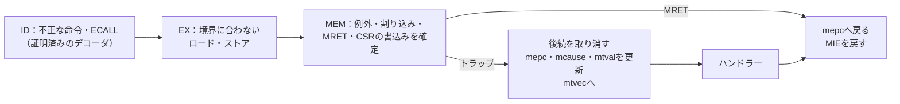

# 例外と割り込みを、ISSとの比較で確かめる

例外は、命令を実行できないときに、処理をトラップハンドラーへ移す仕組みです。原因は、不正な命令、ECALL、境界に合わないロード・ストアなどです。割り込みは、外部の信号で同じようにハンドラーへ移ります。パイプラインでは、例外を起こした命令の前の命令はすべて完了させ、後の命令は1つも結果を残さない（精密な例外）必要があります。誤りやすいのは、保存する戻り番地（mepc）と原因（mcause）、割り込みの許可（mstatus.MIEとmie.MEIE）の扱い、CSRの値を読んだ直後に使う命令です。この例では、[ISSとの逐次比較の例](../local-riscv-iss/README.md)のRV32Iコアに機械モードのトラップを加え、ISSと退出の列を1命令ずつ比べます。

## MEM段でトラップを確定する



コア[`rv32i_core.sv`](../local-riscv-iss/rtl/rv32i_core.sv)の`TRAPS`パラメーターを1にすると、トラップが加わります。原因はIDとEXで見つけて命令と一緒に運び、MEMで確定します。MEMにある命令より前の命令は、すでにメモリやCSRへの書込みを終えています。後の命令は、まだメモリにもCSRにも書いていません。そのため、MEMで後続を取り消せば精密になります。CSRの書込みとMRETも、同じ理由でMEMで行います。

| 原因 | mcause | mtval | 見つける段 |
| --- | --- | --- | --- |
| 不正な命令 | 2 | 命令語 | ID |
| ECALL | 11 | 0 | ID |
| 境界に合わないロード | 4 | 番地 | EX |
| 境界に合わないストア | 6 | 番地 | EX |
| 外部割り込み | 0x8000000b | 0 | MEM |

不正な命令の判定には、[デコーダの形式検証の例](../local-riscv-decoder/README.md)で全命令語について証明した`rv32i_decoder`を使います。これに、実装したCSRへのCSR命令とMRETを加えます。ISSも、同じ公式の命令表で判定します。EBREAKは、これまでどおり停止に使います。

| CSR | 実装した内容 |
| --- | --- |
| `mstatus` | MIEとMPIE。MPPは常に3（機械モード）と読める |
| `mie` | MEIE（外部割り込みの許可）だけ |
| `mtvec` | ハンドラーの番地。直接モードだけで、下位2ビットは0 |
| `mscratch` | 32ビットすべて |
| `mepc`・`mcause`・`mtval` | トラップで書き込む。CSR命令でも書ける。`mepc`の下位2ビットは0 |
| `mip` | MEIPが割り込み線を示す。書込みは無視する |

これ以外の番地のCSR命令は、不正な命令になります。トラップでは、MIEをMPIEに移してMIEを0にします。MRETでは、MPIEをMIEに戻し、MPIEを1にします。

## 割り込みを受け付ける位置

割り込み線は、データメモリの最後のワード（番地`0x3fc`）のビット0です。命令列がこのワードにストアすると線が変わり、ハンドラーが0を書いて下げます。ISSも同じワードを見ます。

コアは、線が立っていてMIEとMEIEが1のとき、最初にMEMへ進んだ命令の前で割り込みを受け付けます。ISSは、次に実行する命令の前で受け付けます。線を立てるストアがMEMを出た次のサイクルには、その次の命令がMEMにあるので、両者は同じ位置になります。MIEを1にするCSR命令やMRETの直後も同じです。この規則で受け付ける位置が決まるので、退出の列をISSと1命令ずつ比べられます。

この比べ方ができるのは、割り込み線を命令列自身のストアで動かし、受け付ける位置をコアの規則で固定しているからです。外から任意の時刻に割り込みが入り、パイプラインの状態で受け付ける位置が変わるコアでは、コアが受け付けた位置をISSに伝え、ISSをそこで割り込ませて比べる方法（DUTに合わせる比較）が必要です。

## 2つの構成

| 構成 | `PREDICT` | 目的 |
| --- | --- | --- |
| `traps` | 0 | 予測しないコアでのトラップ |
| `traps-predict` | 2 | [分岐予測器の例](../local-branch-predictor/README.md)の動的予測と組み合わせる。予測で取り込んだ命令も、トラップで取り消されなければならない |

## 固定の命令列とランダムな命令列

どちらの命令列も、番地4にハンドラーを置きます。ハンドラーは、mcause・mepc・mtvalをx20〜x22に読みます。例外ならmepcに4を足して、原因の命令の次へ戻ります。割り込みなら線を下げ、割り込まれた命令へ戻ります。命令列は、mtvec・mie・mstatusを設定してから始めます。

固定の命令列は、次を実行します。

1. ECALLと、不正な命令語5つ（全0、全1、MUL、実装していないCSR、FENCE.I）
2. 境界に合わないLW・LH・SW・SH。メモリは変わらず、rdにも書かない。続けて、境界に合うLWの値をすぐ使う
3. CSRRW・CSRRS・CSRRC・CSRRWIでmscratchを読み書きし、読んだ値をすぐ使う
4. ストアで割り込み線を立てる（次の命令の前で割り込む）
5. MIEを0にしてから線を立て、2命令の後でMIEを1に戻す（0の間は受け付けず、1に戻した直後に割り込む）
6. mipとmcauseを読み、EBREAKで停止する

ランダムな命令列は、ISSとの比較の例の生成器（バイト・ハーフワードあり）の命令の間に、8%の確率で事象を差し込んだものです。事象は、ECALL、不正な命令語、境界に合わないロード・ストア、CSRの書込み、CSRを読んですぐ使う組、割り込み線を立てるストア、MIEを0にして線を立ててから1に戻す組です。生成器がレジスタを初期化する前と、AUIPCからJALRまでの間（番地を計算している途中）には差し込みません。

退出の記録には、この例で加えた8つの印を付けます。トラップは、退出の記録の種別3（番地にmcause、データにmtval）として比べます。

| 目標 | 内容 |
| --- | --- |
| `trap/illegal`・`trap/ecall` | 不正な命令、ECALLの例外 |
| `trap/misaligned-load`・`trap/misaligned-store` | 境界に合わないロード、ストアの例外 |
| `trap/interrupt` | 外部割り込み |
| `trap/enabled-by-csr` | MIE・MEIEを1にするCSR命令かMRETの直後で受け付けた割り込み |
| `trap/mret` | MRETで戻る |
| `csr/use-at-once` | CSRを読んだ直後の命令が、その値を使う |

[要求カタログ](requirements.json)は3要求・10目標で、これにISSとの比較の例のロード直後の使用と停止を加えています。どちらの構成でも、固定の命令列だけで10目標に達します。

## 意図的な誤実装

コアの変異13〜16です。`--demo-bug 1..4`は、変異13〜16を通常の実行に入れます。

| 番号 | 誤実装 | 検出ラベル | 最初に食い違う退出 |
| --- | --- | --- | --- |
| 13 | 例外のmepcに、次の命令の番地を保存する | `ISS_DATA` | ハンドラーでmepcを読むCSRRS |
| 14 | 割り込みの受付で、mstatus.MIEを見ない | `ISS_DATA` | ハンドラーの先頭（MIEが0なのに、もう一度割り込む） |
| 15 | 境界に合わないロードでも、rdに書く | `ISS_DATA` | 境界に合わないLW |
| 16 | CSRを読んだ直後の命令を待たせない | `ISS_DATA` | CSRを読んだ直後のADD |

CSRの値はMEMで読むので、直後の命令はロードの直後と同じく1サイクル待つ必要があります。変異16はこれを忘れ、EXで計算した別の値を渡します。

seed 17〜19のランダムな命令列だけで実行すると、変異13〜16は、どちらの構成でも300命令ですべてのseedで検出できます。

## 実行

```sh
python3 examples/local-riscv-traps/run.py --out artifacts/riscv-traps
python3 examples/local-riscv-traps/run.py --profile nightly --out artifacts/riscv-traps-nightly
python3 -m unittest discover -s examples/local-riscv-traps/tests -v
```

[共通手順](../local-common/README.md)を使い、構成は`traps`・`traps-predict`の2つです。smokeは300命令×1 seed、nightlyは2000命令×3 seedです。JUnitは各構成7／9件、全体14／18件です。セルフテストは9件で、ISSのトラップの記録（手で計算したmcause・mepc・mtval）、CSRの実装したビット、割り込みを受け付ける位置、不正な命令語とデコーダの命令表の一致、ランダムな命令列の前提も確かめます。

## 確認範囲

2026-10-31に、Python 3.14.7、Icarus Verilog 14.0開発版で、2構成のsmoke／nightly、10目標、変異13〜16の検出、セルフテスト9件が成功しました。seed 1〜12と20〜25の2000命令でも、どちらの構成も合格しています。Verilator 5.052の`--lint-only -Wall`では、`PREDICT`0〜2、`TRAPS`0〜1、変異0〜16のどの組合せでも警告はありません。トラップを加えた後も、ISSとの比較の例、分岐予測器の例、ロード・ストアの例（どれも`TRAPS=0`）の回帰とセルフテストは成功しています。

扱うのは、機械モードだけのコアの同期例外4種類と外部割り込み1本です。分岐・ジャンプの飛び先の境界の例外、命令フェッチやメモリのアクセス違反、EBREAKによるブレークポイント例外、タイマー・ソフトウェア割り込み、ベクターモードのmtvec、割り込みの入れ子、ユーザーモード・スーパーバイザーモード、WFIは扱いません。
