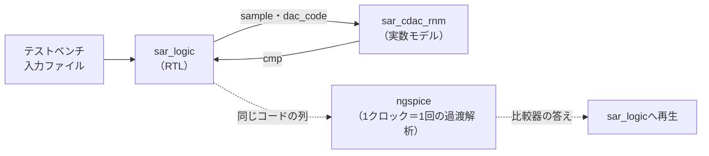

# SAR型ADCで、動作モデルの妥当性をSPICEと比べて確かめる

逐次比較（SAR）型ADCを題材に、3つのことを分けて確かめる教材です。

1. SAR論理のRTLが、毎クロック、決めたとおりのピンの値を出すこと。
2. 容量DACと比較器の実数モデル（SystemVerilogの`real`）が、厳密な有理数の計算と同じ判定をすること。
3. その実数モデルが、同じ回路をngspiceで解いた結果と、どの範囲で一致し、どこから一致しなくなるか。

3つ目が、この例で新しく扱う観点です。実数モデルは整定の時間を持たないので、クロックをどれだけ速めても正しいコードを出します。同じ条件のngspiceは誤ったコードを出します。モデルが合格しても、それはモデルが正しい範囲の中にいる場合だけ意味を持つので、その範囲を式と実行の両方で求めて記録します。

回路の値はすべて、この教材のために決めた架空の値です。実際のプロセスの特性ではなく、PDKやトランジスタのモデルは使っていません。スイッチは抵抗、比較器はほぼ理想の電圧制御電圧源です。

## 回路



- **SAR論理**（[`rtl/sar_logic.sv`](rtl/sar_logic.sv)）：`start`を受けると、標本化の1サイクル、上位ビットからの試行を1ビット1サイクル、最後に`done`を1サイクル出します。試行のサイクルでは、それまでに残したビットと試すビットを`dac_code`に出し、そのサイクルの終わりのクロックで比較器の答え`cmp`を取り込みます（1なら残す）。`start`は`start_ready`が1のとき（待機中と`done`のサイクル）だけ受け、変換中の`start`は捨てます。
- **容量DAC**：2のべきの重みの容量と、終端の単位容量1個です。標本化では、上側の電極を接地し、下側の電極を入力へつなぎます。試行では、上側の電極を浮かせ、`dac_code`が1のビットの下側を参照電圧へ、ほかを接地へつなぎます。上側の電極の電圧が負なら、入力がDACの電圧より高いので、そのビットを残します。
- **実数モデル**（[`tb/sar_cdac_rnm.sv`](tb/sar_cdac_rnm.sv)）：標本化の終わりに入力を覚え、上側の電極の電圧を、電荷の保存の式から直接計算します。時間のかかる要素は何も持ちません。
- **ngspiceの回路**（[`solve.py`](solve.py)が生成）：同じ容量に、下側の電極のスイッチ抵抗、上側の電極の標本化スイッチの抵抗、上側の電極の寄生容量を足したものです。1クロックを1回の過渡解析として解き、終わりの時点の容量の電圧を次の解析の初期値にします。試行のサイクルの終わりの比較器の出力で、次のサイクルのスイッチの位置を決めます。

| 値 | 6ビット（`b6`） | 8ビット（`b8`） |
| --- | --- | --- |
| 参照電圧 | 1.024 V | 1.024 V |
| 1ステップ | 16 mV | 4 mV |
| 単位容量 | 100 fF | 100 fF |
| 容量の合計 | 6.4 pF | 25.6 pF |
| 上側の電極の寄生容量（合計の1/5） | 1.28 pF | 5.12 pF |
| スイッチ抵抗×その容量 | 1 ns（単位容量で10 kΩ） | 1 ns |
| 標本化スイッチの抵抗 | 50 Ω | 50 Ω |
| 比べるときのクロック周期 | 40 ns | 40 ns |

## 独立した期待値

[`model.py`](model.py)に、判定する相手とは別の書き方で置いています。

- **コード**：`exact_code`は、変換結果を定義から求めます。「どのビットについても、そのビットが1であることと、入力がそのビットの判定の閾値を超えることが一致する」コードは1つだけあり、それを全コードの中から探します。計算は有理数です。RTLとngspiceの駆動は、ふつうの1ビットずつの探索です。
- **ピンの時系列**：`Timeline`は、変換1回ごとに、標本化・試行・`done`の行を時間軸へ書き込みます。状態は持ちません。RTLは状態機械です。
- **整定**：標本化の回路（2つの極）と、試行1回の応答（1つの極）の閉じた式です。ngspiceは同じ回路を数値積分します。

入力は、どのコードの閾値からも1/8ステップ以上離して選びます（6ビットで2 mV、8ビットで0.5 mV）。閾値ちょうどの入力は、厳密な計算では「残さない」と決まりますが、実数の計算と比較器では決まらないので、比べる対象にしていません。閾値のすぐ下とすぐ上（どちらも1/8ステップ）は、すべての閾値について固定シナリオに入れています。

## 整定の式

下側の電極のスイッチは、どの枝も「抵抗×容量」が同じ値τ（1 ns）になるように決めています。容量の合計をC、寄生容量をCp、標本化スイッチの抵抗をRとすると、次のことが分かります。

- **試行のサイクル**：上側の電極の極は1つだけで、時定数はτ·Cp／(C＋Cp)です。寄生容量がなければ、上側の電極は瞬時に最終値になります。この例では1/6 nsです。
- **標本化のサイクル**：上側の電極の電圧は、分母がτ·Cp·R·s²＋(τ＋Cp·R＋C·R)·s＋1の2次の系になります。遅い方の時定数は、6ビットで1.34 ns、8ビットで2.43 nsです。
- **標本化の不足**：標本化スイッチを開いた時点で、まだ容量へ届いていない電荷の割合K(T)は、上側の電極の電流の残りの積分として閉じた式になります。K(0)＝1で、Tとともに0へ近づきます。その後の判定は、入力が(1−K)倍に縮んだ場合と同じになります。

3つ目から、**クロック周期がTのときにngspiceが出すコードを式で予測**できます。また、K(T)×参照電圧が1/8ステップ以下になる周期を「モデルが使える最短の周期」とします。6ビットで8.4 ns、8ビットで18.6 nsです。

## 実行

準備は[実行環境](../../tools/ENVIRONMENT.md#ngspiceとspice協調例)の固定版のngspiceです。`lsi-ngspice-config`にパスを通して実行します。

```sh
python3 examples/local-rnm-sar-adc/run.py --out artifacts/rnm-sar-smoke
python3 examples/local-rnm-sar-adc/run.py --profile nightly --out artifacts/rnm-sar-nightly
```

`--ngspice-config`でngspiceの設定コマンド、`--iverilog`と`--vvp`でIcarusの実行ファイルを指定できます。`--timeout`の既定は60秒です。`--waves`を付けると、デジタルの実行の波形も保存します。

構成は`b6`と`b8`の2つで、JUnitはsmoke 47件、nightly 51件です。nightlyは、ランダムの操作列を3 seed・各400変換に増やし、周期の掃引の点を増やします。

| ケース（構成ごと） | 件数 | 内容 |
| --- | --- | --- |
| `fixed` | 1 | 全コード、全閾値の上下、両端の外、握手とリセットの場面。実数モデルで閉じたループ |
| `random-seed*` | 1（nightlyは3） | ランダムな入力・待ち・リセット |
| `mismatch` | 1 | 最上位の容量を2単位小さくした配列での同じ確認 |
| `detect-mutation1`〜`7` | 7 | SAR論理の誤りの検出 |
| `spice-slow`、`replay-slow` | 2 | ngspiceとの比較と、その判定をRTLへ再生した確認 |
| `spice-mismatch`、`replay-mismatch` | 2 | 容量の不一致がある配列での同じ比較 |
| `linearity` | 1 | 欠落コードと単調性を、厳密な計算・実数モデル・ngspiceの3つで照合 |
| `settling-analytic` | 1 | ngspiceの波形と閉じた式の比較 |
| `settling-sweep` | 1 | 周期を変えたときのコードを式の予測と比較。最短の周期の確認 |
| `spice-options` | 1 | ソルバーの設定を変えても結果が変わらないこと |
| `detect-model-weights` | 1 | 容量の不一致を知らないモデルが、ngspiceと食い違うこと |
| `detect-settling` | 1 | 速いクロックで、ngspiceだけが誤ったコードを出すこと |
| `detect-spice-error` | 1 | 壊れたネットリストが、結果ではなくエラーになること |
| `coverage` | 1 | 28目標への到達 |

ほかに、全体で`toolchain`・`ngspice-installation`・`source-freshness`の3件があります。

出力先には、`manifest.json`・`summary.json`・`junit.xml`のほか、ケースごとに入力（`vectors.txt`）、ピンの記録（`trace.csv`）、ngspiceへの依頼と結果（`request.json`・`solution.json`）、ログが残ります。`linearity.json`と`validity.json`は、欠落コードと、周期ごとの結果の表です。

## 要求と目標

[`requirements.json`](requirements.json)に7要求・28目標があります。どの目標も、固定のケースだけで届きます。

| 要求 | 目標の数 | 届け方 |
| --- | --- | --- |
| `SAR-SEQUENCE` | 6 | `fixed`の時系列（残す・落とす・全1・全0・`done`） |
| `SAR-HANDSHAKE` | 6 | `fixed`の時系列（待機、変換中の`start`、連続変換、リセット、標本化の前後の入力の変化） |
| `RNM-EXACT` | 3 | `fixed`で、全コードと閾値の上下 |
| `MODEL-VALID` | 4 | `spice-slow`と`replay-slow` |
| `LINEARITY` | 3 | `linearity` |
| `SETTLING` | 5 | `settling-analytic`と`settling-sweep` |
| `SPICE-SETTINGS` | 1 | `spice-options` |

## 判定と、その根拠

| 判定 | 方法 | 値と根拠 |
| --- | --- | --- |
| SAR論理のピン | ビット一致（毎クロック） | Xなら不合格（`SAR_UNKNOWN`） |
| 実数モデルの判定 | 厳密な計算と一致 | 入力は閾値から1/8ステップ以上離す |
| 実数モデルとngspiceのコード | 一致 | 同上 |
| 実数モデルとngspiceの上側の電極の電圧 | 差が2 µV以下 | 下の内訳 |
| ngspiceの波形と閉じた式 | 差が20 µV以下 | 実測は3〜8 µV（`reltol`＝1e-8、刻みは周期の1/2000以下） |
| 速いクロックのコード | 式の予測と一致 | 予測できる入力が半数以上あること |

上側の電極の電圧の差（周期40 ns）は、次の3つの和で抑えられます。

- 標本化の不足：K(40 ns)×1.024 V÷1.2。6ビットでは1 pV未満、8ビットで約0.06 µV。
- ソルバーの許容誤差：`reltol`（1e-6）×電圧の最大（0.45 V）＝0.45 µV。
- 記録の丸め：0.5 nV。

合計は0.6 µV未満で、許容を2 µVにしました。実測の最大は、6ビットで約1 nV、8ビットで約0.07 µVです。8ビットの値は、標本化の不足の見積りと一致します。

## 結果

- **遅いクロック（40 ns）**：実数モデルとngspiceは、6ビットの384入力、8ビットの322入力で、コードも、すべての試行の上側の電極の電圧も一致しました。両端の外（−0.1倍と1.1倍の参照電圧）も、どちらも0と最大のコードです。
- **容量の不一致**：最上位の容量を2単位小さくすると、6ビットではコード30と31、8ビットでは126と127が出なくなります。厳密な計算・実数モデル・ngspiceの3つが同じ欠落を示し、どれも単調です。逐次比較は、重みがずれても単調のままで、欠落として現れます。
- **速いクロック（2 ns）**：ngspiceは64入力のうち63入力で誤ったコードを出します。実数モデルは、クロックの周期という概念を持たないので合格したままです。
- **式の予測**：周期を変えた掃引で、予測できる入力については、ngspiceのコードが式の予測とすべて一致しました。最短の周期の1.1倍以上では、誤ったコードは0件です。
- **ソルバーの設定**：`reltol`を1e-4にした場合と、台形法で刻みを半分にした場合で、コードは変わらず、上側の電極の電圧の差は0.02 µV以下でした。

実数モデルの適用範囲は、次のとおりです。

| 条件 | 範囲 |
| --- | --- |
| クロック周期 | 6ビットで8.4 ns以上、8ビットで18.6 ns以上（標本化の不足が1/8ステップ以下） |
| 入力 | −0.1倍〜1.1倍の参照電圧で確認。スイッチが理想なので、範囲外でも回路は壊れない |
| 容量 | 与えた値どおり。不一致は値を渡せば追従する。渡さなければ食い違う（`detect-model-weights`） |

## 変異

SAR論理の変異は7種類で、2構成の14件を予定したラベルで検出します。

| 変異 | 内容 | ラベル |
| --- | --- | --- |
| 1 | 下位ビットから判定する | `SAR_DAC` |
| 2 | 最下位ビットを判定せずに終わる | `SAR_READY` |
| 3 | 比較器の答えの極性が逆 | `SAR_DAC` |
| 4 | 変換の開始で、前の結果を消さない | `SAR_DAC` |
| 5 | 変換中の`start`を受ける | `SAR_READY` |
| 6 | `done`のサイクルの結果が1サイクル古い | `SAR_RESULT` |
| 7 | リセットで`busy`を消さない | `SAR_UNKNOWN` |

アナログ側の負例は3件です。`detect-model-weights`は`MODEL_VTOP`、`detect-settling`は`ANALOG_SETTLING`、`detect-spice-error`は`SPICE_ERROR`を、それぞれ予定のラベルとして要求します。ngspiceの結果は、コマンドの失敗、エラーを含むメッセージ、ベクトルの欠落、有限でない値、周期の終わりに届かない解析、コードと比較器の答えの食い違いを、すべてエラーにします。時間切れもエラーです（セルフテストで確かめています）。

## 確認範囲と残る制限

- **ループの閉じ方**：実数モデルは、RTLと同じシミュレーションの中でループを閉じます。ngspiceは同時には動かしていません。Pythonの駆動が逐次比較の探索を行ってngspiceを1クロックずつ解き、得られた比較器の答えをRTLへ再生して、RTLが同じコードの列を出すことを確かめます。RTLが別の列を出せば`SAR_DAC`で不合格になるので、再生した列が実際のループと同じであることは確かめられています。
- **回路の単純化**：スイッチは抵抗で、電荷注入・クロックフィードスルー・リーク・雑音はありません。比較器は、オフセット・遅延・メタスタビリティを持ちません。参照電圧と入力の駆動は理想の電圧源です。
- **時定数をそろえた設計**：式が閉じるのは、どの枝も「抵抗×容量」が同じだからです。容量の不一致の構成では、抵抗を公称の容量に合わせたままなので、枝ごとに少し違います。その構成は遅いクロックでだけ比べています。
- **閾値ちょうどの入力**は比べていません。
- **統計**（容量のばらつきのモンテカルロ、雑音）は扱いません。不一致は決めた1通りです。
- **8ビットのngspice**は、時間を抑えるため、1ステップに1点と、閾値の上下の1/8だけを解いています。実数モデルと厳密な計算の比較は、全コード・全閾値で行っています。
- SAR型ADCの文献や規格とは照合していません。回路の構成と式は、この教材で組み立てて、ngspiceの結果と突き合わせたものです。

## 確認記録

2026-11-21に、macOS arm64、Python 3.13、Icarus Verilog 14.0開発版、固定版のngspice（共有ライブラリー）で、次を確かめました。Linuxでは実行していません。

- smoke（47件）とnightly（51件、`--timeout 60`）が合格。実行時間は、ほかの作業と重なった状態で約30秒と約37秒です。
- セルフテスト23件が合格（[`tests/test_example.py`](tests/test_example.py)）。
- RTLは、2構成と変異0〜7で、Verilator 5.052の`--lint-only --Wall`の警告0件。
- 文書検査と、テストベンチの競合の検査（候補0件）が合格。

計画外の誤りを、作業用の写しへ1つずつ入れてsmokeにかけました。SAR論理へ12個、実数モデルへ3個、ngspiceのネットリストと駆動へ4個です。

- **検出したもの（14個）**：`done`のサイクルで`start`を受けない、`done`が下がらない、次の試行のコードが残したビットを忘れる、`done`のサイクルでDACのコードを消さない、リセットで結果・`sample`を消さない、`busy`が下がらない（以上はRTL）。寄生容量を持たない、標本化の始めの値を覚える、終端の容量を数え忘れる（以上は実数モデル）。比較器の極性、スイッチ抵抗の2倍、寄生容量の2倍、試行中も標本化スイッチを閉じたまま（以上はngspice側）。
- **合格のまま残ったもの（5個）**：どれも、動作に差が出ない誤りです。
  - 残すビットの論理和を排他的論理和にする（試すビットは、まだ立っていません）。
  - 最初の試行のコードで、残したビットを足さない（その時点では0です）。
  - `start`を受けたときにDACのコードを消さない（その時点で既に0です）。
  - リセットで試行中のビットの位置を消さない（`busy`が0なので使われず、次の`start`で消えます）。
  - 試行の分岐から`busy`の条件を外す（待機中は試行中のビットの位置が0です）。

実数モデルの誤りのうち、寄生容量を持たないものは、比較器の符号を変えないので、デジタルの検査はすべて通ります。ngspiceとの上側の電極の電圧の比較だけが見つけます。
