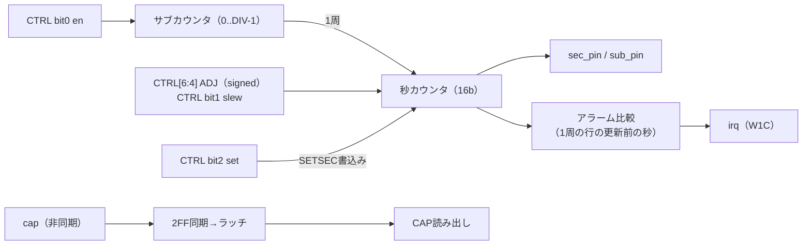
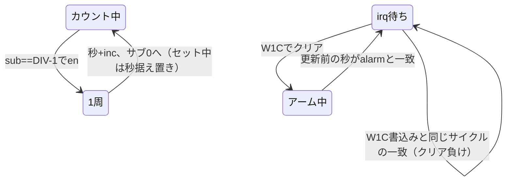

# RTC・アラーム・スリュー補正・キャプチャを検証する

秒カウンタ、アラーム割り込み（W1C）、スリュー（レートを緩やかに変える）補正、2FF非同期キャプチャを持つRTC風のカウンタの教材です。秒とサブカウンタをピンとして毎サイクル比較し、時刻・アラーム・補正の3つのラベルで判定します。

## 回路の契約



| 条件 | 要求する動作 |
| --- | --- |
| `en` | サブカウンタが`0..DIV-1`を進み、1周の行の**終わりに**秒が`inc`だけ進む |
| スリュー | `slew_mode`のあいだ`inc = clamp(1+ADJ, 0, 4)`。**負方向へ戻さない**（ADJ≤-1で秒は停止、サブカウンタは位相を保つ） |
| ジャンプセット | `set=1`のあいだ秒は進まず、SETSECへの書込みが秒をロードしてサブカウンタをクリアする。`set=0`のSETSEC書込みは無視 |
| アラーム | 1周の行で`alarm != 0`かつ**更新前の秒の下位8ビット**が一致すると`irq`セット。読み出しは`{irq, alarm[7:1]}` |
| W1C | `irq`が1のときALARMのbit1に1を書くとクリア。**同じサイクルに新しい一致があれば一致が勝つ**（ビットは立ったまま） |
| キャプチャ | `cap`は2FFで同期し、最初のFFへの取り込みから2サイクル後のエッジで`{秒の下位8ビット, サブカウンタ}`をラッチ。R3で秒、観測ピン `capture_sub` でサブカウンタを確認できる。読出しやSETSECでラッチは動かない |
| リセット | 全カウンタ・レジスタ・フラグをクリア |

## 秒の増分と割込の状態



秒の検査は`irq`→サブピン→秒ピン→読出し値の順で行い、秒ピンの不一致はスリュー中の行なら`RTC_ADJ`、そうでなければ`RTC_TIME`とラベル分けします（判定は行の内容だけで決まる決定的な規則です）。

## 独立した期待値と構成

Pythonはサブ・秒・CTRL・ALARM・キャプチャラッチ・2FF同期線・`irq`をRTLと別に保持し、毎サイクルの`sec_pin`・`sub_pin`・`irq`・読み出し値を独立に計算します。固定シナリオは通常の1周、ジャンプセットのロードと停止、キャプチャ、アラーム一致とW1C、ADJ=+2/+3の増速、ADJ=-1/-2の停止（巻き戻し禁止）、W1Cと同時刻の再一致、リセット復帰を含みます。

| 構成 | DIV（秒あたりのサイクル数） |
| --- | --- |
| `div4` | 4 |
| `div9` | 9 |

[要求カタログ](requirements.json)は5要求・14目標です。秒とサブカウンタはピンとして毎サイクル比較するため、1周の取りこぼしや巻き戻しは読み出しを待たずに捕まります。

## 意図的な誤実装

| 番号 | 誤実装 | 期待する検出ラベル |
| --- | --- | --- |
| 1 | サブカウンタの1周で秒のキャリが失われる | RTC_TIME |
| 2 | アラームが更新後の秒と比較する（1秒遅れ/前倒し） | RTC_IRQ |
| 3 | スリュー補正が現在値より巻き戻せる（非単調） | RTC_ADJ |
| 4 | W1Cが同じサイクルの新しい一致に勝ってしまう | RTC_IRQ |

変異3は`slew_mode`中の秒ピン不一致という判定ラベルで`RTC_ADJ`になり、それ以外の秒のずれは`RTC_TIME`になるため、決定的に区別できます。

## 実行

```sh
python3 examples/local-rtc/run.py --out artifacts/local-rtc-smoke
python3 examples/local-rtc/run.py --profile nightly --out artifacts/local-rtc-nightly
python3 -m unittest discover -s examples/local-rtc/tests -v
```

smokeは200操作×1 seed、nightlyは1000操作×3 seedを固定シナリオへ加えます。各構成6／8件、全体12／16件の回帰に構成別の目標ゲート2件を足したJUnitです。

## 確認範囲

2026-11-23にPython 3.14.7、Icarus Verilog 14.0開発版で両構成のsmoke（回帰12件・JUnit 14・目標14/14・変異は各構成4/4検出）とnightly（回帰16件・JUnit 18）が成功し、セルフテスト10件も成功しました。各実行の `summary.json` に合否と件数、`coverage.json` に構成別の到達目標を記録します。

この教材は実RTCの仕様には対応しません。分・時への桁上げ、カレンダー・うるう年、16ビット全域の秒ロールオーバー近傍の動作、割込マスク・ステータス多重ビット、実32kHzクロックでの長時間動作、スリューのランプ制限（毎秒変化幅の上限）は対象外です。アラームは秒の下位8ビットのみ比較します。
