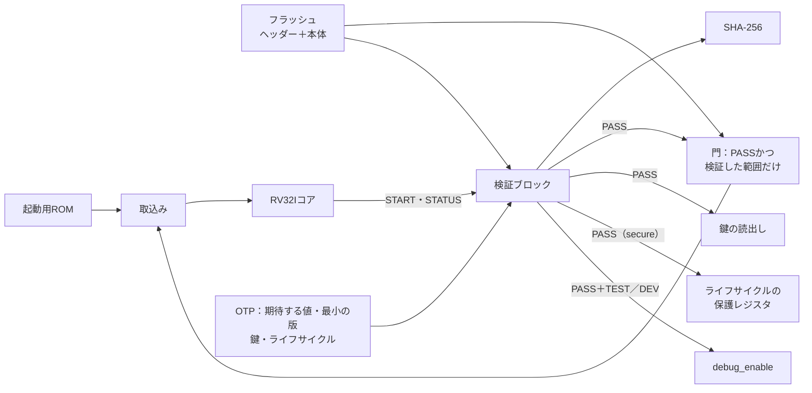

# セキュアブートで、検証の前に実行も鍵もデバッグも開かないことを確かめる

起動用ROMのプログラムが、フラッシュにあるイメージを検証してから実行へ移るSoCの教材です。検証の判定（PASS／FAIL）はハードウェアが出し、命令の取込み・鍵・ライフサイクルの保護レジスタ・デバッグは、その判定だけで開きます。ROMが判定を無視しても、割り込みの処理が途中でイメージへ飛んでも、ハードウェアの門が止めることを確かめます。

防御側の検証の教材です。「どの誤実装を、どの検査が見つけるか」を示すもので、攻撃の手順書ではありません。暗号の強度、物理的な攻撃（電圧や時刻の操作による故障注入）、サイドチャネル、規格・認証への適合は扱わず、主張もしません。

## 構成



既存の例の回路を、ファイルを変えずに組み合わせています。

| 部品 | 元の例 | この例での使い方 |
| --- | --- | --- |
| RV32Iのコア（`rv32i_core.sv`）と命令デコーダ | [コアとISSの比較](../local-riscv-iss/README.md)、[命令デコーダ](../local-riscv-decoder/README.md) | `TRAPS=1`（機械モードの割り込みとMRET）。ROMとイメージは、同じ例のアセンブラー（`iss.py`）で機械語にする |
| SHA-256のエンジン（`sha256_engine.sv`） | [SHA-256](../local-sha256/README.md) | 検証ブロックが、ヘッダーと本体をバイト単位で流し込む |
| ライフサイクルのレジスタ（`secure_lifecycle.sv`） | [セキュリティ・ライフサイクル](../local-secure-lifecycle/README.md) | バスの`secure`属性を、検証の判定（PASS）でハードウェアが決める |

この例で新しく書いたのは、検証ブロック（[`rtl/boot_ctrl.sv`](rtl/boot_ctrl.sv)）とSoCの上位（[`rtl/secure_boot_soc.sv`](rtl/secure_boot_soc.sv)）です。起動用ROMとフラッシュは読出し専用で、テストベンチが持ちます。OTP（1回だけ書ける記憶）の値は、テストベンチがポートで与えます。

## 仕様

### イメージ

フラッシュの先頭の語（0x1000）がヘッダーで、本体は0x1004から始まります。ヘッダーは、上位16ビットがマジック`0xB007`、ビット15〜8が版、ビット7〜0が本体の長さ（バイト）です。ハッシュの対象は、ヘッダーの4バイトと本体の長さ分のバイトで、メモリの並び（リトルエンディアン）の順に流します。ヘッダーもハッシュに含むので、版や長さだけを書き換えても照合で失敗します。

### 検証ブロック

ROMがCTRLへ1を書くと、検証ブロックが自分でフラッシュを読み、次の順に調べます。どれかに反した時点で、その理由のFAILで終わります。

| 順 | 規則 | FAILの理由 |
| --- | --- | --- |
| 1 | マジックが`0xB007` | 1（magic） |
| 2 | 長さが1以上、`IMG_MAX`以下、4の倍数 | 2（length） |
| 3 | 版がOTPの最小の版以上（ロールバックの防止） | 3（rollback） |
| 4 | SHA-256の256ビットすべてがOTPの値と一致 | 4（digest） |

判定はリセットまで変わりません。判定の後のSTARTは無視し、STATUSへの書込みはバスエラーで、判定を変えません。

| 番地 | レジスタ | 内容 |
| --- | --- | --- |
| 0x40000000 | CTRL | 1を書くと検証を始める（待機中だけ） |
| 0x40000004 | STATUS | ビット0 busy、1 pass、2 fail、7〜4 理由。読出し専用 |
| 0x40000008 | IRQ | 外部割り込みの保留。1を書くと消える |
| 0x4000000c | INFO | 受理した版と長さ |
| 0x40000010〜1c | KEY0〜3 | PASSの後はOTPの鍵、それ以前は0 |
| 0x40000100〜 | ライフサイクル | `secure_lifecycle`のレジスタ。`secure`はPASS |

### ハードウェアの門

| 対象 | 開く条件 | それ以外 |
| --- | --- | --- |
| フラッシュからの命令の取込み | PASS、かつ番地が[0x1004, 0x1004＋長さ)の中 | EBREAKを返し、コアはそこで止まる。ヘッダーの語も取り込めない |
| KEY0〜3 | PASS | 0を返す |
| ライフサイクルの保護レジスタ | PASS（`secure`） | `secure_lifecycle`がエラーを返す |
| `debug_enable` | PASS、かつライフサイクルがTEST（0）かDEV（1） | 0 |

リセットは、非同期にかかって同期で外れます。検証ブロック・バス・ライフサイクルのレジスタは`rst_n`が下がった時点で消え、同期リセットのコアとハッシュのエンジンは、`rst_n`が上がってから2クロック後に動き出します。

### ROMとイメージ

起動用ROMは[`model.py`](model.py)で組み立てます。正しいROMは、RAMの結果欄を消し、割り込みを許して検証を始め、判定を待ちます。PASSなら割り込みを止めて0x1004へ飛び、FAILなら失敗の印を書いて止まります。割り込みの処理は、RAMの回数を1つ増やして保留を消し、MRETで戻ります。イメージは、鍵の4語の排他的論理和とライフサイクルのSTATUSをRAMへ書き、成功の印を書いて止まります。

ハードウェアの門を試すため、誤ったROMも3つ用意しました。

| ROM | 誤り | 正しい回路での結果 |
| --- | --- | --- |
| `jump` | 割り込みの処理が、MRETで戻らずにイメージの入口へ飛ぶ | 検証中なので取込みがEBREAKになり、0x1004で止まる。検証はハードウェアで最後まで進む |
| `ignore` | FAILでも鍵とライフサイクルを読み、STATUSを書き換え、STARTし直してから飛ぶ | 鍵は0、ライフサイクルはエラー、判定は変わらず、0x1004で止まる |
| `header` | PASSの後、入口ではなくヘッダーの語へ飛ぶ | 0x1000で止まる |

## 実行と判定

Python 3.10以上とIcarus Verilogを使い、リポジトリのルートで実行します。

```sh
python3 examples/local-secure-boot/run.py
python3 examples/local-secure-boot/run.py --profile nightly
python3 -m unittest discover -s examples/local-secure-boot/tests -v
```

[共通シミュレーションランナー](../local-common/README.md)のプラグインです。構成は2つです。

| 構成 | `IMG_MAX` | データバスの待ち |
| --- | --- | --- |
| `max112-wait0` | 112バイト | 0クロック |
| `max80-wait2` | 80バイト | 2クロック |

1つのケースは1回の起動です。ケースの行には、ROMとフラッシュの語、OTPの値、割り込みとリセットの時刻、期待する結果が入っています。期待する判定はPythonの規則（`verdict()`）と`hashlib`のSHA-256から決め、回路は使いません。

テストベンチは毎クロック（立下りで）次を調べます。

| 検査 | 内容 | ラベル |
| --- | --- | --- |
| 判定 | 出た判定が期待どおりで、判定の後に変わらない | `BOOT_VERDICT` |
| デバッグ | `debug_enable`は、期待どおりのPASSが出た後で、ライフサイクルが許すときだけ | `BOOT_DEBUG` |
| 鍵 | 鍵の番地から読んだ値は、実行してよいイメージの命令なら鍵、ほかは0 | `BOOT_KEY` |
| 実行 | フラッシュの番地で退出した命令は、EBREAK（門）か、実行してよいイメージの検証した範囲の命令だけ | `BOOT_EXEC` |
| リセット | リセット中と、リセットの後に検証が始まるまでは、判定も`debug_enable`も0 | `BOOT_RESET` |
| 不定値 | 出力にXがない | `BOOT_X` |

終わったら、止まった番地（`BOOT_HALT`）、プログラムが書いたRAMの7語（`BOOT_RAM`）、最後の判定と`debug_enable`を照合します。上限のクロック数を超えたときは、検査とは別の`BOOT_TIMEOUT`です。開始の回数、割り込みの処理の回数、バスエラーの回数を`COUNT`で照合します。

### 固定のケース

各構成で20ケースです。どのケースも、破る規則は1つ以下です。

| ケース | 内容 | 期待する判定 |
| --- | --- | --- |
| `golden` | 正しいイメージ（版は最小の版＋2） | PASS |
| `tamper-payload`／`tamper-version` | 本体の最後の1バイト／ヘッダーの版を、照合値を作った後で変える | FAIL（digest） |
| `tamper-low-byte` | 本体の詰め物の1バイトを、ハッシュの最後のバイトが元と同じになる値に変える | FAIL（digest） |
| `bad-magic` | マジックが違う | FAIL（magic） |
| `length-zero`／`length-unaligned`／`length-over` | 長さ0／語の倍数でない（70）／上限＋4 | FAIL（length） |
| `length-max` | 長さが上限ちょうど | PASS |
| `version-equal`／`version-below` | 版が最小の版と同じ／1つ小さい | PASS／FAIL（rollback） |
| `irq-during-check` | 検証中に割り込みを3回 | PASS、処理は3回 |
| `reset-during-check`／`reset-during-image` | 検証中／イメージの実行中にリセット | 起動をやり直してPASS |
| `lifecycle-prod`／`lifecycle-rma` | ライフサイクルがPRODまたはRMA | PASS、デバッグは0のまま |
| `irq-jumps-to-image` | `jump`のROM | 0x1004で止まり、イメージは1命令も実行されない |
| `rom-ignores-verdict` | `ignore`のROMと、改ざんしたイメージ | FAIL、鍵は0、バスエラー2回、0x1004で止まる |
| `unverified-tail` | 検証した本体の直後に、検証していない命令を置く | PASS、検証した範囲の終わりで止まり、その命令は実行されない |
| `rom-jumps-to-header` | `header`のROM | PASS、0x1000で止まる |

乱数のケースは、smokeで2回、nightlyで3つのseed×4回の起動です。イメージの種類（PASS・digest・rollback・length・magic）を先に引き、長さ・版・改ざんする位置・ライフサイクル・鍵・割り込みの時刻を引きます。期待する結果は、種類ではなく規則から求め直します。割り込みは、全体の照合が走るイメージにだけ、照合の最中に入るように入れます。

JUnitは、smoke 64件、nightly 84件です（構成ごとに固定20、乱数2または12、変異9、合否判定1）。26目標は、2構成とも固定のケースだけで届きます。

## 要求と目標

| 要求 | 内容 | 目標 |
| --- | --- | --- |
| SB-VERIFY | ハッシュの一致でだけPASS、ヘッダーも照合の対象 | 2 |
| SB-HEADER | マジック・長さの規則と、長さの境界 | 6 |
| SB-ROLLBACK | 最小の版との比較と、その境界 | 3 |
| SB-FETCH | 取込みの門（検証中、FAILの後、範囲の外、ヘッダー） | 4 |
| SB-SECRET | 鍵、ライフサイクルの保護レジスタ、デバッグの門 | 6 |
| SB-STICKY | 判定の書換えと、判定の後の開始を受け付けない | 2 |
| SB-EVENTS | 検証中の割り込み、検証中とイメージの実行中のリセット | 3 |

## 変異

`--demo-bug N`で、正しいケースに変異を入れて実行できます。計画の`detect-mutationN`は、表のケースで予定のラベルが最初に出ることを確かめます。

| 変異 | 誤り | 見つけるケース | ラベル |
| --- | --- | --- | --- |
| 1 | ハッシュの最後の1バイトしか比べない | `tamper-low-byte` | `BOOT_VERDICT` |
| 2 | 長さが4の倍数かを調べない | `length-unaligned` | `BOOT_VERDICT` |
| 3 | 版の比較の向きが逆 | `golden` | `BOOT_VERDICT` |
| 4 | 鍵の門がFAILでも開く | `rom-ignores-verdict` | `BOOT_KEY` |
| 5 | 取込みの門が、FAILになるまで開いている | `irq-jumps-to-image` | `BOOT_EXEC` |
| 6 | 取込みの門に上限がない | `unverified-tail` | `BOOT_EXEC` |
| 7 | STATUSが書けて、判定を偽れる | `rom-ignores-verdict` | `BOOT_VERDICT` |
| 8 | デバッグがライフサイクルを見ない | `lifecycle-prod` | `BOOT_DEBUG` |
| 9 | 判定のレジスタに電源投入時の値はあるが、リセットで消えない | `reset-during-image` | `BOOT_RESET` |

変異1が見つかるのは、`tamper-low-byte`がハッシュの最後のバイトだけを元と一致させてあるからです。普通の改ざんでは、最後のバイトもほぼ確実に変わるので、1バイトしか比べない誤りは見つかりません。変異5と6は、正しいROMでは見つかりません。正しいROMは、検証中にイメージへ飛ばず、検証した範囲の外へも進まないからです。門の誤りは、誤ったROMや検証していない語を置いたケースで初めて現れます。

## 確認範囲と残る制限

- 署名の検証ではありません。OTPに置いたハッシュ値とイメージのハッシュを比べる方式で、公開鍵による署名、鍵の更新、イメージの更新は扱いません。
- フラッシュは読出し専用で、検証の後にフラッシュが変わる場合（検証した内容と実行する内容の食い違い）は扱いません。実際の製品では、検証した内容をRAMへ写してから実行する、フラッシュを書込み禁止にする、などの対策が要ります。
- 鍵は128ビットの平文のOTPです。鍵の消去、鍵の導出、ライフサイクルによる鍵の切替えは扱いません。
- `debug_enable`はポートだけで、実際のデバッグモジュールはつないでいません（デバッグそのものは[デバッグの例](../local-riscv-debug/README.md)にあります）。ライフサイクルのブロックは、`secure`属性とSTATUSの読出しにだけ使い、デバッグ鍵・タンパー・ロックはつないでいません。
- 割り込みは外部の1本だけで、ROMは1を書いて保留を消します。0を書いた場合の動作は、どのROMも行わないので確かめていません。
- 境界に合わない番地への分岐は、どのROMも行いません。このコアは分岐先の境界の例外を持たないので（[例外・割り込みの例](../local-riscv-traps/README.md)）、門の`imem_addr[1:0]`の検査は、この例では効き目を確かめていません。
- ROMの割り込みの処理は、RAMの回数で確かめます。処理の途中のレジスタの保存は、使うレジスタを分けることで避けています。
- 規格や公開の資料の節番号とは照合していません。ライフサイクルの符号（TEST・DEV・PROD・RMA）とデバッグを許す条件は、この教材で決めたものです。
- LinuxとGCC、kirimasimでは実行していません。

## 確認記録

2026-11-21に、Python 3.13とIcarus Verilog 14.0開発版で、smoke（seed 17・3・100）とnightly（`--timeout 60`）が合格しました。所要時間は、smokeが約8秒、nightlyが約7秒です。`manifest.json`はnightlyで約0.6 MBです。セルフテストは16件で、Icarusがなければskipせずに失敗します。RTLは、Verilator 5.052の`--lint-only --Wall`で、2構成×変異0〜9の20通りと、`boot_ctrl`単体の変異0〜3・7・9で警告0件です。`tools/check_tb_races.py`の候補は0件です。

できあがった後に、作業用の写しのRTLへ、計画の変異とは別の誤りを15個入れてsmokeにかけました。最初の注入で合格のまま残った誤りのうち2つ（ヘッダーの語を命令として取り込める、RMAでもデバッグが開く）は試験の抜けだったので、`rom-jumps-to-header`と`lifecycle-rma`を足しました。足した後は10個が不合格になります。

| 誤り | 結果 |
| --- | --- |
| 規則の順（マジックと長さ）を入れ替える | `bad-magic`と乱数のケースが`BOOT_VERDICT` |
| 長さの上限を「未満」にする | `length-max`が`BOOT_VERDICT` |
| ハッシュに流すバイトが1つ少ない／バイトの順が逆 | ほぼ全ケースが`BOOT_VERDICT` |
| 判定の後もSTARTで検証し直す | `rom-ignores-verdict`が`BOOT_VERDICT` |
| ヘッダーの語を取り込める | `rom-jumps-to-header`が`BOOT_EXEC` |
| KEY3だけ門を通さない | `rom-ignores-verdict`が`BOOT_KEY` |
| ライフサイクルを常にsecureにする | `rom-ignores-verdict`のバスエラーの回数が違う |
| STATUSへの書込みをバスエラーにしない | 同上 |
| RMAでもデバッグを開く | `lifecycle-rma`が`BOOT_DEBUG` |

合格のまま残る5つは、次の理由でこの例の範囲では動作に差が出ません。

- ハッシュのエンジンのエラーを見ない：長さの規則で、エンジンがエラーにする長さ（120バイト以上）には届きません。
- 割り込みの保留を、書いた値に関係なく消す：どのROMも1を書きます。
- データバスの待ちを1クロック増やす：時間が延びるだけで、結果は同じです。
- 取込みの門で番地の下位2ビットを見ない：境界に合わない番地へ飛ぶROMがありません（上の「残る制限」）。
- 取込みの門でフラッシュの範囲を見ない：範囲の検査が、すでにフラッシュの中に収まっています。
