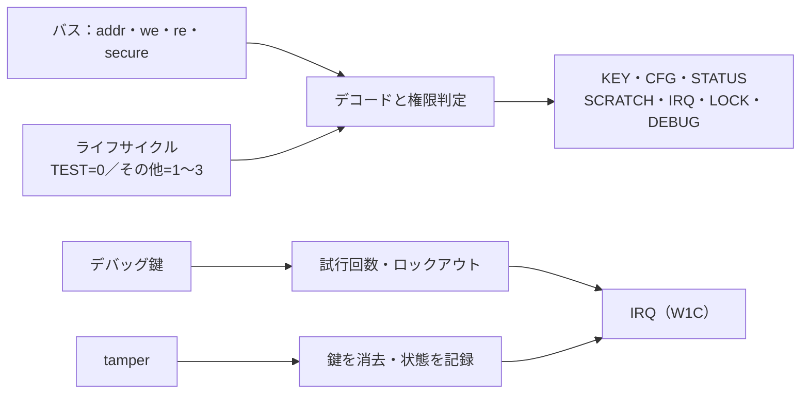
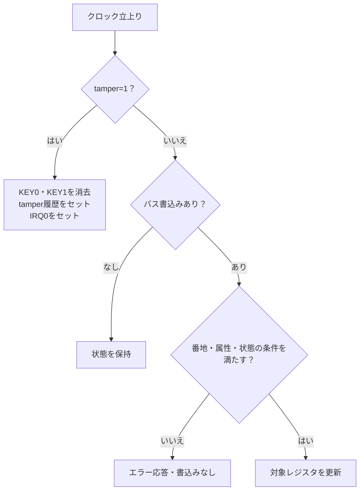

# セキュリティ・ライフサイクルとデバッグ認証を検証する

セキュア／非セキュアのアクセス属性、ライフサイクル、ロック、デバッグ鍵の試行制限、タンパー時の鍵消去を、小さなレジスタ回路で確認する教材です。権限拒否が副作用を残さないこと、状態が読み出せること、イベント後の割り込みをW1Cで消せることを分けて判定します。

## アクセス判定と状態



図は判定の関係です。鍵は教材の確認用にセキュア読出しを許しています。実製品の鍵管理を再現したものではありません。

## 仕様

| アドレス | レジスタ | セキュア読出し | 書込み条件 |
| --- | --- | --- | --- |
| 0x00 / 0x04 | KEY0 / KEY1 | 可 | `secure`、TEST、未ロック、非タンパー |
| 0x08 | CFG | 可 | 同上 |
| 0x0C | STATUS | 可 | 書込みはエラー |
| 0x10 | SCRATCH | 可（非セキュアも可） | タンパー入力が0なら可 |
| 0x14 | IRQ | 可 | `secure`、ビットごとのW1C |
| 0x18 | LOCK | 0を返す | `secure`、TEST、未ロック、`wdata[0]=1`でロックを設定 |
| 0x1C | DEBUG | 0を返す | `secure`、TEST、未ロック、非タンパー、試行制限内、認証未成立 |

- `secure=0`でセキュアレジスタを読書きするとエラーになり、値は変わりません。
- `LOCK`の書込みは一度だけ有効で、以後のKEY・CFG・LOCK・DEBUG書込みは拒否されます。
- `DEBUG`アクセス時の専用入力`debug_key`へ正しい鍵を提示すると`debug_unlocked=1`になります。誤りは試行回数を増やし、上限で`debug_lockout=1`とIRQ[1]を立てます。
- `tamper=1`のクロック立上りでKEY0/KEY1を0にし、`tamper_latched=1`とIRQ[0]を立てます。タンパー中の書込みは拒否します。
- STATUSは`[0]=locked`、`[1]=unlocked`、`[2]=tamper`、`[3]=lockout`、`[7:4]=attempts`です。
- 未定義アドレス、未整列アクセス、読出し専用レジスタへの書込みはエラーです。

## タンパー・ロック・認証履歴を分ける

図はリセット解除中の優先関係です。`lifecycle`は外部から与える2ビットの入力で、0だけをTESTとして扱います。1〜3の区別や不可逆なライフサイクル遷移は実装していません。`debug_unlocked`はSTATUSで読む認証成功履歴です。実デバッグポートの認可出力ではなく、LOCKやタンパー後も履歴は残ります。



| 状態・入力 | KEY・CFG・LOCK・DEBUGの書込み | SCRATCHの書込み | IRQのW1C |
| --- | --- | --- | --- |
| TEST・未ロック・タンパー履歴なし | セキュア属性など各レジスタの条件で許可 | 非セキュアも許可 | セキュアなら許可 |
| LOCK設定後、または非TEST | 拒否 | 許可 | セキュアなら許可 |
| タンパー履歴あり・現在の入力は0 | 拒否 | 許可 | セキュアなら許可 |
| 現在のtamper=1 | 拒否し、鍵消去を優先 | 拒否 | 拒否し、IRQ0をセット |

DEBUGは認証成立後またはロックアウト後も拒否します。LOCKへ0を書いた場合は、許可条件内なら受理しますがロックを解除しません。IRQ ACKは履歴やロックアウトを消さず、リセットがこれらを初期化します。

## 独立した期待値と構成

PythonはRTLのビット割当を写さず、レジスタ値・試行回数・許可条件を別に保持します。各サイクルの`rdata`・`error`・`irq`を比較し、拒否後の値を次の読出しで確認します。

| 構成 | 試行上限 | 正しいデバッグ鍵 |
| --- | --- | --- |
| `limit3` | 3 | 0xA55A |
| `limit2` | 2 | 0x5AA5 |

[要求カタログ](requirements.json)は4要求・15目標です。固定シナリオは、セキュア／非セキュアの読書き、ロックの固定、デバッグ成功・失敗・ロックアウト、タンパー消去、IRQのW1C、リセット復帰を含みます。

## 意図的な誤実装

| 番号 | 誤実装 | 期待する検出ラベル |
| --- | --- | --- |
| 1 | 非セキュア書込みでセキュア属性を無視 | SECURE_ACCESS |
| 2 | デバッグ失敗回数を増やさない | SECURE_DATA |
| 3 | タンパーで鍵を消去しない | SECURE_DATA |
| 4 | 未定義アドレスへの書込みがSCRATCHを変更 | SECURE_DATA |

変異2はSTATUSの試行回数、変異3は鍵読出し、変異4は後続のSCRATCH読出しで検出します。負の試験の観測は通常の15目標へ加算しません。

## 実行

```sh
python3 examples/local-secure-lifecycle/run.py --out artifacts/secure-lifecycle
python3 examples/local-secure-lifecycle/run.py --profile nightly --out artifacts/secure-nightly
python3 -m unittest discover -s examples/local-secure-lifecycle/tests -v
```

smokeは120操作×1 seed、nightlyは600操作×3 seedを固定シナリオへ加えます。各構成7／9件、全体14／18件のJUnitで、確認テストは6件です。

## 確認範囲

2026-10-28にPython 3.14.7、Icarus Verilog 14.0開発版で両構成のsmoke／nightly、15目標、4変異、確認5件が成功しました。

2026-10-29のレビュー修正後も両構成のsmoke／nightlyが成功し、確認テストは6件です。再発防止ケースと図表を追加し、実行したソースハッシュを現行ファイルと照合しています。

この教材はデジタルな権限判定と状態遷移の確認です。鍵の真正性、暗号処理、サイドチャネル、物理的なタンパー検出、セキュアブート、実OTP、ライフサイクル制御の量産手順、UPFによる電源・リセット分離は対象外です。STATUSと鍵スロットの読出しは試験用の可視化で、製品の秘密情報保護を表しません。
