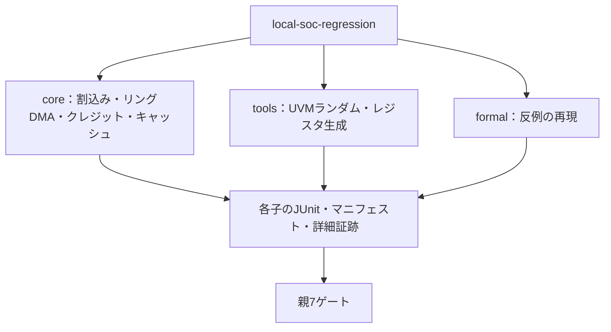

# UVM・仕様生成・反例再現・結合検証の7例

次の7例をローカルでまとめて実行します。GitLabの利用枠は使いません。

1. [UVMの制約付きランダム化とネイティブcovergroup](../local-uvm-random/README.md)
2. [SystemRDLからRTL・Cヘッダー・RALを生成して照合](../local-register-spec/README.md)
3. [フォーマル反例のシミュレーション再現](../local-formal-replay/README.md)
4. [優先順位付き割込み](../local-priority-irq/README.md)
5. [リング式ディスクリプタDMA](../local-descriptor-dma/README.md)
6. [クレジット方式のフロー制御](../local-credit-link/README.md)
7. [小規模キャッシュとDMA](../local-cache-dma/README.md)

## 実行ステージと子回帰の内訳

core・tools・formalを別々に選択でき、allでは7例すべての完了と成功を確認します。



合計は子114／138件です。formal内の8個のBMCや親ゲートを、子の件数へ再合算しません。

| 直下の子の区分 | smoke JUnit | nightly JUnit |
| --- | --- | --- |
| core：4回路8構成 | 56件 | 72件 |
| tools：UVMランダム／生成 | 17＋17件 | 21＋21件 |
| formal：BMC・再現・正常確認 | 24件 | 24件 |

## 準備と実行

4回路の実行にはPython 3.10以上とIcarusを使います。UVM・生成RALにはVerilator 5.052とC++20環境、レジスタ生成には専用のSystemRDL環境、反例の生成には固定版SBY・YoWASP・Z3環境が必要です。[UVM](../local-uvm/README.md)、[SystemRDL](../local-register-spec/README.md)、[フォーマル](../local-formal-common/README.md)の準備を行います。既存の環境はそのまま使えます。

```sh
python3 examples/local-soc-regression/run.py \
  --uvm-home /tmp/lsi-uvm-library/1800.2-2020.3.2 \
  --rdl-python /tmp/lsi-rdl-venv/bin/python \
  --formal-python /tmp/lsi-bus-formal-venv/bin/python \
  --solver /tmp/lsi-bus-formal-venv/bin/z3 --out artifacts/soc-smoke
```

同じ指定に`--profile nightly`と新しい`--out`を付ければnightlyです。`--stage core`は4回路、`--stage tools`はUVM／レジスタ生成、`--stage formal`は反例再現だけを実行します。選択しなかった範囲は合格へ含めません。`--child-timeout`は子1回帰の上限で、既定1800秒です。

## 判定と件数

親は7個の子回帰について、終了コード、予定と完了数、全チェックの合格を要求します。一覧形式の結果には空でない一意のチェックIDを要求し、重複や欠落は拒否します。親JUnitは7件、直下の子JUnitはsmoke **114件**／nightly **138件**です。

内訳は、4回路8構成の56／72件、UVMランダム17／21件、レジスタ生成17／21件、反例再現24件です。反例再現の24件の中に、さらに8個の子BMCの結果があります。親・子・BMCを二重計上しません。フォーマルはnightlyでも同じ固定計画です。

4回路の目標は、各構成で割込み12・DMA13・クレジット10・キャッシュ15です。UVMは各通常実行で24 binを要求します。生成物は独立契約と、実行／コンパイルした各ビューを照合します。反例の内部状態を直接与えず、初期化・入力・比較時点を固定します。

各子に入力の版、ツール、ソースハッシュ、ログ、波形またはネイティブカバレッジ、詳細な判定が残ります。環境エラーや、負の試験で得た観測を通常ケースの不足へ足しません。負の試験にはRTL変異以外の診断も含み、合計数をそのままRTL変異検出率にはしません。

## 確認テスト

4回路各5、UVMカウンター判定4、レジスタ契約・コンパイラー6、witness変換4、集約4の計38件です。レジスタ生成の6件だけはSystemRDL用Pythonで実行してください。

```sh
python3 -m unittest discover -s examples/local-soc-regression/tests -v
/tmp/lsi-rdl-venv/bin/python -m unittest discover -s examples/local-register-spec/tests -v
```

各例のREADMEに個別のコマンドがあります。確認テストの件数と、実回帰・証明のJUnitは別に管理します。

## 実行確認

2026-10-27のレビュー修正後に、全7例のsmoke／nightlyが成功しました。親JUnitは各7件、子は114／138件です。同7例の確認テスト38件を含む、全確認テスト407件も成功しています。

SystemRDLの最終定義は生成例単独でも両プロファイルを再実行し、17／21件と確認6件が成功しました。UVMのvolatile属性を誤らせたモデルも予定したラベルで検出しました。生成例の最終実行と他の子・集約の保存済みマニフェストを照合し、現行ソースのハッシュ一致を確認しています。
