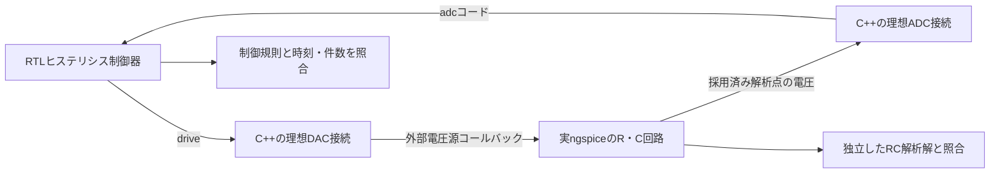
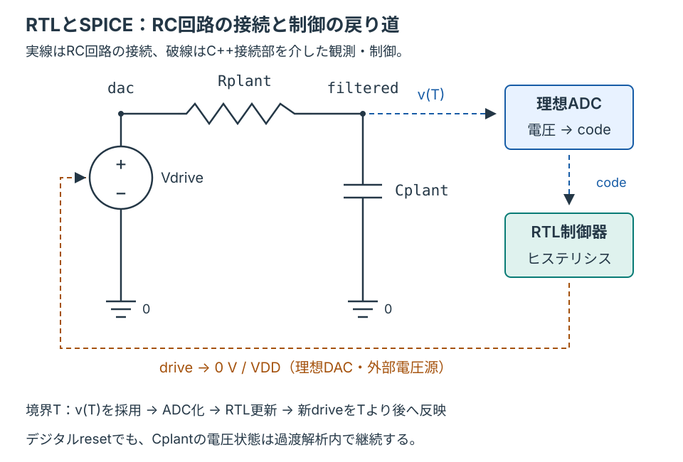

# RTLとngspiceによるRC電圧制御のコシミュレーション

実際のngspice共有ライブラリーでRC回路を過渡解析し、Verilator上のRTL制御器へ電圧を戻す閉ループ例です。RTLの出力でSPICE側の電圧源を変え、その結果を次の制御入力に反映します。[検証手順](../../docs/method/spice-cosimulation.md)、[C++参照モデルの例](../local-cpp-reference/README.md)も参照してください。

## 回路と接続



[plant.cir.in](plant.cir.in)が回路テンプレートです。`drive`が1なら電圧源を指定電源電圧へ、0なら0Vへ接続し、抵抗を介してコンデンサーを充放電します。制御器はADCコードが下限以下ならON、上限以上ならOFF、中間なら前状態を保持します。リセットまたはenable=0でOFFです。



実線は`plant.cir.in`のノード接続、破線はC++接続部の観測・制御です。`filtered`の電圧を読む理想ADCは、負荷やサンプル窓を持つ実ADCの回路モデルではありません。R・Cの値は下表の構成ごとに与えます。

| 構成 | ADC | R | C | 時定数 |
| --- | --- | --- | --- | --- |
| `adc8-rc100us` | 8ビット | 1kΩ | 100nF | 100µs |
| `adc10-rc200us` | 10ビット | 2kΩ | 100nF | 200µs |

制御クロックは10µs周期、ADC基準は3.3Vです。ADCは0〜基準電圧へクランプして最近接整数へ丸めます。DACは理想電圧源で、接続点の電圧はSPICEの解から観測します。

## 時刻の契約

`ngSpice_SetBkpt`で全デジタル境界を登録します。SPICEの適応刻みで採用された解析点をコールバックで受け取り、境界Tで電圧を観測→ADC化→RTL立上り→Tより後の駆動値を更新、の順で進めます。時刻Tの電圧を同じTの新しい駆動値から作る処理にはしません。

デジタルのリセット中も、SPICEの解析とコンデンサーの状態は継続します。リセット時にアナログ電圧を強制的に0へ置き換えません。同期APIを使い、1試験につき1プロセス・1ライブラリーで実行します。

## 環境と実行

Verilator 5.052、C++17、Python 3.10以上、makeに加え、[固定版ngspiceの導入](../../tools/ENVIRONMENT.md#ngspiceとspice協調例)を行います。LinuxとmacOSを対象にします。

```sh
# 初回のみ。ソース版・互換パッチ・各ビルド段階を記録する
python3 tools/setup_ngspice.py --jobs 2 --out artifacts/toolchains/ngspice
export PATH="$PWD/artifacts/toolchains/ngspice/install/bin:$PATH"

python3 examples/local-spice-cosim/run.py --profile smoke --out artifacts/spice-smoke
python3 examples/local-spice-cosim/run.py --profile nightly --out artifacts/spice-nightly
python3 -m unittest discover -s examples/local-spice-cosim/tests -v

# 共通の実行・証跡集約へ接続する
python3 tools/run_regression.py --example local-spice-cosim --profile nightly \
  --tool-bin artifacts/toolchains/ngspice/install/bin --out artifacts/spice-campaign
```

macOSではAutotoolsとHomebrew版Bison・FlexのPATH設定も必要です。詳しくは環境手順を参照してください。`--ngspice-config`で別配置、`--cxx`・`--verilator`で実行ファイルを指定できます。出力先は毎回新しくします。

ngspice 47の初期化抑止APIに対する[互換パッチ](../../tools/patches/README.md)を適用します。元コードとパッチのハッシュを照合し、設定ファイルの抑止と実際のRC解析を診断します。既存のngspiceやユーザー設定ファイルは変更しません。

## 検査と合格条件

通常の閉ループ、enable停止とリセット、電源電圧変更、上下限変更、ランダム制御を実行します。ランダム試験はsmokeで192観測点×1 seed、nightlyで640観測点×3 seedです。固定試験も省略しません。

- 全ての採用済みアナログ解析点を、区間ごとのRC解析解と比較します。電圧の絶対許容誤差は0.2mVです。
- 最大解析刻みは制御周期の1/20、積分法はGearです。デジタル境界との時刻一致は1ps以内を要求します。
- DACの実電圧、ADCコード、RTLの制御出力をそれぞれ照合します。
- 予定観測点・リセット指定点・enable無効点・駆動値更新の件数を照合し、余分な解析終了や境界の取りこぼしを防ぎます。
- [5要求・15目標](requirements.json)を構成ごとに全達成します。RTL2種類、回路定数、ADC接続、DAC接続の意図した不具合を、それぞれ予定した検査で検出します。

smokeは25、nightlyは29判定です。`checks`と`COUNT samples`はデジタル境界で検査を完了した観測点数です。`resets`はリセットを指定した観測点数で、パルス数とは異なります。`disabled`はenable無効点数、`updates`は駆動値の更新指定数です。実際のアナログ解析点数・電圧源の問合せ数・最大誤差は`metrics.json`へ保存します。

## 証跡と範囲

各試験のVCDはRTL信号、CSVはSPICE電圧・解析解・DAC電圧・ADC・制御出力・時刻を記録します。`clock_edge=1`がデジタルの観測点で、0はアナログの解析点です。`vectors/構成/試験/plant.cir`には実際に与えた回路、`vectors.txt`には制御入力を保存します。ビルド・実行・カバレッジ・JUnitとともに、`ngspice-source.json`で実ライブラリー・APIヘッダー・版・パッチを照合します。

対象は理想R・C、理想ADC／DAC接続とデジタル制御の協調です。PDKのトランジスター、スイッチング電源段、雑音・ジッター・メタステーブル・PVT・実装遅延は含めていません。Verilog-AMSの言語機能を検証する例でもありません。到達目標は手続き型の機能記録で、RTLコードカバレッジとは別です。
