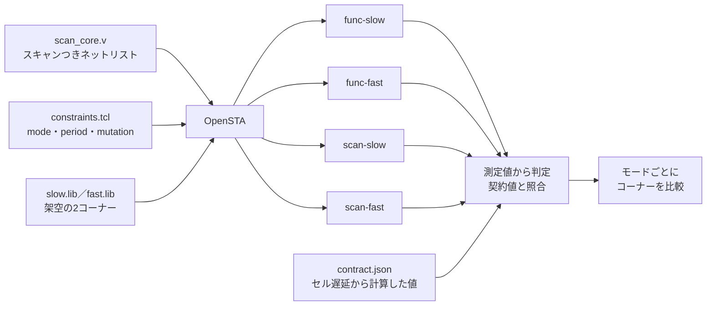

# モードとコーナーを分けてSTAを実行する

静的タイミング解析（STA）は、1回の解析で1つの動作モードと1つの遅延条件（コーナー）しか見ません。機能モードとスキャンモードでは、動く経路もクロックの周期も違います。遅い条件と速い条件では、厳しくなる検査が逆になります。この教材では、スキャンチェーンつきの小さなネットリストを、2つのモード×2つのコーナーの4通りでOpenSTAにかけます。そのうえで、モードを混ぜた制約、誤ったモードの固定、片方のコーナーだけの確認、片方向だけのフォルスパスが、それぞれ何を起こすかを確かめます。

STAの読み方そのものは[OpenSTAの実行例](../local-sta/README.md)、STAが見逃す誤りを遅延つきのシミュレーションで見つける例は[遅延つきのゲートレベルシミュレーション](../local-gate-timing/README.md)です。手法の分担は[ゲートレベルとタイミングの検証](../../docs/method/gate-level-and-timing-verification.md)にまとめています。

## 4つの解析と、その間の比較



| 構成 | scan_enable | `core`の周期（ns） | ライブラリ |
| --- | --- | --- | --- |
| `func-slow` | 0に固定 | 2.0 | `slow.lib` |
| `func-fast` | 0に固定 | 2.0 | `fast.lib` |
| `scan-slow` | 1に固定 | 10.0 | `slow.lib` |
| `scan-fast` | 1に固定 | 10.0 | `fast.lib` |

## 対象回路

[`scan_core.v`](design/scan_core.v)は、手で書いたセルレベルのネットリストです。スキャン挿入ツールの出力ではありません。

- クロック`clk`（名前は`core`）のフリップフロップが4個（`f0`〜`f3`）あります。それぞれのデータ入力の前に2入力のマルチプレクサ`MUX2`があり、`scan_enable`が0なら機能のデータ（`A`）、1ならスキャンのデータ（`B`）を選びます。
- 機能の経路は、`din → f0 → バッファ3個 → f1 → バッファ1個 → f2 → dout`です。
- スキャンチェーンは、`scan_in → f0 → f1 → f2 → f3 → scan_out`です。フリップフロップの間に、ホールドを満たすためのバッファを1個ずつ入れています。
- 別のクロック`aclk`（名前は`aux`、周期3.1 ns）のフリップフロップ`ga`が1個あります。`f2 → ga`と`ga → f3`（`f3`の機能のデータ）の2方向に、クロックをまたぐ経路があります。`ga`はスキャンチェーンに入れていません。

[`slow.lib`](design/slow.lib)と[`fast.lib`](design/fast.lib)は、この教材のために作った架空のライブラリです。遅延はセルごとに1つの定数で、入力の傾きにも負荷にも依存しません。実際の製造プロセスの値ではありません。

| 値（ns） | `BUF` | `MUX2` | クロックから出力 | セットアップ | ホールド |
| --- | --- | --- | --- | --- | --- |
| slow | 0.4 | 0.3 | 0.2 | 0.2 | 0.3 |
| fast | 0.1 | 0.1 | 0.1 | 0.1 | 0.2 |

## 制約

[`constraints.tcl`](constraints.tcl)は1つで、変数`mode`と`period`で2つのモードを作ります。

- クロックは`core`と`aux`の2本で、どちらも理想クロックです。不確かさはセットアップ0.05 ns、ホールド0.01 nsです。
- `set_case_analysis`で`scan_enable`をモードの値に固定します。OpenSTAは、固定した値から`MUX2`の選ばれない側の入力を無効にし、その経路を解析しません。
- `set_clock_groups -asynchronous`で、`core`と`aux`の間の経路を両方向とも解析から外します。
- 入出力の遅延は、すべてのポートに与えます。`scan_enable`はテスターから遅く届く信号として、最大1.9 nsの入力遅延を持たせています。モードの中では値が変わらないので、正しい制約ではこの遅延は使われません。

## 契約と判定

[`contract.json`](contract.json)に、13の経路と、モードごとの扱いを書いています。

| 経路 | 始点 → 通過点 → 終点 | `func` | `scan` |
| --- | --- | --- | --- |
| `in` | `din` → `m0/A` → `f0/D` | 解析する | ない |
| `logic` | `f0` → `m1/A` → `f1/D` | 解析する | ない |
| `stage` | `f1` → `m2/A` → `f2/D` | 解析する | ない |
| `sin` | `scan_in` → `m0/B` → `f0/D` | ない | 解析する |
| `link01`・`link12`・`link23` | 前のフリップフロップ → `MUX2`の`B` → 次の`D` | ない | 解析する |
| `enable` | `scan_enable` → `m0/S` → `f0/D` | ない | ない |
| `out`・`sout`・`aout` | `f2`・`f3`・`ga` → 出力ポート | 解析する | 解析する |
| `cross_out` | `f2` → `ga/D` | 解析しない | 解析しない |
| `cross_in` | `ga` → `m3/A` → `f3/D` | 解析しない | ない |

解析する経路には、4つの構成それぞれについて、セットアップとホールドのスラックの期待値があります。期待値は、上の表のセル遅延から計算した値です。例を2つ示します。

- `func-slow`の`logic`のセットアップ：周期2.0 − 不確かさ0.05 − クロックから出力0.2 − `BUF` 0.4×3 − `MUX2` 0.3 − セットアップ0.2 = **0.05 ns**
- `scan-fast`の`link01`のホールド：クロックから出力0.1 + `BUF` 0.1 + `MUX2` 0.1 − ホールド0.2 − 不確かさ0.01 = **0.09 ns**

[`check.tcl`](check.tcl)は、経路ごとに最悪のスラック、または「経路がない」ことを出力するだけで、合否を決めません。判定は[`run.py`](run.py)が測定値から行います。

| 順 | 条件 | ラベル |
| --- | --- | --- |
| 1 | `check_setup`が制約の漏れを報告した | `STA_CONSTRAINT` |
| 2 | このモードで解析するはずの経路がない | `STA_PATH` |
| 3 | このモードにないはずの経路が解析された | `STA_MODE` |
| 4 | クロックをまたぐ経路が解析された | `STA_ASYNC` |
| 5 | セットアップのスラックが負 | `STA_SETUP` |
| 6 | ホールドのスラックが負 | `STA_HOLD` |
| 7 | どれでもない | `PASS` |

通常の解析は、`PASS`であることに加えて、全スラックが契約値と0.00005 ns以内で一致することを要求します。スラックが正でも、値が違えば不合格です。

クロックグループで外した経路は、STAの報告に現れません。そこで、`get_fanin`で終点から始点までの接続をたどり、クロックをまたぐ経路がネットリストに存在することを別に記録します（`CROSSING`）。`func`では2本とも存在し、`scan`では`cross_in`が`scan_enable`の固定で消えます。この記録も契約と照合します。

## 6種類の誤りと、それが見える解析

| 番号 | 誤り | `func-slow` | `func-fast` | `scan-slow` | `scan-fast` |
| --- | --- | --- | --- | --- | --- |
| 1 | 周期を短くする（`func` 1.2 ns、`scan` 0.9 ns） | `STA_SETUP` | 見えない | `STA_SETUP` | 見えない |
| 2 | スキャンの最初の区間のホールド用バッファを迂回する | 見えない | 見えない | 見えない | `STA_HOLD` |
| 3 | `set_case_analysis`を書かない（モードを混ぜる） | `STA_MODE` | `STA_MODE` | `STA_MODE` | `STA_MODE` |
| 4 | `set_case_analysis`の値を逆にする | `STA_PATH` | `STA_PATH` | `STA_PATH` | `STA_PATH` |
| 5 | クロックグループの代わりに、`core`から`aux`への片方向のフォルスパスを書く | `STA_ASYNC` | `STA_ASYNC` | 見えない | 見えない |
| 6 | クロックをまたぐ経路に何も指定しない | `STA_ASYNC` | `STA_ASYNC` | `STA_ASYNC` | `STA_ASYNC` |

検出は17件、「見えない」は7件です。「見えない」の解析は、違反なしの`PASS`になることを診断として確かめます。検出の件数には数えません。

- **誤り1**は、速いコーナーでは全経路が間に合います。`func-fast`の`logic`のスラックは0.55 nsです。遅いコーナーでは−0.75 nsになります。セットアップを速いコーナーだけで確かめると見逃します。
- **誤り2**は、スキャンモードの速いコーナーでだけ、`link01`のホールドが−0.01 nsになります。遅いコーナーでは0.19 nsで合格し、機能モードではこの経路を解析しません。ホールドを遅いコーナーだけ、または機能モードだけで確かめると見逃します。
- **誤り3**は、実際には起きない違反を作ります。機能モードの制約から`scan_enable`の固定を外すと、`scan_enable`から`f0`への経路が周期2.0 nsで解析され、スラックは遅いコーナーで−0.45 ns、速いコーナーで−0.15 nsになります。スキャンの経路も機能の周期で解析されます。スキャンモードの制約から外した場合は、違反は出ませんが、機能の経路まで10 nsの周期で解析した結果が混ざります。
- **誤り4**は、解析するはずの経路が消えます。機能モードで`scan_enable`を1に固定すると、`in`・`logic`・`stage`が解析されなくなり、違反も出ません。違反がないことだけを見ると、合格に見えます。
- **誤り5**は、フォルスパスに向きがあることを示します。`core`から`aux`へのフォルスパスは`f2 → ga`だけを外し、逆向きの`ga → f3`は解析されたまま残ります（遅いコーナーで−0.65 ns）。スキャンモードでは`ga → f3`がモードの固定で消えるので、差が見えません。
- **誤り6**では、関係のない2つのクロックの間で、OpenSTAが最も近いエッジの組を探して解析します。`f2 → ga`は、セットアップ−0.35 ns、ホールド−0.11 nsと報告されます。これは同期した経路としての数値で、非同期の受渡しの安全性を表すものではありません。

検出は、ラベルが合うだけでは数えません。誤り1なら`logic`（スキャンモードでは`link01`）のセットアップ、誤り2なら`link01`のホールドだけ、誤り4ならそのモード固有の経路がすべて消えていること、というように、予定した経路がラベルの理由であることを確かめます。ツールのエラー、時間切れ、不完全な出力は、検出に数えません。

## コーナーの比較

4つの構成をすべて実行したとき、モードごとに2つのコーナーの測定値を比べます（`func-corners`、`scan-corners`）。両方のコーナーで解析した全経路について、セットアップのスラックは遅いコーナーのほうが小さく、ホールドのスラックは速いコーナーのほうが小さいことを要求します。

| モード | 最悪のセットアップ（slow／fast） | 最悪のホールド（fast／slow） |
| --- | --- | --- |
| `func` | 0.05／1.15 ns | 0.09／0.39 ns |
| `scan` | 1.95／2.35 ns | 0.09／0.29 ns |

`scan`の最悪のセットアップは、周期の変わらない`aux`の出力`aout`です。

## 実行

OpenSTAが要ります。準備は[OpenSTAの実行例](../local-sta/README.md#オープンソース環境の準備)と同じです。Python 3.10以上を使い、リポジトリのルートで実行します。

```sh
python3 examples/local-sta-modes/run.py --out artifacts/sta-modes
python3 examples/local-sta-modes/run.py --sta /path/to/sta --configuration scan-fast
python3 -m unittest discover -s examples/local-sta-modes/tests -v
```

- `--sta`：既定では、このリポジトリ内に構築した実行ファイルを使い、それがなければPATHの`sta`を使います。指定した場合は、その実行ファイルだけを使います。
- `--configuration`：`all`（既定）または4つの構成のどれか。1つだけ実行したときは、コーナーの比較は計画に入りません。
- `--demo-bug 1..6`：通常の解析にも誤りを入れます。その誤りが見える構成では、終了コードが1になります。見えない構成では、スラックが変わる誤り1だけが不合格になります。
- `--timeout`：OpenSTAの1回の起動に適用する秒数です。既定は30秒です。smokeとnightlyの区別はありません。

## 証跡

出力先には次を保存します。

- `manifest.json`：全ケースの計画、コーナーの比較の有無、入力ソースのSHA-256、OpenSTAの実行ファイルの位置・SHA-256・版。
- ケースごとのディレクトリ：使ったLiberty、ネットリスト、制約、経路の一覧`paths.tcl`、起動スクリプト、OpenSTAのログ`console.log`、スラック・消えた経路・漏れた経路・違反した経路・`CROSSING`を記録した`result.json`。
- `summary.json`：予定と完了の件数、検出数、「見えない」の数、全結果。
- `junit.xml`：28解析、2つのコーナー比較、証跡検査1件の**31件**。

予定した30件の順序と名前が結果と一致しなければ、不合格にします。

## 確認範囲

2026-11-20に、macOS arm64のPython 3.14、OpenSTA 3.1.0で、4構成の通常解析、6種類の誤りの検出17件と「見えない」7件、2つのコーナー比較、セルフテスト14件が成功しました。Linuxでは実行していません。

セルフテストは、実際のOpenSTAによる全ケース、誤りを入れた通常解析の不合格、ツールがない場合、契約の値がセル遅延から再計算できること、ライブラリの値が契約と同じであること、記録の欠落・重複・NaN、正でも誤ったスラック、ツールのエラーを検出に数えないこと、別の経路で同じラベルになった場合を検出に数えないことを確かめます。

この教材で確かめていないことは次のとおりです。

- 遅延は架空のライブラリの定数です。実PDK、配線の寄生（SPEF）、配置配線後のSTA、OCV・AOCV・POCVなどのばらつきの扱いは含みません。
- モードとコーナーは、構成ごとにOpenSTAを起動して解析します。複数のモードとコーナーを1回の実行でまとめて扱う機能（MCMM）や、モードごとの制約を1つに統合する手順は扱いません。
- ネットリストとスキャンチェーンは手で書いたものです。実際のスキャン挿入、スキャン用のフリップフロップのセル、ロックアップラッチ、圧縮回路は使いません。スキャン挿入の前後の論理の一致は、等価性検証で確かめる内容です。
- スキャンモードは、遅い周期でのシフトだけです。キャプチャのタイミング、at-speedの試験のためのクロック制御（OCC）、遷移故障の試験は扱いません。
- クロックは理想クロックです。クロックツリーの遅延、生成クロック、クロックのゲーティング、リカバリとリムーバルは扱いません。
- クロックグループやフォルスパスは、経路を解析から外すだけです。外した経路の受渡しが安全かどうか（同期器、再収束、複数ビット）は、[非同期検証](../../docs/method/asynchronous-verification.md)の方法で別に確かめます。`CROSSING`の記録は、経路があることを示すだけです。
- 例外の指定の根拠（その経路が本当に使われないこと）は、この教材では回路の構造から明らかな範囲に限っています。

## 参考にした一次資料

- [OpenSTAのコマンドの説明](https://opensta.readthedocs.io/en/latest/Commands/)：`set_case_analysis`、`set_clock_groups`、`set_false_path`、`find_timing_paths`、`check_setup`、`get_fanin`。
- [OpenSTAのリポジトリ](https://github.com/parallaxsw/OpenSTA)：構築手順とライセンス（GPL v3以降）。固定したコミットは[STAの例の`toolchain.json`](../local-sta/toolchain.json)に記録しています。
- 制約の形式はSDC（Synopsys Design Constraints）の公開されたコマンド名に従っています。仕様の本文は写していません。
