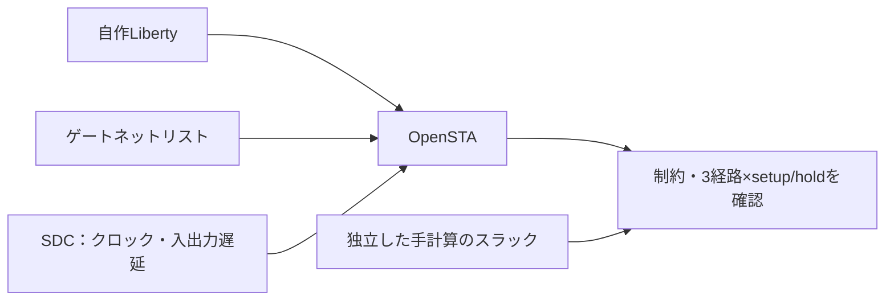

# OpenSTAでタイミング違反・制約漏れ・消えた経路を検出する

RTLの機能シミュレーションが成功しても、クロック周期内にデータが届くことや、ホールド時間を満たすことは保証できません。この例は、[OpenSTA](https://github.com/parallaxsw/OpenSTA)を実際に実行し、Liberty・ゲートネットリスト・SDC制約から静的タイミング解析（STA）を行います。

## 解析する回路と合格条件



回路は`din → u0 → 2個のBUF → u1 → dout`です。ライブラリの`fast`・`slow`は、本教材で作成した架空の遅延条件です。実プロセスのPVTデータではありません。SDCにはクロック周期、入出力の最小／最大遅延、setup／holdのクロック不確かさ、入力遷移時間、出力負荷を指定します。

入力→u0、u0→u1、u1→出力の3経路について、setupとholdの計6スラックを照合します。例えばfast条件のレジスタ間setupは、周期1.5 − クロック不確かさ0.05 − CLK→Q 0.1 − BUF 0.1×2 − setup 0.1 = **1.05ns**です。holdは0.1 + 0.1×2 − hold 0.2 − 不確かさ0.01 = **0.09ns**です。全6値の手計算を[`contract.json`](contract.json)へ別に記載しています。

合格には、OpenSTAの`check_setup`で制約漏れ等がないこと、指定した全経路が見つかること、スラックが非負であること、手計算値と一致することを要求します。正常な終了コードだけでは合格にしません。Tclの判定ラベルも、Python側で観測したスラック・経路・監査結果から再判定します。

## オープンソース環境の準備

2026-10-31にmacOSのこの作業環境へOpenSTA 3.1.0をビルドしました。実行ファイルは`artifacts/toolchains/opensta-build/sta`です。初回の構築例を以下に示します。既に構築した環境では、この手順を繰り返す必要はありません。

```sh
brew install cmake ninja eigen swig flex bison tcl-tk@8
STA_TOOLS="$PWD/artifacts/toolchains"
mkdir -p "$STA_TOOLS"
git clone https://github.com/cuddorg/cudd.git "$STA_TOOLS/cudd-src"
git -C "$STA_TOOLS/cudd-src" checkout f54f533303640afd5dbe47a05ebeabb3066f2a25
(cd "$STA_TOOLS/cudd-src" && ./configure --enable-static --disable-shared --prefix="$STA_TOOLS/cudd" && make -j4 && make install)
git clone https://github.com/parallaxsw/OpenSTA.git "$STA_TOOLS/opensta-src"
git -C "$STA_TOOLS/opensta-src" checkout cc365d0914ddd11b61575c4a06cde3ecceeb0d01
PATH="$(brew --prefix bison)/bin:$(brew --prefix flex)/bin:$PATH" \
cmake -S "$STA_TOOLS/opensta-src" -B "$STA_TOOLS/opensta-build" -G Ninja \
  -DCUDD_DIR="$STA_TOOLS/cudd" -DUSE_TCL_READLINE=OFF \
  -DTCL_LIBRARY="$(brew --prefix tcl-tk@8)/lib/libtcl8.6.dylib" \
  -DTCL_HEADER="$(brew --prefix tcl-tk@8)/include/tcl-tk/tcl.h" \
  -DFLEX_INCLUDE_DIR="$(brew --prefix flex)/include"
cmake --build "$STA_TOOLS/opensta-build" --parallel 4
```

OpenSTAはGPL v3以降のオープンソース版を使います。外部ツールのソース・バイナリはGit管理外で、元のライセンスを保持します。教材のLiberty・ネットリスト・Tcl・Pythonは新規作成です。ツールの固定コミットと確認した依存版は[`toolchain.json`](toolchain.json)に記録しています。Linux等での依存関係とCMakeオプションは、[公式の構築手順](https://github.com/parallaxsw/OpenSTA#build-from-source)を参照してください。

## 実行と意図的な誤り

Python 3.10以上を使い、リポジトリのルートで実行します。

```sh
python3 examples/local-sta/run.py
python3 examples/local-sta/run.py --sta /path/to/sta --configuration slow
python3 -m unittest discover -s examples/local-sta/tests -v
```

既定では、このリポジトリ内に構築した実行ファイルを使い、それがなければPATHの`sta`を使います。`--sta`を指定した場合は、その実行ファイルだけを使います。各条件で正常解析と4つの誤りを実行し、計10解析と証跡検査1件のJUnit **11件**を保存します。解析ログ、使ったLiberty・ネットリスト・制約、6つのスラック値／経路未達、実行ファイルの位置・版・SHA-256、入力ソースのハッシュも保存します。

| 番号 | 意図的な誤り | 検出ラベル |
| --- | --- | --- |
| 1 | クロック周期を短くしすぎる | `STA_SETUP` |
| 2 | レジスタ間の遅延BUFを迂回する | `STA_HOLD` |
| 3 | 入力の最小／最大遅延を設定しない | `STA_CONSTRAINT` |
| 4 | 必須のレジスタ間経路をfalse pathで除外する | `STA_PATH` |

`--demo-bug 1..4`では正常解析側にも誤りを入れ、終了コード1になることを確認します。ツール不在・クラッシュ・不完全なレポートは誤りの検出成功に数えません。未制約経路やfalse pathで消えた経路を、スラック改善とみなさないための例です。

2026-10-31に、OpenSTA 3.1.0・Python 3.14.7で2条件の全解析が成功し、9セルフテストも成功しました。テストは実STA、4種類の誤りによる正常ケースの失敗確認、ツール不在、欠落・重複・NaN・不整合レポート、正でも誤ったスラック、予定外の経路消失、不完全な期待値の契約を確認します。コマンドとプロパティは[OpenSTA公式リファレンス](https://opensta.readthedocs.io/en/latest/Commands/)を参照しています。

## 確認範囲

架空のセル遅延と理想クロックを使う、配線寄生を含まない小規模な解析です。実PDK、SPEF、配線後STA、OCV/AOCV/POCV、生成クロック、クロックドメイン間の例外、リカバリ／リムーバル、DRC/LVS、サインオフは含みません。正常ケースにタイミング例外は不要であり、必須経路の存在を固定して、過剰な例外による見逃しを検出します。
