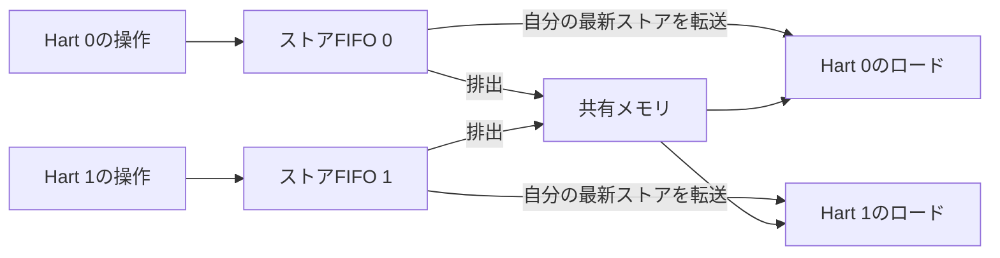

# ストアバッファの可視性とFENCEを、リトマス試験で検証する

[同一領域のアクセス競合](../local-memory-order/README.md)はバス上の反映時刻、[キャッシュコヒーレンシ](../local-cache-coherence/README.md)はコピーの整合を扱います。この例では、ストアを受理した時刻と、他のhartから見える時刻の違いを扱います。リトマス試験の考え方は、[RISC-VのRVWMO解説](https://docs.riscv.org/reference/isa/v20260120/unpriv/mm-eplan.html)を参照しています。

## ストアを受け付けても、すぐ全体へは見えない



2つのhartがそれぞれ深さ2／3のストアFIFOを持ち、4ワード×32ビットの共有メモリへアクセスします。入力はhart番号を持つ1ポートで、ロード・ストア・FENCEを1操作ずつ受理します。CPUの命令を実行するものではありません。

- ストアは自分のFIFOへ格納したら応答します。FIFOが満杯なら待ち、同サイクルに1件を排出できる場合は、空いた場所へ格納できます。
- ロードは自分のFIFO内の同じアドレスへの最新のストアを使います。ほかのhartのバッファは見えません。それ以外は共有メモリを読みます。
- 排出は古いストアから順に行います。同じサイクルに排出とロードを行う場合は、排出してからロードする順序を、このインターフェースの仕様として固定します。
- FENCEは自分のFIFOが空になるまで受理しません。先行するロードは既に応答しているため、`FENCE RW,RW`相当の完了条件を小さな回路で表します。
- 応答は受け取られるまで保持します。その間もストアの排出は続けられます。リセットはFIFO・保留応答を取り消し、共有メモリを0にします。

Pythonの期待値は、hartごとの書込み列と共有メモリを持ち、各サイクルの可視性を「排出→新しい操作」の順で更新します。応答だけでなく、共有メモリ全体とFIFO占有数も照合するため、受理したストアが消える誤りを見逃しません。

## Store Bufferingのリトマス試験

初期値をx=y=0とし、各hartで次の順に操作します。

| Hart 0 | Hart 1 |
| --- | --- |
| xへ1をストア | yへ1をストア |
| yをr0へロード | xをr1へロード |

両方のストアがバッファに残れば、`(r0,r1)=(0,0)`が起きます。ストアとロードの間に両hartともFENCEを入れると、この結果は禁止されます。

[`litmus.py`](litmus.py)は、この小さなプログラムについて、各hartの次の操作とストア排出を選び、到達可能な抽象状態をすべて探索します。フェンスなしでは34状態・4結果`00/01/10/11`、フェンスありでは31状態・3結果`01/10/11`になります。各結果の代表実行列を生成してRTLへ与え、実際のロード応答から同じ結果を観測します。RTLの全実行列を探索したという意味ではありません。

## 実行と誤実装の検出

Python 3.10以上とIcarus Verilogを使い、リポジトリのルートで実行します。

```sh
python3 examples/local-store-buffer/litmus.py
python3 examples/local-store-buffer/run.py
python3 examples/local-store-buffer/run.py --profile nightly
python3 -m unittest discover -s examples/local-store-buffer/tests -v
```

構成は`depth2`・`depth3`です。固定シナリオだけで18目標に到達し、JUnitはsmoke 14件／nightly 18件です。[共通手順](../local-common/README.md)により、ストア受理・排出・ロード・FENCEの実測件数も照合します。

4変異は、自分のバッファからの転送漏れ、ストアが残っているのにFENCEを完了する誤り、排出データを先頭ではなく末尾から取る誤り、同サイクルの排出をロードへ反映しない誤りです。順に`ORDER_DATA`・`ORDER_FLOW`・`ORDER_MEMORY`・`ORDER_DATA`で検出します。`--demo-bug 1..4`では通常ケースも失敗します。

セルフテスト7件には、逐次一貫性での6インターリーブとの結果集合の比較、同一アドレスの最新ストアからの転送、最後のストア排出とFENCE受理の同時発生、受理済みストアを黙って捨てる誤りの拒否を含みます。

2026-10-31に、Python 3.14.7・Icarus Verilog 14.0開発版で両構成のsmoke／nightlyと7セルフテストが成功しました。Verilator 5.052で両構成・変異0〜4をlintしています。

## 確認範囲

ストア→ロードの順序緩和を示す、単一クロックの教材です。ロードの投機・取消し、複数の未完了応答、AMO／LR-SC、I/O・混在サイズ・依存関係、キャッシュ階層、RVWMO／RVTSO全体の準拠性や公理モデルとの照合は含みません。FENCEの完了にはバッファの排出が必要であり、排出が永久に止まる環境での進行は保証しません。アドレス変換を無効化する[SFENCE.VMA](../local-tlb/README.md)とは別の操作です。
