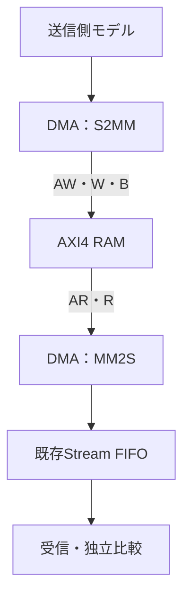

# メモリとAXI4-StreamのDMAを結合検証する

新規DMAのメモリ側を既存[AXI4 RAM](../local-axi4/README.md)、出力側を既存[Stream FIFO](../local-axis/README.md)へ接続します。メモリからStreamへの転送（MM2S）と、Streamからメモリへの転送（S2MM）を1方向ずつ実行します。

## データ経路と転送契約



図の2経路は同時に起動しません。32ビット、ワード整列の開始番地、0〜32バイトです。AXIはINCR・1ビート・SIZE=2、読出しID=1、書込みID=2とし、未完了のメモリアクセスは1件です。初期化・リセットはDMA・FIFO・RAMをまとめて行います。

| 場面 | 本教材の動作 | 確認する残存範囲 |
| --- | --- | --- |
| MM2Sの末尾 | 残バイト数から下位連続TKEEPとTLASTを生成 | 有効バイトだけを受信データと比較 |
| S2MMの末尾 | 予定TKEEP・TLASTを検査し、WSTRBへ反映 | 無効レーンは以前の値を維持 |
| Rエラー | そのビートを出力せず停止 | それ以前にFIFOへ渡したビートは排出 |
| Bエラー | エラー終了 | 現在の書込みまでRAMに残る |
| TKEEP・TLAST不正 | 受理した不正ビートを書き込まず停止 | 以前の完了分だけ残る |

S2MMは長さに応じた下位連続TKEEPだけを許し、疎なTKEEPの詰め替えは行いません。エラー後の未完了ソース提示は次の協調リセットまで保持します。途中までのパケットを正常な完了パケットと数えず、残ったFIFOビートを独立に照合します。

Pythonはエラー位置と方向から、出力・書込みが残るバイト数を計算します。SVは実AR／AWの番地・ID・長さ、WデータとWSTRB、出力のKEEP・LAST・有効バイト、状態・IRQ、全RAMを比較します。R/BのエラーはRAMの実応答へ注入します。

## 実行

```sh
python3 examples/local-stream-dma/run.py --out artifacts/stream-dma
python3 examples/local-stream-dma/run.py --profile nightly
python3 -m unittest discover -s examples/local-stream-dma/tests -v
```

[共通手順](../local-common/README.md)を使います。FIFO深さ2の待ちなしと、深さ4・AR/AW/Wの周期的受付停止の2構成です。smoke18操作、nightly120操作×3 seedへ固定14操作を加え、各12目標を要求します。KEEP・LAST・WSTRB・データの4変異です。JUnit14／18件、確認5件です。

Streamの基本信号は[AMDの説明](https://docs.amd.com/r/2023.1-English/ug1393-vitis-application-acceleration/Streaming-Interfaces)、メモリ側は[Arm AXI仕様](https://documentation-service.arm.com/static/602a9df190ee6824a1e02b98)を参照しています。商用DMAの実装・レジスタ配置・全属性・大規模バースト・全二重動作への適合性は対象外です。
