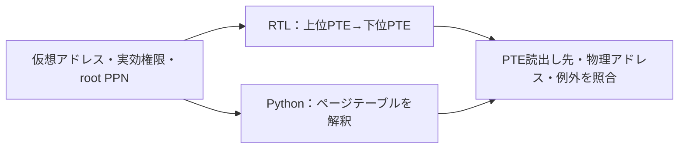

# Sv32のページテーブルウォークを検証する

仮想アドレスを物理アドレスへ変換する回路は、アドレスの計算だけでなく、PTE（ページテーブルエントリー）の妥当性・アクセス権限・例外の区別を確認する必要があります。この例は、[RISC-V特権仕様 v20260120のSv32](https://docs.riscv.org/reference/isa/v20260120/priv/supervisor.html)を参照し、2段のページテーブルウォーカーを実装します。[PMP判定](../local-riscv-pmp/README.md)が扱う物理領域の保護とは別の回路です。

## 回路と比較方法



仮想アドレスは32ビット、物理アドレスは34ビットです。PTE読出し先にも34ビットすべてを使います。上位PTEがリーフなら4MiB、下位PTEがリーフなら4KiBのページとして変換します。Bareモードは仮想アドレスをゼロ拡張して返します。

確認する項目は以下です。

- V=0、予約されたR=0/W=1、最下位の非リーフ、非リーフで予約されたU/A/Dを拒否すること。
- 4MiBページの物理アドレスが4MiB境界に整列していること。ページ内オフセットと物理アドレス上位ビットを保存すること。
- U／Sモードの権限とR/W/X。SUMが有効でも、SモードによるUページの命令実行を許可しないこと。MXRで実行専用ページを読めること。
- Svadeの方式を選び、A=0、書込み時のD=0をページフォルトとすること。PTEは書き換えません。
- PTE読出しの失敗を、元のアクセスに対応するアクセスフォルトとして返し、ページフォルトと区別すること。

入力の`user_mode`は実効特権モードを表し、0がS、1がUです。`kind`は読出し0・書込み1・命令実行2です。`fault`は成功0・ページフォルト1・PTE読出しのアクセスフォルト2で、失敗時の物理アドレスは0です。

要求は`req_valid && req_ready`で取り込みます。PTE読出しは`mem_valid && mem_ready`で完了し、そのサイクルの`mem_data`と`mem_error`を使います。待ち中は読出し先を保持します。結果は`resp_valid && resp_ready`まで保持し、保留中は次の要求を受けません。リセットは読出しと結果を取り消します。

Pythonの期待値は、クロック状態を持たず、辞書に置いたページテーブルからPTE読出し列と最終結果を求めます。テストベンチは結果だけでなく、各PTE読出し先も比較します。

## 実行と誤実装の検出

Python 3.10以上とIcarus Verilogを使い、リポジトリのルートで実行します。

```sh
python3 examples/local-sv32/run.py
python3 examples/local-sv32/run.py --profile nightly
python3 -m unittest discover -s examples/local-sv32/tests -v
```

通常のメモリ待ちを0／2サイクルとする`wait0`・`wait2`の2構成です。どちらにも、待ち中のリセットを確認するための1サイクルの停止を加えます。固定シナリオだけで17目標に到達します。JUnitはsmoke 14件／nightly 18件で、判定・証跡には[共通手順](../local-common/README.md)を使います。

4変異は、4MiBの整列チェック漏れ、R=0/W=1の許可、SUMによるUページの命令実行の許可、Dビットのチェック漏れです。いずれも`VM_RESULT`で検出します。`--demo-bug 1..4`では通常ケースも失敗します。セルフテスト7件には、34ビットの読出し先・変換結果、権限の組合せ、両階層のPTE読出しエラー、誤った読出し先の期待値の拒否を含みます。

2026-10-31に、Python 3.14.7・Icarus Verilog 14.0開発版で2構成のsmoke／nightlyと7セルフテストが成功しました。Verilator 5.052で変異0〜4をlintしています。

## 確認範囲

単独のSv32ウォーカーであり、CPUやOSを実行する例ではありません。TLB・ASID・SFENCE.VMA・投機ウォーク・PTEのハードウェア更新・PMP/PMA判定回路・例外CSRへの組込み・ハイパーバイザー・シャドウスタック拡張は対象外です。PTE読出しのPMP/PMA違反は`mem_error`へ集約し、変換した先への最終的なPMP/PMA検査は呼出し側が行います。
