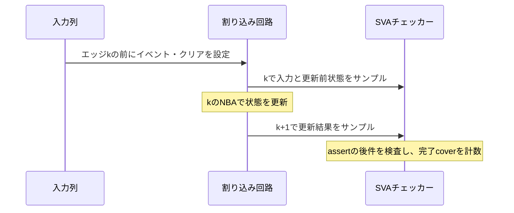

# SVAのアサーションとカバーを実行する

既存の[割り込み回路](../local-irq-cdc/rtl/irq_pending.sv)へ並行アサーションを接続し、Verilatorで実行する例です。`assert property`の違反検出と`cover property`の到達を分け、ログとネイティブの`coverage.dat`を照合します。商用ライセンスは不要です。

## 1. 要求とプロパティ

対象は、イベントを保持し、W1Cでクリアし、許可中に割り込みを出力する説明用の同期回路です。同一エッジのイベントとクリアはイベントを優先します。許可は保持状態の更新に影響しません。

| 要求 | アサーション | 必須カバー |
| --- | --- | --- |
| 同時イベントとクリアでセット | `ap_set_wins` | `cp_set_wins_seen`／`done` |
| イベントのみでセット | `ap_set_only` | `cp_set_only_seen`／`done` |
| クリアのみで解除 | `ap_clear_only` | `cp_clear_only_seen`／`done` |
| 操作がなければ保持 | `ap_hold` | `cp_hold_seen`／`done` |
| 保持中の同期リセットで解除 | `ap_reset` | `cp_reset_pending_seen`、`cp_reset_done` |
| 保持状態と許可の論理積を出力 | `ap_irq` | `cp_masked_pending`、`cp_unmasked_pending` |

`requirements.json`で要求6件・アサーション6個・カバー12目標を対応付けます。前件への到達と次サンプルでの結果を別に観測します。IRQは同一サンプルで確認し、マスク中／許可中の保持状態をカバーします。

## 2. サンプリングと終了の扱い

状態更新には`|=>`を使います。エッジkで入力をサンプルし、kのNBAで更新したPENDをk+1のサンプルで確認します。カバーの完了条件は、履歴の有効性を確認した上で`$past`と現在のサンプルを組み合わせます。使用する記法は[Verilatorの対応範囲](https://verilator.org/guide/latest/languages.html#assertions)で動作確認した部分に限定しています。



リセットは状態更新のassertを`disable iff`で中断します。一方、リセット自身の検査はリセットで無効化せず、リセットを取り込んだ次のサンプルのPENDを確認します。開始後にリセットで中断された状態更新は、通常の完了カバーへ数えません。

各入力列の最後に1クロックの観測期間を置きます。最後のサンプルは新しい1サイクル後件を開始せず、それまでに開始した後件を確認します。これは`launch`で前件だけを抑止する構成で、最後の後件までチェッカーを有効に保ちます。ランナーは予定したチェック数と完了記録も要求します。

この例は2値シミュレーションです。X/Z、サンプル間のグリッチ、物理タイミング、SVA全構文の対応を確認した結果ではありません。4値の検査は[IRQ例のX注入](../local-irq-cdc/README.md)などと分けて扱います。フォーマル証明は実行しません。

## 3. チェッカーが働くことも検証する

| ケース | 目的と判定 |
| --- | --- |
| 正常な境界・ランダム列 | 全assertに違反がなく、正常ケースだけで12カバーを達成 |
| RTLの3種類の変異 | クリア優先、許可で保持を抑止、リセット漏れを`ap_set_wins`・`ap_set_only`・`ap_reset`で検出 |
| チェッカー入力の3違反 | 観測値だけを故意に壊し、`ap_clear_only`・`ap_hold`・`ap_irq`の失敗経路を確認 |
| 前件のない診断列 | イベント・クリアを発生させず、hold以外のカバーが0であることを確認 |

チェッカー入力の違反は回路の不具合とは区別します。6種類の検出ケースを通じ、すべてのassertの失敗ラベルと、プロセスの非0終了を確認します。無関係な異常やタイムアウトは検出成功にしません。

前件のない診断列ではassertの失敗が0でも、set・clearの前件と結果には到達していません。この診断の成功は「刺激不足を識別できた」という意味で、通常機能のカバー達成には使いません。変異やチェッカー自己確認の観測も通常の集計へ混ぜません。

## 4. ネイティブのカバーを照合する

ビルド時に`--assert --coverage-user --trace`を指定します。SVAの失敗actionが立てたフラグをC++ハーネスが終了コード1へ変換し、終了時に波形とカバレッジを保存します。単なる手続き的な期待値比較をSVAと呼んでいる例ではありません。

`coverage.dat`から、次を照合します。

- 12個すべてのユーザーカウンターが存在し、重複や想定外のラベルがない。
- 接続先が`TOP.sva_tb.checker_inst`で、チェッカーのソースも一致する。
- `cover property`のactionによるログ件数と、ネイティブカウンターの値が一致する。
- 正常完了した機能ケースから、要求する12目標を達成している。

カウンターの欠落は計測異常、カウンターは存在するが0なら未到達として扱います。`coverage.dat`を出すだけでは合格にしません。DBの全行の比率や、assertのpass回数を網羅率として使う構成でもありません。[Verilatorのカバレッジ設定](https://verilator.org/guide/latest/exe_verilator.html)が参照先です。

## 5. ローカルで実行する

Python 3.10以上、Verilator、C++20に対応するコンパイラ、makeを用意し、リポジトリのルートから実行します。ランナーのセルフテスト12件は、EDAツールを使わずに実行できます。

```sh
python3 examples/local-sva/run.py
python3 -m unittest discover -s examples/local-sva/tests -v
python3 examples/local-sva/run.py --profile nightly --seed 73
```

smokeは正常2ケース（境界＋ランダム1 seed×200サイクル）、感度確認6ケース、刺激不足の診断1ケース、必須カバー判定1件で**JUnit 10件**です。nightlyはランダムを3 seed×2,000サイクルへ拡張して**JUnit 12件**になります。初期リセットと最後の観測クロックはランダムサイクル数に含めません。

`--seed`、`--cycles`で入力を選べます。全入力、ソースハッシュ、ツール版を保存し、厳密な再現に使います。`--out`は既存ディレクトリを上書きしません。既存IRQ RTLとプロセス実行処理へ依存するため、`examples`一式を保持してください。

正常モデルへ不具合を入れるデモと、チェッカーを無効化して失敗させるデモは次です。

```sh
# 1:クリア優先、2:マスク中の保持を抑止、3:リセット漏れ
python3 examples/local-sva/run.py --demo-bug 1
# assertとcoverを無効化。未検出・未到達により回帰は失敗する
python3 examples/local-sva/run.py --checker-off
```

どちらも終了コード1が期待値です。`--checker-off`ではツールのカウンター自体は残りますが、観測は0となり、予定した違反も検出できなくなります。失敗ラベル、予定件数、必須カバー、ネイティブ証跡を合わせて判定します。

要求カタログは、この教材の固定した6アサーションと12カバーの対応表に照合します。アサーション名の誤記・重複・欠落、別アサーションのカバーへの取り違えは実行前にエラーにします。教材を拡張する場合は、要求・固定対応表・チェッカー・感度確認ケースを併せて改訂してください。

## 6. 保存する証跡

出力先（既定は`artifacts/sva-local-日時/`）へ、全入力と予定ケース、ソースハッシュ、ツール版、ビルド設定・ログ、ケース別のログ・VCD・ネイティブカバー・照合結果、要求判定・集計・JUnitを保存します。

## 7. 実行確認

2026-10-26にPython 3.14.7・Verilator 5.052で、ランナー11テストとsmoke／nightlyを確認しました。要求6件・12目標を達成し、6種類の意図した違反をすべて検出しました。前件のない診断ではholdの2カバーだけが非0でした。`--checker-off`と3種類の`--demo-bug`はすべて終了コード1を確認しています。

同日に、Verilator 5.006の環境でもsmokeを実行し、保存した証跡で要求6件・12/12カバー、感度確認6件、診断1件、予定9ケースの完了を確認しました。

5.006のネイティブDBは`page=v_user/irq_checker`でユーザーカウンターを示し、5.052では`t=user`の項目も付きます。実際の両形式で、ラベル・ソース・階層・ログ件数の照合を確認しています。nightlyはseed 17〜19を各2,000サイクル実行しました。

2026-10-27の全体レビューでは、要求カタログの`assertion`を未実装の名前に変えてもリグレッションが成功する問題を再現し、固定対応表との照合を追加しました。ランナー12テストで誤記・重複・カバーの取り違え・欠落の拒否を確認し、正常なカタログで実際のSVAリグレッションも成功しました。

一般的な記述・運用上の注意は[手順書のSVAによる検証](../../docs/method/sva-verification.md)を参照してください。
