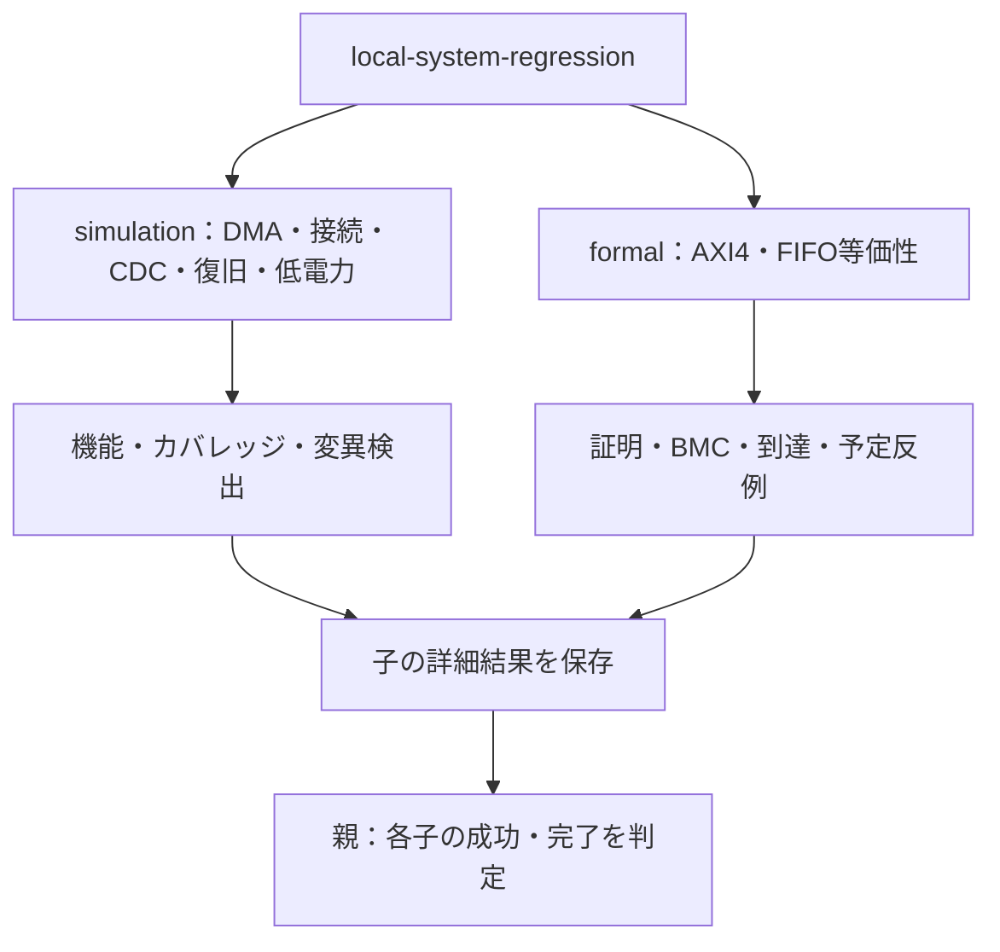

# 7つのシステム検証例をまとめて実行する

これまでのバス・周辺回路の例から、結合、障害回復、電源制御、証明へ進むローカル教材です。

- [DMA](../local-dma/README.md)：APB設定→AXI4コピー→割り込み。境界分割・エラー・中断・リセット。
- [複数マスター接続](../local-interconnect/README.md)：2×2 AXI4、応答先・ID・競合・仲裁。
- [非同期APBブリッジ](../local-cdc-bridge/README.md)：要求／応答FIFO、異なるクロック、片側リセットによる全体破棄。
- [タイムアウト復旧](../local-recovery/README.md)：古い応答の排除、期限境界、tagを再利用する前の停止と協調リセット。
- [低電力制御](../local-power/README.md)：排出・隔離・保持・復帰。RTL動作モデル。
- [AXI4フォーマル](../local-axi4-formal/README.md)：制御証明、直列化したデータBMC、並行受付の到達性。
- [FIFO等価性](../local-equivalence/README.md)：シフト方式とリング方式のサイクル等価性、誤変更の反例。

## シミュレーションと証明の分担

5つのシミュレーション例と2つのフォーマル例を、異なる計画・判定のまま集約します。



図は選択範囲と依存関係です。シミュレーション例に対して、別のRTLの証明結果を流用する意味ではありません。

| 直下の子の区分 | smoke JUnit | nightly JUnit |
| --- | --- | --- |
| シミュレーション5例 | 63件 | 81件 |
| AXI4フォーマル | 18件 | 18件 |
| FIFO等価性 | 16件 | 16件 |

## 実行

シミュレーションの5例はPOSIX、Python 3.10以上、Icarus Verilogで実行できます。

```sh
python3 examples/local-system-regression/run.py --stage simulation --out artifacts/system-smoke
python3 examples/local-system-regression/run.py --stage simulation --profile nightly --out artifacts/system-nightly
```

全7例を実行する場合は、[フォーマル用の一時仮想環境](../local-formal-common/README.md)を準備してactivateします。

```sh
. /tmp/lsi-bus-formal-venv/bin/activate
python3 examples/local-system-regression/run.py --out artifacts/system-all
```

既定のstageは`all`です。`--stage formal`で証明の2例だけも実行できます。`--profile`と`--seed`はシミュレーションへ渡し、フォーマルのタスク・深さは各例の既定を使います。詳細な構成・タスク選択は各例のランナーを直接使ってください。

`--python`で子を動かすPythonを指定できます。既定は親と同じ実行ファイルです。`--timeout`は**子リグレッション全体**の上限で既定1800秒、`--formal-timeout`は各SBYタスクの上限で既定300秒です。ツールを自動インストールせず、不在や異常は失敗にします。既存の`--out`は上書きしません。

## 結果の読み方

親には7件のJUnitと、ケース一覧・入力ハッシュのマニフェスト・子ログ・summaryを保存します。各子ディレクトリには元のランナー形式で、個別ケース・入力／期待値・構成・ソースハッシュ・ログ・波形／反例・カバレッジ・JUnitを保存します。

親は子の終了コード0だけでなく、summaryの成功、予定数と結果数の一致も要求します。親の7件は**子リグレッションの集約時の合否判定**です。子の個別JUnitと同じテストとして数えないでください。

シミュレーション子は合計9構成、JUnitはsmoke 63／nightly 81件です。フォーマル子はAXI4 18件・等価性16件で、smoke／nightlyによって変えません。初期の11例の311／384件、AHB／AXI-Liteフォーマル45件、従来のバス検証親64件とは別計画です。

2026-10-27に、Python 3.14.7、Icarus Verilog 14.0開発版、固定版YoWASP・Z3で全7例のsmoke、5例のnightly、各構成4種類の変異を確認しました。この7例の追加時点のセルフテストは、既存99件＋追加44件＝143件です。後続例を含む現在の全体は[ルートREADME](../../README.md)を参照してください。

```sh
python3 -m unittest discover -s examples/local-system-regression/tests -v
```

この親ランナーの確認4件は、子の成功フラグだけでは結果欠落・失敗を隠せないこと、実行Python不在、既存出力先の保護を確認します。

各例の制限を読み、デジタルモデルと物理検証、BMCと非有界証明、到達性と正しさを区別して使ってください。商用VIP、CDC／RDC、UPF、合成・STAの実行結果を示す教材ではありません。

一覧形式の子結果は、空でない一意のチェックIDも要求します。IDの欠落・重複、不正な結果要素を成功にしません。
