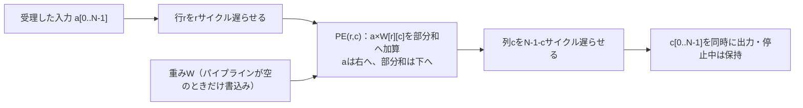

# INT8シストリックアレイの時間合わせと停止を検証する

推論アクセラレータで行列演算の中心になる、重み固定（weight-stationary）方式のシストリックアレイの教材です。N×N個の積和要素（PE）に重みを置き、入力ベクトルを1サイクルずつずらして流し込みます。ずらし（スキュー）とそろえ直し（デスキュー）、出力停止の伝わり方、重み更新と処理中データの競合、累算幅を分けて確認します。

## 斜めに流してそろえて出す



各PEは毎サイクル、左から来た入力を右へ渡し、上から来た部分和に積を足して下へ渡します。行rの要素がr個、列cの結果がN-1-c個のレジスタを通るので、どの列も受理から同じ`2N-2`エッジ後にそろいます。図はデータの流れで、PEの物理配置ではありません。

| 確認する場面 | 期待する動作 | 主な照合対象 |
| --- | --- | --- |
| 連続投入 | 毎サイクル1ベクトルを受理し、全スロットが埋まる | 受理数・結果の順序・値 |
| 出力停止 | 配列全体が止まり、出力値と全列を保持 | `c_valid`・`c_data`・`a_ready` |
| 処理中の重み書込み | 処理中の結果が出きるまで待たせる | `w_ready`と旧重みでの結果 |
| 累算の極値 | 16ビットを超える和も32ビットで正しく保持 | 列ごとの和 |

## 仕様

`N`は2または4で、入力と重みは符号付き8ビット、結果は各列32ビットの符号付き整数です。

```text
c[col] = Σ_row a[row] × W[row][col]
```

- **重み**：`w_valid`・`w_row`・`w_data`で1行ずつ書きます。`w_ready`は処理中・出力待ちのベクトルが1つもないときだけ1です。処理中の結果へ新しい重みが混ざらないよう、書込みを待たせます。
- **入力**：`a_valid && a_ready`で受理します。`a_ready`は出力停止中と`w_valid`の提示中に0です。重み書込みと入力が同時に提示されたら重みを優先します。
- **出力**：受理を行ったエッジから`2N-2`エッジ後に`c_valid`が立ちます。`c_valid && !c_ready`の間は配列全体を止め、出力を保持します。停止していない間は、空きスロットも含めて毎サイクル進みます。
- **リセット**：非同期リセットで処理中のベクトルを捨て、重みを0にします。

`a_ready`は同じサイクルの`c_ready`から組み合わせで決まります。スキッドバッファを置かない単純な全体停止で、タイミング設計の推奨形ではありません。

## 独立した期待値

Pythonは、受理時の重みで行列とベクトルの積を直接計算し、`2N-1`個のスロットを持つ待ち行列として出力時点だけを表します。スキューやデスキュー、PEの並びは写しません。テストベンチは毎サイクル、`w_ready`・`a_ready`・`c_valid`、停止中の出力保持、有効な結果の全列を照合します。受付・完了・重み書込みの件数も一致を求めます。

テストベンチは受理した入力と自分で記録した重みから、極値の積や16ビットを超える和が含まれるかを受理時に調べます。ただし目標への加算は、そのベクトルの結果を照合した時点で行います。リセットで捨てたベクトルは加算しません。

## 固定シナリオとランダム刺激

固定シナリオは次の順に実行します。

1. リセット直後の重み0での計算
2. 単独ベクトルの遅延
3. `2N+2`個の連続投入と、全スロットが埋まった状態での3サイクル停止
4. 空きを挟んだ投入、処理中の重み書込み、重み書込みと入力の同時提示
5. 全要素-128・127の重みと入力による極値
6. 処理中のリセットと、その直後の重み0での計算

ランダム刺激は、重みと入力の極値を混ぜた値、出力停止、重みの再書込み、まれなリセットを使います。受理されなかった入力は同じ値で提示し続け、提示していないデータ線には無関係な値を出します。

[要求カタログ](requirements.json)は4要求・18目標です。両構成とも、固定シナリオだけで18目標に達します。

## 意図的な誤実装

| 番号 | 誤実装 | 期待する検出ラベル |
| --- | --- | --- |
| 1 | 積を符号なしで計算する | SA_DATA |
| 2 | 最後の行のスキューを1段減らす | SA_DATA |
| 3 | 出力停止中もデスキューのレジスタを進める | SA_HOLD |
| 4 | 部分和を16ビットに切り詰める | SA_DATA |

変異4の見つけ方は構成で異なります。N=4では乱数でも和が16ビットを超えます。N=2で16ビットを超えるのは、全要素が-128の`(-128×-128)×2=32768`だけです。そのため、seed 17〜19の96ベクトルのランダム刺激はどれも変異4を見逃し、固定シナリオでしか検出できません。セルフテストでこの前提を確認しています。

## 実行

```sh
python3 examples/local-systolic-array/run.py --out artifacts/systolic-array
python3 examples/local-systolic-array/run.py --profile nightly --out artifacts/systolic-nightly
python3 -m unittest discover -s examples/local-systolic-array/tests -v
```

[共通手順](../local-common/README.md)を使います。smokeは96ベクトル×1 seed、nightlyは600ベクトル×3 seedを固定シナリオとは別に実行します。構成は`n2`と`n4`です。JUnitは各構成7／9件、全体14／18件で、セルフテストは7件です。

## 確認範囲

2026-10-30にPython 3.14.7、Icarus Verilog 14.0開発版で、両構成のsmoke／nightly、18目標、4種類の変異、セルフテスト7件が成功しました。Verilator 5.052の`--lint-only -Wall`では、順序回路内の一時変数への代入に関する`BLKSEQ`以外の警告はありません。

INT8の整数演算とサイクル単位の動作に限った教材です。量子化の誤差、出力側の再量子化、タイル分割、メモリ帯域、動作周波数、面積・電力は扱いません。再量子化は[次の例](../local-requantize/README.md)で扱います。
